## 1 概述

这款功能丰富的第二代互联NFC标签旨在为家庭自动化和消费电子应用中的NFC提供完美的技术实现方案，是为几乎所有电子设备添加“即触即用”连接的最快捷、成本最低的方法。

恩智浦 NTAG I²C plus 是将无源 NFC 接口与接触式 I²C 接口集成到一起的互联 NFC 标签系列。作为行业领先的恩智浦第二代互联标签技术，这些器件与第一代 NTAG I²C 产品完全保持向后兼容性，同时添加了新的密码保护高级功能，两个接口均具有完整的存储器访问配置，并具有独创签名以防止克隆。

第二代技术提供高出四倍的直通性能，并具有能量采集功能，NTAG I²C plus 器件还针对入门级 NFC 应用进行了优化，并为各种 NFC 解决方案提供最低物料成本。

I²C 和 NFC 通信基于简单的标准命令集，并通过演示板 OM5569/NT322E 进行扩充，该演示板包括在线参考源代码。所需要的只是一个简单的天线设计（参见参考文献 5），无需或只需有限的额外组件，并且具有大量的在线参考设计可提供灵感。NTAG I²C plus 开发板通过了 NFC Forum 2 类标签认证（认证 ID：58514）。

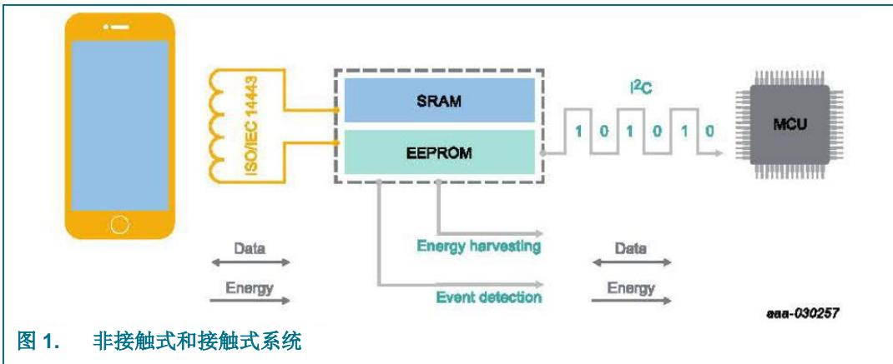

## 2 特性和优势

## 2.1 主要特性

\- 互操作性
- 符合 ISO/IEC 14443 第 2 和第 3 部分的规定
- NTAG I²C plus 开发板通过了 NFC Forum 2 类标签认证（认证 ID: 58514）
- 唯一 7 字节 UID
- GET\_VERSION 命令用于轻松识别芯片类型和支持功能
- 50 pF 的输入电容
- 主机接口
- I²C 从机
- 基于漏极开路实现的可配置场检测引脚，用于触发 NFC 事件信号或同步直通数据传输
- 存储器
- 2k 字节 EEPROM
- 64 字节 SRAM 缓冲区可用于在 NFC 和 I²C 接口之间采用存储器镜像或直通模式传输数据
- 清除 NFC 和 I²C 存储器访问之间的仲裁
- 数据传输
- 64 字节 SRAM 缓冲区直通模式
- FAST\_WRITE 和 FAST\_READ NFC 命令用于更高的数据吞吐量
- 安全和存储器访问管理
- 基于 32 位密码从 NFC 接口对存储器进行完全、只读访问或不进行访问
- 从 I²C 接口对存储器进行完全、只读访问或不进行访问
- NFC 静音特性可禁用 NFC 接口
- 基于椭圆曲线加密(ECG)的独创签名用于简易真实的身份验证
- 电源管理
- 可配置场检测输出信号用于数据传输同步和器件唤醒
- 从 NFC 场采集能量，从而为外部器件（如连接的微控制器）供电
- 工业应用需求
- 温度范围从 -40 °C 到 105 °C

## 2.2 NFC 接口

\- 非接触式传输数据速率为 106 kbps

\- NTAG I²C plus 开发板通过了 NFC Forum 2 类标签认证（认证 ID：58514）（参见参考文献 1）

\- 符合 ISO/IEC 14443A 标准（参见参考文献 2）

\- 数据传输速率为 106 kbit/s

\- 通过 EEPROM 在 4.8 ms 内或通过 SRAM 在 0.8 ms 内完成 4 字节（1 页）写入，包括所有开销

\- 使用 FAST\_WRITE 命令在 6.1 ms 内完成 64 字节（整个 SRAM）写入，包括所有开销

## NTAG I²C plus: NFC Forum T2T 带有 I²C 接口、密码保护和能量采集功能

16 位 CRC 数据完整性、奇偶校验、位编码、位计数

\- 工作距离长达 $100 \mathrm{~mm}$ （取决于场强、天线阵型等各个参数）

\- 真正的防碰撞特性

\- 符合 ISO/IEC 14443-3 标准的唯一 7 字节序列号(UID)（参见参考文献 2）

## 2.3 存储器

\- 2k 字节 EEPROM

\- 64 字节 SRAM 易失性存储器无写入耐受程度限制

\- 数据保留时间至少为 20 年

\- EEPROM 写入耐受程度为至少 50 万次

## 2.4 I²C 接口

\- I²C 从机接口支持频率高达 400 kHz（参见第 13.1 部分）

\- 故障安全 I²C 工作

\- I²C 从机支持 7 位从机地址

\- 由于最低有效 R/W 位用于表示数据传输的方向，因此默认从机地址 55h 将相应重新计算为 I²C 写入地址 AAh 和 I²C 读取地址 ABh

\- 在 4 ms 内(EEPROM)或 0.4 ms 内(SRAM)完成 16 字节（1 个模块）写入

\- NTAG I²C plus 可用作标准的 I²C EEPROM 和 I²C SRAM

## 2.5 安全性

\- 制造商可对每个器件的7字节UID进行编程

\- 功能容器带有一次性可编程位

\- 前 12 页具有每页场可编程只读锁定功能,对于扩展存储器分区则为每 16 页(1k 版本)或每 32 页（2k 版本）

\- 基于ECC的独创签名

\- 在 NFC 方式下，可对部分或全部存储器启用 32 位密码保护，以防止未经授权的存储器操作

\- 在 I²C 方式下，可限制对密码保护数据区的访问

\- 可对直通和镜像模式操作进行密码保护

\- 对受保护的数据可通过密码验证失败次数限制提供保护

## 2.6 主要优势

\- 与所有 NFC 设备的完全互操作性

\- 通过 NFC 和 I²C 接口可进行超快速数据交换（速率高达 40 kbit/s），带来流畅的最终用户体验

\- 通过非易失性数据存储实现零功耗工作

\- 能量采集特性可从 NFC 场提供高达 15 mW 的功率为（部分）主机系统供电

\- 数据保护可防止未经授权的数据操作

\- 通过存储器大小和分段选项实现多应用支持

\- 在嵌入式电子产品中实现物料成本最低、尺寸最小的NFC解决方案

## NTAG I²C plus: NFC Forum T2T 带有 I²C 接口、密码保护和能量采集功能

## 3 应用

恩智浦 NTAG I²C plus 是将无源 NFC 接口与接触式 I²C 接口集成到一起的互联 NFC 标签系列。作为行业领先的恩智浦第二代互联标签技术，这些器件与第一代 NTAG I²C 产品保持完全向后兼容性，同时添加了新的密码保护高级功能，两个接口均具有完整的存储器访问配置，并具有独创签名以防止克隆。

第二代技术提供高出四倍的直通性能，并具有能量采集功能，NTAG I²C plus 器件还针对入门级 NFC 应用进行了优化，包括：

\- 物联网节点（家庭自动化、智能家居等）

\- 消费电子应用的配对和配置

\- NFC 附件（耳机、扬声器等）

\- 可穿戴式信息娱乐设备

\- 健身设备

\- 消费类电子产品

\- 医疗

智能打印机

仪表

\- 电子货架标签

NTAG I²C plus: NFC Forum T2T 带有 I²C 接口、密码保护和能量采集功能

## 4 订购信息

表 1. 订购信息

<table><tr><td rowspan="2">型号</td><td colspan="3">封装</td></tr><tr><td>名称</td><td>说明</td><td>版本</td></tr><tr><td>NT3H2111W0FHK</td><td>XQFN8</td><td>塑料超薄四方扁平封装;无引脚;8个端子;主体尺寸 $1.6 \times 1.6 \times 0.5$  mm; $1k$ 字节存储器, $50$  pF输入电容</td><td>SOT902-3</td></tr><tr><td>NT3H2211W0FHK</td><td>XQFN8</td><td>塑料超薄四方扁平封装;无引脚;8个端子;主体尺寸 $1.6 \times 1.6 \times 0.5$  mm; $2k$ 字节存储器, $50$  pF输入电容</td><td>SOT902-3</td></tr><tr><td>NT3H2111W0FTT</td><td>TSSOP8</td><td>塑料超薄紧缩小型封装;8个引脚;体宽 $3$ mm; $1k$ 字节存储器; $50$  pF输入电容</td><td>SOT505-1</td></tr><tr><td>NT3H2211W0FTT</td><td>TSSOP8</td><td>塑料超薄紧缩小型封装;8个引脚;体宽 $3$ mm; $2k$ 字节存储器; $50$  pF输入电容</td><td>SOT505-1</td></tr><tr><td>NT3H2111W0FT1</td><td>SO8</td><td>塑料小型封装;8个引脚;体宽 $3.9$ mm, $1k$ 字节存储器; $50$  pF输入电容</td><td>SOT96-1</td></tr><tr><td>NT3H2211W0FT1</td><td>SO8</td><td>塑料小型封装;8个引脚;体宽 $3.9$ mm, $2k$ 字节存储器; $50$  pF输入电容</td><td>SOT96-1</td></tr><tr><td>NT3H2111W0FUG</td><td>FFC凸起</td><td>8英寸晶圆, $150$  μm厚,置于薄膜铁框承载器中,符合SECS-II格式的故障芯片电子标记,金凸块, $1k$ 字节存储器, $50$  pF输入电容</td><td>-</td></tr><tr><td>NT3H2211W0FUG</td><td>FFC凸起</td><td>8英寸晶圆, $150$  μm厚,置于薄膜铁框承载器中,符合SECS-II格式的故障芯片电子标记,金凸块, $2k$ 字节存储器, $50$  pF输入电容</td><td>-</td></tr><tr><td colspan="4">注:签署保密协议(NDA)后可提供晶圆规格附件</td></tr></table>

NTAG I²C plus: NFC Forum T2T 带有 I²C 接口、密码保护和能量采集功能

## 5 标记

表 2. 标记代码

<table><tr><td rowspan="2">型号</td><td colspan="3">标记代码</td></tr><tr><td>第1行</td><td>第2行</td><td>第3行</td></tr><tr><td>NT3H2111W0FHK</td><td>211</td><td>-</td><td>-</td></tr><tr><td>NT3H2211W0FHK</td><td>221</td><td>-</td><td>-</td></tr><tr><td>NT3H2111W0FTT</td><td>32111</td><td>DBSN ASID</td><td>YWW</td></tr><tr><td>NT3H2211W0FTT</td><td>32211</td><td>DBSN ASID</td><td>YWW</td></tr><tr><td>NT3H2111W0FT1</td><td>NT32111</td><td>DBSN ASID</td><td>nDYWW</td></tr><tr><td>NT3H2211W0FT1</td><td>NT32211</td><td>DBSN ASID</td><td>nDYWW</td></tr></table>

所使用的缩写：

DBSN: 扩散批次序列号

ASID: 封装序列 ID

n: 封装中心代码

D: RHF-2006 指示符

Y: 年

WW: 周

NTAG I²C plus: NFC Forum T2T 带有 I²C 接口、密码保护和能量采集功能

## 6 功能框图

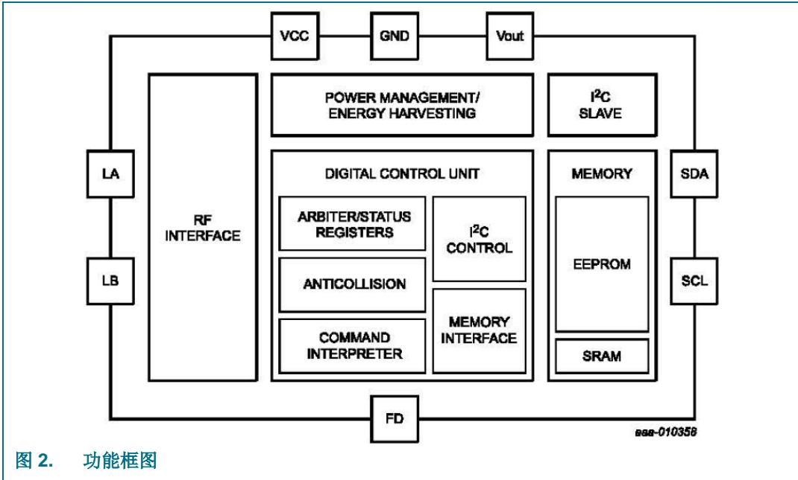

NTAG I²C plus: NFC Forum T2T 带有 I²C 接口、密码保护和能量采集功能

## 7 引脚配置信息

## 7.1 引脚配置

## 7.1.1 XQFN8

图3. XQFN8引脚配置  
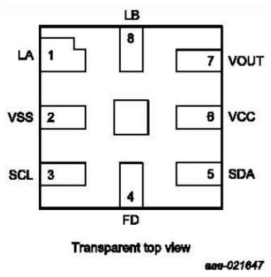

详细封装和焊接信息参见第 17 部分。

## 7.1.2 TSSOP8

图 4. TSSOP8 引脚配置  
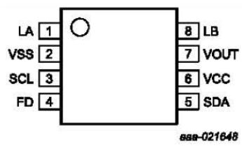

详细封装和焊接信息参见第 17 部分。

## 7.1.3 SO8

图5. SO8引脚配置  
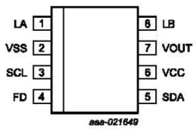

详细封装和焊接信息参见第 17 部分。

NTAG I²C plus: NFC Forum T2T 带有 I²C 接口、密码保护和能量采集功能

## 7.2 引脚说明

表 3. XQFN8、TSSOP8 和 SO8 的引脚说明

<table><tr><td>引脚</td><td>符号</td><td>说明</td></tr><tr><td>1</td><td>LA</td><td>天线连接 LA</td></tr><tr><td>2</td><td>VSS</td><td>GND</td></tr><tr><td>3</td><td>SCL</td><td>串行时钟 I2C</td></tr><tr><td>4</td><td>FD</td><td>场检测</td></tr><tr><td>5</td><td>SDA</td><td>串行数据 I2C</td></tr><tr><td>6</td><td>VCC</td><td>连接 VCC(外部电源)</td></tr><tr><td>7</td><td>VOUT</td><td>输出电压(能量采集)</td></tr><tr><td>8</td><td>LB</td><td>天线连接 LB</td></tr></table>

## 8 功能说明

## 8.1 框图说明

NTAG I²C plus IC 包含 EEPROM、SRAM、NFC 接口、数字控制单元（命令解译器、防冲突器、仲裁器/状态寄存器、I²C 控制和存储器接口）、电源管理、能量采集单元和 I²C 从机接口。能量和数据通过天线传输，天线包含一个转了几圈并直接连接到 NTAG I²C plus IC 的线圈。

## 8.2 NFC 接口

无源 NFC 接口基于 ISO/IEC 14443-3 A 类标准。

它需要由一个 NFC 场（如支持 NFC 的设备）提供，以便始终能够接收适当的命令并发送相关响应。

根据 ISO/IEC 14443-3 A 类标准中对两个方向数据通信的定义，在每个帧的开头有一个起始位（开始通信）。每个字节传输结束时有一个奇校验位。所选模块字节 0 的最低有效位先传输。

对于多字节参数，最低有效字节始终先传输。例如，使用 READ 命令从存储器中读取时，先传输已寻址模块的字节 0，然后传输该模块中的字节 1 至字节 3。下一个模块及后续所有模块均遵守相同顺序。

## 8.2.1 数据完整性

在 NFC 器件和 NTAG I²C plus IC 之间的非接触式通信链路中实施以下机制，以确保非常可靠的数据传输：

\- 每个模块 16 位 CRC

\- 每个字节均带有奇偶校验位

\- 位计数检查

\- 位编码用于区分“1”、“0”和“无信息”

\- 信道监控（协议序列和位流分析）

命令通过 NFC 器件启动，由 NTAG I²C plus IC 的数字控制单元进行控制。命令响应取决于 IC 的状态，对于存储器操作，还取决于对相应页面有效的访问条件。

NTAG I²C plus: NFC Forum T2T 带有 I²C 接口、密码保护和能量采集功能

## 8.2.2 NFC 状态机

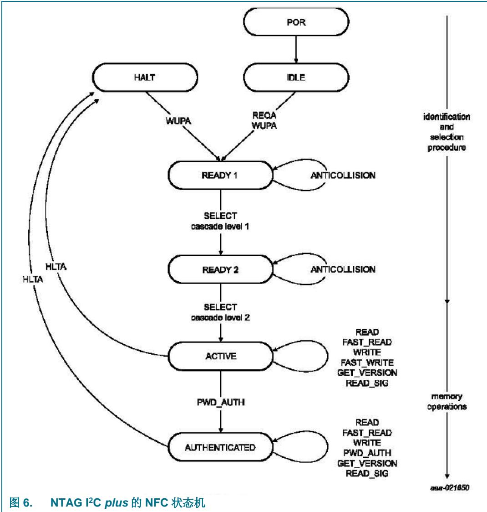

NFC 状态机的整体概述参见图 6。当检测到错误或收到意外命令时，标签在每个状态下都会返回到 ISO/IEC 14443-3 A 类标准中定义的 IDLE 或 HALT 状态。

## 8.2.2.1 IDLE 状态

上电复位(POR)后，NTAG I²C plus 切换到默认的等待状态，即 IDLE 状态。从 NFC 器件中收到 REQA 或 WUPA 命令时，它会从 IDLE 状态退出转入 READY 1 状态。在 IDLE 状态下收到的任何其他数据会被解译为错误，NTAG I²C plus 仍处于 IDLE 状态。

## 8.2.2.2 READY 1 状态

在 READY 1 状态下，NFC 设备在级联级别 1 使用 ANTICOLLISION 或 SELECT 命令解析 UID 的第一部分（3 个字节）。在从级联级别 1 收到 SELECT 命令并与 UID 整个第一部分相匹配后，正确退出 READY 1 状态。

NTAG I²C plus: NFC Forum T2T 带有 I²C 接口、密码保护和能量采集功能

\- 在此情况下，NFC 设备将 NTAG I²C plus 切换到 READY 2 状态，在该状态下，会解析 UID 的第二部分。

注：NTAG I²C plus 对 SELECT 命令的响应是 Select AcKnowledge (SAK) 字节，并将级联位设置为 1b，以表示 UID 不完整。

## 8.2.2.3 READY 2 状态

在 READY 2 状态下，NFC 器件在级联级别 2 使用 ANTICOLLISION 或 SELECT 命令解析 UID 的第二部分（4 个字节）。在从级联级别 2 收到 SELECT 命令并与 UID 整个第二部分相匹配后，正确退出 READY 2 状态。

\- 在此情况下，NFC 设备将 NTAG I²C plus 切换到 ACTIVE 状态，在此状态下，会执行所有与应用相关的命令。

注：在 READY 2 状态下，NTAG I²C plus 对 SELECT 命令的响应是 Select AcKnowledge (SAK) 字节，并且将级联位清零，以表示 NTAG I²C plus 现在为唯一选择，且只有此器件会与 NFC 设备通信，即使在 NFC 设备场存在其他非接触式设备时也是如此。

## 8.2.2.4 ACTIVE 状态

所有不受保护的存储器操作都在 ACTIVE 和 AUTHENTICATED 状态下工作。

ACTIVE 状态可使用 PWD\_AUTH 命令或 HLTA 命令退出。

当在 PWD\_AUTH 命令中收到正确密码时，NTAG I²C plus 将在使用 PACK 进行响应后过渡到 AUTHENTICATED 状态。

通过 HLTA 命令，NTAG I²C plus 将过渡到 HALT 状态。

ACTIVE 状态下的任何其他无效命令都会被解译为错误。根据之前的状态，NTAG I²C plus 返回 IDLE 状态或 HALT 状态。

## 8.2.2.5 AUTHENTICATED 状态

在 AUTHENTICATED 状态下仅运行受保护的存储器操作，但是仍然可以访问不受保护的存储器。

AUTHENTICATED 状态可使用 HLTA 命令退出，收到该命令后，NTAG I²C plus 会过渡到 HALT 状态。

AUTHENTICATED 状态下的任何其他无效命令都会被解译为错误。根据之前的状态，NTAG I²C plus 返回 IDLE 状态或 HALT 状态。

## 8.2.2.6 HALT 状态

HALT 和 IDLE 状态是 NTAG I²C plus 中实行的两个等待状态。已处理的处于 ACTIVE 或 AUTHENTICATED 状态的 NTAG I²C plus 可通过 HLTA 命令设为 HALT 状态。在防冲突阶段，该状态有助于 NFC 设备区分已处理的标签和尚未选择的标签。NTAG I²C plus 只能在执行 WUPA 命令时退出 HALT 状态。当设备处于此状态时收到的任何其他数据都会被解译为错误，NTAG I²C plus 状态保持不变。

NTAG I²C plus: NFC Forum T2T 带有 I²C 接口、密码保护和能量采集功能

## 8.3 存储器规划

NFC 接口的存储器映射详情参见表 4（1k 存储器）和表 5（2k 存储器），I²C 接口的存储器映射详情参见表 6（1k 存储器）和表 7（2k 存储器）。SRAM 存储器仅在通过 VCC 供电时可用和可访问。请参考第 11 部分查看 NFC 接口与 SRAM 映射的存储器映射示例。

制造数据的结构、静态和动态锁定字节、功能容器和用户存储器页与其他 NTAG 产品兼容。

任何从有效地址开始并扩展到无效访问区域的存储器访问都会为无效区域返回 00h 值。

不能更改标记为保留供将来使用(RFU)的位和字节，因为这会导致意外的标签行为。

## 8.3.1 NFC 方式下的存储器映射

NFC 方式下的存储器访问按每 4 个字节的页面规划。如果未使用密码保护，则整个用户存储器都不受保护。

NTAG I²C plus: NFC Forum T2T 带有 I²C 接口、密码保护和能量采集功能

表 4. NFC 方式下的 NTAG I²C plus 1k 存储器规划

<table><tr><td rowspan="2">扇区地址</td><td colspan="2">页地址</td><td colspan="4">页内的字节数</td><td rowspan="2">访问条件ACTIVE状态</td><td rowspan="2">访问条件AUTH.状态</td></tr><tr><td>十进制</td><td>十六进制</td><td>0</td><td>1</td><td>2</td><td>3</td></tr><tr><td rowspan="26">0</td><td>0</td><td>00h</td><td colspan="4">序列号(UID)</td><td colspan="2">READ</td></tr><tr><td>1</td><td>01h</td><td colspan="3">序列号(UID)</td><td>内部</td><td colspan="2">READ</td></tr><tr><td>2</td><td>02h</td><td colspan="2">内部</td><td colspan="2">静态锁定字节</td><td colspan="2">READ/R&amp;W</td></tr><tr><td>3</td><td>03h</td><td colspan="4">功能容器(CC)</td><td colspan="2">READ&amp;WRITE</td></tr><tr><td>4</td><td>04h</td><td rowspan="2" colspan="4">不受保护的用户存储器</td><td rowspan="2" colspan="2">READ&amp;WRITE</td></tr><tr><td>......</td><td>......</td></tr><tr><td>AUTH0</td><td>AUTH0</td><td rowspan="3" colspan="4">受保护的用户存储器</td><td rowspan="3"> $READ^1$ </td><td rowspan="3">READ&amp;WRITE</td></tr><tr><td>......</td><td>......</td></tr><tr><td>225</td><td>E1h</td></tr><tr><td>226</td><td>E2h</td><td colspan="3">动态锁定字节</td><td>00h</td><td colspan="2">R&amp;W/READ</td></tr><tr><td>227</td><td>E3h</td><td>RFU</td><td>RFU</td><td>RFU</td><td>AUTH0</td><td> $READ^1$ </td><td>READ&amp;WRITE</td></tr><tr><td>228</td><td>E4h</td><td>ACCESS</td><td>RFU</td><td>RFU</td><td>RFU</td><td> $READ^1$ </td><td>READ&amp;WRITE</td></tr><tr><td>229</td><td>E5h</td><td colspan="4"> $PWD^2$ </td><td> $READ^1$ </td><td>READ&amp;WRITE</td></tr><tr><td>230</td><td>E6h</td><td colspan="2"> $PACK^2$ </td><td>RFU</td><td>RFU</td><td> $READ^1$ </td><td>READ&amp;WRITE</td></tr><tr><td>231</td><td>E7h</td><td>PT_I2C</td><td>RFU</td><td>RFU</td><td>RFU</td><td> $READ^1$ </td><td>READ&amp;WRITE</td></tr><tr><td>232</td><td>E8h</td><td rowspan="2" colspan="4">配置寄存器</td><td rowspan="2" colspan="2">参见第8.3.12部分</td></tr><tr><td>233</td><td>E9h</td></tr><tr><td>234</td><td>EAh</td><td rowspan="2" colspan="4">无效访问-返回NAK</td><td rowspan="2" colspan="2">不适用</td></tr><tr><td>235</td><td>EBh</td></tr><tr><td>236</td><td>ECh</td><td rowspan="2" colspan="4">会话寄存器</td><td rowspan="2" colspan="2">参见第8.3.12部分</td></tr><tr><td>237</td><td>EDh</td></tr><tr><td>236</td><td>EEh</td><td rowspan="2" colspan="4">无效访问-返回NAK</td><td rowspan="2" colspan="2">不适用</td></tr><tr><td>239</td><td>EFh</td></tr><tr><td>240</td><td>F0h</td><td rowspan="3" colspan="4">无效访问-返回NAK</td><td rowspan="3" colspan="2">不适用</td></tr><tr><td>......</td><td>......</td></tr><tr><td>255</td><td>FFh</td></tr><tr><td>1</td><td>......</td><td>......</td><td colspan="4">无效访问-返回NAK</td><td colspan="2">不适用</td></tr><tr><td>2</td><td>......</td><td>......</td><td colspan="4">无效访问-返回NAK</td><td colspan="2">不适用</td></tr><tr><td rowspan="4">3</td><td>0</td><td>00h</td><td rowspan="2" colspan="4">无效访问-返回NAK</td><td rowspan="2" colspan="2">不适用</td></tr><tr><td>......</td><td>......</td></tr><tr><td>246</td><td>F8h</td><td rowspan="2" colspan="4">镜像会话寄存器</td><td rowspan="2" colspan="2">参见第8.3.12部分</td></tr><tr><td>249</td><td>F9h</td></tr></table>

NTAG I²C plus: NFC Forum T2T 带有 I²C 接口、密码保护和能量采集功能

<table><tr><td rowspan="2">扇区地址</td><td colspan="2">页地址</td><td colspan="4">页内的字节数</td><td rowspan="2">访问条件ACTIVE状态</td><td rowspan="2">访问条件AUTH.状态</td></tr><tr><td>十进制</td><td>十六进制</td><td>0</td><td>1</td><td>2</td><td>3</td></tr><tr><td rowspan="2"></td><td>......</td><td>......</td><td rowspan="2" colspan="4">无效访问-返回NAK</td><td rowspan="2" colspan="2">不适用</td></tr><tr><td>255</td><td>FFh</td></tr><tr><td colspan="9"> $^{1}$ 如果将NFC_PROT位设置为1b,NTAG  $I^{2}C$  plus返回NAK $^{2}$ 读取PWD或PACK时,NTAG  $I^{2}C$  plus始终向所有字节返回00h</td></tr></table>

NTAG I²C plus: NFC Forum T2T 带有 I²C 接口、密码保护和能量采集功能

表 5. NFC 方式下的 NTAG I²C plus 2k 存储器规划

<table><tr><td rowspan="2">扇区地址</td><td colspan="2">页地址</td><td colspan="4">页内的字节数</td><td rowspan="2">访问条件ACTIVE状态</td><td rowspan="2">访问条件AUTH.状态</td></tr><tr><td>十进制</td><td>十六进制</td><td>0</td><td>1</td><td>2</td><td>3</td></tr><tr><td rowspan="24">0</td><td>0</td><td>00h</td><td colspan="4">序列号(UID)</td><td colspan="2">READ</td></tr><tr><td>1</td><td>01h</td><td colspan="3">序列号(UID)</td><td>内部</td><td colspan="2">READ</td></tr><tr><td>2</td><td>02h</td><td colspan="2">内部</td><td colspan="2">静态锁定字节</td><td colspan="2">READ/R&amp;W</td></tr><tr><td>3</td><td>03h</td><td colspan="4">功能容器(CC)</td><td colspan="2">READ&amp;WRITE</td></tr><tr><td>4</td><td>04h</td><td rowspan="2" colspan="4">不受保护的用户存储器</td><td rowspan="2" colspan="2">READ&amp;WRITE</td></tr><tr><td>......</td><td>......</td></tr><tr><td>AUTH0</td><td>AUTH0</td><td rowspan="3" colspan="4">受保护的用户存储器</td><td rowspan="3"> $READ^1$ </td><td rowspan="3">READ&amp;WRITE</td></tr><tr><td>......</td><td>......</td></tr><tr><td>225</td><td>E1h</td></tr><tr><td>226</td><td>E2h</td><td colspan="3">动态锁定字节</td><td>00h</td><td colspan="2">R&amp;W/READ</td></tr><tr><td>227</td><td>E3h</td><td>RFU</td><td>RFU</td><td>RFU</td><td>AUTH0</td><td> $READ^1$ </td><td>READ&amp;WRITE</td></tr><tr><td>228</td><td>E4h</td><td>ACCESS</td><td>RFU</td><td>RFU</td><td>RFU</td><td> $READ^1$ </td><td>READ&amp;WRITE</td></tr><tr><td>229</td><td>E5h</td><td colspan="4"> $PWD^2$ </td><td> $READ^1$ </td><td>READ&amp;WRITE</td></tr><tr><td>230</td><td>E6h</td><td colspan="2"> $PACK^2$ </td><td>RFU</td><td>RFU</td><td> $READ^1$ </td><td>READ&amp;WRITE</td></tr><tr><td>231</td><td>E7h</td><td>PT_I2C</td><td>RFU</td><td>RFU</td><td>RFU</td><td> $READ^1$ </td><td>READ&amp;WRITE</td></tr><tr><td>232</td><td>E8h</td><td rowspan="2" colspan="4">配置寄存器</td><td rowspan="2" colspan="2">参见第8.3.12部分</td></tr><tr><td>233</td><td>E9h</td></tr><tr><td>234</td><td>EAh</td><td rowspan="2" colspan="4">无效访问-返回NAK</td><td rowspan="2" colspan="2">不适用</td></tr><tr><td>235</td><td>EBh</td></tr><tr><td>236</td><td>ECh</td><td rowspan="2" colspan="4">会话寄存器</td><td rowspan="2" colspan="2">参见第8.3.12部分</td></tr><tr><td>237</td><td>EDh</td></tr><tr><td>236</td><td>EEh</td><td rowspan="3" colspan="4">无效访问-返回NAK</td><td rowspan="3" colspan="2">不适用</td></tr><tr><td>......</td><td>......</td></tr><tr><td>255</td><td>FFh</td></tr><tr><td rowspan="3">1</td><td>0</td><td>00h</td><td rowspan="3" colspan="4">(不)受保护的用户存储器 $^{3,4}$ </td><td rowspan="3" colspan="2">参见扇区0中受保护的用户存储器</td></tr><tr><td>......</td><td>......</td></tr><tr><td>255</td><td>FFh</td></tr><tr><td>2</td><td>......</td><td>......</td><td colspan="4">无效访问-返回NAK</td><td colspan="2">不适用</td></tr><tr><td rowspan="4">3</td><td>0</td><td>00h</td><td rowspan="2" colspan="4">无效访问-返回NAK</td><td rowspan="2" colspan="2">不适用</td></tr><tr><td>......</td><td>......</td></tr><tr><td>246</td><td>F8h</td><td rowspan="2" colspan="4">镜像会话寄存器</td><td rowspan="2" colspan="2">参见第8.3.12部分</td></tr><tr><td>249</td><td>F9h</td></tr></table>

NTAG I²C plus: NFC Forum T2T 带有 I²C 接口、密码保护和能量采集功能

<table><tr><td rowspan="2">扇区地址</td><td colspan="2">页地址</td><td colspan="4">页内的字节数</td><td rowspan="2">访问条件ACTIVE状态</td><td rowspan="2">访问条件AUTH.状态</td></tr><tr><td>十进制</td><td>十六进制</td><td>0</td><td>1</td><td>2</td><td>3</td></tr><tr><td rowspan="2"></td><td>......</td><td>......</td><td rowspan="2" colspan="4">无效访问-返回NAK</td><td rowspan="2" colspan="2">不适用</td></tr><tr><td>255</td><td>FFh</td></tr><tr><td colspan="9"> $^{1}$ 如果将NFC_PROT位设置为1b,NTAG  $I^{2}C$  plus返回NAK $^{2}$ 读取PWD或PACK时,NTAG  $I^{2}C$  plus始终向所有字节返回00h $^{3}$ 如果将2K_PROT位设置为1b,NTAG  $I^{2}C$  plus的整个扇区1受密码保护 $^{4}$ 如果将NFC_DIS_SEC1位设置为1b,NTAG  $I^{2}C$  plus的整个扇区1在NFC接口下不可访问</td></tr></table>

NTAG I²C plus: NFC Forum T2T 带有 I²C 接口、密码保护和能量采集功能

## 8.3.2 I²C 接口的存储器映射

I²C 接口的 NTAG I²C plus 存储器访问按每 16 个字节一个模块规划。

I²C 从机地址存储于模块 0 中字节 0 的 7 位最高有效位。但是，在读取模块 0 时，NTAG I²C plus 总是向字节 0 返回 04h。

警告：在配置静态锁字节和功能容器时，地址字节也会更新。地址字节由从机地址（使用7位最高有效位编码）和设置为0b的最低有效位组成。

注：为方便起见，建议将地址字节（模块 0，字节 0）配置为 04h。

NTAG I²C plus: NFC Forum T2T 带有 I²C 接口、密码保护和能量采集功能

表 6. I²C 接口的 NTAG I²C plus 1k 存储器规划

<table><tr><td rowspan="4" colspan="2"> $I^{2}C$ 模块地址</td><td colspan="4">模块内的字节数</td><td colspan="3">访问条件</td></tr><tr><td>0</td><td>1</td><td>2</td><td>3</td><td rowspan="2" colspan="3"> $I^{2}C\_PROT$ </td></tr><tr><td>4</td><td>5</td><td>6</td><td>7</td></tr><tr><td>8</td><td>9</td><td>10</td><td>11</td><td rowspan="2">00b</td><td rowspan="2">01b</td><td rowspan="2">1xb</td></tr><tr><td>十进制</td><td>十六进制</td><td>12</td><td>13</td><td>14</td><td>15</td></tr><tr><td rowspan="4">0</td><td rowspan="4">00h</td><td> $地址^1$ </td><td colspan="3">序列号(UID)</td><td rowspan="4" colspan="3">READ&amp;WRITE</td></tr><tr><td colspan="3">序列号(UID)</td><td>内部</td></tr><tr><td colspan="2">内部</td><td colspan="2">静态锁定字节</td></tr><tr><td colspan="4">功能容器(CC)</td></tr><tr><td>1</td><td>01h</td><td rowspan="2" colspan="4">不受保护的用户存储器</td><td rowspan="2" colspan="3">READ&amp;WRITE</td></tr><tr><td>......</td><td>......</td></tr><tr><td>AUTH0</td><td>AUTH0</td><td rowspan="3" colspan="4">受保护的用户存储器</td><td rowspan="3">READ&amp;WRITE</td><td rowspan="3">READ</td><td rowspan="3">NAK</td></tr><tr><td>......</td><td>......</td></tr><tr><td>55</td><td>37h</td></tr><tr><td rowspan="3">56</td><td rowspan="3">38h</td><td colspan="4">受保护的用户存储器</td><td>READ&amp;WRITE</td><td>READ</td><td>NAK</td></tr><tr><td colspan="3">动态锁定字节</td><td>00h</td><td rowspan="6" colspan="3">READ&amp;WRITE</td></tr><tr><td>RFU</td><td>RFU</td><td>RFU</td><td>AUTH0</td></tr><tr><td rowspan="4">57</td><td rowspan="4">39h</td><td>ACCESS</td><td>RFU</td><td>RFU</td><td>RFU</td></tr><tr><td colspan="4"> $PWD^2$ </td></tr><tr><td colspan="2"> $PACK^2$ </td><td>RFU</td><td>RFU</td></tr><tr><td>PT_I2C</td><td>RFU</td><td>RFU</td><td>RFU</td></tr><tr><td rowspan="3">58</td><td rowspan="3">3Ah</td><td colspan="4">配置寄存器</td><td colspan="3">参见第8.3.12部分</td></tr><tr><td>00h</td><td>00h</td><td>00h</td><td>00h</td><td rowspan="2" colspan="3">READ</td></tr><tr><td>00h</td><td>00h</td><td>00h</td><td>00h</td></tr><tr><td>59</td><td>3Bh</td><td rowspan="3" colspan="4">无效访问-返回NAK</td><td rowspan="3" colspan="3">不适用</td></tr><tr><td>......</td><td>......</td></tr><tr><td>247</td><td>F7h</td></tr><tr><td>248</td><td>F8h</td><td rowspan="3" colspan="4">SRAM存储器(64字节)</td><td rowspan="3" colspan="3">READ&amp;WRITE</td></tr><tr><td>......</td><td>......</td></tr><tr><td>251</td><td>FBh</td></tr><tr><td>......</td><td>......</td><td colspan="4">无效访问-返回NAK</td><td colspan="3">不适用</td></tr><tr><td rowspan="2">254</td><td rowspan="2">FEh</td><td colspan="4">会话寄存器</td><td colspan="3">参见第8.3.12部分</td></tr><tr><td>00h</td><td>00h</td><td>00h</td><td>00h</td><td colspan="3">READ</td></tr></table>

NTAG I²C plus: NFC Forum T2T 带有 I²C 接口、密码保护和能量采集功能

<table><tr><td rowspan="4" colspan="2"> $I^{2}C$ 模块地址</td><td colspan="4">模块内的字节数</td><td colspan="3">访问条件</td></tr><tr><td>0</td><td>1</td><td>2</td><td>3</td><td rowspan="2" colspan="3"> $I^{2}C\_PROT$ </td></tr><tr><td>4</td><td>5</td><td>6</td><td>7</td></tr><tr><td>8</td><td>9</td><td>10</td><td>11</td><td rowspan="2">00b</td><td rowspan="2">01b</td><td rowspan="2">1xb</td></tr><tr><td>十进制</td><td>十六进制</td><td>12</td><td>13</td><td>14</td><td>15</td></tr><tr><td></td><td></td><td>00h</td><td>00h</td><td>00h</td><td>00h</td><td colspan="3"></td></tr><tr><td>255</td><td>FFh</td><td colspan="4">无效访问-返回NAK</td><td colspan="3">不适用</td></tr><tr><td colspan="9"> $^{1}$ 模块0的字节0总是读做04h(UID0)。向模块0写入以更新 $I^{2}C$ 地址。 $^{2}$ 读取PWD和PACK时,NTAG  $I^{2}C$  plus始终向所有字节返回00h</td></tr></table>

NTAG I²C plus: NFC Forum T2T 带有 I²C 接口、密码保护和能量采集功能

表 7. I²C 接口的 NTAG I²C plus 2k 存储器规划

<table><tr><td rowspan="4" colspan="2"> $I^{2}C$ 模块地址</td><td colspan="4">模块内的字节数</td><td colspan="3">访问条件</td></tr><tr><td>0</td><td>1</td><td>2</td><td>3</td><td rowspan="2" colspan="3"> $I^{2}C\_PROT$ </td></tr><tr><td>4</td><td>5</td><td>6</td><td>7</td></tr><tr><td>8</td><td>9</td><td>10</td><td>11</td><td rowspan="2">00b</td><td rowspan="2">01b</td><td rowspan="2">1xb</td></tr><tr><td>十进制</td><td>十六进制</td><td>12</td><td>13</td><td>14</td><td>15</td></tr><tr><td rowspan="4">0</td><td rowspan="4">00h</td><td> $地址^1$ </td><td colspan="3">序列号(UID)</td><td rowspan="4" colspan="3">READ&amp;WRITE</td></tr><tr><td colspan="3">序列号(UID)</td><td>内部</td></tr><tr><td colspan="2">内部</td><td colspan="2">静态锁定字节</td></tr><tr><td colspan="4">功能容器(CC)</td></tr><tr><td>1</td><td>01h</td><td rowspan="2" colspan="4">不受保护的用户存储器</td><td rowspan="2" colspan="3">READ&amp;WRITE</td></tr><tr><td>......</td><td>......</td></tr><tr><td>AUTH0</td><td>AUTH0</td><td rowspan="2" colspan="4">受保护的用户存储器</td><td rowspan="2">READ&amp;WRITE</td><td rowspan="2">READ</td><td rowspan="2">NAK</td></tr><tr><td>......</td><td>......</td></tr><tr><td rowspan="4">56</td><td rowspan="4">38h</td><td colspan="4">受保护的用户存储器</td><td>READ&amp;WRITE</td><td>READ</td><td>NAK</td></tr><tr><td colspan="4">受保护的用户存储器</td><td></td><td></td><td></td></tr><tr><td colspan="3">动态锁定字节</td><td>00h</td><td rowspan="6" colspan="3">READ&amp;WRITE</td></tr><tr><td>RFU</td><td>RFU</td><td>RFU</td><td>AUTH0</td></tr><tr><td rowspan="4">57</td><td rowspan="4">39h</td><td>ACCESS</td><td>RFU</td><td>RFU</td><td>RFU</td></tr><tr><td colspan="4"> $PWD^2$ </td></tr><tr><td colspan="2"> $PACK^2$ </td><td>RFU</td><td>RFU</td></tr><tr><td>PT_I2C</td><td>RFU</td><td>RFU</td><td>RFU</td></tr><tr><td rowspan="3">58</td><td rowspan="3">3Ah</td><td colspan="4">配置寄存器</td><td colspan="3">参见第8.3.12部分</td></tr><tr><td>00h</td><td>00h</td><td>00h</td><td>00h</td><td rowspan="2" colspan="3">READ</td></tr><tr><td>00h</td><td>00h</td><td>00h</td><td>00h</td></tr><tr><td>......</td><td>......</td><td colspan="4">无效访问-返回NAK</td><td colspan="3">不适用</td></tr><tr><td>64</td><td>40h</td><td rowspan="3" colspan="4">(不)受保护的用户存储器</td><td rowspan="3">READ&amp;WRITE</td><td rowspan="3">READ</td><td rowspan="3">NAK</td></tr><tr><td>......</td><td>......</td></tr><tr><td>127</td><td>7Fh</td></tr><tr><td>......</td><td>......</td><td colspan="4">无效访问-返回NAK</td><td colspan="3">不适用</td></tr><tr><td>248</td><td>F8h</td><td rowspan="3" colspan="4">SRAM存储器(64字节)</td><td rowspan="3" colspan="3">READ&amp;WRITE</td></tr><tr><td>......</td><td>......</td></tr><tr><td>251</td><td>FBh</td></tr><tr><td>......</td><td>......</td><td colspan="4">无效访问-返回NAK</td><td colspan="3">不适用</td></tr></table>

NTAG I²C plus: NFC Forum T2T 带有 I²C 接口、密码保护和能量采集功能

<table><tr><td rowspan="4" colspan="2">I2C模块地址</td><td colspan="4">模块内的字节数</td><td colspan="3">访问条件</td></tr><tr><td>0</td><td>1</td><td>2</td><td>3</td><td rowspan="2" colspan="3">I2C_PROT</td></tr><tr><td>4</td><td>5</td><td>6</td><td>7</td></tr><tr><td>8</td><td>9</td><td>10</td><td>11</td><td rowspan="2">00b</td><td rowspan="2">01b</td><td rowspan="2">1xb</td></tr><tr><td>十进制</td><td>十六进制</td><td>12</td><td>13</td><td>14</td><td>15</td></tr><tr><td rowspan="3">254</td><td rowspan="3">FEh</td><td colspan="4">会话寄存器</td><td colspan="3">参见第8.3.12部分</td></tr><tr><td>00h</td><td>00h</td><td>00h</td><td>00h</td><td rowspan="2" colspan="3">READ</td></tr><tr><td>00h</td><td>00h</td><td>00h</td><td>00h</td></tr><tr><td>255</td><td>FFh</td><td colspan="4">无效访问-返回NAK</td><td colspan="3">不适用</td></tr><tr><td colspan="9">1模块0的字节0总是读做04h(UID0)。向模块0写入以更新I2C地址。2读取PWD和PACK时,NTAG I2C plus始终向所有字节返回00h</td></tr></table>

## 8.3.3 EEPROM

EEPROM 是非易失性存储器，用于存储 7 字节 UID、存储器锁定条件、IC 配置信息和用户存储器。

扇区 0 存储器映射看上去与 NTAG I²C plus 1k 和 2k 版本完全相同，唯一的区别是动态锁定位粒度。

恩智浦推出的 NTAG I²C plus 使得将存储器分为一个开放区域和一个受密码保护的区域成为可能（参见第 8.3.11 部分）。

## 8.3.4 SRAM

对于频繁变化的数据，内置了一个无限耐受程度的 64 字节易失性存储器。64 个字节的映射方式与 EEPROM 类似，即从 NFC 视角来看，64 字节被视为 16 页 4 字节页面。

SRAM 仅在标签通过 VCC 引脚供电时可用。

SRAM 位于存储器空间的末端，总是可以通过 I²C 主机直接访问（地址 F8h 至 FBh）。NFC 设备在正常模式下（例如在直通模式以外）不能访问 SRAM 存储器。只有将 SRAM 镜像到 EEPROM 存储器空间中时，NFC 设备才能访问 SRAM。

启用 SRAM 镜像（SRAM\_MIRROR\_ON\_OFF = 1b，参见第 11.2 部分）时，SRAM 可以镜像到用户存储器中，从起始页 01h 至 74h，以便从 NFC 端访问 SRAM。

当两个接口都打开时，必须启用存储器镜像，因为此功能在每次 POR 之后被禁用。

寄存器 SRAM\_MIRROR\_BLOCK（参见表 14）指示 SRAM 缓冲区第一页的地址。如果启用了 SRAM 镜像，并且读命令是 SRAM 镜像所在的寻址块，则将返回 SRAM 字节值，而不是 EEPROM 字节值。同样，如果标签不是 VCC 供电，SRAM 镜像将被禁用，读取与 SRAM 镜像位置相关的字节将返回 EEPROM 的值。

NTAG I²C plus: NFC Forum T2T 带有 I²C 接口、密码保护和能量采集功能

在直通模式（PTHRU\_ON\_OFF = 1b，参见第8.3.12部分）中，SRAM镜像到NTAG I²C plus的第一个存储器扇区（扇区0）中的固定地址F0h - FFh，用于NFC访问（参见第11部分）。

## 8.3.5 序列号(UID)

唯一 7 字节序列号(UID)编程到存储器的前 7 个字节，涵盖页面地址 00h 和 01h（参见图 7）。这些字节经过编程，在生产中受写入保护。

UID0 固定为值 04h（按照 ISO/IEC 14443-3 规定的恩智浦半导体的制造商 ID）。

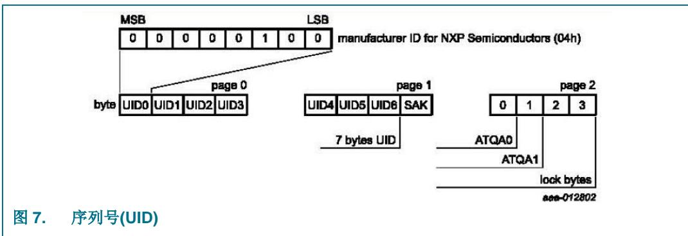

## 8.3.6 静态锁定字节

根据 NFC Forum 2 类标签规范，02h 页的字节 2 和字节 3 的位（通过 NFC）或字节 10 和 11 的地址 00h（通过 I²C）代表场可编程、只读锁定机制（参见图 8）。通过将相应锁定位 Lx 设置为逻辑 1b，可单独锁定 03h (CC) 到 0Fh 的每一页，以防止进一步写入访问。锁定后，对应页面成为只读存储器。

该只读锁定基于地址。这意味着，当SRAM镜像到这些模块时，也只能在NFC方式下读取SRAM模块。

此外，NTAG I²C plus 使用锁定字节 0 的 3 个最低有效位作为模块锁定位。位 2 处理 0Ah 至 0Fh 页（通过 NFC），位 1 处理 04h 至 09h 页（通过 NFC），位 0 控制 03h 页(CC)。设置了模块锁定位后，对应存储区域的锁定配置冻结，即无法改变为只读。

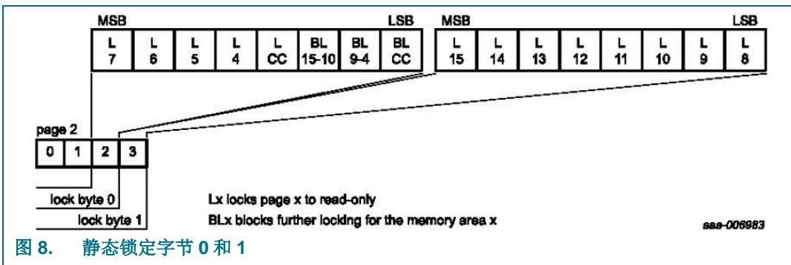

NTAG I²C plus: NFC Forum T2T 带有 I²C 接口、密码保护和能量采集功能

例如，如果 BL15-10 设置为逻辑 1b，则位 L15 至 L10（锁定字节 1，位[7:2]）无法更改。静态锁定和模块锁定位通过 WRITE 命令的字节 2 和 3 设置为 02h 页。锁定字节的内容是按位 OR 的关系，结果之后成为锁定字节的新内容。在 NFC 方式下，此过程不可逆。如果位设置为逻辑 1b，则无法更改回逻辑 0b。在 I²C 方式下，位可以通过写入模块 00h 的字节 10 和 11 重置为 0b。由于 I²C 地址在模块 0 的字节 0 中进行编码，它可能会在无意中被更改。

02h 页的字节 0 和 1 的内容（通过 NFC）不受 WRITE 命令的相应数据字节的影响。

静态锁定字节的默认值为 0000h。

## 8.3.7 动态锁定字节

要从页面地址 16 起锁定 NTAG I²C plus 的页面，使用动态锁定字节。动态锁定字节位于 E2h 页的扇区 0。3 个锁定字节涵盖的存储器区域为 840 个数据字节(NTAG I²C plus 1k)或 1864 个数据字节(NTAG I²C plus 2k)。前 48 个字节与单页面相比（参见图 8），NTAG I²C plus 1k 的粒度为 16 页（参见图 9），NTAG I²C plus 2k 则为 32 页（参见图 10）。

为确保 NFC Forum 2 类标签的兼容性, 按照 NFC Forum Type 2 类标签规范的规定, NTAG I²C plus 需要一个锁定控制 TLV。

当需要将 NFC Forum 2 类标签过渡到 READ ONLY 状态时，所有标记为 RFUI 的位和与受保护区域相关的动态锁定位在写入动态锁字节时应设置为 0b。

动态锁定字节的默认值为 000000h。在读取时，字节 3 的值总是 00h。

与静态锁定字节相同，在 NFC 方式下，这个动态锁定位的修改过程也是不可逆的，同样适用于可能镜像的 SRAM。如果位设置为逻辑 1b，则无法更改回逻辑 0b。通过 I²C 接口，这些位可以再次设置为 0b。

NTAG I²C plus: NFC Forum T2T 带有 I²C 接口、密码保护和能量采集功能  
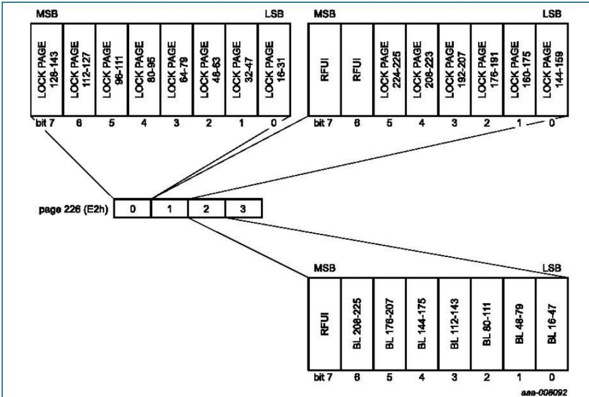  
图 9. NTAG I²C plus 1k 动态锁定字节 0、1 和 2

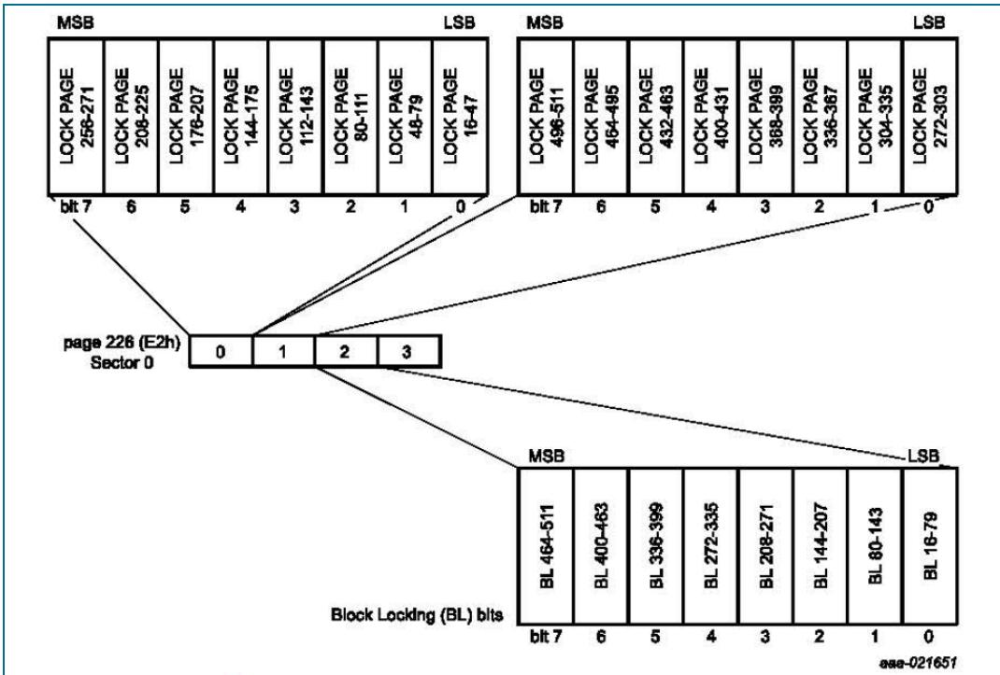  
图10. NTAG I²C plus 2k动态锁定字节0、1和2

NTAG I²C plus: NFC Forum T2T 带有 I²C 接口、密码保护和能量采集功能

## 8.3.8 功能容器(CC)

按照 NFC Forum 2 类标签规范，CC 位于 03h 页（参见参考文献 1）。为了充分保持将存储器分为开放区域和受保护区域的灵活性，CC 的默认值在 IC 生产期间初始化为 00000000h。

通过 I²C 或 NFC 接口的 WRITE 命令根据特定应用需求和 NFC Forum 规范设置这些 CC 字节后，只能使用 NFC Forum 设备写入 NDEF 消息。根据 NFC Forum 规范，位一旦设置为 1b，NFC Forum 设备就不能将 CC 位设置回 0b。但是，与锁定位类似，在 I²C 方式下，可以将这些位再次设置回 0b。

警告：I²C 地址（字节 0）和静态锁定字节（字节 10 和字节 11）从 I²C 端在模块 00h 中进行编码，在改变 CC 时，I²C 地址可能会改变或标签可能会在无意中被锁定。

注：在读取字节 0 时，NTAG I²C plus 总是返回 04h (UID0)。因此，为方便起见，建议将 I²C 地址字节配置为 04h。

恩智浦建议在仅使用部分存储器存储 NDEF 消息时，只需将 CC 大小的参数值设置为 T2T\_Area 终止于锁定位粒度边界处的值。因此，T2T\_Area 的大小应为 112 + 64\*N 或 888 字节，其中 N≤13（1k 版本），或 176 + 128\*N 或 2032 字节，其中 N≤14（2k 版本）。

图11显示了根据NFC Forum规范，当从READ/WRITE过渡为READ ONLY状态时，CC如何改变。

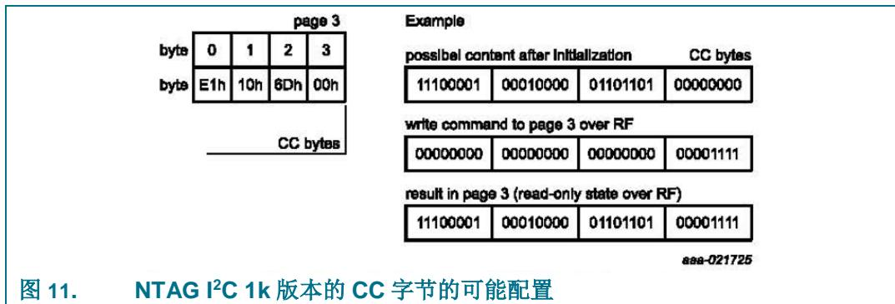

## 8.3.9 用户存储器页面

NTAG I²C plus 1k 和 2k 版本的用户存储器区域为通过 NFC 接口时的扇区 0 的 04h 至 E1h 页或通过 I²C 接口是的模块 01h 至 37h 加上模块 38h 的前 8 个字节。

此外，通过 NFC 接口时的整个扇区 1（00h 至 FFh 页）或通过 I²C 接口时的模块 40h 至 7Fh 用作 NTAG I²C plus 2k 版本的用户存储区。

## 8.3.10 交付时的存储器内容

如上所述，03h 页的 CC 全部设置为 00h，以充分保持灵活性。为了允许 NFC Forum NDEF 消息读写 NTAG I²C plus 的 03h 页(CC)和后续数据页面(NDEF TLV)，用户需要按照 NFC Forum 2 类标签规范进行初始化（参见参考文献 1）。表 8 显示了一个将整个扇区 0 用于 NDEF 消息并符合 NFC Forum 规范的示例。

NTAG I²C plus: NFC Forum T2T 带有 I²C 接口、密码保护和能量采集功能

注：从 04h 页开始，数据页面的默认内容在交付时未定义。

表 8. NTAG I²C plus 初始化状态下的最小存储器内容

<table><tr><td>页地址</td><td colspan="4">页内的字节数</td></tr><tr><td></td><td>0</td><td>1</td><td>2</td><td>3</td></tr><tr><td>03h</td><td>E1h</td><td>10h</td><td>6Dh</td><td>00h</td></tr><tr><td>04h</td><td>03h</td><td>00h</td><td>FEh</td><td>00h</td></tr></table>

## 8.3.11 密码和访问配置

NTAG I²C plus 可配置为具有密码保护的存储器区域。

如果使用了该特性，恩智浦建议针对每个芯片更改并使用不同的 PWD 和 PACK。

通过 NFC 接口时的 E3h 至 E7h 页的密码和访问配置区域（扇区 0，参见表 9）或通过 I²C 接口时的模块 38h 和 39h 用来配置 NTAG I²C plus 的密码和访问条件。这些位的值存储在 EEPROM 中。如果适用并且未被寄存器锁定位锁定时，从两个接口均可对它们的值进行读取和写入（参见表 13 中的 REG\_LOCK）。

AUTH0 定义扇区 0 中受保护区域的起始页地址。恩智浦建议始终以遵从锁定位粒度的方式设置 AUTH0。将 AUTH0 设置为大于 EBh，禁用密码保护。

NFC\_PROT 位可用于只需要 PWD\_AUTH 即可将数据写入的受保护区域，还可用于保护从受保护区域读取数据。

如果使用密码验证,甚至还可以通过将SRAM\_PROT位设置为1b进行SRAM访问保护。

I2C\_PROT 允许在 I²C 方式下将对受保护区域的访问限制为只读或完全无权访问。

AUTLIM 值可以用来限制失败 PWD\_AUTH 尝试。

在 NFC 方式下，NTAG I²C plus 2k 版本的 NFC\_DIS\_SEC1 位可用来禁止对扇区 1 的访问（启用扇区 1 的 2K\_PROT 位密码保护时）。

一旦启用密码和访问配置，只有在成功进行密码验证后，才能写入密码并访问配置字节。在 NFC 或 I²C 方式下读取 PWD 或 PACK 时，NTAG I²C plus 总是全部返回 00h 字节。

第8.7部分详细描述了该机制以及如何对所有参数进行编程。

NTAG I²C plus: NFC Forum T2T 带有 I²C 接口、密码保护和能量采集功能

表 9. 密码和访问配置寄存器

<table><tr><td colspan="2">NFC 页地址(扇区0)</td><td colspan="2">I2C 模块地址</td><td colspan="4">NFC 方式下的字节数</td></tr><tr><td>十进制</td><td>十六进制</td><td>十进制</td><td>十六进制</td><td>0</td><td>1</td><td>2</td><td>3</td></tr><tr><td>224</td><td>E0h</td><td rowspan="4">56</td><td rowspan="4">38h</td><td rowspan="2" colspan="4">用户存储器</td></tr><tr><td>225</td><td>E1h</td></tr><tr><td>226</td><td>E2h</td><td colspan="3">动态锁定字节</td><td>00h</td></tr><tr><td>227</td><td>E3h</td><td>RFU</td><td>RFU</td><td>RFU</td><td>AUTH0</td></tr><tr><td>228</td><td>E4h</td><td rowspan="4">57</td><td rowspan="4">39h</td><td>ACCESS</td><td>RFU</td><td>RFU</td><td>RFU</td></tr><tr><td>229</td><td>E5h</td><td colspan="4">PWD</td></tr><tr><td>230</td><td>E6h</td><td colspan="2">PACK</td><td>RFU</td><td>RFU</td></tr><tr><td>231</td><td>E7h</td><td>PT_I2C</td><td>RFU</td><td>RFU</td><td>RFU</td></tr></table>

表 10. 密码和访问配置字节

<table><tr><td>位</td><td>字段</td><td>通过NFC访问</td><td>通过I2C访问</td><td>默认值</td><td>说明</td></tr><tr><td colspan="6">验证指针(AUTH0)</td></tr><tr><td>7-0</td><td>AUTH0</td><td>R&amp;W</td><td>R&amp;W</td><td>FFh</td><td>在NFC方式下,从扇区0的页地址开始,访问用户存储器需要密码验证,这取决于NFC_PROT位。如果AUTH0设置为大于EBh的页地址,则密码保护实际已禁用。密码保护区域从AUTH0开始,到EBh页为止。密码保护不包括动态锁定位、会话寄存器和镜像SRAM页。注:通过I2C接口可以访问所有配置页,直至REG_LOCK_I2C位设置为1b。</td></tr><tr><td colspan="6">访问条件(ACCESS)</td></tr><tr><td>7</td><td>NFC_PROT</td><td>R&amp;W</td><td>R&amp;W</td><td>0b</td><td>存储器保护位:0b:写入访问受密码验证的保护1b:读取和写入访问受密码验证的保护</td></tr><tr><td>6</td><td>RFU</td><td>R&amp;W</td><td>R&amp;W</td><td>0b</td><td>RFU - 必须为0b</td></tr><tr><td>5</td><td>NFC_DIS_SEC1</td><td>R&amp;W</td><td>R&amp;W</td><td>0b</td><td>扇区1的NFC访问保护0b:2k版本中的扇区1可访问1b:扇区1不可访问并返回NAK0</td></tr><tr><td>4-3</td><td>RFU</td><td>R&amp;W</td><td>R&amp;W</td><td>00b</td><td>RFU - 必须为00b</td></tr></table>

NTAG I²C plus: NFC Forum T2T 带有 I²C 接口、密码保护和能量采集功能

<table><tr><td>位</td><td>字段</td><td>通过NFC访问</td><td>通过I2C访问</td><td>默认值</td><td>说明</td></tr><tr><td>2-0</td><td>AUTHLIM</td><td>R&amp;W</td><td>R&amp;W</td><td>000b</td><td>失败密码验证尝试次数限制。达到限制次数后,不能再访问受保护的区域。000b:禁用失败密码验证尝试次数限制。001b-111b:失败密码验证尝试次数的上限为 $2^{\text{AUTHLIM}}$ </td></tr><tr><td colspan="6">密码(PWD)</td></tr><tr><td>31-0</td><td>PWD</td><td>R&amp;W</td><td>R&amp;W</td><td>FFFFFFFh</td><td>32位密码用于存储器访问保护。读取PWD始终返回00000000h</td></tr><tr><td colspan="6">密码确认(PACK)</td></tr><tr><td>15-0</td><td>PACK</td><td>R&amp;W</td><td>R&amp;W</td><td>0000h</td><td>在密码验证过程中使用的16位密码确认读取PACK始终返回0000h</td></tr><tr><td colspan="6">保护位(PT_I2C)</td></tr><tr><td>7-4</td><td>RFU</td><td>R&amp;W</td><td>R&amp;W</td><td>0000b</td><td>RFU - 必须为0000b</td></tr><tr><td>3</td><td>2K_PROT</td><td>R&amp;W</td><td>R&amp;W</td><td>0b</td><td>2k版本扇区1的密码保护0b:禁用扇区1密码验证1b:访问扇区1需要密码验证</td></tr><tr><td>2</td><td>SRAM_PROT</td><td>R&amp;W</td><td>R&amp;W</td><td>0b</td><td>直通和镜像模式的密码保护0b:禁用直通模式密码验证1b:在直通模式下访问SRAM需要密码验证</td></tr><tr><td>1-0</td><td>I2C_PROT</td><td>R&amp;W</td><td>R&amp;W</td><td>00b</td><td>在I2C方式下访问受保护的区域00b:可从I2C访问整个用户存储器01b:对未受保护的用户区域的读取和写入访问,对受保护区域的只读访问1Xb:对未受保护的用户区域的读取和写入访问,对受保护区域无权访问注:独立于这些位,I2C始终可对以下区域进行读写访问:会话寄存器SRAM配置页(包括PWD配置区域,但取决于REG_LOCK_I2C位)</td></tr></table>

## 8.3.12 NTAG I²C 配置和会话寄存器

NTAG I²C plus 行为可以在两个单独的位置进行配置和读取，具体取决于配置在通信会话（使用会话寄存器）内是否有效，或者默认为在上电复位(POR)后（使用配置寄存器）。

通过 NFC 接口时的 E8h 至 E9h 页的配置寄存器（扇区 0，参见表 11）或通过 I2C 接口时的模块 3Ah 可用于配置 NTAG I2C plus 的默认行为。这些位的值存储在 EEPROM 中，表示在 POR 后该默认设置生效。如果适用并且未被寄存器锁定位锁定时，从两个接口均可对它们的值进行读取和写入（参见表 13 中的 REG\_LOCK）。

NTAG I²C plus: NFC Forum T2T 带有 I²C 接口、密码保护和能量采集功能

表 11. 配置寄存器 NTAG I²C plus

<table><tr><td colspan="2">NFC 地址(扇区 0)</td><td colspan="2">I2C 地址</td><td colspan="4">NFC 方式下的字节数</td></tr><tr><td>十进制</td><td>十六进制</td><td>十进制</td><td>十六进制</td><td>0</td><td>1</td><td>2</td><td>3</td></tr><tr><td>232</td><td>E8h</td><td rowspan="2">58</td><td rowspan="2">3Ah</td><td>NC_REG</td><td>LAST_NDEF_BLOCK</td><td>SRAM_MIRROR_BLOCK</td><td>WDT_LS</td></tr><tr><td>233</td><td>E9h</td><td>WDT_MS</td><td>I2C_CLOCK_STR</td><td>REG_LOCK</td><td>RFU</td></tr></table>

通过 NFC 接口时的 ECh 至 EDh 页（扇区 0）上的会话寄存器或通过 I²C 时的模块 FEh（参见表 12），可用于配置或监控当前通信会话的值。通过 NFC 接口只能读取这些位，但通过 I²C 接口可以读取或写入。

出于向后兼容性的原因,会话寄存器被镜像到扇区3(通过NFC接口时的F8h和F9h页)。

表 12. 会话寄存器 NTAG I²C plus

<table><tr><td colspan="2">NFC 地址(扇区 0)</td><td colspan="2">I2C 地址</td><td colspan="4">字节数</td></tr><tr><td>十进制</td><td>十六进制</td><td>十进制</td><td>十六进制</td><td>0</td><td>1</td><td>2</td><td>3</td></tr><tr><td>236</td><td>ECh</td><td rowspan="2">254</td><td rowspan="2">FEh</td><td>NC_REG</td><td>LAST_NDEF_BLOCK</td><td>SRAM_MIRROR_BLOCK</td><td>WDT_LS</td></tr><tr><td>237</td><td>EDh</td><td>WDT_MS</td><td>I2C_CLOCK_STR</td><td>NS_LOCK</td><td>RFU</td></tr></table>

会话寄存器和配置寄存器都具有同样的配置选项和参数，除了 REG\_LOCK 位仅在配置寄存器中提供，NS\_REG 位仅在会话寄存器中提供。POR 后，配置寄存器的内容加载到会话寄存器中。

两个寄存器的值在通信会话过程中都可以改变。如果要立即看到期望的效果（但仅限于当前通信会话），则必须使用会话寄存器。POR 后，会话寄存器的值将和之前一样，再次包含配置寄存器的值。

要更改默认行为,需要更改配置寄存器,但是只能在下一次 POR 后才能看到相应的效果。

为了能立即生效或在 POR 后看见效果，需要更改配置和会话寄存器。

所有寄存器和配置默认值、访问条件和说明参见表 13 和表 14。

通过 I²C 读取和写入会话寄存器只能通过 READ 和 WRITE 寄存器操作完成（参见第 9.8 部分）。

表 13. 配置字节  
NTAG I²C plus: NFC Forum T2T 带有 I²C 接口、密码保护和能量采集功能

<table><tr><td>位</td><td>字段</td><td>通过NFC访问</td><td>通过I2C访问</td><td>默认值</td><td>说明</td></tr><tr><td colspan="6">配置寄存器:NC_REG</td></tr><tr><td>7</td><td>NFCS_I2C_RST_ON_OFF</td><td>R&amp;W</td><td>R&amp;W</td><td>0b</td><td>启用NFC静音特性并通过重复起始的I2C启用软复位(参见第9.3部分)</td></tr><tr><td>6</td><td>PTHRU_ON_OFF</td><td>R&amp;W</td><td>R&amp;W</td><td>0b</td><td>1b:启用使用SRAM的直通模式并将SRAM映射到扇区0的末端。0b:禁用直通模式</td></tr><tr><td>5-4</td><td>FD_OFF</td><td>R&amp;W</td><td>R&amp;W</td><td>00b</td><td>定义释放FD引脚上信号输出的事件00b:如果场关闭01b:如果场关闭或标签设置为HALT状态10b:如果场关闭或已读取完NDEF消息的最后一页(在LAST_NDEF_BLOCK中定义)11b:(如果FD_ON=11b)如果场关闭或已通过I2C读取完最后一个数据(直通模式下NFC----&gt;I2C)或已通过I2C写入最后一个数据(直通模式下I2C----&gt;NFC)11b:(如果FD_ON=00b、01b或10b)如果场关闭更多详细信息请参阅第8.4部分</td></tr><tr><td>3-2</td><td>FD_ON</td><td>R&amp;W</td><td>R&amp;W</td><td>00b</td><td>定义拉低FD引脚上的信号输出的事件00b:如果场开启01b:第一个有效通信的开始(SoC)10b:标签选择11b:(在直通模式下NFC----&gt;I2C)如果从I2C接口读取数据已就绪11b:(在直通模式下I2C----&gt;NFC)如果从NFC接口读取数据更多详细信息请参阅第8.4部分</td></tr><tr><td>1</td><td>SRAM_MIRROR_ON_OFF</td><td>R&amp;W</td><td>R&amp;W</td><td>0b</td><td>1b:启用SRAM镜像,镜像SRAM从SRAM_MIRROR_BLOCK页开始0b:禁用SRAM镜像</td></tr><tr><td>0</td><td>TRANSFER_DIR</td><td>R&amp;W</td><td>R&amp;W</td><td>1b</td><td>在直通模式启用时定义数据流方向0b:从I2C至NFC接口1b:从NFC至I2C接口在直通模式未启用的情况下,该位应设置为1b,否则在NFC方式下没有WRITE访问权限</td></tr><tr><td colspan="6">配置寄存器:LAST_NDEF_BLOCK</td></tr></table>

NTAG I²C plus: NFC Forum T2T 带有 I²C 接口、密码保护和能量采集功能

<table><tr><td>位</td><td>字段</td><td>通过NFC访问</td><td>通过I2C访问</td><td>默认值</td><td>说明</td></tr><tr><td>7-0</td><td>LAST_NDEF_BLOCK</td><td>R&amp;W</td><td>R&amp;W</td><td>00h</td><td>I2C模块的I2C模块地址,其中包含所存储NDEF消息的最后一(几)个字节。该I2C模块最后一页的NFC读取将寄存器NDEF_DATA_READ设置为1b,并且如果FD_OFF设置为10b,则会触发场检测引脚。有效范围从01h(NFC 04h页)开始直至37h(NFC DCh页)(适用于NTAG I2C plus 1k)或直至7Fh(NFC扇区1的FCh页)(适用于NTAG I2Cplus 2k)</td></tr><tr><td colspan="6">配置寄存器:SRAM_MIRROR_BLOCK</td></tr><tr><td>7-0</td><td>SRAM_MIRROR_BLOCK</td><td>R&amp;W</td><td>R&amp;W</td><td>F8h</td><td>SRAM镜像至用户存储器的I2C模块地址。有效范围从01h(NFC 04h页)开始直至34h(NFC D0h页)(适用于NTAG I2C plus 1k)或直至7Ch(NFC扇区1的F0h页)(适用于NTAG I2Cplus 2k)</td></tr><tr><td colspan="6">配置寄存器:WDT_LS</td></tr><tr><td>7-0</td><td>WDT_LS</td><td>R&amp;W</td><td>R&amp;W</td><td>48h</td><td>看门狗定时控制寄存器的最低有效字节</td></tr><tr><td colspan="6">配置寄存器:WDT_MS</td></tr><tr><td>7-0</td><td>WDT_MS</td><td>R&amp;W</td><td>R&amp;W</td><td>08h</td><td>看门狗定时控制寄存器的最高有效字节。当写入WDT_MS字节时,看门狗定时器的WDT_MS和WDT_LS内容有效。</td></tr><tr><td colspan="6">配置寄存器:I2C_CLOCK_STR</td></tr><tr><td>7-1</td><td>RFU</td><td>R&amp;W</td><td>R&amp;W</td><td>0000000b</td><td>RFU - 7位必须全部为0b</td></tr><tr><td>0</td><td>I2C_CLOCK_STR</td><td>R&amp;W</td><td>R&amp;W</td><td>1b</td><td>启用(1b)或禁用(0b)I2C时钟延伸</td></tr><tr><td colspan="6">配置寄存器:REG_LOCK</td></tr><tr><td>7-2</td><td>RFU</td><td>R&amp;W</td><td>R&amp;W</td><td>000000b</td><td>RFU - 6位必须全部为0b</td></tr><tr><td>1</td><td>REG_LOCK_I2C1</td><td>R&amp;W</td><td>R&amp;W</td><td>0b</td><td>I2C配置锁定位0b:可以通过I2C改变配置字节1b:不能通过I2C改变配置字节一旦设置为1b,则无法复位为0b。</td></tr><tr><td>0</td><td>REG_LOCK_NFC1</td><td>R&amp;W</td><td>R&amp;W</td><td>0b</td><td>NFC配置锁定位0b:可以通过NFC改变配置字节1b:不能通过NFC改变配置字节一旦设置为1b,则无法复位为0b。</td></tr><tr><td colspan="6">1将REG_LOCK_I2C和REG_LOCK_NFC两个位均设置为1b,写入访问永久锁定为寄存器默认值(因为不允许写入)。只要有一位还是0b,其对应接口仍然可以访问和更改寄存器锁定字节。</td></tr></table>

NTAG I²C plus: NFC Forum T2T 带有 I²C 接口、密码保护和能量采集功能

表 14. 会话寄存器字节

<table><tr><td>位</td><td>字段</td><td>通过NFC访问</td><td>通过 $I^{2}C$ 访问</td><td>默认值</td><td>说明</td></tr><tr><td colspan="6">会话寄存器: NC_REG</td></tr><tr><td>7</td><td>NFCS_I2C_RST_ON_OFF</td><td>READ</td><td>R&amp;W</td><td>-</td><td>参见配置字节说明</td></tr><tr><td>6</td><td>PTHRU_ON_OFF</td><td>READ</td><td>R&amp;W</td><td>-</td><td>参见配置字节说明,当其中一个接口为 OFF 时,该位自动清零</td></tr><tr><td>5-4</td><td>FD_OFF</td><td>READ</td><td>R&amp;W</td><td>-</td><td>参见配置字节说明</td></tr><tr><td>3-2</td><td>FD_ON</td><td>READ</td><td>R&amp;W</td><td></td><td></td></tr><tr><td>1</td><td>SRAM_MIRROR_ON_OFF</td><td>READ</td><td>R&amp;W</td><td>-</td><td>参见配置字节说明,当没有 Vcc 电源时,该位自动清零。</td></tr><tr><td>0</td><td>TRANSFER_DIR</td><td>READ</td><td>R&amp;W</td><td></td><td>参见配置字节说明</td></tr><tr><td colspan="6">会话寄存器: LAST_NDEF_BLOCK</td></tr><tr><td>7-0</td><td>LAST_NDEF_BLOCK</td><td>READ</td><td>R&amp;W</td><td>-</td><td>参见配置字节说明</td></tr><tr><td colspan="6">会话寄存器: SRAM_MIRROR_BLOCK</td></tr><tr><td>7-0</td><td>SRAM_MIRROR_BLOCK</td><td>READ</td><td>R&amp;W</td><td>-</td><td>参见配置字节说明</td></tr><tr><td colspan="6">会话寄存器: WDT_LS</td></tr><tr><td>7-0</td><td>WDT_LS</td><td>READ</td><td>R&amp;W</td><td>-</td><td>参见配置字节说明</td></tr><tr><td colspan="6">会话寄存器: WDT_MS</td></tr><tr><td>7-0</td><td>WDT_MS</td><td>READ</td><td>R&amp;W</td><td>-</td><td>参见配置字节说明</td></tr><tr><td colspan="6">会话寄存器: I2C_CLOCK_STR</td></tr><tr><td>7-2</td><td>RFU</td><td>READ</td><td>READ</td><td>-</td><td>RFU,6 位全部锁定为 0b</td></tr><tr><td>1</td><td>NEG_AUTH_REACHED</td><td>READ</td><td>READ</td><td>0b</td><td>状态位用于显示失败 PWD_AUTH 尝试的次数0b: PWD_AUTH 仍可用1b: PWD_AUTH 锁定</td></tr><tr><td>0</td><td>I2C_CLOCK_STR</td><td>READ</td><td>READ</td><td>-</td><td>参见配置字节说明</td></tr><tr><td colspan="6">会话寄存器: NS_REG</td></tr><tr><td>7</td><td>NDEF_DATA_READ</td><td>READ</td><td>READ</td><td>0b</td><td>1b:从 LAST_NDEF_BLOCK 规定的地址读取所有数据字节。读取时位重置为 0b</td></tr><tr><td>6</td><td>I2C_LOCKED</td><td>READ</td><td>R&amp;W</td><td>0b</td><td>1b:存储器访问锁定至  $I^{2}C$  接口</td></tr><tr><td>5</td><td>RF_LOCKED</td><td>READ</td><td>READ</td><td>0b</td><td>1b:存储器访问锁定至 NFC 接口</td></tr><tr><td>4</td><td>SRAM_I2C_READY</td><td>READ</td><td>READ</td><td>0b</td><td>1b:SRAM 缓冲区内的数据已准备就绪,可由  $I^{2}C$  读取</td></tr><tr><td>3</td><td>SRAM_RF_READY</td><td>READ</td><td>READ</td><td>0b</td><td>1b:SRAM 缓冲区内的数据已准备就绪,可由 NFC 读取</td></tr><tr><td>2</td><td>EEPROM_WR_ERR</td><td>READ</td><td>R&amp;W</td><td>0b</td><td>1b:在 EEPROM 读取或擦除周期内的 HV 电压错误需要通过  $I^{2}C$  写回为 0b 以清零</td></tr></table>

NTAG I²C plus: NFC Forum T2T 带有 I²C 接口、密码保护和能量采集功能

<table><tr><td>位</td><td>字段</td><td>通过NFC访问</td><td>通过I2C访问</td><td>默认值</td><td>说明</td></tr><tr><td>1</td><td>EEPROM_WR_BUSY</td><td>READ</td><td>READ</td><td>0b</td><td>1b: EEPROM 写入周期进行中,禁用 EEPROM 访问0b: EEPROM 访问可用</td></tr><tr><td>0</td><td>RF_FIELD_PRESENT</td><td>READ</td><td>READ</td><td>0b</td><td>1b: 检测到 NFC 场</td></tr></table>

## 8.4 可配置场检测引脚

基于漏极开路实现的可配置场检测引脚提供根据 NFC 接口上的活动触发外部器件（例如微控制器）的功能，或可由外部电源管理单元启用连接电路。

由于场检测引脚功能通过 NFC 场电源操作，因此不需要为标签本身提供 $V_{cc}$ 电源。

注意：在某些情况下， $V_{OUT}$ 引脚可用作场检测触发器。

将场检测信号拉低的条件可以为以下 FD\_ON:

\- 存在 NFC 场

\- 检测到有效命令（通信的开始）

\- IC 的选择

注：当 FD\_ON 配置为存在 NFC 场(00b)时触发，主机在 I²C 方式下读取 NS\_REG 会话寄存器的 NDEF\_DATA\_READ 位时，FD 将被再次拉低。

释放场检测信号的条件可定义为以下 FD\_ON:

\- 不存在 NFC 场

\- 检测到 HALT 状态

\- NFC 接口已读取完由 LAST\_NDEF\_BLOCK 定义的 NDEF 消息的最后部分

表 13 描述了所有配置的各种组合，图 13、图 14 和图 15 说明了场检测信号配置的各种组合。时序图不是按比例绘制的，所有给定的时序值都是典型值。

如果出现以下情况，则场检测引脚也可用作直通模式中的一种交流机制，向外部微控制器发送信号：

\- 新数据写入 NFC 接口上的 SRAM

\- 通过 NFC 接口读取从微控制器写入 SRAM 的数据。

有关此交流机制的更多信息，请参阅第11部分。

图 12 给出了一个如何连接 FD 引脚的示例。所有给定值都是典型值，可能因应用而异。

NTAG I²C plus: NFC Forum T2T 带有 I²C 接口、密码保护和能量采集功能

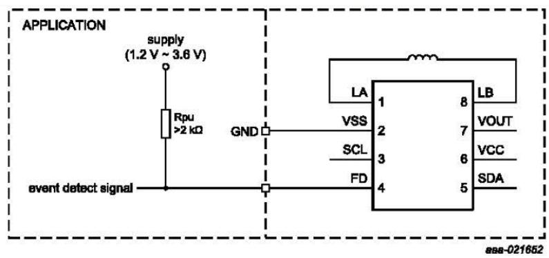  
图 12. FD 引脚示例电路

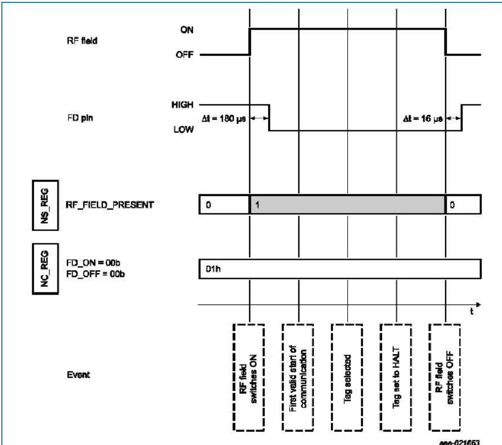  
图13. 配置为简单场检测时的场检测特性图示说明

NTAG I²C plus: NFC Forum T2T 带有 I²C 接口、密码保护和能量采集功能

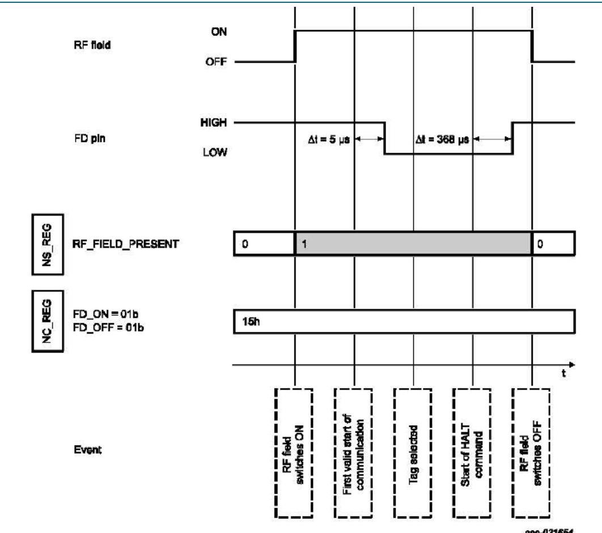  
图14. 配置为检测第一个有效通信的开始时的场检测特性图示说明

NTAG I²C plus: NFC Forum T2T 带有 I²C 接口、密码保护和能量采集功能

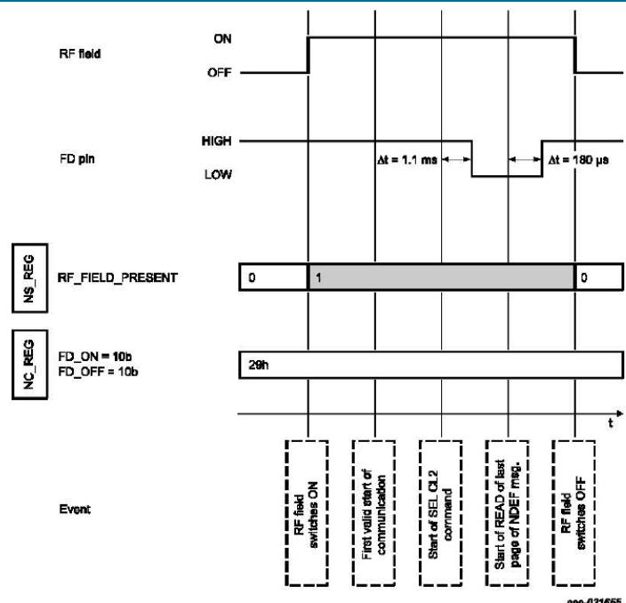  
图15. 配置为检测标签选择时的场检测特性图示说明

## 8.5 看门狗定时器

为了允许 I²C 接口执行所有需要的命令(READ, WRITE, …)，存储器访问保持锁定到 I²C 接口，直到寄存器 I2C\_LOCKED 被主机清零为止（参见表 14）。

但是，为了避免存储器长时间“锁定”在 I2C 上，可以编制一个看门狗定时器程序，用来从标签中解锁 I2C 主机，以便 NFC 设备在一段时间的不活动状态后可以访问标签。该事件不会直接通知主机本身，但会对 NS\_REG 寄存器进行相应地更新（寄存器位 I2C\_LOCKED 将被清零，参见表 14）。

默认值设置为 20 ms (848h)，但看门狗定时器可以在 0001h (9.43 μs) 到 FFFFh (617.995 ms) 间自由设置。当 NTAG I²C 和 I²C 接口之间开始通信时，定时器开始计时。如果在看门狗定时器超时后，与 I²C 的通信仍在继续，则通信将继续进行到通信完成为止。然后，状态寄存器 I2C\_LOCKED 将立即被清零。

如果与 I2C 接口的通信在定时器结束之前完成，并且主机未清零状态寄存器 I2C\_LOCKED，则将在看门狗定时器结束时将其清零。

## NTAG I²C plus: NFC Forum T2T 带有 I²C 接口、密码保护和能量采集功能

看门狗定时器仅在 VCC 引脚供电时有效, 如果 NTAG I²C 未通过 VCC 供电或寄存器状态 I2C\_LOCKED 设置为 0 且 RF\_LOCKED 设置为 1b, 将复位并停止看门狗定时器。

## 8.6 能量采集

NTAG I²C plus 具有从 NFC 设备的 NFC 场中采集能量并提供给外部低功耗设备的功能（如图 16 所示）。所有给定值均为典型值。更多详细信息请参阅参考文献 7。

能量采集产生的电压和电流取决于各个不同的参数，例如 NFC 场的强度、标签天线尺寸或与 NFC 设备的距离。用于 NFC 手机时，NTAG I²C plus 通常在 VOUT 引脚上提供 5 mA 电流、2 V 电压。

在能量采集模式下运行 NTAG I²C 需要一些防御措施:

\- 应在 VOUT 和 GND 之间靠近端子处完整连接一个电容(通常为 150 nF 至最大 220 nF)，以确保在调制期间或任何应用运行期间的电压不会低于 VCC 最小值。

\- 应限制 VOUT 上的启动负载电流，直到在 VOUT 上建立了足够的电压。

\- 如果 NTAG I²C 也为 I²C 总线供电，则必须将 VCC 连接到 VOUT，并且当这些线路被 NTAG I²C 或 I²C 主机拉低时，SCL 和 SDA 引脚上的上拉电阻的大小必须足以控制 SCL 和 SDA 的反向电流。

\- 如果NTAG I²C也为场检测总线供电，则场检测线路上的上拉电阻的大小必须足以在NTAG I²C将其拉低时控制流入场检测引脚的反向电流。

\- 与 NTAG I²C 通信的 NFC 读卡器设备应该采用轮询周期，包括 NFC Forum Activity 规范中规定的 NFC 场关闭条件至少为 5.1 ms（请参阅参考文献 4 的第 6 章）。

注：增加 $V_{out}$ 上的输出电流会减小 NFC 通信范围。

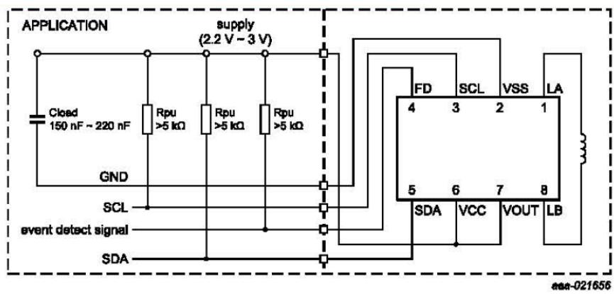  
图 16. 能量采集示例电路

NTAG I²C plus: NFC Forum T2T 带有 I²C 接口、密码保护和能量采集功能

## 8.7 密码验证

存储器对存储器可配置部分的写入和读/写访问权限可限制为正确的密码验证。32位密码(PWD)和16位密码确认(PACK)响应通常在标签个性化阶段编程到配置页中。

第 8.3.11 部分 中规定的 AUTHLIM 参数可用于限制失败验证尝试次数。

在NTAG I²C plus的初始状态下，密码保护通过AUTH0值FFh禁用。在此状态下，PWD和PACK自由可写。通过将AUTH0设置为可用存储器空间中的页地址，可限制对配置页和用户存储器任何部分的访问权限。该页地址首先受到保护。

有关所有保护机制的全面描述，请参阅参考文献9。

注: NTAG I²C plus 中提供的密码保护方法必须简单便捷, 可防止未经授权的存储器访问。如果需要更高级别的保护, 则可在应用层实施加密方法, 以提高系统的整体安全性。

## 8.7.1 PWD 和 PACK 的编程

32 位 PWD 和 16 位 PACK 需要编程到配置页中，请参阅第 8.3.11 部分。密码和密码确认是以 LSByte 优先方式写入。该字节顺序与 PWD\_AUTH 命令及其响应期间使用的字节顺序相同。

永远不会从存储器中读出 PWD 和 PACK 字节。不会从 NFC 和 I²C 两个接口传输任何有效读取命令的实际值，只会回复 00h 字节。

如果禁用了密码验证，则可以随时写入 PWD 和 PACK。

如果启用了密码验证，则只能在成功的 PWD\_AUTH 命令之后写入 PWD 和 PACK。

注：为了提高系统的整体安全性，建议使用 IC 的独立芯片参数分散密码和密码确认，它可以是 NTAG I²C plus 上可用的 7 字节 UID。

## 8.7.2 限制失败的验证尝试次数

为防止密码遭到暴力攻击，可利用 AUTHLIM 设置最大允许的失败密码验证尝试次数。通过将 AUTHLIM 设置为值 000b（这也是 NTAG I²C plus 的初始状态），可禁用此机制。

如果 AUTHLIM 不等于 000b，则内部会计算每次失败验证。该内部计数器达到 $2^{AUTHLIM}$ 后，任何其他失败的密码验证将导致指定访问模式下存储器中受保护的部分永久锁定。单独来说，无论提供的密码是否正确，后续的每次 PWD\_AUTH 均失败。

在达到失败密码验证尝试次数上限之前，只要密码验证成功，内部计数器便会复位为零。

NTAG I²C plus: NFC Forum T2T 带有 I²C 接口、密码保护和能量采集功能

## 8.7.3 配置段保护

配置页也可通过密码验证来保护。保护级别通过 NFC\_PROT 位定义。

通过将 AUTH0 字节（参见表 10）设置为可寻址存储器空间中的某个值，可启用保护。

## 8.8 独创签名

NTAG I²C plus 提供加密方式支持的独创检验。通过此特性，可以验证标签使用的 IC 是否由恩智浦半导体制造。该检验也可以在个性化标签上执行。

根据 ECDSA 算法，NTAG I²C plus 数字签名基于标准椭圆曲线加密(ECC)。标准算法和曲线的使用可确保在运行于 NFC 设备上的应用中轻松实现独创检验过程的软件集成，无需特殊硬件要求。

每个 NTAG I²C plus UID 使用恩智浦私钥签名，产生的 32 字节签名在 IC 生产过程中存储在 NTAG I²C plus 存储器的隐藏部分。

该签名可使用 READ\_SIG 命令进行检索，可通过使用恩智浦提供的相应 ECC 公钥，在 NFC 器件中进行验证。如果恩智浦公钥存在 NFC 器件中，完整的签名验证过程可离线执行。

如椭圆曲线加密标准 SEC 中定义的，要验证签名（例如，通过使用公共域加密库 OpenSSL），工具域参数应设置为 secp128r1（参考文献 10）。

有关如何检查签名值的详细信息，请参阅相应的应用笔记（参考文献6）。预计不仅将提供在线NTAG I²C plus独创验证方法，还将提供离线方法。

## 9 I²C 命令

有关 I²C 接口的详细信息，请参阅参考文献 3。

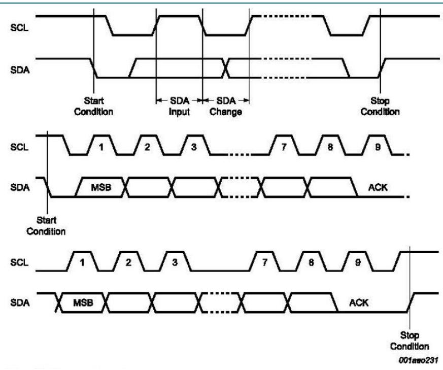  
图17. I²C总线协议

NTAG I²C plus 支持 I²C 协议。该协议概述请参见图 17。向总线上发送数据的任何设备都被定义为发射器，从总线读取数据的任何设备都被定义为接收器。控制数据传输的设备称为“总线主机”，其他的则称为“从机”。数据传输只能由总线主机发起，总线主机还将为同步提供串行时钟。NTAG I²C plus 在所有通信中始终是从机。

## 9.1 启动条件

启动由串行时钟(SCL)稳定在高电平状态时的串行数据(SDA)的下降沿识别。启动条件必须在任何数据传输命令之前发生。NTAG I²C plus 持续监控 SDA（在写入周期期间除外）和 SCL 的启动条件，除非发现启动条件，否则不会响应。

## 9.2 停止条件

停止由 SCL 稳定且驱动为高电平时的 SDA 上升沿识别。停止条件终止 NTAG I²C plus 和总线主机之间的通信。“写入”命令结束时的停止条件触发内部写入周期。

警告：在任何情况下，主机都应遵守在该停止条件后的 EEPROM 编程时间（约 4 ms）。如果主机过早发送下一条命令，可能会损坏存储器，因为这可能会终止正在进行的 EEPROM 写入周期。

NTAG I²C plus: NFC Forum T2T 带有 I²C 接口、密码保护和能量采集功能

## 9.3 I²C 软复位和 NFC 静音功能

利用 NFCS\_I2C\_RST\_ON\_OFF 位（参见表 13），NTAG I²C plus 可实现两个功能：I²C 子系统软复位和 NFC 静音（此时会禁用 NFC 解调器）。

I²C 软复位功能将 I²C 重复启动（期间无 I²C 停止）解译为执行 I²C 子系统软复位命令。该功能在严重的总线干扰可能导致 I²C 接口卡滞时很有用。该功能的一个缺点是，每个启动条件都必须用一个停止条件来终止，会降低通信速率。如果遗漏一个停止条件，I²C 接口将被清零，之前的通信（如果有的话）将丢失。因此，在使用此功能时，对于 READ/WRITE 应该在 MEMA 之后发送停止条件（参见图 18），对于 READ/WRITE 寄存器应该在 REGA 之后发送停止条件（参见图 19）。

NFC 静音功能可以禁用 NFC 接口。设置该功能后，不会再收到 NFC 命令，也不会对设置了 NFC 静音后尚未接收完整的命令作出回复。此功能允许标签 “消失”，即使它仍在读卡器字段中。NTAG I²C plus 将保持启用 NFC 静音时它所处的 ISO 状态，直到 NFC 静音被移除。

这两个功能组合在一个位中意味着 I²C 软复位只有在 NFC 静音时才有效。

## 9.4 确认位(ACK)

确认位用于指示成功的字节传输。无论总线发射器是总线主机还是从机设备，它在发送8位数据后释放串行数据(SDA)。在第9个时钟脉冲期间，接收器将串行数据(SDA)拉低以确认接收到第9个数据位。

## 9.5 数据输入

在数据输入过程中，NTAG I²C plus 在 SCL 上升沿采样 SDA。为了使器件正常工作，在 SCL 上升沿期间，SDA 必须保持稳定，并且只有当 SCL 驱动为低电平时，SDA 信号才必须改变。

## 9.6 寻址

要启动总线主机和NTAG I²C plus从机设备之间的通信，总线主机必须发起一个启动条件（参见第9.1部分）。在这一初始化后，总线主机发送7位设备地址，即下图中的从机地址(SA)。

第 8 位是读/写位(R/W)。对于 “读取” 操作，该位设置为 1b，对于 “写入” 操作，该位设置为 0b。

默认设备地址 55h 会导致默认 I²C 写入地址为 AAh 和默认 I²C 读取地址为 ABh。

在 I²C 方式下，I²C 地址可以通过模块 0 的字节 0 进行配置。返回 UID0（参见第 8.3.2 部分）时，读取该模块获得 04h。因此，建议使用 04h 作为 I²C 写入地址（02h 设备地址）。

注意：模块 0 的字节 0 用于配置设备地址。7 位设备地址需要在该字节的 7 个最高有效位中进行编程。在对设备地址编程时，最低有效位需要设置为 0b。例如，为了保持默认设备地址为 55h，需要将模块 0 的字节 0 设置为 AAh。

NTAG I²C plus: NFC Forum T2T 带有 I²C 接口、密码保护和能量采集功能

如果设备地址匹配，NTAG I²C plus 将在第 9 位时间周期内在 SDA 上给出确认。如果 NNTAG I²C plus 地址不匹配，它将从总线中取消选择自身并将寄存器 I2C\_LOCK 清零（参见表 12）。

表 15. I²C 的默认 NTAG I²C 地址

<table><tr><td></td><td colspan="7">设备/从机地址(SA)</td><td>R/W</td></tr><tr><td></td><td>b7</td><td>b6</td><td>b5</td><td>b4</td><td>b3</td><td>b2</td><td>b1</td><td>b0</td></tr><tr><td>值[1]</td><td>1</td><td>0</td><td>1</td><td>0</td><td>1</td><td>0</td><td>1</td><td>1/0</td></tr></table>

[1] 在 $I^{2}C$ 方式下，初始值可以改变

## 9.7 READ 和 WRITE 操作

NTAG I²C plus 的 I²C 地址（模块 0 的字节 0）只能通过 I²C 接口修改。两个接口都不能读取设备地址，从 NFC 或 I²C 接口到该字节的 READ 命令将返回 04h（UID 0：恩智浦半导体的制造商 ID，参见图 7）。

NTAG I²C plus: NFC Forum T2T 带有 I²C 接口、密码保护和能量采集功能  
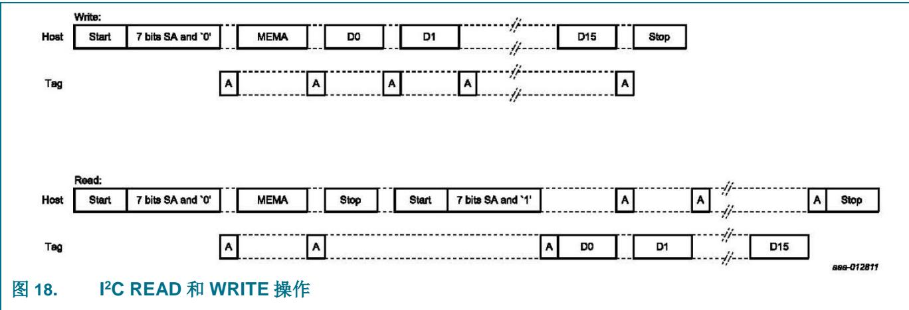

## NTAG I²C plus: NFC Forum T2T 带有 I²C 接口、密码保护和能量采集功能

READ 和 WRITE 操作始终处理 16 字节的读取或写入（1 个模块，参见表 6）。

对于 READ 操作（参见图 18），在启动条件之后，总线主机发送 NTAG I²C 从机地址代码（SA - 7 位）并将读/写位(R/W)设置为 0b。NTAG I²C plus 对此进行确认(A)，并等待一个地址字节(MEMA)，该字节应与目标读取寄存器模块（SRAM 或 EEPROM）的地址相对应。NTAG I²C plus 对有效地址字节响应一个确认(A)。接着发出一个停止条件。然后主机再发出一个启动条件，随后发送 NTAG I²C plus 从机地址并将读/写位设置为 1b。当 I²C\_CLOCK\_STR 设置为 0b 时，应在该启动条件之前保持至少 50 μs 的暂停。NTAG I²C plus 对此进行确认(A)，并发送读取数据的第 1 个字节(D0)。总线主机对此进行确认(A)，然后 NTAG I²C plus 将在每个字节后通过主机确认发送后续 15 个字节的存储器读取内容。在 NTAG I²C plus 传输完存储器数据的最后一个字节后，总线主机将对此进行确认并发出一个停止条件。

警告：READ 顺序应为原子顺序。需要完整执行上图中的序列，否则标签会处于未定义状态并无限延长时钟。

对于 WRITE 操作（参见图 18），在发生启动条件之后，总线主机发送 NTAG I²C plus 从机地址代码(SA-7位)并将读/写位(R/W)设置为 0b。NTAG I²C plus 对此进行确认(A)，并等待一个地址字节(MEMA)，该字节应与目标写入寄存器模块（SRAM 或 EEPROM）的地址相对应。NTAG I²C plus 对有效地址字节响应一个确认(A)。在 WRITE 操作时，总线主机开始以每 16 个字节(D0...D15)的方式传输需要写入规定地址的数据，并且每个字节后带有 NTAG I²C plus 确认(A)。完成 NTAG I²C plus 的最后一个字节确认后，总线主机发出一个停止条件。

警告：在任何情况下，主机都应遵守在该停止条件后的 EEPROM 编程时间（约 4 ms）。如果主机过早发送下一条命令，可能会损坏存储器，因为这会终止正在进行的 EEPROM 写入周期。

通过 READ 和 WRITE 操作可访问的存储器地址仅与 EEPROM 或 SRAM 相对应（对于 NTAG I²C plus 1k 为 00h 至 3Ah 或 F8h 至 FBh；对于 NTAG I²C plus 2k 为 00h 至 7Ah 或 F8h 至 FBh）。

NTAG I²C plus: NFC Forum T2T 带有 I²C 接口、密码保护和能量采集功能

## 9.8 WRITE 和 READ 寄存器操作

旨在修改或读取会话寄存器字节（参见表14）。NTAG I²C plus 要求进行 WRITE 和 READ 寄存器操作（参见图19）。

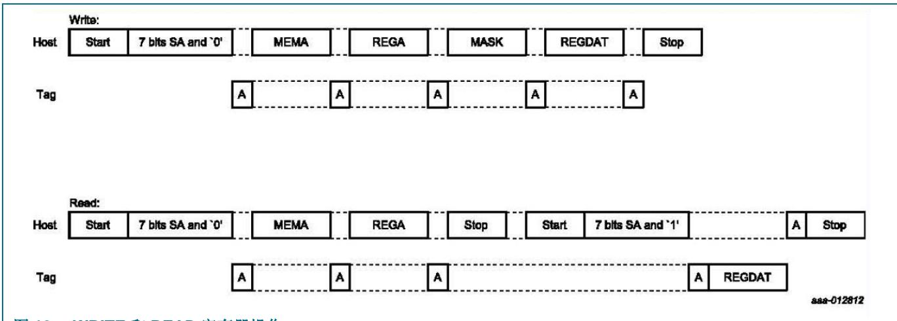  
图 19. WRITE 和 READ 寄存器操作

对于 READ 寄存器操作，在出现启动条件之后，总线主机发送 NTAG I²C plus 从机地址代码（SA - 7 位）并将读/写位(R/W)设置为 0b。NTAG I²C plus 对此进行确认(A)，并等待一个地址字节(MEMA)，该字节与会话寄存器字节(FEh)内存储器模块的地址相对应。NTAG I²C plus 对地址字节响应一个确认(A)。接着总线主机发出一个寄存器地址(REGA)，它与模块 FEh (00h, 01h... to 07h)内的目标字节地址相对应，随后等待停止条件。

然后总线主机再发出一个启动条件，随后发送 NTAG I²C plus 的从机地址并将读/写位设置为 1b。NTAG I²C plus 对此进行确认(A)，并在模块 FEh 内发送会话寄存器数据 (REGDAT) 的所选字节。总线主机对此进行确认并发出一个停止条件。

警告：READ 顺序应为原子顺序。需要完整执行上图中的序列，否则标签会处于未定义状态并无限延长时钟。

对于 WRITE 寄存器操作，在启动条件之后，总线主机发送 NTAG I²C plus 从机地址代码（SA - 7 位）并将读/写位(R/W)设置为 0b。NTAG I²C plus 对此进行确认(A)，并等待一个地址字节(MEMA)，该字节与会话寄存器字节(FEh)内的存储器模块的地址相对应。NTAG I²C plus 确认(A)之后，总线主机发出一个寄存器地址(REGA)，该地址与模块 FEh (00h, 01h...to 07h)内目标字节的地址相对应。在 NTAG I²C plus 确认(A)之后，总线主机发出一个 MASK 字节，该字节具体定义哪些位需要在其对应位置以 1b 位值进行修改。在 NTAG I²C plus 确认(A)之后，总线主机传输需要写入的新的寄存器数据（1 个字节的 REGDAT）。NTAG I²C plus 对此进行确认(A)，并且总线主机发出一个停止条件。

## 10 NFC 命令

NTAG 激活遵从 ISO/IEC 14443-3 A 类规范。选择 NTAG I²C plus 后，既可以使用 ISO/IEC 14443 HALT 命令将其禁用，也可以执行 NTAG 命令（如 READ\_SIG、PWD\_AUTH、SECTOR\_SELECT、READ 或 WRITE）。有关卡激活的更多详细信息，请参阅参考文献 2。

## 10.1 NTAG I²C plus 命令概述

NTAG I²C plus 的所有可用命令参见表 16。

表 16. 命令概述

<table><tr><td>命令[1]</td><td>ISO/IEC 14443</td><td>NFC FORUM</td><td>命令代码(十六进制)</td></tr><tr><td>Request</td><td>REQA</td><td>SENS_REQ</td><td>26h (7位)</td></tr><tr><td>Wake-up</td><td>WUPA</td><td>ALL_REQ</td><td>52h (7位)</td></tr><tr><td>Anticollision CL1</td><td>Anticollision CL1</td><td>SDD_REQ CL1</td><td>93h 20h</td></tr><tr><td>Select CL1</td><td>Select CL1</td><td>SEL_REQ CL1</td><td>93h 70h</td></tr><tr><td>Anticollision CL2</td><td>Anticollision CL2</td><td>SDD_REQ CL2</td><td>95h 20h</td></tr><tr><td>Select CL2</td><td>Select CL2</td><td>SEL_REQ CL2</td><td>95h 70h</td></tr><tr><td>Halt</td><td>HLTA</td><td>SLP_REQ</td><td>50h 00h</td></tr><tr><td>GET_VERSION</td><td>-</td><td>-</td><td>60h</td></tr><tr><td>READ</td><td>-</td><td>READ</td><td>30h</td></tr><tr><td>FAST_READ</td><td>-</td><td>-</td><td>3Ah</td></tr><tr><td>WRITE</td><td>-</td><td>WRITE</td><td>A2h</td></tr><tr><td>FAST_WRITE</td><td>-</td><td>-</td><td>A6h</td></tr><tr><td>SECTOR_SELECT</td><td>-</td><td>SECTOR_SELECT</td><td>C2h</td></tr><tr><td>PWD_AUTH</td><td>-</td><td>-</td><td>1Bh</td></tr><tr><td>READ_SIG</td><td>-</td><td>-</td><td>3Ch</td></tr></table>

[1] 除非另有说明，否则所有命令使用参考文献1中所述的编码和帧。

## 10.2 时序

本文档所述的命令和响应时序未按比例绘制，且数值四舍五入至 $1 \mu s$ 。

所有给定的命令和响应时间指的是数据帧，包括通信的开始和通信的结束。它们不包括编码时间（如 Miller 脉冲）。NFC 设备数据帧包含通信的开始（1 个 “起始位”）和通信的结束（1 个逻辑 0+1 位长度的未调制载波）。NFC 标签数据帧包含通信的开始（1 个 “起始位”）和通信的结束（1 位长度的无副载波）。

根据参考文献 1 规定命令响应时间的最小值和最大值。从 NFC 标签到 NFC 设备的帧延迟时间最小值为 86.43 μs。命令响应时间最大值规定为超时值。根据具体命令，命令响应的 TACK 规定值定义为 NFC 设备到 NFC 标签帧延迟时间。无论是 4 位 ACK 的规定值还是数据帧的规定值，都是如此。

所有时序可根据 ISO/IEC 14443-3 的帧规范进行测量（如图 20 中的帧延迟时间所示）。更多详细信息请参阅参考文献 2。

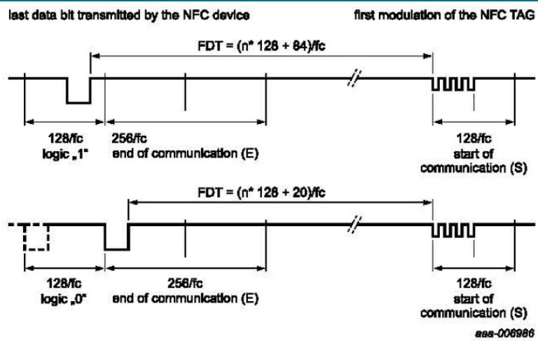  
图20. 帧延迟时间（从NFC设备到NFC标签）， $\mathsf{T}_{\mathsf{ACK}}$ 和 $\mathsf{T}_{\mathsf{NAK}}$

注：由于命令代码的影响，测量的时序通常不包括（一部分）通信的结束。在比较规定时间和测量时间时，需要考虑这一因素。

## 10.3 NTAG ACK 和 NAK

NTAG I²C plus 采用一个 4 位 ACK/NAK（如表 17 所示）。

表 17. ACK 和 NAK 值

<table><tr><td>代码(4位)</td><td>ACK/NAK</td></tr><tr><td>Ah</td><td>确认(ACK)</td></tr><tr><td>0h</td><td>NAK,表示无效自变量(例如,无效页地址或错误密码)</td></tr><tr><td>1h</td><td>NAK,表示奇偶校验或CRC错误</td></tr><tr><td>3h</td><td>NAK,表示仲裁器锁定到 $I^{2}C$ </td></tr><tr><td>4h</td><td>失败PWD_AUTH命令的次数达到限值</td></tr><tr><td>7h</td><td>NAK,表示EEPROM写入错误</td></tr></table>

## 10.4 ATQA 和 SAK 响应

NTAG I²C plus 向 REQA 或 WUPA 命令回复 ATQA 值(如表 18 所示)。它向 Select CL2 命令回复 SAK 值（如表 19 所示）。2 字节 ATQA 值采用最低有效位优先(44h)的方式传输。

NTAG I²C plus: NFC Forum T2T 带有 I²C 接口、密码保护和能量采集功能

表 18. NTAG I²C plus 的 ATQA 响应

<table><tr><td></td><td></td><td colspan="16">位数</td></tr><tr><td>销售类型</td><td>十六进制值</td><td>15</td><td>14</td><td>13</td><td>12</td><td>11</td><td>10</td><td>9</td><td>8</td><td>7</td><td>6</td><td>5</td><td>4</td><td>3</td><td>2</td><td>1</td><td>0</td></tr><tr><td>NTAG I²C plus</td><td>00 44h</td><td>0</td><td>0</td><td>0</td><td>0</td><td>0</td><td>0</td><td>0</td><td>0</td><td>0</td><td>1</td><td>0</td><td>0</td><td>0</td><td>1</td><td>0</td><td>0</td></tr></table>

表 19. NTAG I²C plus 的 SAK 响应

<table><tr><td></td><td></td><td colspan="8">位数</td></tr><tr><td>销售类型</td><td>十六进制值</td><td>7</td><td>6</td><td>5</td><td>4</td><td>3</td><td>2</td><td>1</td><td>0</td></tr><tr><td>NTAG I2C plus</td><td>00h</td><td>0</td><td>0</td><td>0</td><td>0</td><td>0</td><td>0</td><td>0</td><td>0</td></tr></table>

注：位 7 和 6 的 ATQA 代码表示按照 ISO/IEC 14443 的 UID 大小。

注：ISO/IEC 14443 规范中的位标号从位 1 开始作为最低有效位。

## 10.5 GET\_VERSION

GET\_VERSION 命令用来检索信息，包括 NTAG 系列、产品版本、存储大小和其他识别特定 NTAG I²C plus 所需的产品数据。

该命令还可用于其他 NTAG 产品，以便通过一种常见方法跨平台和演进步骤识别产品。

GET\_VERSION 命令无自变量，它返回特定 NTAG I²C plus 类型的版本信息。命令结构如图 21 和表 20 所示。

表 21 显示了所需时序。  
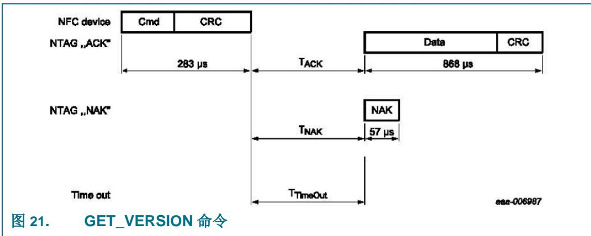

表 20. GET\_VERSION 命令

<table><tr><td>名称</td><td>代码</td><td>说明</td><td>长度</td></tr><tr><td>Cmd</td><td>60h</td><td>获取产品版本</td><td>1 字节</td></tr><tr><td>CRC</td><td>-</td><td>CRC(根据参考文献 1)</td><td>2 字节</td></tr></table>

NTAG I²C plus: NFC Forum T2T 带有 I²C 接口、密码保护和能量采集功能

<table><tr><td>名称</td><td>代码</td><td>说明</td><td>长度</td></tr><tr><td>数据</td><td>-</td><td>产品版本信息</td><td>8字节</td></tr><tr><td>NAK</td><td>参见表17</td><td>参见第10.3部分</td><td>4位</td></tr></table>

表 21. GET\_VERSION 时序  
这些时间不包括 NFC 设备通信的结束。

<table><tr><td></td><td> $T_{ACK/NAK}$ 最小值</td><td> $T_{ACK/NAK}$ 最大值</td><td> $T_{TimeOut}$ </td></tr><tr><td>GET_VERSION</td><td>n=9[1]</td><td> $T_{TimeOut}$ </td><td>5 ms</td></tr></table>

[1] 请参阅第 10.2 部分的 “时序”。

表 22. NTAG I²C plus 的 GET\_VERSION 响应

<table><tr><td>字节编号</td><td>说明</td><td>NTAG I2C plus 1k</td><td>NTAG I2C plus 2k</td><td>解释</td></tr><tr><td>0</td><td>固定标头</td><td>00h</td><td>00h</td><td></td></tr><tr><td>1</td><td>供应商 ID</td><td>04h</td><td>04h</td><td>恩智浦半导体</td></tr><tr><td>2</td><td>产品类型</td><td>04h</td><td>04h</td><td>NTAG</td></tr><tr><td>3</td><td>产品子类型</td><td>05h</td><td>05h</td><td>50 pF I2C,场检测</td></tr><tr><td>4</td><td>主要产品版本</td><td>02h</td><td>02h</td><td>2</td></tr><tr><td>5</td><td>次要产品版本</td><td>02h</td><td>02h</td><td>V2</td></tr><tr><td>6</td><td>存储大小</td><td>13h</td><td>15h</td><td>参见以下信息</td></tr><tr><td>7</td><td>协议类型</td><td>03h</td><td>03h</td><td>符合 ISO/IEC 14443-3 标准</td></tr></table>

存储大小字节的 7 位最高有效位被解析为无符号的整数值 n。因此，它将总可用用户存储器大小编码为 $2^{n}$ 。如果最低有效位是 0b，用户存储器大小正是 $2^{n}$ 。如果最低有效位是 1b，用户存储器大小介于 $2^{n}$ 和 $2^{n+1}$ 之间。

## 10.6 READ\_SIG

READ\_SIG 命令返回 IC 特定的 32 字节 ECC 签名, 以便验证恩智浦半导体作为硅片厂商。签名在生产芯片时编程, 之后无法更改。命令结构如图 24 和表 27 所示。

表 28 显示了所需时序。

NTAG I²C plus: NFC Forum T2T 带有 I²C 接口、密码保护和能量采集功能

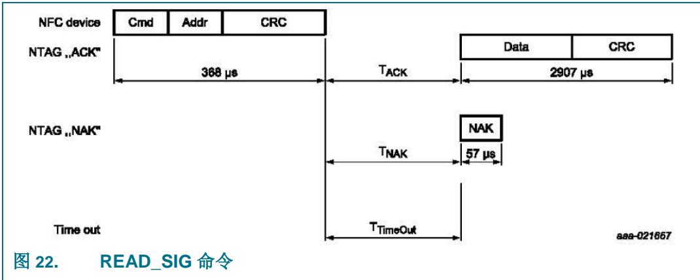

表 23. READ\_SIG 命令

<table><tr><td>名称</td><td>代码</td><td>说明</td><td>长度</td></tr><tr><td>Cmd</td><td>3Ch</td><td>读取 ECC 签名</td><td>1 字节</td></tr><tr><td>Addr</td><td>00h</td><td>RFU, 设置为 00h</td><td>1 字节</td></tr><tr><td>CRC</td><td>-</td><td>CRC(根据参考文献 1)</td><td>2 字节</td></tr><tr><td>签字</td><td>-</td><td>ECC 签名</td><td>32 字节</td></tr><tr><td>NAK</td><td>参见表 17</td><td>参见第 10.3 部分</td><td>4 位</td></tr></table>

表 24. READ\_SIG 时间  
这些时间不包括 NFC 设备通信的结束。

<table><tr><td></td><td> $T_{ACK/NAK}$ 最小值</td><td> $T_{ACK/NAK}$ 最大值</td><td> $T_{TimeOut}$ </td></tr><tr><td>READ_SIG</td><td>n=9[1]</td><td> $T_{TimeOut}$ </td><td>5 ms</td></tr></table>

[1] 请参阅第 10.2 部分的 “时序”。

有关如何检查签名值的详细信息，请参阅相应的应用笔记。预计将提供在线和离线的NTAG I²C plus独创验证方法。

## 10.7 PWD\_AUTH

只有在使用 PWD\_AUTH 命令成功完成密码验证后，才能访问受保护的存储器区域。AUTH0 配置字节定义了受保护区域的开始。它规定了密码机制保护的第 1 页。保护级别可使用 NFC\_PROT 位配置为写入保护或读/写保护。PWD\_AUTH 命令将密码视为参数，如果成功，会返回密码验证确认，PACK。通过将 AUTHLIM 配置位设为大于 000b 的值，可限制失败密码验证次数。随后计数每次失败验证。达到失败尝试次数限制(2 $^{AUTHLIM}$ )后，不能再对受保护区域进行存储器写入访问或任何存储器访问（在 NFC\_PROT 中指定）。PWD\_AUTH 命令如图 23 和表 25 所示。

表 26 显示了所需时序。

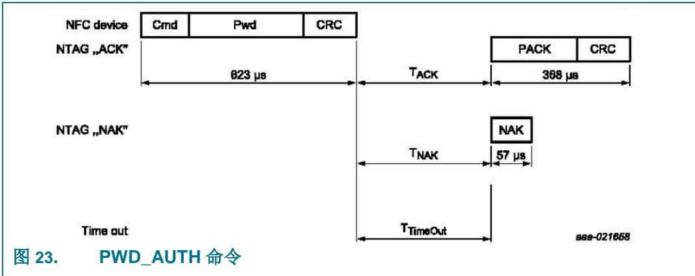

表 25. PWD\_AUTH 命令

<table><tr><td>名称</td><td>代码</td><td>说明</td><td>长度</td></tr><tr><td>Cmd</td><td>1Bh</td><td>密码验证</td><td>1字节</td></tr><tr><td>Pwd</td><td>-</td><td>密码</td><td>4字节</td></tr><tr><td>CRC</td><td>-</td><td>CRC(根据参考文献2)</td><td>2字节</td></tr><tr><td>PACK</td><td>-</td><td>密码验证确认</td><td>2字节</td></tr><tr><td>NAK</td><td>参见表17</td><td>参见第10.3部分</td><td>4位</td></tr></table>

表 26. PWD\_AUTH 时序  
这些时间不包括 NFC 设备通信的结束。

<table><tr><td></td><td> $T_{ACK/NAK}$  最小值</td><td> $T_{ACK/NAK}$  最大值</td><td> $T_{TimeOut}$ </td></tr><tr><td>PWD_AUTH</td><td>n=9[1]</td><td> $T_{TimeOut}$ </td><td>5 ms</td></tr></table>

[1] 请参阅第 10.2 部分的 “时序”。

注：强烈建议在每个标签生成时从其交付状态起就更改并分散密码和 PACK。

## 10.8 READ

READ 命令需要起始页地址，并返回四个 NTAG I²C plus 页的 16 个字节。例如，如果地址(Addr)是 03h，则返回 03h、04h、05h、06h 页。如果 READ 命令地址靠近可访问存储器区域末端，则特殊条件适用。有关这些情形和命令结构的更多详情，请参见图 24 和表 27。

表 28 显示了所需时序。

NTAG I²C plus: NFC Forum T2T 带有 I²C 接口、密码保护和能量采集功能

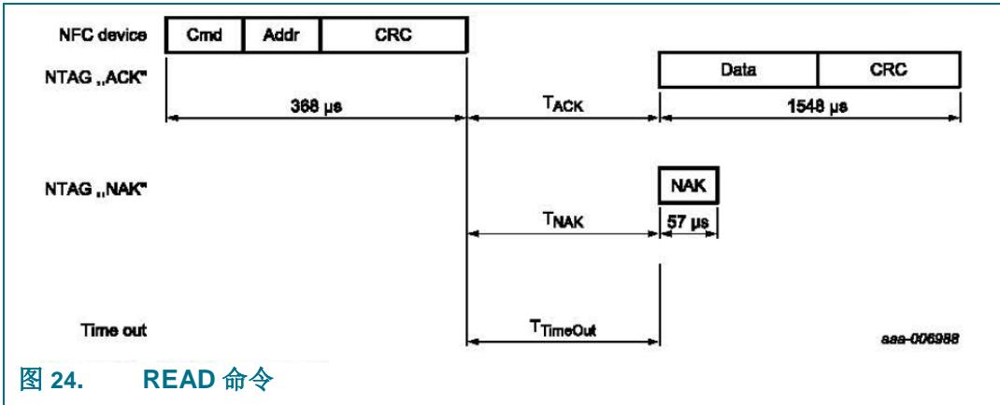

表 27. READ 命令

<table><tr><td>名称</td><td>代码</td><td>说明</td><td>长度</td></tr><tr><td>Cmd</td><td>30h</td><td>读取四个页面</td><td>1字节</td></tr><tr><td>Addr</td><td>-</td><td>起始页地址</td><td>1字节</td></tr><tr><td>CRC</td><td>-</td><td>CRC(根据参考文献1)</td><td>2字节</td></tr><tr><td>数据</td><td>-</td><td>已寻址页的数据内容</td><td>16字节</td></tr><tr><td>NAK</td><td>参见表17</td><td>参见第10.3部分</td><td>4位</td></tr></table>

表 28. READ 时间  
这些时间不包括 NFC 设备通信的结束。

<table><tr><td></td><td> $T_{ACK/NAK}$ 最小值</td><td> $T_{ACK/NAK}$ 最大值</td><td> $T_{TimeOut}$ </td></tr><tr><td>READ</td><td>n=9[1]</td><td> $T_{TimeOut}$ </td><td>5 ms</td></tr></table>

[1] 请参阅第 10.2 部分的 “时序”。

在 NTAG I²C plus 的初始状态下，所有存储器页允许作为 READ 命令的 Addr 参数。

\- 页地址从 00h 到 E9h 和页 ECh 和 EDh（适用于 NTAG I²C plus 1k 和 2k）

\- 页地址从 00h 到 FFh（扇区 1）（仅适用于 NTAG I²C plus 2k）

\- SRAM 缓冲区地址（启用直通模式时）

超出限制寻址起始存储器页会产生来自 NTAG I²C plus 的 NAK 响应。

如果 READ 命令寻址从有效存储器区域开始，但扩展到无效存储器区域，则无效存储器区域的内容将报告为 00h。

## 10.9 FAST\_READ

FAST\_READ 命令需要起始页地址和结束页地址，并返回已寻址页的所有 n\*4 字节。例如，如果起始地址为 03h，结束地址为 07h，则返回页 03h、04h、05h、06h 和 07h。

有关这些情况和命令结构的更多详情，请参见图 25 和表 29。

表 30 显示了所需时序。  
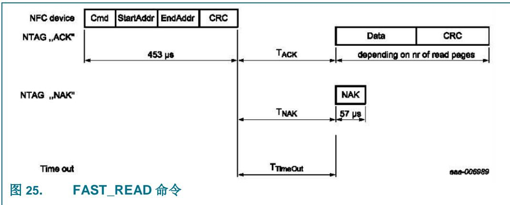

表 29. FAST\_READ 命令

<table><tr><td>名称</td><td>代码</td><td>说明</td><td>长度</td></tr><tr><td>Cmd</td><td>3Ah</td><td>读取多个页</td><td>1字节</td></tr><tr><td>StartAddr</td><td>-</td><td>起始页地址</td><td>1字节</td></tr><tr><td>EndAddr</td><td>-</td><td>结束页地址</td><td>1字节</td></tr><tr><td>CRC</td><td>-</td><td>CRC(根据参考文献1)</td><td>2字节</td></tr><tr><td>数据</td><td>-</td><td>已寻址页的数据内容</td><td>n*4字节</td></tr><tr><td>NAK</td><td>参见表17</td><td>参见第10.3部分</td><td>4位</td></tr></table>

表 30. FAST\_READ 时间  
这些时间不包括 NFC 设备通信的结束。

<table><tr><td></td><td> $T_{ACK/NAK}$ 最小值</td><td> $T_{ACK/NAK}$ 最大值</td><td> $T_{TimeOut}$ </td></tr><tr><td>FAST_READ</td><td>n=9[1]</td><td> $T_{TimeOut}$ </td><td>5 ms</td></tr></table>

[1] 请参阅第 10.2 部分的 “时序”。

在 NTAG I²C plus 的初始状态下，所有存储器页允许作为 FAST\_READ 命令的 StartAdd 参数。

\- 页地址从 00h 到 E9h 和页 ECh 和 EDh（适用于 NTAG I²C plus 1k 和 2k）

\- 页地址从 00h 到 FFh（扇区 1）（仅适用于 NTAG I²C plus 2k）

\- SRAM 缓冲区地址（启用直通模式时）

如果起始已寻址页(StartAddr)位于可访问区域外，则 NTAG I²C plus 回复 NAK。

如果 FAST\_READ 命令从有效存储器区域开始，但扩展到无效存储器区域，则无效存储器区域的内容将报告为 00h。

EndAddr 参数必须等于或高于 StartAddr。

NTAG I²C plus: NFC Forum T2T 带有 I²C 接口、密码保护和能量采集功能

注：FAST\_READ 命令能够用单个命令读出一个扇区的全部存储器。尽管如此，NFC 器件的接收缓冲区必须能够处理请求的数据量，因为没可能进行链接。

## 10.10 WRITE

WRITE 命令需要页地址，并将 4 字节数据写入已寻址的 NTAG I²C plus 页。WRITE 命令如图 26 和表 31 所示。

表 32 显示了所需时序。  
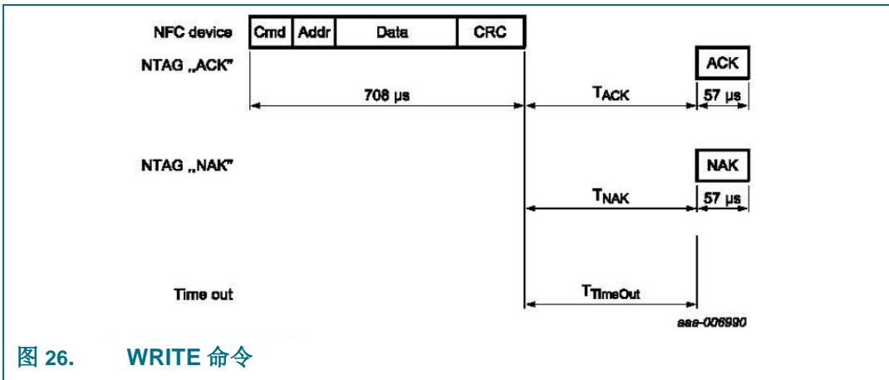

表 31. WRITE 命令

<table><tr><td>名称</td><td>代码</td><td>说明</td><td>长度</td></tr><tr><td>Cmd</td><td>A2h</td><td>写入一页</td><td>1 字节</td></tr><tr><td>Addr</td><td>-</td><td>页地址</td><td>1 字节</td></tr><tr><td>数据</td><td>-</td><td>数据</td><td>4 字节</td></tr><tr><td>CRC</td><td>-</td><td>CRC(根据参考文献 1)</td><td>2 字节</td></tr><tr><td>NAK</td><td>参见表 17</td><td>参见第 10.3 部分</td><td>4 位</td></tr></table>

表 32. WRITE 时序  
这些时间不包括 NFC 设备通信的结束。

<table><tr><td></td><td> $T_{ACK/NAK}$ 最小值</td><td> $T_{ACK/NAK}$ 最大值</td><td> $T_{TimeOut}$ </td></tr><tr><td>WRITE</td><td>n=9[1]</td><td> $T_{TimeOut}$ </td><td>5 ms</td></tr></table>

[1] 请参阅第 10.2 部分的 “时序”。

在 NTAG I²C plus 的初始状态下，以下存储器页是 WRITE 命令的有效 Addr 参数。

\- 页地址从 02h 到 E9h（扇区 0）（适用于 NTAG I²C plus 1k 和 2k）

\- 页地址从 00h 到 FFh（扇区 1）（适用于 NTAG I²C plus 2k）

\- SRAM 缓冲区地址（启用直通模式时的）

超出限制寻址存储器页会产生来自 NTAG I²C plus 的 NAK 响应。

锁定以避免写入的页无法使用任何写入命令进行重新编程。锁定机制包括静态和动态锁定位，以及配置页的锁定。

## 10.11 FAST\_WRITE

FAST\_WRITE 允许在直通模式下将处于 ACTIVE 状态的数据写入完整的 SRAM（64 字节），它需要起始模块地址 (F0h)、结束地址 (FFh)，并将 64 字节的数据写入 NTAG I²C plus SRAM。FAST\_WRITE 命令如图 26 和表 31 所示。

警告: 数据直接写入 SRAM。如果在传输结束时接收到的 CRC 不正确，并且响应为 NAK，则接收到的（损坏）数据仍在 SRAM 中。因此，建议在使用 SRAM 时，在上层实施一个确保数据完整性的协议（例如，在有效载荷的末端包括自身的 CRC）。

表 32 显示了所需时序。  
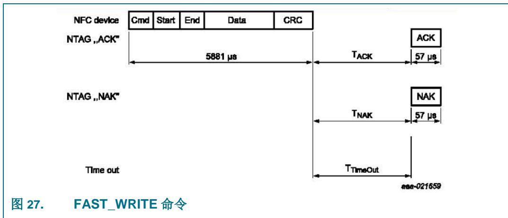

表 33. FAST\_WRITE 命令

<table><tr><td>名称</td><td>代码</td><td>说明</td><td>长度</td></tr><tr><td>Cmd</td><td>A6h</td><td>写入完整的 SRAM</td><td>1 字节</td></tr><tr><td>START_ADDR</td><td>F0h</td><td>在直通模式下的起始 SRAM</td><td>1 字节</td></tr><tr><td>END_ADDR</td><td>FFh</td><td>在直通模式下的结束 SRAM</td><td>1 字节</td></tr><tr><td>数据</td><td>-</td><td>数据</td><td>64 字节</td></tr><tr><td>-</td><td>CRC</td><td>CRC(根据参考文献 1)</td><td>2 字节</td></tr><tr><td>ACK</td><td>参见表 17</td><td>参见第 10.3 部分</td><td>4 位</td></tr><tr><td>NAK</td><td>参见表 17</td><td>参见第 10.3 部分</td><td>4 位</td></tr></table>

NTAG I²C plus: NFC Forum T2T 带有 I²C 接口、密码保护和能量采集功能

表 34. FAST\_READ 时序  
这些时间不包括 NFC 设备通信的结束。

<table><tr><td></td><td> $T_{ACK/NAK}$  最小值</td><td> $T_{ACK/NAK}$  最大值</td><td> $T_{TimeOut}$ </td></tr><tr><td>FAST_WRITE</td><td>n=9[1]</td><td> $T_{TimeOut}$ </td><td>5 ms</td></tr></table>

[1] 请参阅第 10.2 部分的 “时序”。

## 10.12 扇区选择

SECTOR SELECT 命令由两个命令包组成：第一个命令包是扇区选择命令(C2h)、FFh 和 CRC。在收到标签的 ACK 应答后，第二个命令包需要发出要访问的相关扇区的地址和 3 字节 RFU。

为了成功地访问所请求的存储器扇区，标签应发出一个被动 ACK，它在第二个命令集的 CRC 之后发送 NO REPLY，为时超过 1 ms。

SECTOR SELECT 命令如图 28 和表 35 所示。

表 36 显示了所需时序。  
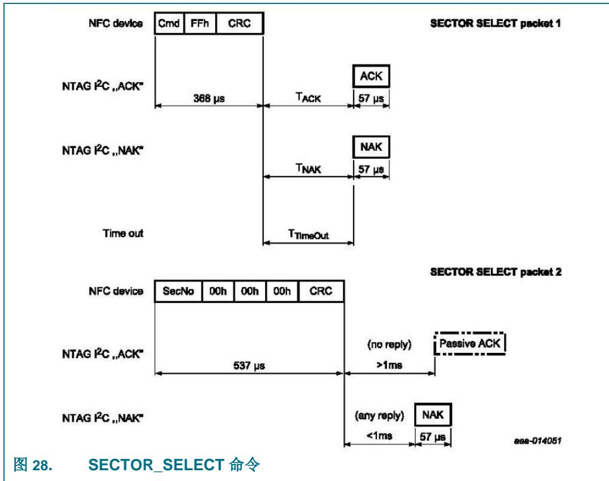

表 35. SECTOR\_SELECT 命令

<table><tr><td>名称</td><td>代码</td><td>说明</td><td>长度</td></tr><tr><td>Cmd</td><td>C2h</td><td>扇区选择</td><td>1 字节</td></tr></table>

## NTAG I²C plus: NFC Forum T2T 带有 I²C 接口、密码保护和能量采集功能

<table><tr><td>名称</td><td>代码</td><td>说明</td><td>长度</td></tr><tr><td>FFh</td><td>-</td><td></td><td>1字节</td></tr><tr><td>CRC</td><td>-</td><td>CRC(根据参考文献1)</td><td>2字节</td></tr><tr><td>SecNo</td><td>-</td><td>要选择的存储器扇区(00h - FEh)</td><td>1字节</td></tr><tr><td>NAK</td><td>参见表17</td><td>参见第10.3部分</td><td>4位</td></tr></table>

## 表 36. SECTOR\_SELECT 时序

这些时间不包括 NFC 设备通信的结束。

<table><tr><td></td><td> $T_{ACK/NAK}$ 最小值</td><td> $T_{ACK/NAK}$ 最大值</td><td> $T_{TimeOut}$ </td></tr><tr><td>SECTOR_SELECT</td><td>n=9[1]</td><td> $T_{TimeOut}$ </td><td>5 ms</td></tr></table>

[1] 请参阅第 10.2 部分的 “时序”。

## 11 NFC 和 I²C 接口之间的通信与仲裁

如果两个接口都由各自的电源供电，只有一个接口将根据 “先到先得” 的原则可以访问存储器。

在 NS\_REG 中，I2C\_LOCKED 和 RF\_LOCKED 两个状态位反映了 NTAG I²C plus 存储器访问的状态，并指示哪个接口正在锁定存储器访问。上电时，两个位均为 0b，将仲裁设为空闲模式。

在仲裁器锁定到 I²C 接口的情况下，NFC 设备仍然可以读取会话寄存器。如果 NFC 状态机处于 ACTIVE 状态，只允许 SECTOR SELECT 命令。而任何其他需要 EEPROM 访问的命令（如 READ 或 WRITE）都被作为非法命令处理，并回复一个 NAK 值。

在存储器访问锁定到 NFC 接口的情况下，I2C 主机仍然可以通过发出 “寄存器 READ/WRITE” 命令来访问会话寄存器。所有其他读取或写入命令将向 I2C 主机回复 NACK。

## 11.1 直通模式未激活

PTHRU\_ON\_OFF = 0b（参见表14）表示非直通模式。

## 11.1.1 I²C 接口访问

如果标签处于 IDLE 或 HALT 状态（POR 或 HALT 命令后的 NFC 状态），并且在 START 条件下接收到 NTAG I²C plus 的正确 I²C 从机地址，I2C\_LOCKED 位将自动设置为 1b。如果 I2C\_LOCKED = 1b，则 I²C 接口可访问标签存储器，此时标签将以 NACK 响应 NFC 接口上的任何存储器 READ/WRITE 命令，而非读取会话寄存器字节。

I2C\_LOCKED 必须在 I²C 序列的末端复位为 0b，或者在看门狗定时器结束时自动清零。

## 11.1.2 NFC 接口访问

只有当 I2C\_LOCKED 设置为 0b 时，仲裁才允许 NFC 接口读写访问 EEPROM。

如果标签在 NFC 接口上收到有效命令（EEPROM 访问命令），则会自动将 RF\_LOCKED 设置为 1b。如果 RF\_LOCKED = 1b，则标签锁定到 NFC 接口，不会响应来自 I²C 接口的任何命令，READ 寄存器命令除外（见表 14）。

在下列情况下，RF\_LOCKED 自动设置为 0b

\- POR 时或 NFC 场关闭时

\- 如果在 NFC 接口上使用 HALT 命令将标记设置为 HALT 状态

\- 如果 NFC 接口上的存储器访问命令执行完毕

当 NFC 接口已读取 LAST\_NDEF\_BLOCK 中指定的 NDEF 消息的最后一页（参见表 13 和表 14）时，NDEF\_DATA\_READ 位（位于寄存器 NS\_REG 中，参见表 14）设置为 1b，并向 I²C 接口发出指示，例如，可以写入新的 NDEF 数据。

NTAG I²C plus: NFC Forum T2T 带有 I²C 接口、密码保护和能量采集功能

## 11.2 启动 SRAM 缓冲区映射和存储器镜像

当 SRAM\_MIRROR\_ON\_OFF=1b 时，启用 SRAM 缓冲区镜像。此模式不能和直通模式混合使用（参见第 11.3 部分）。

启用存储器镜像时，SRAM 从 NFC 接口映射到用户存储器中，使用在 SRAM\_MIRROR\_BLOCK 字节中规定的 SRAM 镜像较低页地址（表 13 和表 14）。有关 SRAM\_MIRROR\_BLOCK 设置为 01h 时此 SRAM 存储器映射的示例，请参见表 37 (NTAG I²C plus 1k) 和表 38 (NTAG I²C plus 2k)。

映射 SRAM 的密码保护可以通过启用密码验证并将 SRAM\_PROT 位设置为 1b 来实现。

与密码保护相反，对于只读锁定，没有特定的 SRAM 锁定位。一旦用户 EEPROM 模块被静态和/或动态锁定位锁定为只读时，潜在的镜像 SRAM 模块也只读。

标签必须由 VCC 供电，此模式才能工作，因为如果没有 VCC，SRAM 将无法通过仅由 NFC 供电的方式访问。

应注意，将 SRAM 缓冲区映射到用户存储器时，一旦 NTAG I²C Plus 不再从 I²C 端供电，所有写入 SRAM 的数据都将丢失（因为 SRAM 为易失性存储器）。

表 37. NTAG I²C plus 1k 通过 NFC 接口的 SRAM 存储器寻址（SRAM\_MIRROR\_ON\_OFF 设置为 1b，SRAM\_MIRROR\_BLOCK 设置为 01h）的示例

<table><tr><td rowspan="2">扇区地址</td><td colspan="2">页地址</td><td colspan="4">页内的字节数</td><td rowspan="2">访问条件ACTIVE状态</td><td rowspan="2">访问条件AUTH.状态</td></tr><tr><td>十进制</td><td>十六进制</td><td>0</td><td>1</td><td>2</td><td>3</td></tr><tr><td rowspan="19">0</td><td>0</td><td>00h</td><td colspan="4">序列号(UID)</td><td colspan="2">READ</td></tr><tr><td>1</td><td>01h</td><td colspan="3">序列号(UID)</td><td>内部</td><td colspan="2">READ</td></tr><tr><td>2</td><td>02h</td><td colspan="2">内部</td><td colspan="2">静态锁定字节</td><td colspan="2">READ/R&amp;W</td></tr><tr><td>3</td><td>03h</td><td colspan="4">功能容器(CC)</td><td colspan="2">READ&amp;WRITE</td></tr><tr><td>4</td><td>04h</td><td rowspan="3" colspan="4">SRAM</td><td rowspan="3" colspan="2">READ&amp;WRITE</td></tr><tr><td>......</td><td>......</td></tr><tr><td>19</td><td>13h</td></tr><tr><td>......</td><td>......</td><td colspan="4">不受保护的用户存储器</td><td colspan="2">READ&amp;WRITE</td></tr><tr><td>AUTH0</td><td>AUTH0</td><td rowspan="3" colspan="4">受保护的用户存储器</td><td rowspan="3">READ</td><td rowspan="3">READ&amp;WRITE</td></tr><tr><td>......</td><td>......</td></tr><tr><td>225</td><td>E1h</td></tr><tr><td>226</td><td>E2h</td><td colspan="3">动态锁定字节</td><td>00h</td><td colspan="2">R&amp;W/READ</td></tr><tr><td>227</td><td>E3h</td><td>RFU</td><td>RFU</td><td>RFU</td><td>AUTH0</td><td>READ</td><td>READ&amp;WRITE</td></tr><tr><td>228</td><td>E4h</td><td>ACCESS</td><td>RFU</td><td>RFU</td><td>RFU</td><td>READ</td><td>READ&amp;WRITE</td></tr><tr><td>229</td><td>E5h</td><td colspan="4">PWD</td><td>READ</td><td>READ&amp;WRITE</td></tr><tr><td>230</td><td>E6h</td><td colspan="2">PACK</td><td>RFU</td><td>RFU</td><td>READ</td><td>READ&amp;WRITE</td></tr><tr><td>231</td><td>E7h</td><td>PT_I2C</td><td>RFU</td><td>RFU</td><td>RFU</td><td>READ</td><td>READ&amp;WRITE</td></tr><tr><td>232</td><td>E8h</td><td rowspan="2" colspan="4">配置寄存器</td><td rowspan="2" colspan="2">参见第8.3.12部分</td></tr><tr><td>233</td><td>E9h</td></tr></table>

© NXP B.V. 2019。保留所有权利。

NTAG I²C plus: NFC Forum T2T 带有 I²C 接口、密码保护和能量采集功能

<table><tr><td rowspan="2">扇区地址</td><td colspan="2">页地址</td><td colspan="4">页内的字节数</td><td rowspan="2">访问条件ACTIVE状态</td><td rowspan="2">访问条件AUTH.状态</td></tr><tr><td>十进制</td><td>十六进制</td><td>0</td><td>1</td><td>2</td><td>3</td></tr><tr><td rowspan="9"></td><td>234</td><td>EAh</td><td rowspan="2" colspan="4">无效访问-返回NAK</td><td rowspan="2" colspan="2">不适用</td></tr><tr><td>235</td><td>EBh</td></tr><tr><td>236</td><td>ECh</td><td rowspan="2" colspan="4">会话寄存器</td><td rowspan="2" colspan="2">参见第8.3.12部分</td></tr><tr><td>237</td><td>EDh</td></tr><tr><td>238</td><td>EEh</td><td rowspan="2" colspan="4">无效访问-返回NAK</td><td rowspan="2" colspan="2">不适用</td></tr><tr><td>239</td><td>EFh</td></tr><tr><td>240</td><td>F0h</td><td rowspan="3" colspan="4">无效访问-返回NAK</td><td rowspan="3" colspan="2">不适用</td></tr><tr><td>......</td><td>......</td></tr><tr><td>255</td><td>FFh</td></tr><tr><td>1</td><td>......</td><td>......</td><td colspan="4">无效访问-返回NAK</td><td colspan="2">不适用</td></tr><tr><td>2</td><td>......</td><td>......</td><td colspan="4">无效访问-返回NAK</td><td colspan="2">不适用</td></tr><tr><td rowspan="6">3</td><td>0</td><td>00h</td><td rowspan="2" colspan="4">无效访问-返回NAK</td><td rowspan="2" colspan="2">不适用</td></tr><tr><td>......</td><td>......</td></tr><tr><td>248</td><td>F8h</td><td rowspan="2" colspan="4">会话寄存器</td><td rowspan="2" colspan="2">参见第8.3.12部分</td></tr><tr><td>249</td><td>F9h</td></tr><tr><td>......</td><td>......</td><td rowspan="2" colspan="4">无效访问-返回NAK</td><td rowspan="2" colspan="2">不适用</td></tr><tr><td>255</td><td>FFh</td></tr></table>

表 38. NTAG I²C plus 2k 通过 NFC 接口的 SRAM 存储器寻址（SRAM\_MIRROR\_ON\_OFF 设置为 1b，SRAM\_MIRROR\_BLOCK 设置为 01h）示例

<table><tr><td rowspan="2">扇区地址</td><td colspan="2">页地址</td><td colspan="4">页内的字节数</td><td rowspan="2">访问条件ACTIVE状态</td><td rowspan="2">访问条件AUTH.状态</td></tr><tr><td>十进制</td><td>十六进制</td><td>0</td><td>1</td><td>2</td><td>3</td></tr><tr><td rowspan="13">0</td><td>0</td><td>00h</td><td colspan="4">序列号(UID)</td><td colspan="2">READ</td></tr><tr><td>1</td><td>01h</td><td colspan="3">序列号(UID)</td><td>内部</td><td colspan="2">READ</td></tr><tr><td>2</td><td>02h</td><td colspan="2">内部</td><td colspan="2">静态锁定字节</td><td colspan="2">READ/R&amp;W</td></tr><tr><td>3</td><td>03h</td><td colspan="4">功能容器(CC)</td><td colspan="2">READ&amp;WRITE</td></tr><tr><td>4</td><td>04h</td><td rowspan="3" colspan="4">SRAM</td><td rowspan="3" colspan="2">READ&amp;WRITE</td></tr><tr><td>......</td><td>......</td></tr><tr><td>19</td><td>13h</td></tr><tr><td>......</td><td>......</td><td colspan="4">不受保护的用户存储器</td><td colspan="2">READ&amp;WRITE</td></tr><tr><td>AUTH0</td><td>AUTH0</td><td rowspan="3" colspan="4">受保护的用户存储器</td><td rowspan="3">READ</td><td rowspan="3">READ&amp;WRITE</td></tr><tr><td>......</td><td>......</td></tr><tr><td>225</td><td>E1h</td></tr><tr><td>226</td><td>E2h</td><td colspan="3">动态锁定字节</td><td>00h</td><td colspan="2">R&amp;W/READ</td></tr><tr><td>227</td><td>E3h</td><td>RFU</td><td>RFU</td><td>RFU</td><td>AUTH0</td><td>READ</td><td>READ&amp;WRITE</td></tr></table>

© NXP B.V. 2019。保留所有权利。

NTAG I²C plus: NFC Forum T2T 带有 I²C 接口、密码保护和能量采集功能

<table><tr><td rowspan="2">扇区地址</td><td colspan="2">页地址</td><td colspan="4">页内的字节数</td><td rowspan="2">访问条件ACTIVE状态</td><td rowspan="2">访问条件AUTH.状态</td></tr><tr><td>十进制</td><td>十六进制</td><td>0</td><td>1</td><td>2</td><td>3</td></tr><tr><td rowspan="15"></td><td>226</td><td>E4h</td><td>ACCESS</td><td>RFU</td><td>RFU</td><td>RFU</td><td>READ</td><td>READ&amp;WRITE</td></tr><tr><td>229</td><td>E5h</td><td colspan="4">PWD</td><td>READ</td><td>READ&amp;WRITE</td></tr><tr><td>230</td><td>E6h</td><td colspan="2">PACK</td><td>RFU</td><td>RFU</td><td>READ</td><td>READ&amp;WRITE</td></tr><tr><td>231</td><td>E7h</td><td>PT_I2C</td><td>RFU</td><td>RFU</td><td>RFU</td><td>READ</td><td>READ&amp;WRITE</td></tr><tr><td>232</td><td>E8h</td><td rowspan="2" colspan="4">配置寄存器</td><td rowspan="2" colspan="2">参见第8.3.12部分</td></tr><tr><td>233</td><td>E9h</td></tr><tr><td>234</td><td>EAh</td><td rowspan="2" colspan="4">无效访问-返回NAK</td><td rowspan="2" colspan="2">不适用</td></tr><tr><td>235</td><td>EBh</td></tr><tr><td>236</td><td>ECh</td><td rowspan="2" colspan="4">会话寄存器</td><td rowspan="2" colspan="2">参见第8.3.12部分</td></tr><tr><td>237</td><td>EDh</td></tr><tr><td>238</td><td>EEh</td><td rowspan="2" colspan="4">无效访问-返回NAK</td><td rowspan="2" colspan="2">不适用</td></tr><tr><td>239</td><td>EFh</td></tr><tr><td>240</td><td>F0h</td><td rowspan="3" colspan="4">无效访问-返回NAK</td><td rowspan="3" colspan="2">不适用</td></tr><tr><td>......</td><td>......</td></tr><tr><td>255</td><td>FFh</td></tr><tr><td rowspan="3">1</td><td>0</td><td>00h</td><td rowspan="3" colspan="4">(不)受保护的用户存储器</td><td rowspan="3" colspan="2">READ&amp;WRITE</td></tr><tr><td>......</td><td>......</td></tr><tr><td>255</td><td>FFh</td></tr><tr><td>2</td><td>......</td><td>......</td><td colspan="4">无效访问-返回NAK</td><td colspan="2">不适用</td></tr><tr><td rowspan="6">3</td><td>0</td><td>00h</td><td rowspan="2" colspan="4">无效访问-返回NAK</td><td rowspan="2" colspan="2">不适用</td></tr><tr><td>......</td><td>......</td></tr><tr><td>248</td><td>F8h</td><td rowspan="2" colspan="4">会话寄存器</td><td rowspan="2" colspan="2">参见第8.3.12部分</td></tr><tr><td>249</td><td>F9h</td></tr><tr><td>......</td><td>......</td><td rowspan="2" colspan="4">无效访问-返回NAK</td><td rowspan="2" colspan="2">不适用</td></tr><tr><td>255</td><td>FFh</td></tr></table>

## 11.3 直通模式

PTHRU\_ON\_OFF = 1b（参见表 14）启用并指示直通模式。

直通模式的密码保护可以通过启用密码验证并将 SRAM\_PROT 位设置为 1b 来实现。

为了处理从一个接口到另一个接口的大量数据传输，NTAG I²C plus 提供直通模式，数据在该模式下通过 64 字节 SRAM 进行传输。缓冲区提供快速写入访问、无限写入操作耐受程度以及两个接口间轻松的交流机制。

在 NTAG I²C plus 扇区 0 的末端直接映射缓冲区。

通过 NFC 和 I²C 接口对 SRAM 缓冲区的访问原理在两个方向上完全相同（参见第 11.3.2 部分和第 11.3.3 部分）。

© NXP B.V. 2019。保留所有权利。

数据流方向必须使用会话寄存器在当前通信会话中通过 TRANSFER\_DIR 位设置（参见表 14）（这只能通过 I²C 接口设置）或 POR 后的配置位（在这种情形下，NFC 和 I²C 接口都可对其进行设置）。该直通方向的设置避免了在从一个接口到 SRAM 缓冲区传输数据期间锁定存储器访问。

直通模式只能在两个接口都上电时通过 $\mathrm{I}^2\mathrm{C}$ 接口启用。位于会话寄存器NC\_REG内的PTHRU\_ON\_OFF位（参见第8.3.12部分）应设置为1b。如果一个接口掉电，则直通模式自动被禁用。

除了 FAST\_READ 命令外，NTAG I²C plus 还引入了 FAST\_WRITE 命令。在 ACTIVE 状态下，这个新命令可以同时写入整个 SRAM，从而显著提高了直通的整体性能。

更多信息请参阅相关应用笔记（参考文献8）。

## 11.3.1 SRAM 缓冲区映射

在直通模式下，NTAG I²C plus 的 SRAM 映射到扇区 0 的 F0h 至 FFh 页。

SRAM 的最后一页/模块（FFh 页）用作终止页。一旦对相应接口中的终止页/模块进行读取/写入，控制权将转移到其他接口(NFC/I²C) - 更多详情请参阅第 11.3.2 部分和第 11.3.3 部分。

因此，只需使用 SRAM 缓冲区的最后一个模块/页，通过单个直通步骤即可传输 16/32/48/64 字节的数据，使应用在读卡器和主机端保持一致。

为了获得最佳性能，除了 FAST\_READ 之外，还应使用 FAST\_WRITE 命令。

表 39. NTAG I²C 1k 在直通模式下通过 NFC 接口进行 SRAM 存储器寻址（PTHRU\_ON\_OFF 设置为 1b）的示例

<table><tr><td rowspan="2">扇区地址</td><td colspan="2">页地址</td><td colspan="4">页内的字节数</td><td rowspan="2">访问条件ACTIVE状态</td><td rowspan="2">访问条件AUTH.状态</td></tr><tr><td>十进制</td><td>十六进制</td><td>0</td><td>1</td><td>2</td><td>3</td></tr><tr><td rowspan="13">0</td><td>0</td><td>00h</td><td colspan="4">序列号(UID)</td><td colspan="2">READ</td></tr><tr><td>1</td><td>01h</td><td colspan="3">序列号(UID)</td><td>内部</td><td colspan="2">READ</td></tr><tr><td>2</td><td>02h</td><td colspan="2">内部</td><td colspan="2">静态锁定字节</td><td colspan="2">READ/R&amp;W</td></tr><tr><td>3</td><td>03h</td><td colspan="4">功能容器(CC)</td><td colspan="2">READ&amp;WRITE</td></tr><tr><td>4</td><td>04h</td><td rowspan="2" colspan="4">不受保护的用户存储器</td><td rowspan="2" colspan="2">READ&amp;WRITE</td></tr><tr><td>......</td><td>......</td></tr><tr><td>AUTH0</td><td>AUTH0</td><td rowspan="3" colspan="4">受保护的用户存储器</td><td rowspan="3">READ</td><td rowspan="3">READ&amp;WRITE</td></tr><tr><td>......</td><td>......</td></tr><tr><td>225</td><td>E1h</td></tr><tr><td>226</td><td>E2h</td><td colspan="3">动态锁定字节</td><td>00h</td><td colspan="2">R&amp;W/READ</td></tr><tr><td>227</td><td>E3h</td><td>RFU</td><td>RFU</td><td>RFU</td><td>AUTH0</td><td>READ</td><td>READ&amp;WRITE</td></tr><tr><td>228</td><td>E4h</td><td>ACCESS</td><td>RFU</td><td>RFU</td><td>RFU</td><td>READ</td><td>READ&amp;WRITE</td></tr><tr><td>229</td><td>E5h</td><td colspan="4">PWD</td><td>READ</td><td>READ&amp;WRITE</td></tr></table>

NTAG I²C plus: NFC Forum T2T 带有 I²C 接口、密码保护和能量采集功能

<table><tr><td rowspan="2">扇区地址</td><td colspan="2">页地址</td><td colspan="4">页内的字节数</td><td rowspan="2">访问条件ACTIVE状态</td><td rowspan="2">访问条件AUTH.状态</td></tr><tr><td>十进制</td><td>十六进制</td><td>0</td><td>1</td><td>2</td><td>3</td></tr><tr><td rowspan="13"></td><td>230</td><td>E6h</td><td colspan="2">PACK</td><td>RFU</td><td>RFU</td><td>READ</td><td>READ&amp;WRITE</td></tr><tr><td>231</td><td>E7h</td><td>PT_I2C</td><td>RFU</td><td>RFU</td><td>RFU</td><td>READ</td><td>READ&amp;WRITE</td></tr><tr><td>232</td><td>E8h</td><td rowspan="2" colspan="4">配置寄存器</td><td rowspan="2" colspan="2">参见第8.3.12部分</td></tr><tr><td>233</td><td>E9h</td></tr><tr><td>234</td><td>EAh</td><td rowspan="2" colspan="4">无效访问-返回NAK</td><td rowspan="2" colspan="2">不适用</td></tr><tr><td>235</td><td>EBh</td></tr><tr><td>236</td><td>ECh</td><td rowspan="2" colspan="4">会话寄存器</td><td rowspan="2" colspan="2">参见第8.3.12部分</td></tr><tr><td>237</td><td>EDh</td></tr><tr><td>238</td><td>EEh</td><td rowspan="2" colspan="4">无效访问-返回NAK</td><td rowspan="2" colspan="2">不适用</td></tr><tr><td>239</td><td>EFh</td></tr><tr><td>240</td><td>F0h</td><td rowspan="3" colspan="4">SRAM</td><td rowspan="3" colspan="2">READ&amp;WRITE</td></tr><tr><td>......</td><td>......</td></tr><tr><td>255</td><td>FFh</td></tr><tr><td>1</td><td>......</td><td>......</td><td colspan="4">无效访问-返回NAK</td><td colspan="2">不适用</td></tr><tr><td>2</td><td>......</td><td>......</td><td colspan="4">无效访问-返回NAK</td><td colspan="2">不适用</td></tr><tr><td rowspan="6">3</td><td>0</td><td>00h</td><td rowspan="2" colspan="4">无效访问-返回NAK</td><td rowspan="2" colspan="2">不适用</td></tr><tr><td>......</td><td>......</td></tr><tr><td>248</td><td>F8h</td><td rowspan="2" colspan="4">会话寄存器</td><td rowspan="2" colspan="2">参见第8.3.12部分</td></tr><tr><td>249</td><td>F9h</td></tr><tr><td>......</td><td>......</td><td rowspan="2" colspan="4">无效访问-返回NAK</td><td rowspan="2" colspan="2">不适用</td></tr><tr><td>255</td><td>FFh</td></tr></table>

表 40. NTAG I²C 2k 在直通模式下通过 NFC 接口进行 SRAM 存储器寻址（PTHRU\_ON\_OFF 设置为 1b）的示例

<table><tr><td rowspan="2">扇区地址</td><td colspan="2">页地址</td><td colspan="4">页内的字节数</td><td rowspan="2">访问条件ACTIVE状态</td><td rowspan="2">访问条件AUTH.状态</td></tr><tr><td>十进制</td><td>十六进制</td><td>0</td><td>1</td><td>2</td><td>3</td></tr><tr><td rowspan="9">0</td><td>0</td><td>00h</td><td colspan="4">序列号(UID)</td><td colspan="2">READ</td></tr><tr><td>1</td><td>01h</td><td colspan="3">序列号(UID)</td><td>内部</td><td colspan="2">READ</td></tr><tr><td>2</td><td>02h</td><td colspan="2">内部</td><td colspan="2">静态锁定字节</td><td colspan="2">READ/R&amp;W</td></tr><tr><td>3</td><td>03h</td><td colspan="4">功能容器(CC)</td><td colspan="2">READ&amp;WRITE</td></tr><tr><td>4</td><td>04h</td><td rowspan="2" colspan="4">不受保护的用户存储器</td><td rowspan="2" colspan="2">READ&amp;WRITE</td></tr><tr><td>......</td><td>......</td></tr><tr><td>AUTH0</td><td>AUTH0</td><td rowspan="3" colspan="4">受保护的用户存储器</td><td rowspan="3">READ</td><td rowspan="3">READ&amp;WRITE</td></tr><tr><td>......</td><td>......</td></tr><tr><td>225</td><td>E1h</td></tr></table>

NTAG I²C plus: NFC Forum T2T 带有 I²C 接口、密码保护和能量采集功能

<table><tr><td rowspan="2">扇区地址</td><td colspan="2">页地址</td><td colspan="4">页内的字节数</td><td rowspan="2">访问条件ACTIVE状态</td><td rowspan="2">访问条件AUTH.状态</td></tr><tr><td>十进制</td><td>十六进制</td><td>0</td><td>1</td><td>2</td><td>3</td></tr><tr><td rowspan="17"></td><td>226</td><td>E2h</td><td colspan="3">动态锁定字节</td><td>00h</td><td colspan="2">R&amp;W/READ</td></tr><tr><td>227</td><td>E3h</td><td>RFU</td><td>RFU</td><td>RFU</td><td>AUTH0</td><td>READ</td><td>READ&amp;WRITE</td></tr><tr><td>228</td><td>E4h</td><td>ACCESS</td><td>RFU</td><td>RFU</td><td>RFU</td><td>READ</td><td>READ&amp;WRITE</td></tr><tr><td>229</td><td>E5h</td><td colspan="4">PWD</td><td>READ</td><td>READ&amp;WRITE</td></tr><tr><td>230</td><td>E6h</td><td colspan="2">PACK</td><td>RFU</td><td>RFU</td><td>READ</td><td>READ&amp;WRITE</td></tr><tr><td>231</td><td>E7h</td><td>PT_I2C</td><td>RFU</td><td>RFU</td><td>RFU</td><td>READ</td><td>READ&amp;WRITE</td></tr><tr><td>232</td><td>E8h</td><td rowspan="2" colspan="4">配置寄存器</td><td rowspan="2" colspan="2">参见第8.3.12部分</td></tr><tr><td>233</td><td>E9h</td></tr><tr><td>234</td><td>EAh</td><td rowspan="2" colspan="4">无效访问-返回NAK</td><td rowspan="2" colspan="2">不适用</td></tr><tr><td>235</td><td>EBh</td></tr><tr><td>236</td><td>ECh</td><td rowspan="2" colspan="4">会话寄存器</td><td rowspan="2" colspan="2">参见第8.3.12部分</td></tr><tr><td>237</td><td>EDh</td></tr><tr><td>238</td><td>EEh</td><td rowspan="2" colspan="4">无效访问-返回NAK</td><td rowspan="2" colspan="2">不适用</td></tr><tr><td>239</td><td>EFh</td></tr><tr><td>240</td><td>F0h</td><td rowspan="3" colspan="4">SRAM</td><td rowspan="3" colspan="2">READ&amp;WRITE</td></tr><tr><td>......</td><td>......</td></tr><tr><td>255</td><td>FFh</td></tr><tr><td rowspan="3">1</td><td>0</td><td>00h</td><td rowspan="3" colspan="4">(不)受保护的用户存储器</td><td rowspan="3" colspan="2">READ&amp;WRITE</td></tr><tr><td>......</td><td>......</td></tr><tr><td>255</td><td>FFh</td></tr><tr><td>2</td><td>......</td><td>......</td><td colspan="4">无效访问-返回NAK</td><td colspan="2">不适用</td></tr><tr><td rowspan="6">3</td><td>0</td><td>00h</td><td rowspan="2" colspan="4">无效访问-返回NAK</td><td rowspan="2" colspan="2">不适用</td></tr><tr><td>......</td><td>......</td></tr><tr><td>246</td><td>F8h</td><td rowspan="2" colspan="4">会话寄存器</td><td rowspan="2" colspan="2">参见第8.3.12部分</td></tr><tr><td>249</td><td>F9h</td></tr><tr><td>......</td><td>......</td><td rowspan="2" colspan="4">无效访问-返回NAK</td><td rowspan="2" colspan="2">不适用</td></tr><tr><td>255</td><td>FFh</td></tr></table>

## 11.3.2 NFC 至 I²C 的数据传输

如果启用 NFC 接口(RF\_LOCKED = 1b)且数据通过 NFC 接口写入 SRAM 的终端页 FFh，则在 WRITE 命令的最后，SRAM\_I2C\_READY 位自动设置为 1b，RF\_LOCKED 位自动设置为 0b，NTAG I²C plus 锁定到 I²C 接口。

要向主机发出数据读取准备就绪的信号，请使用以下机制：

\- 主机从 NS\_REG 轮询/读取 SRAM\_I2C\_READY 位（参见表 14），以了解 SRAM 中的数据是否就绪。

NTAG I²C plus: NFC Forum T2T 带有 I²C 接口、密码保护和能量采集功能

\- FD 引脚上的触发信号向主机指示从 SRAM 读取数据已准备就绪。此功能可通过对 NC\_REG 的位 5:2 (FD\_OFF, FD\_ON) 进行适当的编程来启用（参见表 13）。

图 29 说明了这一机制。

如果使用正确的 I2C 从机地址对标签进行寻址，则 I2C\_LOCKED 位自动设置为 1b（根据接口仲裁）。从 SRAM 的终止页收到 READ 后，SRAM\_I2C\_READY 位和 I2C\_LOCKED 位自动复位为 0b，标记返回仲裁空闲模式，例如，在此模式下可以从 NFC 接口传输更多数据。

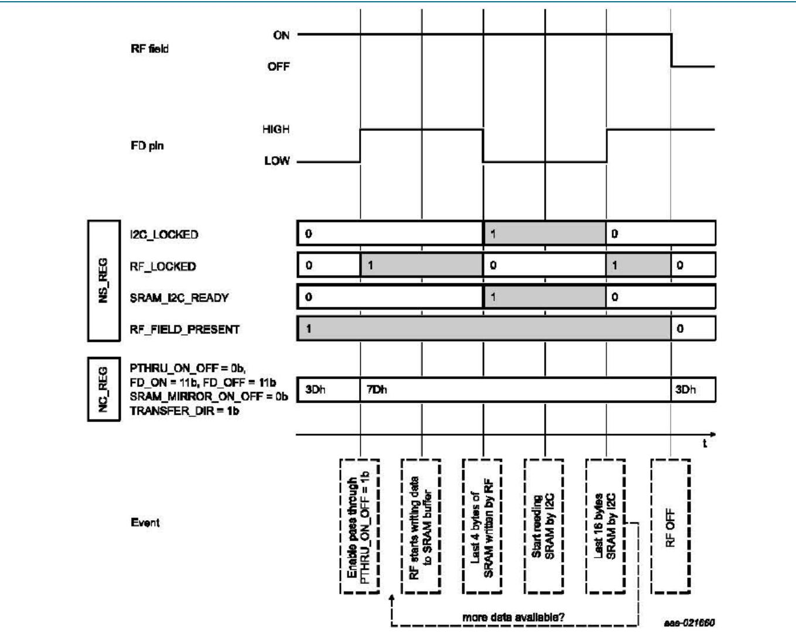  
图 29. 场检测特性和从 NFC 到 I²C 的数据传输直通模式相结合的图示说明

## 11.3.3 I²C 至 NFC 的数据传输

如果启用 I²C 接口(I2C\_LOCKED 为 1b)且数据通过 I²C 接口写入 SRAM 的终端块 FBh，则在 WRITE 命令的最后，SRAM\_RF\_READY 位设置为 1b，I2C\_LOCKED 位自动重置为 0b，从而将标签设置为仲裁空闲状态。

然后 RF\_LOCKED 位自动设置为 1b（根据接口仲裁）。在涉及 SRAM 的终止页的 READ 或 FAST\_READ 命令之后,SRAM\_RF\_READY 位和 RF\_LOCKED 位自动复位为 0b，以允许 I²C 接口向 SRAM 缓冲区继续写入数据。

要向主机发出更多写入数据准备就绪的信号，请使用以下机制：

\- NFC 接口从 NS\_REG 轮询/读取 SRAM\_RF\_READY 位（参见表 14），以了解新数据是否已通过 I²C 接口写入 SRAM。

\- FD 引脚上的触发信号向主机指示已通过 NFC 接口从 SRAM 读取了数据。此功能可通过对 NC\_REG 的位 5:2 (FD\_OFF, FD\_ON) 进行适当的编程来启用（参见表 13）。

图 30 说明了上述机制。  
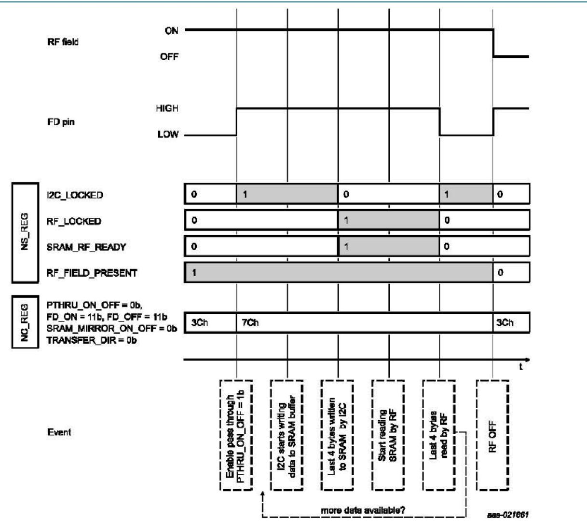  
图30. 场检测信号功能和从 $\mathsf{I}^2\mathsf{C}$ 到NFC的数据传输直通模式相结合的图示说明

## NTAG I²C plus: NFC Forum T2T 带有 I²C 接口、密码保护和能量采集功能

## 12 限值

超出一个或多个参考值的限值可能会对器件造成永久性损坏。长期处于限值条件下工作会影响器件可靠性。

## 表 41. 限值

依据 “绝对最大额定值体系 (IEC 60134)”。[1][2]

<table><tr><td>符号</td><td>参数</td><td>条件</td><td></td><td>最小值</td><td>最大值</td><td>单位</td></tr><tr><td> $T_{stg}$ </td><td>存储温度</td><td></td><td></td><td>-55</td><td>+125</td><td>°C</td></tr><tr><td> $T_{j(max)}$ </td><td>最大结温</td><td></td><td></td><td>-</td><td>+105</td><td>°C</td></tr><tr><td> $V_{ESD}$ </td><td>静电放电电压(人体模型)</td><td>[3]</td><td></td><td>-</td><td>2</td><td>kV</td></tr><tr><td> $V_{ESD}$ </td><td>静电放电电压(充电设备模型)</td><td>[4]</td><td></td><td>-</td><td>1</td><td>kV</td></tr><tr><td> $V_{DD}$ </td><td>电源电压</td><td colspan="2">在引脚 VCC 上</td><td>-0.5</td><td>4.6</td><td>V</td></tr><tr><td> $V_i$ </td><td>输入电压</td><td colspan="2">在引脚 FD、SDA、SCL</td><td>-0.5</td><td>4.6</td><td>V</td></tr><tr><td> $I_i$ </td><td>输入电流</td><td>在引脚 LA、LB上</td><td></td><td>-</td><td>40</td><td>mA</td></tr><tr><td> $V_{i(RF)}$ </td><td>RF 输入电压</td><td colspan="2">在引脚 LA、LB 上</td><td>-</td><td>4.6</td><td> $V_{peak}$ </td></tr></table>

[1] 超过一个或多个限值会对器件造成永久性损害。

[2] 长期处于限值条件下工作会影响器件可靠性。

[3] ANSI/ESDA/JEDEC JS-001

[4] ANSI/ESDA/JEDEC JS-002

NTAG I²C plus: NFC Forum T2T 带有 I²C 接口、密码保护和能量采集功能

## 13 特性

## 13.1 电气特性

表 42. 特性

<table><tr><td>符号</td><td>参数</td><td>条件</td><td>最小值</td><td>典型值</td><td>最大值</td><td>单位</td></tr><tr><td> $C_i$ </td><td>输入电容</td><td>LA-LB,片内 $C_{IC}$ ,f=13.56 MHz, $V_{LA-LB}=2.4 V_{RMS}$ </td><td>44</td><td>50</td><td>56</td><td>pF</td></tr><tr><td> $f_l$ </td><td>输入频率</td><td></td><td>-</td><td>13.56</td><td>-</td><td>MHz</td></tr><tr><td> $T_{amb}$ </td><td>工作环境温度</td><td></td><td>40</td><td>25</td><td>+105 [1]</td><td>°C</td></tr><tr><td> $R_{TH\_JA}$ </td><td>热阻</td><td>JEDEC 2s2p板和XQFN8封装</td><td>-</td><td>150</td><td>-</td><td>K/W</td></tr><tr><td> $R_{TH\_JA}$ </td><td>热阻</td><td>JEDEC 2s2p板和TSSOP8封装</td><td>-</td><td>211</td><td>-</td><td>K/W</td></tr><tr><td> $R_{TH\_JA}$ </td><td>热阻</td><td>JEDEC 2s2p板和SO8封装</td><td>-</td><td>115</td><td>-</td><td>K/W</td></tr><tr><td colspan="7">能量采集特性</td></tr><tr><td> $V_{out,max}$ </td><td>输出电压</td><td>产生于 $V_{out}$ 引脚,5类天线,14A/m,1mA负载电流</td><td>[2]</td><td>-</td><td>3.3</td><td>V</td></tr><tr><td colspan="7"> $I^{2}C$ 接口特性</td></tr><tr><td> $V_{CC}$ </td><td>电源电压</td><td>仅通过 $V_{CC}$ 供电</td><td>1.67</td><td>-</td><td>3.6</td><td>V</td></tr><tr><td rowspan="2"> $I_{DD}$ </td><td rowspan="2">电源电流</td><td> $V_{CC}=1.8 V I^{2}C$ ;空闲总线</td><td>-</td><td>160</td><td>-</td><td>μA</td></tr><tr><td> $V_{CC}=3.3 V I^{2}C$ ;空闲总线</td><td>-</td><td>195</td><td>-</td><td>μA</td></tr><tr><td rowspan="3"> $I_{DD}$ </td><td rowspan="3">电源电流</td><td> $V_{CC}=1.8 V I^{2}C@400KHz$ </td><td>-</td><td>-</td><td>185</td><td>μA</td></tr><tr><td> $V_{CC}=2.5 V I^{2}C@400KHz$ </td><td>-</td><td>-</td><td>210</td><td>μA</td></tr><tr><td> $V_{CC}=3.3 V I^{2}C@400KHz$ </td><td>-</td><td>-</td><td>240</td><td>μA</td></tr><tr><td colspan="7"> $I^{2}C$ 引脚特性</td></tr><tr><td rowspan="2"> $V_{OL}$ </td><td rowspan="2">低电平输出电压</td><td> $I_{OL}=3 mA;V_{CC}>2 V$ </td><td>-</td><td>-</td><td>0.4</td><td>V</td></tr><tr><td> $I_{OL}=2mA;V_{CC}<2V$ </td><td>-</td><td>-</td><td>0.2* $V_{CC}$ </td><td>V</td></tr><tr><td> $V_{IH}$ </td><td>高电平输入电压</td><td colspan="2">0.7* $V_{CC}$ </td><td>-</td><td>-</td><td>V</td></tr><tr><td> $V_{IL}$ </td><td>低电平输入电压</td><td colspan="2">-</td><td>-</td><td>0.3* $V_{CC}$ </td><td>V</td></tr><tr><td> $C_I$ </td><td>输入电容</td><td>SCL和SDA引脚</td><td>-</td><td>2.4</td><td>-</td><td>pF</td></tr><tr><td> $I_L$ </td><td>漏电流</td><td>0V和 $V_{CC,max}$ </td><td>-</td><td>-</td><td>10</td><td>μA</td></tr><tr><td> $t_{high}$ </td><td>SCL高电平时间</td><td>快速模式400kHz</td><td>950</td><td>-</td><td>-</td><td>ns</td></tr><tr><td colspan="7">FD引脚特性</td></tr><tr><td rowspan="2"> $V_{OL}$ </td><td rowspan="2">低电平输出电压</td><td> $I_{OL}=4 mA;V_{CC}>2V$ </td><td>-</td><td>-</td><td>0.4</td><td>V</td></tr><tr><td> $I_{OL}=3 mA;V_{CC}<2V$ </td><td>-</td><td>-</td><td>0.2* $V_{CC}$ </td><td>V</td></tr><tr><td> $I_L$ </td><td>漏电流</td><td colspan="2">-</td><td>1.5</td><td>10</td><td>μA</td></tr><tr><td colspan="7">EEPROM特性</td></tr></table>

## NTAG I²C plus: NFC Forum T2T 带有 I²C 接口、密码保护和能量采集功能

<table><tr><td>符号</td><td>参数</td><td>条件</td><td>最小值</td><td>典型值</td><td>最大值</td><td>单位</td></tr><tr><td> $t_{ret}$ </td><td>保留时间</td><td> $T_{amb}$ </td><td>20</td><td>50</td><td>-</td><td>年</td></tr><tr><td> $N_{endu(W)}$ </td><td>写入操作耐受程度</td><td> $T_{amb}$ </td><td>200000</td><td>-</td><td>-</td><td>次</td></tr><tr><td> $N_{endu(W)}$ </td><td>写入操作耐受程度</td><td>-40°C至95°C</td><td>500000</td><td>1000000</td><td>-</td><td>次</td></tr></table>

[1] 取决于PCB设计和工作条件

[2] 最小值取决于可用的场强度和负载电流。有关详情，参见[7]AN11578 NTAG I²C 能量采集

## 14 封装尺寸

<table><tr><td>Unit</td><td>A</td><td>A1</td><td>b</td><td>D</td><td>E</td><td>e</td><td>a1</td><td>L</td><td>v</td><td>w</td><td>y</td><td>y1</td></tr><tr><td rowspan="3">mm</td><td>max</td><td>0.5</td><td>0.05</td><td>0.25</td><td>1.65</td><td>1.65</td><td></td><td>0.45</td><td></td><td></td><td></td><td></td></tr><tr><td>nom</td><td></td><td>0.20</td><td>1.60</td><td>1.60</td><td>0.8</td><td>0.5</td><td>0.40</td><td>0.1</td><td>0.05</td><td>0.05</td><td>0.05</td></tr><tr><td>min</td><td>0.00</td><td>0.15</td><td>1.55</td><td>1.55</td><td></td><td>0.35</td><td></td><td></td><td></td><td></td><td></td></tr></table>

图 31. 封装尺寸 SOT902-3 (XQFN8)

NTAG I²C plus: NFC Forum T2T 带有 I²C 接口、密码保护和能量采集功能

<table><tr><td rowspan="2">OUTLINE VERSION</td><td colspan="11">REFERENCES</td><td rowspan="2" colspan="3">EUROPEAN PROJECTION</td><td rowspan="2" colspan="2">ISSUE DATE</td></tr><tr><td>IEC</td><td>JEDEC</td><td>JEITA</td><td colspan="8"></td></tr><tr><td>SOT505-1</td><td></td><td></td><td></td><td colspan="6"></td><td colspan="2"></td><td colspan="3"></td><td colspan="2">-99-04-09-03-02-18</td></tr></table>

图 32. 封装尺寸 SOT505-1 (TSSOP8)

NTAG I²C plus: NFC Forum T2T 带有 I²C 接口、密码保护和能量采集功能

<table><tr><td rowspan="2">OUTLINE VERSION</td><td colspan="11">REFERENCES</td><td rowspan="2" colspan="3">EUROPEAN PROJECTION</td><td rowspan="2" colspan="3">ISSUE DATE</td></tr><tr><td>IEC</td><td>JEDEC</td><td>JETA</td><td colspan="8"></td></tr><tr><td>SOT96-1</td><td>078E03</td><td>MS-012</td><td></td><td colspan="8"></td><td colspan="3"></td><td colspan="3">99-12-27-03-02-16</td></tr></table>

图33. 封装尺寸SOT96-1(S08)

NTAG I²C plus: NFC Forum T2T 带有 I²C 接口、密码保护和能量采集功能

## 15 操作信息

注意

此器件对静电放电(ESD)很敏感。请遵守操作静电敏感器件的注意事项。在 ANSI/ESD S20.20、IEC/ST 61340-5、JESD625-A 或其他等效标准中详细说明了这些注意事项。

NTAG I²C plus: NFC Forum T2T 带有 I²C 接口、密码保护和能量采集功能

## 16 缩略词

表 43. 缩略词

<table><tr><td>首字母缩略词</td><td>说明</td></tr><tr><td>ASID</td><td>封装序列 ID</td></tr><tr><td>DBSN</td><td>扩散批次序列号</td></tr><tr><td>POR</td><td>上电复位</td></tr></table>

## 17 参考文献

2. ISO/IEC 14443 - 身份验证卡 - 非接触式集成电路卡 - 近距离卡国际标准

3. I²C 总线规范和用户手册
恩智浦标准 UM10204
http://www.nxp.com/documents/user\_manual/UM10204.pdf

4. NFC Forum - Activity 2.0
技术规范

5. AN11276 NTAG 天线设计指南
恩智浦应用笔记
http://www.nxp.com/documents/application\_note/AN11276.pdf

6. AN11350 NTAG21x 独创签名验证
恩智浦应用笔记
http://www.nxp.com/restricted\_documents/53420/AN11350.pdf

7. AN11578 NTAG I²C 能量采集
恩智浦应用笔记
http://www.nxp.com/documents/application\_note/AN11578.pdf

8. AN11579 如何使用 NTAG I²C (plus) 进行双向通信
恩智浦应用笔记
http://www.nxp.com/documents/application\_note/AN11579.pdf

9. AN11786 NTAG I²C plus 存储器配置选项
恩智浦应用笔记
http://www.nxp.com/documents/application\_note/AN11786.pdf

10. XQFN8 - SOT902-3
封装信息
https://www.nxp.com/docs/en/package-information/SOT902-3.pdf

11. TSSOP8 - SOT505-1
封装信息
https://www.nxp.com/docs/en/package-information/SOT505-1.pdf

12. SO8 - SOT505-1
封装信息
https://www.nxp.com/docs/en/package-information/SOT96-1.pdf

13. Certicom Research
SEC 2: 建议的椭圆曲线域参数 V2.0

## NTAG I²C plus: NFC Forum T2T 带有 I²C 接口、密码保护和能量采集功能

## 18 修订记录

表 44. 修订记录

<table><tr><td>文档 ID</td><td>发布日期</td><td>数据手册状态</td><td>更改说明</td><td>取代版本</td></tr><tr><td>NT3H2111_2211 v. 3.5</td><td>2019年5月7日</td><td>产品数据手册</td><td>-</td><td>NT3H2111_2211 v. 3.4</td></tr><tr><td>变更内容:</td><td colspan="4">添加了有关 $I^{2}C$ 故障安全工作模式的信息添加了nxp.com上的详细封装规范链接添加了信息:对于新增ED功能,标签不需要通过VCC供电添加了信息:配置为检测是否存在NFC场时,读取NS_REG会导致FD引脚拉低添加了信息:未使用能量采集时,VOUT可用作场检测引脚在特性中添加了典型空闲电流和FD引脚泄漏电流(参见第13部分)添加了RFU位和字节的处理要求添加了静态和动态锁定位对镜像SRAM的影响编辑更新</td></tr><tr><td>NT3H2111_2211 v. 3.4</td><td>2019年1月8日</td><td>产品数据手册</td><td>-</td><td>NT3H2111_2211 v. 3.3</td></tr><tr><td>变更内容:</td><td colspan="4">根据封装尺寸更正了订购信息中的XQFN8封装尺寸在限值表中添加了CDM ESD限值(参见第12部分)编辑更新</td></tr><tr><td>NT3H2111_2211 v. 3.3</td><td>2018年8月8日</td><td>产品数据手册</td><td>-</td><td>NT3H2111_2211 v. 3.2</td></tr><tr><td>变更内容:</td><td colspan="4">添加ED引脚基于漏极开路实现的信息添加了有关 $I^{2}C$ 地址的警告和建议添加了 $I^{2}C$ 读取操作必须采用原子方式的警告添加了 $T_{j}$ 和热阻编辑更新</td></tr><tr><td>NT3H2111_2211 v. 3.2</td><td>2017年11月30日</td><td>产品数据手册</td><td>-</td><td>NT3H2111_2211 v.3.1</td></tr><tr><td>变更内容:</td><td colspan="4">更正了V3.1编辑更新表13中的TRANSFER_DIR错误</td></tr><tr><td>NT3H2111_2211 v. 3.1</td><td>2017年10月9日</td><td>产品数据手册</td><td>-</td><td>3.0版</td></tr><tr><td>变更内容:</td><td colspan="4">添加了NTAG  $I^{2}C$  plus现已通过NFC Forum认证的信息更新了表42中的耐久程度编辑更新</td></tr><tr><td>NT3H2111_2211 v. 3.0</td><td>2016年2月3日</td><td>产品数据手册</td><td>-</td><td>-</td></tr></table>

NTAG I²C plus: NFC Forum T2T 带有 I²C 接口、密码保护和能量采集功能

## 19 法律信息

## 19.1 数据手册状态

<table><tr><td>文档状态[1][2]</td><td>产品状态[3]</td><td>定义</td></tr><tr><td>客观[缩略版]数据手册</td><td>开发</td><td>该文档包含产品开发客观规范的数据。</td></tr><tr><td>初始[缩略版]数据手册</td><td>验证</td><td>该文档含有初始规范的数据。</td></tr><tr><td>产品[缩略版]数据手册</td><td>生产</td><td>该文档含有产品规范。</td></tr></table>

[1] 请在开始或完成设计之前查看最新发布文件。  
[2] 有关 “缩略版数据手册” 的说明见 “定义” 部分。  
[3] 自本文件发布以来，文件中的器件产品状态可能已发生变化；如果存在多个器件，则可能存在差异。最新产品状态信息通过互联网发布，网址为：http://www.nxp.com。

## 19.2 定义

草案——本文档仅为草案版本。内容仍在内部审查，尚未正式批准，可能会有进一步修改或补充。恩智浦半导体对本文信息的准确性或完整性不做任何说明或保证，并对因使用此信息而带来的后果不承担任何责任。

缩略版数据手册——缩略版数据手册是产品型号和标题完全相同的完整版数据手册的节选。缩略版数据手册仅供快速参考使用，不包括详细和完整的信息。欲了解详细、完整的信息，请查看相关的完整版数据手册，可向当地的恩智浦半导体销售办事处索取。如完整版与缩略版存在任何不一致或冲突，请以完整版为准。

产品规范——产品数据手册中提供的信息和数据应定义恩智浦半导体与客户之间达成一致的产品规范，除非恩智浦半导体和客户另行达成书面协议。在任何情况下，若协议认为恩智浦半导体产品需要具有超出产品数据手册规定的功能和质量，则该协议无效。

## 19.3 免责声明

有限保证和责任——本文中的信息据信是准确和可靠的。但是，恩智浦半导体对此处所含信息的准确性或完整性不做任何明示或暗示的声明或保证，并对因使用此信息而带来的后果不承担任何责任。若文中信息并非来自恩智浦半导体，则恩智浦半导体对该信息的内容概不负责。在任何情况下，对于任何间接性、意外性、惩罚性、特殊性或后果性损害（包括但不限于利润损失、积蓄损失、业务中断、因拆卸或更换任何产品而产生的开支或返工费用），无论此等损害是否基于侵权行为（包括过失）、保证、违约或任何其他法理，恩智浦半导体均不承担任何责任。对于因任何原因给客户带来的任何损害，恩智浦半导体对本文所述产品的总计责任和累积责任仅限于恩智浦商业销售条款和条件所规定的范围。

修改权利——恩智浦半导体保留对本文所发布的信息（包括但不限于规范和产品说明）随时进行修改的权利，恕不另行通知。本文档将取代并替换之前就此提供的所有信息。

适宜使用——恩智浦半导体产品并非设计、授权或担保适合用于生命保障、生命关键或安全关键系统或设备，亦非设计、授权或担保适合用于在恩智浦半导体产品失效或故障时可导致人员受伤、死亡或严重财产或环境损害的应用。恩智浦半导体及其供应商对在此类设备或应用中加入和/或使用恩智浦半导体产品不承担任何责任，客户需自行承担因加入和/或使用恩智浦半导体产品而带来的风险。

应用——本文档所述任何产品的应用只用于例证目的。此类应用如不经进一步测试或修改用于特定用途，恩智浦半导体对其适用性不做任何声明或保证。客户负责自行利用恩智浦半导体产品进行设计和应用，对于应用或客户产品设计，恩智浦半导体无义务提供任何协助。客户须自行负责检验恩智浦半导体的产品是否适用于其规划的应用和产品，以及是否适用于其第三方客户的规划应用和使用。客户须提供适当的设计和操作安全保障措施，以尽可能降低与应用和产品相关的风险。对于因客户的应用或产品中的任何缺陷或故障，或者客户的第三方客户的应用或使用导致的任何故障、损害、费用或问题，恩智浦半导体均不承担任何责任。客户负责对自己基于恩智浦半导体的产品的应用和产品进行所有必要测试，以避免这些应用和产品或者客户的第三方客户的应用或使用存在任何缺陷。恩智浦不承担与此相关的任何责任。

限值——超过一个或多个限值（如 IEC 60134 绝对最大额定值体系所规定）会给器件带来永久性损害。限值仅为强度额定值，若器件工作于这些条件下或者超过“建议工作条件部分”（若有）或者本文档“特性”部分规定的条件下，则不在担保范围之内。持续或反复超过限值将对器件的质量和可靠性造成永久性、不可逆转的影响。

商业销售条款和条件——除非有效书面单项协议另有规定，恩智浦半导体产品的销售遵循关于商业销售的一般条款和条件，详见http://www.nxp.com/profile/terms。如果只达成了单项协议，则该协议的条款和条件适用。恩智浦半导体特此明确反对，应用客户就其购买恩智浦半导体的产品而制定的一般条款和条件。

# NTAG I²C plus: NFC Forum T2T 带有 I²C 接口、密码保护和能量采集功能

无销售或许可要约——本文档中的任何信息均不得被理解或解释为对承诺开放的销售产品的要约，或者授予、让与或暗示任何版权、专利或其他工业或知识产权的任何许可。

快速参考数据——快速参考数据指本文件“限值”和“特性”部分所提供数据的节选，因此不完整、不详尽并且不具法律约束力。

出口管制——本文档以及此处说明的产品可能受出口法规的管制。出口可能需要事先经主管部门批准。

非汽车应用产品——除非本数据手册明确表示，恩智浦半导体的本特定产品适用于汽车应用，否则，均不适用于汽车应用。未根据汽车测试或应用要求进行验证或测试。对于在汽车器件或应用中包括和/或使用非汽车应用产品的行为，恩智浦半导体不承担任何责任。客户将产品用于设计导入以及符合汽车规范和标准的汽车应用时，客户须(a)使用产品但恩智浦半导体不对产品的此等汽车应用、用途和规范作任何担保；并且(b)若客户超越恩智浦半导体所提供规格使用汽车应用产品，须自行承担所有风险；并且(c)对于因客户设计以及客户超出恩智浦半导体标准担保范围和恩智浦半导体所提供规格使用汽车应用产品而导致的任何责任、损害或产品故障索赔，客户须免除恩智浦半导体的全部责任。

翻译——非英文（翻译）版的文档仅供参考。如翻译版与英文版存在任何差异，以英文版为准。

## 19.4 许可

## 购买采用NFC技术的恩智浦IC

购买符合近场通信(NFC)标准 ISO/IEC 18092 和 ISO/IEC 21481 之一的恩智浦半导体 IC 不会转让因实施任何这些标准而侵犯的任何专利权下的默示许可。购买恩智浦半导体 IC 不包括涵盖这些产品与其他产品（无论是硬件还是软件）组合的任何恩智浦专利（或其他知识产权）的许可。

## 19.5 商标

注意：所有引用的品牌、产品名称、服务名称以及商标均为其各自所有者的资产。

I²C 总线——该徽标是恩智浦的商标。

NTAG——是恩智浦的商标。

NTAG I²C plus: NFC Forum T2T 带有 I²C 接口、密码保护和能量采集功能

## 表

表 1. 订购信息....5
表 2. 标记代码....6
表 3. XQFN8、TSSOP8 和 SO8 的引脚说明....9
表 4. NFC 方式下的 NTAG I2C plus 1k 存储器规划....14
表 5. NFC 方式下的 NTAG I2C plus 2k 存储器规划....16
表 6. I2C 接口的 NTAG I2C plus 1k 存储器规划....19
表 7. I2C 接口的 NTAG I2C plus 2k 存储器规划....21
表 8. NTAG I2C plus 初始化状态下的最小存储器内容....27
表 9. 密码和访问配置寄存器....28
表 10. 密码和访问配置字节....28
表 11. 配置寄存器 NTAG I2C plus....30
表 12. 会话寄存器 NTAG I2C plus....30
表 13. 配置字节....31
表 14. 会话寄存器字节....33
表 15. I2C 的默认 NTAG I2C 地址....43
表 16. 命令概述....47
表 17. ACK 和 NAK 值....48
表 18. NTAG I2C plus 的 ATQA 响应....49
表 19. NTAG I2C plus 的 SAK 响应....49
表 20. GET\_VERSION 命令....49
表 21. GET\_VERSION 时序....50
表 22. NTAG I2C plus 的 GET\_VERSION 响应....50
表 23. READ\_SIG 命令....51
表 24. READ\_SIG 时间....51
表 25. PWD\_AUTH 命令....52

表 26. PWD\_AUTH 时序....52
表 27. READ 命令....53
表 28. READ 时间....53
表 29. FAST\_READ 命令....54
表 30. FAST\_READ 时间....54
表 31. WRITE 命令....55
表 32. WRITE 时序....55
表 33. FAST\_WRITE 命令....56
表 34. FAST\_READ 时序....57
表 35. SECTOR\_SELECT 命令....57
表 36. SECTOR\_SELECT 时序....58
表 37. NTAG I2C plus 1k 通过 NFC 接口的 SRAM 存储器寻址（SRAM\_MIRROR\_ON\_OFF 设置为 1b，SRAM\_MIRROR\_BLOCK 设置为 01h）的示例60
表 38. NTAG I2C plus 2k 通过 NFC 接口的 SRAM 存储器寻址（SRAM\_MIRROR\_ON\_OFF 设置为 1b，SRAM\_MIRROR\_BLOCK 设置为 01h）示例..61
表 39. NTAG I2C 1k 在直通模式下通过 NFC 接口进行 SRAM 存储器寻址（PTHRU\_ON\_OFF 设置为 1b）的示例....63
表 40. NTAG I2C 2k 在直通模式下通过 NFC 接口进行 SRAM 存储器寻址（PTHRU\_ON\_OFF 设置为 1b）的示例....64
表 41. 限值....68
表 42. 特性....69
表 43. 缩略词....75
表 44. 修订记录....77

NTAG I²C plus: NFC Forum T2T 带有 I²C 接口、密码保护和能量采集功能

## 图

图1. 非接触式和接触式系统....1  
图2. 功能框图....7  
图3. XQFN8引脚配置....8  
图4. TSSOP8引脚配置....8  
图5. SO8引脚配置....8  
图6. NTAG I2C plus的NFC状态机....11  
图7. 序列号(UID)....23  
图8. 静态锁定字节0和1....23  
图9. NTAG I2C plus 1k动态锁定字节0、1和2....25  
图10. NTAG I2C plus 2k动态锁定字节0、1和2....25  
图11. NTAG I2C 1k版本的CC字节的可能配置....26  
图12. FD引脚示例电路....35  
图13. 配置为简单场检测时的场检测特性图示说明....35  
图14. 配置为检测第一个有效通信的开始时的场检测特性图示说明....36  
图15. 配置为检测标签选择时的场检测特性图示说明37  
图16. 能量采集示例电路....38  
图17. I2C总线协议....41  
图18. I2C READ和WRITE操作....44

图 19. WRITE 和 READ 寄存器操作 ..... 46
图 20. 帧延迟时间（从 NFC 设备到 NFC 标签），TACK 和 TNAK ..... 48
图 21. GET\_VERSION 命令 ..... 49
图 22. READ\_SIG 命令 ..... 51
图 23. PWD\_AUTH 命令 ..... 52
图 24. READ 命令 ..... 53
图 25. FAST\_READ 命令 ..... 54
图 26. WRITE 命令 ..... 55
图 27. FAST\_WRITE 命令 ..... 56
图 28. SECTOR\_SELECT 命令 ..... 57
图 29. 场检测特性和从 NFC 到 I2C 的数据传输直通模式相结合的图示说明 ..... 66
图 30. 场检测信号功能和从 I2C 到 NFC 的数据传输直通模式相结合的图示说明 ..... 67
图 31. 封装尺寸 SOT902-3 (XQFN8) ..... 71
图 32. 封装尺寸 SOT505-1 (TSSOP8) ..... 72
图 33. 封装尺寸 SOT96-1 (S08) ..... 73

NTAG I²C plus: NFC Forum T2T 带有 I²C 接口、密码保护和能量采集功能

## 目录

1 概述....1
2 特性和优势....2
2.1 主要特性....2
2.2 NFC接口....2
2.3 存储器....3
2.4 I2C接口....3
2.5 安全性....3
2.6 主要优势....3
3 应用....4
4 订购信息....5
5 标记....6
6 功能框图....7
7 引脚配置信息....8
7.1 引脚配置....8
7.1.1 XQFN8....8
7.1.2 TSSOP8....8
7.1.3 SO8....8
7.2 引脚说明....9
8 功能说明....10
8.1 框图说明....10
8.2 NFC接口....10
8.2.1 数据完整性....10
8.2.2 NFC状态机....11
8.2.2.1 IDLE状态....11
8.2.2.2 READY 1状态....11
8.2.2.3 READY 2状态....12
8.2.2.4 ACTIVE状态....12
8.2.2.5 AUTHENTICATED状态....12
8.2.2.6 HALT状态....12
8.3 存储器规划....13
8.3.1 NFC方式下的存储器映射....13
8.3.2 I2C接口的存储器映射....18
8.3.3 EEPROM....22
8.3.4 SRAM....22
8.3.5 序列号(UID)....23
8.3.6 静态锁定字节....23
8.3.7 动态锁定字节....24
8.3.8 功能容器(CC)....26
8.3.9 用户存储器页面....26
8.3.10 交付时的存储器内容....26
8.3.11 密码和访问配置....27
8.3.12 NTAG I2C配置和会话寄存器....29
8.4 可配置场检测引脚....34
8.5 看门狗定时器....37
8.6 能量采集....38
8.7 密码验证....39
8.7.1 PWD和PACK的编程....39

8.7.2 限制失败的验证尝试次数....39
8.7.3 配置段保护....40
8.8 独创签名....40
9 I2C 命令....41
9.1 启动条件....41
9.2 停止条件....41
9.3 I2C 软复位和 NFC 静音功能....42
9.4 确认位(ACK)....42
9.5 数据输入....42
9.6 寻址....42
9.7 READ 和 WRITE 操作....43
9.8 WRITE 和 READ 寄存器操作....46
10 NFC 命令....47
10.1 NTAG I2C plus 命令概述....47
10.2 时序....47
10.3 NTAG ACK 和 NAK....48
10.4 ATQA 和 SAK 响应....48
10.5 GET\_VERSION....49
10.6 READ\_SIG....50
10.7 PWD\_AUTH....51
10.8 READ....52
10.9 FAST\_READ....53
10.10 WRITE....55
10.11 FAST\_WRITE....56
10.12 扇区选择....57
11 NFC 和 I2C 接口之间的通信与仲裁....59
11.1 直通模式未激活....59
11.1.1 I2C 接口访问....59
11.1.2 NFC 接口访问....59
11.2 启动 SRAM 缓冲区映射和存储器镜像....60
11.3 直通模式....62
11.3.1 SRAM 缓冲区映射....63
11.3.2 NFC 至 I2C 的数据传输....65
11.3.3 I2C 至 NFC 的数据传输....66
12 限值....68
13 特性....69
13.1 电气特性....69
14 封装尺寸....71
15 操作信息....74
16 缩略词....75
17 参考文献....76
18 修订记录....77
19 法律信息....78

注意：关于本文档及相关产品的重要说明详见“法律信息”一节。

© NXP B.V. 2019。保留所有权利。
欲了解更多信息，请访问：http://www.nxp.com
欲咨询销售办事处地址，请发送电子邮件至：salesaddresses@nxp.com
发布日期：2019年5月7日
文档号：NT3H2111/NT3H2211
文档编号：359935