<table><tr><td>Description</td><td colspan="2">-This command is used to control display brightness.-BCTRL: Brightness Control Block On/Off, This bit is always used to switch brightness for display.0 = Off (Brightness register are 00h, DBV[7:0])1 = On (Brightness register are active, according to the other parameters.)-DD: Display Dimming (Only for manual brightness setting)DD = 0: Display Dimming is off.DD = 1: Display Dimming is on.-BL: Backlight Control On/Off0 = Off (Completely turn off backlight circuit. Control lines must be low.)1 = On-Dimming function is adapted to the brightness registers for display when bit BCTRL is changed at DD=1.-When BL bit changed from &#x27;on&#x27; to &#x27;off&#x27;, backlight is turned off without gradual dimming, even if dimming-on (DD=1) are selected.</td></tr><tr><td>Restriction</td><td colspan="2"></td></tr><tr><td rowspan="7">Register availability</td><td colspan="2"></td></tr><tr><td>Status</td><td>Availability</td></tr><tr><td>Normal Mode On, Idle Mode Off, Sleep Out</td><td>Yes</td></tr><tr><td>Normal Mode On, Idle Mode On, Sleep Out</td><td>Yes</td></tr><tr><td>Partial Mode On, Idle Mode Off, Sleep Out</td><td>Yes</td></tr><tr><td>Partial Mode On, Idle Mode On, Sleep Out</td><td>Yes</td></tr><tr><td>Sleep In</td><td>Yes</td></tr><tr><td rowspan="5">Default</td><td colspan="2"></td></tr><tr><td>Status</td><td>Default Value</td></tr><tr><td>Power On Sequence</td><td>0000h</td></tr><tr><td>S/W Reset</td><td>0000h</td></tr><tr><td>H/W Reset</td><td>0000h</td></tr></table>

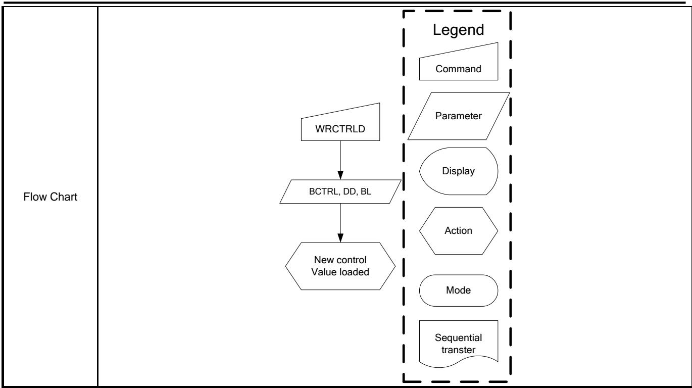

9.2.40 RDCTRLD (54h): Read CTRL value Display

<table><tr><td>54H</td><td colspan="13">RDCTRLD (Read CTRL value Display)</td></tr><tr><td>Inst / Para</td><td>D/CX</td><td>WRX</td><td>RDX</td><td>D17-8</td><td>D7</td><td>D6</td><td>D5</td><td>D4</td><td>D3</td><td>D2</td><td>D1</td><td>D0</td><td>HEX</td></tr><tr><td>RDCTRLD</td><td>0</td><td>↑</td><td>1</td><td>-</td><td>0</td><td>1</td><td>0</td><td>1</td><td>0</td><td>1</td><td>0</td><td>0</td><td>(54h)</td></tr><tr><td> $1^{st}$  parameter</td><td>1</td><td>1</td><td>↑</td><td>-</td><td>-</td><td>-</td><td>-</td><td>-</td><td>-</td><td>-</td><td>-</td><td>-</td><td></td></tr><tr><td> $2^{nd}$  parameter</td><td>1</td><td>1</td><td>↑</td><td>-</td><td>0</td><td>0</td><td>BCTRL</td><td>0</td><td>DD</td><td>BL</td><td>0</td><td>0</td><td></td></tr><tr><td>Description</td><td colspan="13">-This command returns ambient light and brightness control values..-BCTRL: Brightness Control Block On/Off, This bit is always used to switch brightness for display.0 = Off1 = On-DD: Display Dimming (Only for manual brightness setting)DD = 0DD = 1-BL: Backlight Control On/Off0 = Off1 = On</td></tr></table>

Page 202 of 279

<table><tr><td>Restriction</td><td colspan="3">-</td></tr><tr><td rowspan="7">Register availability</td><td colspan="3"></td></tr><tr><td colspan="2">Status</td><td>Availability</td></tr><tr><td colspan="2">Normal Mode On, Idle Mode Off, Sleep Out</td><td>Yes</td></tr><tr><td colspan="2">Normal Mode On, Idle Mode On, Sleep Out</td><td>Yes</td></tr><tr><td colspan="2">Partial Mode On, Idle Mode Off, Sleep Out</td><td>Yes</td></tr><tr><td colspan="2">Partial Mode On, Idle Mode On, Sleep Out</td><td>Yes</td></tr><tr><td colspan="2">Sleep In</td><td>Yes</td></tr><tr><td rowspan="5">Default</td><td colspan="3"></td></tr><tr><td>Status</td><td colspan="2">Default Value</td></tr><tr><td>Power On Sequence</td><td colspan="2">0000h</td></tr><tr><td>S/W Reset</td><td colspan="2">0000h</td></tr><tr><td>H/W Reset</td><td colspan="2">0000h</td></tr><tr><td>Flow Chart</td><td colspan="3"></td></tr></table>

9.2.41 WRCABC (55h): Write Adaptive Brightness Control

<table><tr><td>55H</td><td colspan="13">WRCABC (Write Adaptive Brightness Control)</td></tr><tr><td>Inst / Para</td><td>D/CX</td><td>WRX</td><td>RDX</td><td>D17-8</td><td>D7</td><td>D6</td><td>D5</td><td>D4</td><td>D3</td><td>D2</td><td>D1</td><td>D0</td><td>HEX</td></tr><tr><td>WRCABC</td><td>0</td><td>↑</td><td>1</td><td>-</td><td>0</td><td>1</td><td>0</td><td>1</td><td>0</td><td>1</td><td>0</td><td>1</td><td>(55h)</td></tr><tr><td>Parameter</td><td>1</td><td>↑</td><td>1</td><td>-</td><td>CECTRL</td><td>0</td><td>CE1</td><td>CE0</td><td>0</td><td>0</td><td>C1</td><td>C0</td><td></td></tr><tr><td rowspan="3">Description</td><td colspan="13">-This command is used to set parameters for image content based adaptive brightness control functionality.-There is possible to used 4 different modes for content adaptive image functionality, which are defined on a table below.</td></tr><tr><td colspan="2">C1</td><td colspan="2">C0</td><td colspan="9">Function</td></tr><tr><td colspan="2">0</td><td colspan="2">0</td><td colspan="9">Off</td></tr></table>

V1.0  
2014/11  
Sitronix Confidential The information contained herein is the exclusive property of Sitronix and shall not be distributed, reproduced, o disclosed in whole or in part without prior written permission of Sitronix.

<table><tr><td rowspan="3"></td><td>0</td><td>1</td><td>User Interface Mode</td></tr><tr><td>1</td><td>0</td><td>Still Picture</td></tr><tr><td>1</td><td>1</td><td>Moving Image</td></tr><tr><td rowspan="5" colspan="4">-CECTRL: Color Enhancement Control Bit:CECTRL=0: Color Enhancement Off.CECTRL=1: Color Enhancement On.-There are three color enhancement levels can be set.</td></tr><tr></tr><tr></tr><tr></tr><tr></tr><tr><td>Restriction</td><td colspan="3"></td></tr><tr><td rowspan="7">Register availability</td><td rowspan="7" colspan="3"></td></tr><tr></tr><tr></tr><tr></tr><tr></tr><tr></tr><tr></tr><tr><td rowspan="5">Default</td><td rowspan="5" colspan="3"></td></tr><tr></tr><tr></tr><tr></tr><tr></tr></table>

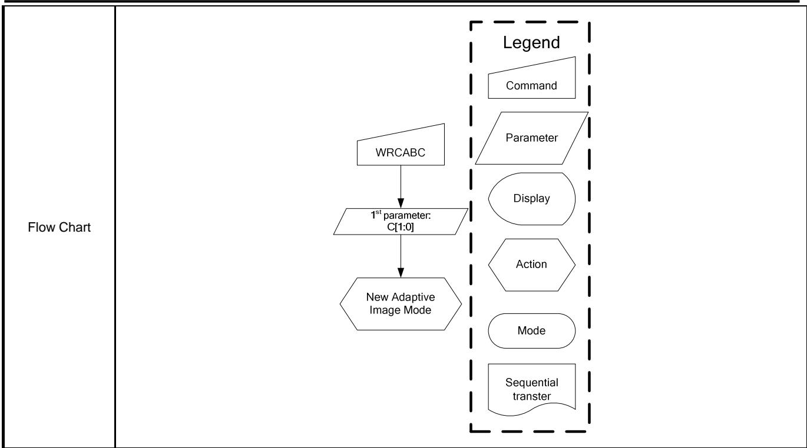

9.2.42 RDCABC (56h): Read Content Adaptive Brightness Control

<table><tr><td>56H</td><td colspan="13">RDCABC (Read Content Adaptive Brightness Control)</td></tr><tr><td>Inst / Para</td><td>D/CX</td><td>WRX</td><td>RDX</td><td>D17-8</td><td>D7</td><td>D6</td><td>D5</td><td>D4</td><td>D3</td><td>D2</td><td>D1</td><td>D0</td><td>HEX</td></tr><tr><td>RDCABC</td><td>0</td><td>↑</td><td>1</td><td>-</td><td>0</td><td>1</td><td>0</td><td>1</td><td>0</td><td>1</td><td>1</td><td>0</td><td>(56h)</td></tr><tr><td> $1^{st}$  parameter</td><td>1</td><td>1</td><td>↑</td><td>-</td><td>-</td><td>-</td><td>-</td><td>-</td><td>-</td><td>-</td><td>-</td><td>-</td><td></td></tr><tr><td> $2^{nd}$  parameter</td><td>1</td><td>1</td><td>↑</td><td>-</td><td>0</td><td>0</td><td>0</td><td>0</td><td>0</td><td>0</td><td>C1</td><td>C0</td><td></td></tr><tr><td rowspan="6">Description</td><td colspan="13">-This command is used to read the settings for image content based adaptive brightness control functionality.-There is possible to used 4 different modes for content adaptive image functionality, which are defined on a table below.</td></tr><tr><td colspan="2">C1</td><td colspan="2">C0</td><td colspan="9">Function</td></tr><tr><td colspan="2">0</td><td colspan="2">0</td><td colspan="9">Off</td></tr><tr><td colspan="2">0</td><td colspan="2">1</td><td colspan="9">User Interface Mode</td></tr><tr><td colspan="2">1</td><td colspan="2">0</td><td colspan="9">Still Picture</td></tr><tr><td colspan="2">1</td><td colspan="2">1</td><td colspan="9">Moving Image</td></tr><tr><td>Restriction</td><td colspan="13">-</td></tr><tr><td rowspan="3">Register availability</td><td rowspan="3" colspan="13"></td></tr><tr></tr><tr></tr></table>

V1.0

Page 205 of 279

Sitronix  
ST7796S

<table><tr><td rowspan="3"></td><td rowspan="3"></td><td colspan="2">Partial Mode On, Idle Mode Off, Sleep Out</td><td>Yes</td><td rowspan="3"></td></tr><tr><td colspan="2">Partial Mode On, Idle Mode On, Sleep Out</td><td>Yes</td></tr><tr><td colspan="2">Sleep In</td><td>Yes</td></tr><tr><td rowspan="5">Default</td><td rowspan="5" colspan="5"></td></tr><tr></tr><tr></tr><tr></tr><tr></tr><tr><td>Flow Chart</td><td colspan="5"></td></tr></table>

## 9.2.43 WRCABCMB (5Eh): Write CABC Minimum Brightness

<table><tr><td>5EH</td><td colspan="13">WRCABCMB (Write CABC Minimum Brightness)</td></tr><tr><td>Inst / Para</td><td>D/CX</td><td>WRX</td><td>RDX</td><td>D17-8</td><td>D7</td><td>D6</td><td>D5</td><td>D4</td><td>D3</td><td>D2</td><td>D1</td><td>D0</td><td>HEX</td></tr><tr><td>WRCABCMB</td><td>0</td><td>↑</td><td>1</td><td>-</td><td>0</td><td>1</td><td>0</td><td>1</td><td>1</td><td>1</td><td>1</td><td>0</td><td>(5Eh)</td></tr><tr><td>Parameter</td><td>1</td><td>↑</td><td>1</td><td>-</td><td>CMB7</td><td>CMB6</td><td>CMB5</td><td>CMB4</td><td>CMB3</td><td>CMB2</td><td>CMB1</td><td>CMB0</td><td></td></tr><tr><td>Description</td><td colspan="13">-This command is used to set the minimum brightness value of the display for CABC function.-In principle relationship is that 00h value means the lowest brightness for CABC and FFh value means the brightness for CABC.‘-: Don&#x27;t care</td></tr><tr><td>Restriction</td><td colspan="13"></td></tr><tr><td rowspan="4">Register availability</td><td rowspan="4"></td><td colspan="6">Status</td><td colspan="6">Availability</td></tr><tr><td colspan="6">Normal Mode On, Idle Mode Off, Sleep Out</td><td colspan="6">Yes</td></tr><tr><td colspan="6">Normal Mode On, Idle Mode On, Sleep Out</td><td colspan="6">Yes</td></tr><tr><td colspan="6">Partial Mode On, Idle Mode Off, Sleep Out</td><td colspan="6">Yes</td></tr></table>

V1.0  
2014/11  
Sitronix Confidential The information contained herein is the exclusive property of Sitronix and shall not be distributed, reproduced, or disclosed in whole or in part without prior written permission of Sitronix.

Sitronix  
ST7796S

<table><tr><td rowspan="2"></td><td rowspan="2"></td><td colspan="2">Partial Mode On, Idle Mode On, Sleep Out</td><td>Yes</td><td rowspan="2"></td></tr><tr><td colspan="2">Sleep In</td><td>Yes</td></tr><tr><td rowspan="5">Default</td><td rowspan="5" colspan="5"></td></tr><tr></tr><tr></tr><tr></tr><tr></tr><tr><td>Flow Chart</td><td colspan="5"></td></tr></table>

9.2.44 RDCABCMB (5Fh): Read CABC Minimum Brightness

<table><tr><td>5FH</td><td colspan="13">RDCABCMB (Read CABC Minimum Brightness)</td></tr><tr><td>Inst / Para</td><td>D/CX</td><td>WRX</td><td>RDX</td><td>D17-8</td><td>D7</td><td>D6</td><td>D5</td><td>D4</td><td>D3</td><td>D2</td><td>D1</td><td>D0</td><td>HEX</td></tr><tr><td>RDCABCMB</td><td>0</td><td>↑</td><td>1</td><td>-</td><td>0</td><td>1</td><td>0</td><td>1</td><td>1</td><td>1</td><td>1</td><td>1</td><td>(5Fh)</td></tr><tr><td> $1^{st}$  parameter</td><td>1</td><td>1</td><td>↑</td><td>-</td><td>-</td><td>-</td><td>-</td><td>-</td><td>-</td><td>-</td><td>-</td><td>-</td><td></td></tr><tr><td> $2^{nd}$  parameter</td><td>1</td><td>1</td><td>↑</td><td>-</td><td>CMB7</td><td>CMB6</td><td>CMB5</td><td>CMB4</td><td>CMB3</td><td>CMB2</td><td>CMB1</td><td>CMB0</td><td></td></tr><tr><td>Description</td><td colspan="13">-This command returns the minimum brightness value of CABC function.-In principle relationship is that 00h value means the lowest brightness for CABC and FFh value means the brightness for CABC.‘-: Don&#x27;t care</td></tr><tr><td>Restriction</td><td colspan="13">-</td></tr><tr><td rowspan="9">Register availability</td><td rowspan="8" colspan="13"></td></tr><tr></tr><tr></tr><tr></tr><tr></tr><tr></tr><tr></tr><tr></tr><tr><td colspan="8">Sleep In</td><td colspan="5">Yes</td></tr><tr><td rowspan="7">Default</td><td rowspan="7" colspan="13"></td></tr><tr></tr><tr></tr><tr></tr><tr></tr><tr></tr><tr><td></td><td></td><td></td><td></td><td></td><td></td><td></td><td></td><td></td><td></td></tr><tr><td>Flow Chart</td><td colspan="13">Serial I/F Mode Parallel I/F Mode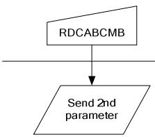 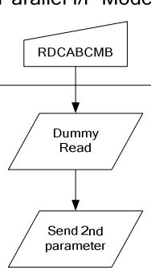 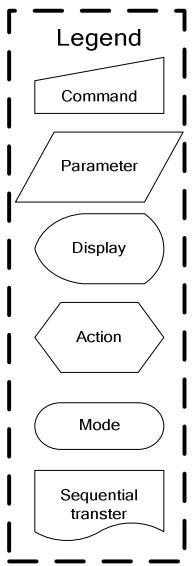</td></tr></table>

V1.0

## 9.2.45 RDFCS (Aah): Read First Checksum

<table><tr><td>AAH</td><td colspan="13">RDFCS (Read First Checksum)</td></tr><tr><td>Inst / Para</td><td>D/CX</td><td>WRX</td><td>RDX</td><td>D17-8</td><td>D7</td><td>D6</td><td>D5</td><td>D4</td><td>D3</td><td>D2</td><td>D1</td><td>D0</td><td>HEX</td></tr><tr><td>RDID1</td><td>0</td><td>↑</td><td>1</td><td>-</td><td>1</td><td>0</td><td>1</td><td>0</td><td>1</td><td>0</td><td>1</td><td>0</td><td>(Aah)</td></tr><tr><td> $1^{st}$  parameter</td><td>1</td><td>1</td><td>↑</td><td>-</td><td>-</td><td>-</td><td>-</td><td>-</td><td>-</td><td>-</td><td>-</td><td>-</td><td></td></tr><tr><td> $2^{nd}$  parameter</td><td>1</td><td>1</td><td>↑</td><td>-</td><td colspan="8">FCS[7:0]</td><td></td></tr><tr><td>Description</td><td colspan="13">- This command returns the first checksum what has been calculated from User&#x27;s area registers and the frame memory after the write access to those registers and/or frame memory has been done. $X = \text{can be '0' or '1'}$ </td></tr><tr><td>Restriction</td><td colspan="13">It will be necessary to wait 150ms after there is the last write access on User area registers before there can read this checksum value.</td></tr><tr><td rowspan="9">Register availability</td><td rowspan="8" colspan="13"></td></tr><tr></tr><tr></tr><tr></tr><tr></tr><tr></tr><tr></tr><tr></tr><tr><td colspan="8">Sleep In</td><td colspan="5">Yes</td></tr><tr><td rowspan="4">Default</td><td rowspan="4"></td><td colspan="4">Status</td><td colspan="7">Default Value</td><td rowspan="4"></td></tr><tr><td colspan="4">Power On Sequence</td><td colspan="7">00h</td></tr><tr><td colspan="4">S/W Reset</td><td colspan="7">00h</td></tr><tr><td colspan="4">H/W Reset</td><td colspan="7">00h</td></tr><tr><td>Flow Chart</td><td colspan="13">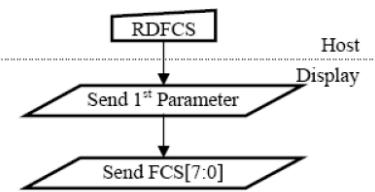 </td></tr></table>

## 9.2.46 RDCFCS (Afh): Read Continue Checksum

<table><tr><td>AFH</td><td colspan="13">RDCFCS (Read Continue Checksum)</td></tr><tr><td>Inst / Para</td><td>D/CX</td><td>WRX</td><td>RDX</td><td>D17-8</td><td>D7</td><td>D6</td><td>D5</td><td>D4</td><td>D3</td><td>D2</td><td>D1</td><td>D0</td><td>HEX</td></tr><tr><td>RDID1</td><td>0</td><td>↑</td><td>1</td><td>-</td><td>1</td><td>0</td><td>1</td><td>0</td><td>1</td><td>1</td><td>1</td><td>1</td><td>(Afh)</td></tr><tr><td> $1^{st}$  parameter</td><td>1</td><td>1</td><td>↑</td><td>-</td><td>-</td><td>-</td><td>-</td><td>-</td><td>-</td><td>-</td><td>-</td><td>-</td><td></td></tr><tr><td> $2^{nd}$  parameter</td><td>1</td><td>1</td><td>↑</td><td></td><td colspan="8">CCS[7:0]</td><td></td></tr><tr><td>Description</td><td colspan="13">- This command returns the continue checksum what has been calculated continuously after the first checksum has calculated from User&#x27;s area registers and the frame memory after the write access to those registers and/or frame memory has been done. $X = \text{can be '0' or '1'}$ </td></tr><tr><td>Restriction</td><td colspan="13">It will be necessary to wait 300ms after there is the last write access on User area registers before there can read this checksum value in the first time..</td></tr><tr><td rowspan="9">Register availability</td><td rowspan="8" colspan="13"></td></tr><tr></tr><tr></tr><tr></tr><tr></tr><tr></tr><tr></tr><tr></tr><tr><td colspan="8">Sleep In</td><td colspan="5">Yes</td></tr><tr><td rowspan="4">Default</td><td rowspan="4" colspan="13"></td></tr><tr></tr><tr></tr><tr></tr><tr><td>Flow Chart</td><td colspan="13">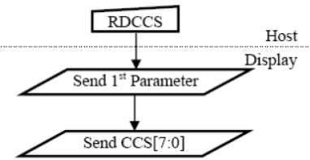 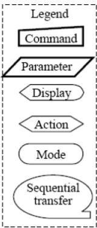</td></tr></table>

9.2.47 RDID1 (Dah): Read ID1

<table><tr><td>DAH</td><td colspan="13">RDID1 (Read ID1)</td></tr><tr><td>Inst / Para</td><td>D/CX</td><td>WRX</td><td>RDX</td><td>D17-8</td><td>D7</td><td>D6</td><td>D5</td><td>D4</td><td>D3</td><td>D2</td><td>D1</td><td>D0</td><td>HEX</td></tr></table>

2014/11

<table><tr><td>RDID1</td><td>0</td><td>↑</td><td>1</td><td>-</td><td>1</td><td>1</td><td>0</td><td>1</td><td>1</td><td>0</td><td>1</td><td>0</td><td>(Dah)</td></tr><tr><td> $1^{st}$  parameter</td><td>1</td><td>1</td><td>↑</td><td>-</td><td>-</td><td>-</td><td>-</td><td>-</td><td>-</td><td>-</td><td>-</td><td>-</td><td></td></tr><tr><td> $2^{nd}$  parameter</td><td>1</td><td>1</td><td>↑</td><td>-</td><td>ID17</td><td>ID16</td><td>ID15</td><td>ID14</td><td>ID13</td><td>ID12</td><td>ID11</td><td>ID10</td><td></td></tr><tr><td>Description</td><td colspan="13">-This read byte identifies the LCD module&#x27;s manufacturer.+: Don&#x27;t care.</td></tr><tr><td>Restriction</td><td colspan="13">-</td></tr><tr><td rowspan="6">Register availability</td><td rowspan="6"></td><td colspan="6">Status</td><td colspan="6">Availability</td></tr><tr><td colspan="6">Normal Mode On, Idle Mode Off, Sleep Out</td><td colspan="6">Yes</td></tr><tr><td colspan="6">Normal Mode On, Idle Mode On, Sleep Out</td><td colspan="6">Yes</td></tr><tr><td colspan="6">Partial Mode On, Idle Mode Off, Sleep Out</td><td colspan="6">Yes</td></tr><tr><td colspan="6">Partial Mode On, Idle Mode On, Sleep Out</td><td colspan="6">Yes</td></tr><tr><td colspan="6">Sleep In</td><td colspan="6">Yes</td></tr><tr><td rowspan="4">Default</td><td rowspan="4"></td><td colspan="3">Status</td><td colspan="9">Default Value</td></tr><tr><td colspan="3">Power On Sequence</td><td colspan="9">00h</td></tr><tr><td colspan="3">S/W Reset</td><td colspan="9">00h</td></tr><tr><td colspan="3">H/W Reset</td><td colspan="9">00h</td></tr><tr><td>Flow Chart</td><td></td><td colspan="8">Serial I/F Mode Parallel I/F Mode</td><td colspan="4">LegendCommandParameterDisplayActionModeSequential transter</td></tr></table>

## 9.2.48 RDID2 (DBh): Read ID2

<table><tr><td>DBH</td><td colspan="13">RDID2 (Read ID2)</td></tr><tr><td>Inst / Para</td><td>D/CX</td><td>WRX</td><td>RDX</td><td>D17-8</td><td>D7</td><td>D6</td><td>D5</td><td>D4</td><td>D3</td><td>D2</td><td>D1</td><td>D0</td><td>HEX</td></tr><tr><td>RDID2</td><td>0</td><td>↑</td><td>1</td><td>-</td><td>1</td><td>1</td><td>0</td><td>1</td><td>1</td><td>0</td><td>1</td><td>1</td><td>(DBh)</td></tr></table>

V1.0  
Sitronix Confidential The information contained herein is the exclusive property of Sitronix and shall not be distributed, reproduced, o disclosed in whole or in part without prior written permission of Sitronix.

<table><tr><td> $1^{st}$ parameter</td><td>1</td><td>1</td><td>↑</td><td>-</td><td>-</td><td>-</td><td>-</td><td>-</td><td>-</td><td>-</td><td>-</td><td>-</td><td></td></tr><tr><td> $2^{nd}$ parameter</td><td>1</td><td>1</td><td>↑</td><td>-</td><td>ID27</td><td>ID26</td><td>ID25</td><td>ID24</td><td>ID23</td><td>ID22</td><td>ID21</td><td>ID20</td><td></td></tr><tr><td>Description</td><td colspan="13">This read byte is used to track the LCD module/driver IC version.·: Don&#x27;t care.</td></tr><tr><td>Restriction</td><td colspan="13">-</td></tr><tr><td rowspan="8">Register availability</td><td rowspan="8" colspan="13"></td></tr><tr></tr><tr></tr><tr></tr><tr></tr><tr></tr><tr></tr><tr></tr><tr><td rowspan="6">Default</td><td rowspan="6" colspan="13"></td></tr><tr></tr><tr></tr><tr></tr><tr></tr><tr></tr><tr><td rowspan="7">Flow Chart</td><td rowspan="7" colspan="13"></td></tr><tr></tr><tr></tr><tr></tr><tr></tr><tr></tr><tr><td></td><td></td><td></td><td></td><td></td><td></td><td></td><td></td><td></td><td></td></tr></table>

## 9.2.49 RDID3 (DCh): Read ID3

<table><tr><td>DCH</td><td colspan="13">RDID3 (Read ID3)</td></tr><tr><td>Inst / Para</td><td>D/CX</td><td>WRX</td><td>RDX</td><td>D17-8</td><td>D7</td><td>D6</td><td>D5</td><td>D4</td><td>D3</td><td>D2</td><td>D1</td><td>D0</td><td>HEX</td></tr><tr><td>RDID3</td><td>0</td><td>↑</td><td>1</td><td>-</td><td>1</td><td>1</td><td>0</td><td>1</td><td>1</td><td>1</td><td>0</td><td>0</td><td>(DCh)</td></tr><tr><td> $1^{st}$  parameter</td><td>1</td><td>1</td><td>↑</td><td>-</td><td>-</td><td>-</td><td>-</td><td>-</td><td>-</td><td>-</td><td>-</td><td>-</td><td></td></tr></table>

V1.0

<table><tr><td> $2^{nd}$  parameter</td><td>1</td><td>1</td><td>↑</td><td>-</td><td>ID37</td><td>ID36</td><td>ID35</td><td>ID34</td><td>ID33</td><td>ID32</td><td>ID31</td><td>ID30</td><td></td></tr><tr><td>Description</td><td colspan="13">This read byte identifies the LCD module/driver.·: Don&#x27;t care.</td></tr><tr><td>Restriction</td><td colspan="13">-</td></tr><tr><td rowspan="8">Register availability</td><td rowspan="8" colspan="13"></td></tr><tr></tr><tr></tr><tr></tr><tr></tr><tr></tr><tr></tr><tr></tr><tr><td rowspan="6">Default</td><td rowspan="6" colspan="13"></td></tr><tr></tr><tr></tr><tr></tr><tr></tr><tr></tr><tr><td>Flow Chart</td><td colspan="13">Serial I/F Mode Parallel I/F ModeRead ID3Send 2nd parameter Dummy ReadSend 2nd parameter 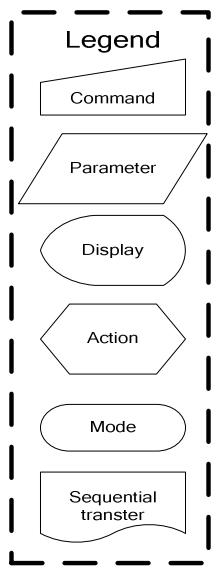</td></tr></table>

## 9.3.. Command Table 2

## 9.3.1 IFMODE (B0h): Interface Mode Control

<table><tr><td>B0H</td><td colspan="13">IFMODE (Interface Mode Control)</td></tr><tr><td>Inst / Para</td><td>D/CX</td><td>WRX</td><td>RDX</td><td>D17-8</td><td>D7</td><td>D6</td><td>D5</td><td>D4</td><td>D3</td><td>D2</td><td>D1</td><td>D0</td><td>HEX</td></tr><tr><td>IFMODE</td><td>0</td><td>↑</td><td>1</td><td>-</td><td>1</td><td>0</td><td>1</td><td>1</td><td>0</td><td>0</td><td>0</td><td>0</td><td>(B0h)</td></tr><tr><td> $1^{st}$  parameter</td><td>1</td><td>↑</td><td>1</td><td>-</td><td>SPI_EN</td><td>0</td><td>0</td><td>0</td><td>VSCP</td><td>HSCP</td><td>PKP</td><td>DEP</td><td>00h</td></tr><tr><td>Description</td><td colspan="13">Sets the operation status of the display interface. The setting becomes effective as soon as the command is received.</td></tr></table>

V1.0

<table><tr><td></td><td colspan="3">DEP: DE polarity (&quot;0&quot; = High enable for RGB interface, &quot;1&quot; = Low enable for RGB interface)PKP: PCLK polarity set (&quot;0&quot; = data fetched at the rising time, &quot;1&quot; = data fetched at the falling time)HSCP: HSYNC polarity (&quot;0&quot; = Low level sync clock, &quot;1&quot; = High level sync clock)VSCP: VSYNC polarity (&quot;0&quot; = Low level sync clock, &quot;1&quot; = High level sync clock)SPI_EN: 3/4 wire serial interface selectionSPI_EN = &quot;0&quot;, DIN and DOUT pins are used for 3/4 wire serial interface.SPI_EN = &quot;1&quot;, DIN/SDA pin is used for 3/4 wire serial interface and DOUT pin is not used.‘-&#x27;: Don&#x27;t care.</td></tr><tr><td>Restriction</td><td colspan="3">-</td></tr><tr><td rowspan="9">Register availability</td><td rowspan="9" colspan="3"></td></tr><tr></tr><tr></tr><tr></tr><tr></tr><tr></tr><tr></tr><tr></tr><tr></tr><tr><td rowspan="5">Default</td><td rowspan="5" colspan="3"></td></tr><tr></tr><tr></tr><tr></tr><tr></tr><tr><td>Flow Chart</td><td colspan="3"></td></tr></table>

9.3.2 FRMCTR1 (B1h): Frame Rate Control (In Normal Mode/Full Colors)

<table><tr><td>B1H</td><td colspan="13">FRMCTR1 (Frame Rate Control In Normal Mode/Full Colors)</td></tr><tr><td>Inst / Para</td><td>D/CX</td><td>WRX</td><td>RDX</td><td>D17-8</td><td>D7</td><td>D6</td><td>D5</td><td>D4</td><td>D3</td><td>D2</td><td>D1</td><td>D0</td><td>HEX</td></tr><tr><td>FRMCTR1</td><td>0</td><td>↑</td><td>1</td><td>-</td><td>1</td><td>0</td><td>1</td><td>1</td><td>0</td><td>0</td><td>0</td><td>1</td><td>(B1h)</td></tr><tr><td> $1^{st}$  parameter</td><td>1</td><td>↑</td><td>1</td><td>-</td><td colspan="4">FRS[3:0]</td><td>0</td><td>0</td><td colspan="2">DIVA[1:0]</td><td>A0h</td></tr><tr><td> $2^{nd}$  parameter</td><td>1</td><td>↑</td><td>1</td><td>-</td><td>0</td><td>0</td><td>0</td><td colspan="5">RTNA[4:0]</td><td>10h</td></tr><tr><td rowspan="3">Description</td><td colspan="13">FRS[3:0]: Sets the frame frequency of full color normal mode.DIVA [1:0] : division ratio for internal clocks when Normal mode.</td></tr><tr><td rowspan="2" colspan="4"></td><td colspan="2">DIVA [1:0]</td><td colspan="7">Inversion mode</td></tr><tr><td colspan="2">2&#x27;b00</td><td colspan="7">Fosc</td></tr></table>

V1.0

<table><tr><td rowspan="3"></td><td>2&#x27;b01</td><td>Fosc/2</td></tr><tr><td>2&#x27;b10</td><td>Fosc/4</td></tr><tr><td>2&#x27;b11</td><td>Fosc/8</td></tr><tr><td colspan="3">RTNA [4:0] : RTNA[4:0] is used to set 1H (line) period of Normal mode at CPU interface.Normal Display Mode On frame rate :Frame rate =  $\frac{10^7}{(168 + RTNA[4:0] + 32X(15 - FRS[3:0]))(480 + VFP[7:0] + VBP[7:0])}$ ‘-: Don&#x27;t care.</td></tr><tr><td>Restriction</td><td colspan="2">-</td></tr><tr><td rowspan="6">Register availability</td><td>Status</td><td>Availability</td></tr><tr><td>Normal Mode On, Idle Mode Off, Sleep Out</td><td>Yes</td></tr><tr><td>Normal Mode On, Idle Mode On, Sleep Out</td><td>Yes</td></tr><tr><td>Partial Mode On, Idle Mode Off, Sleep Out</td><td>Yes</td></tr><tr><td>Partial Mode On, Idle Mode On, Sleep Out</td><td>Yes</td></tr><tr><td>Sleep In</td><td>Yes</td></tr><tr><td rowspan="4">Default</td><td>Status</td><td>Default Value</td></tr><tr><td>Power On Sequence</td><td>N/A</td></tr><tr><td>S/W Reset</td><td>N/A</td></tr><tr><td>H/W Reset</td><td>N/A</td></tr><tr><td>Flow Chart</td><td colspan="2"></td></tr></table>

## 9.3.3 FRMCTR2 (B2h): Frame Rate Control 2 (In Idle Mode/8 colors)

<table><tr><td>B2H</td><td colspan="13">Frame Rate Control 2 (In Idle Mode/8 colors)</td></tr><tr><td>Inst / Para</td><td>D/CX</td><td>WRX</td><td>RDX</td><td>D17-8</td><td>D7</td><td>D6</td><td>D5</td><td>D4</td><td>D3</td><td>D2</td><td>D1</td><td>D0</td><td>HEX</td></tr><tr><td>FRC IDLE</td><td>0</td><td>↑</td><td>1</td><td>-</td><td>1</td><td>0</td><td>1</td><td>1</td><td>0</td><td>0</td><td>1</td><td>0</td><td>(B2h)</td></tr><tr><td> $1^{st}$  parameter</td><td>1</td><td>↑</td><td>1</td><td>-</td><td>0</td><td>0</td><td>0</td><td>0</td><td>0</td><td>0</td><td>0</td><td>0</td><td>00h</td></tr><tr><td> $2^{nd}$  parameter</td><td>1</td><td>↑</td><td>1</td><td>-</td><td>0</td><td>0</td><td>0</td><td colspan="5">RTNB[4:0]</td><td>10h</td></tr><tr><td>Description</td><td colspan="13">Sets the division ratio for internal clocks of Idle mode at CPU interface.RTNB [4:0] : RTNB[4:0] is used to set 1H (line) period of Idle mode at CPU interface.‘-’: Don’t care.</td></tr></table>

V1.0

<table><tr><td>Restriction</td><td colspan="3">-</td></tr><tr><td rowspan="7">Register availability</td><td colspan="3"></td></tr><tr><td colspan="2">Status</td><td>Availability</td></tr><tr><td colspan="2">Normal Mode On, Idle Mode Off, Sleep Out</td><td>Yes</td></tr><tr><td colspan="2">Normal Mode On, Idle Mode On, Sleep Out</td><td>Yes</td></tr><tr><td colspan="2">Partial Mode On, Idle Mode Off, Sleep Out</td><td>Yes</td></tr><tr><td colspan="2">Partial Mode On, Idle Mode On, Sleep Out</td><td>Yes</td></tr><tr><td colspan="2">Sleep In</td><td>Yes</td></tr><tr><td rowspan="5">Default</td><td colspan="3"></td></tr><tr><td>Status</td><td colspan="2">Default Value</td></tr><tr><td>Power On Sequence</td><td colspan="2">N/A</td></tr><tr><td>S/W Reset</td><td colspan="2">N/A</td></tr><tr><td>H/W Reset</td><td colspan="2">N/A</td></tr><tr><td>Flow Chart</td><td colspan="3"></td></tr></table>

9.3.4 FRMCTR3 (B3h): Frame Rate Control3 (In Partial Mode/Full Colors)

<table><tr><td>B3H</td><td colspan="13">Frame Rate Control 3(In Partial Mode/Full Colors)</td></tr><tr><td>Inst / Para</td><td>D/CX</td><td>WRX</td><td>RDX</td><td>D17-8</td><td>D7</td><td>D6</td><td>D5</td><td>D4</td><td>D3</td><td>D2</td><td>D1</td><td>D0</td><td>HEX</td></tr><tr><td>FRC PTL</td><td>0</td><td>↑</td><td>1</td><td>-</td><td>1</td><td>0</td><td>1</td><td>1</td><td>0</td><td>0</td><td>1</td><td>1</td><td>(B3h)</td></tr><tr><td> $1^{st}$  parameter</td><td>1</td><td>↑</td><td>1</td><td>-</td><td>0</td><td>0</td><td>0</td><td>0</td><td>0</td><td>0</td><td>0</td><td>0</td><td>00h</td></tr><tr><td> $2^{nd}$  parameter</td><td>1</td><td>↑</td><td>1</td><td>-</td><td>0</td><td>0</td><td>0</td><td colspan="5">RTNC[4:0]</td><td>10h</td></tr><tr><td>Description</td><td colspan="13">Sets the division ratio for internal clocks of Partial mode (Idle mode off) at CPU interface.RTNC [4:0] : RTNC[4:0] is used to set 1H (line) period of Partial mode at CPU interface.‘-’: Don't care.</td></tr><tr><td>Restriction</td><td colspan="13">-</td></tr><tr><td rowspan="7">Register availability</td><td colspan="13" rowspan="7"></td></tr><tr></tr><tr></tr><tr></tr><tr></tr><tr></tr><tr></tr><tr><td rowspan="5">Default</td><td colspan="13"></td></tr><tr><td>Status</td><td colspan="12">Default Value</td></tr><tr><td>Power On Sequence</td><td colspan="12">N/A</td></tr><tr><td>S/W Reset</td><td colspan="12">N/A</td></tr><tr><td>H/W Reset</td><td colspan="12">N/A</td></tr><tr><td>Flow Chart</td><td colspan="13"></td></tr></table>

9.3.5 DIC (B4): Display Inversion Control

<table><tr><td>B4H</td><td colspan="13">Display Inversion Control</td></tr><tr><td>Inst / Para</td><td>D/CX</td><td>WRX</td><td>RDX</td><td>D17-8</td><td>D7</td><td>D6</td><td>D5</td><td>D4</td><td>D3</td><td>D2</td><td>D1</td><td>D0</td><td>HEX</td></tr><tr><td>DIC</td><td>0</td><td>↑</td><td>1</td><td>-</td><td>1</td><td>0</td><td>1</td><td>1</td><td>0</td><td>1</td><td>0</td><td>0</td><td>(B4h)</td></tr><tr><td> $1^{st}$  parameter</td><td>1</td><td>↑</td><td>1</td><td>-</td><td></td><td></td><td></td><td></td><td></td><td></td><td colspan="2">DINV</td><td>01h</td></tr><tr><td rowspan="9">Description</td><td rowspan="8" colspan="13">DINV[1:0] : Set the inversion mode</td></tr><tr></tr><tr></tr><tr></tr><tr></tr><tr></tr><tr></tr><tr></tr><tr><td colspan="13">Don&#x27;t care.</td></tr><tr><td>Restriction</td><td colspan="13">-</td></tr><tr><td rowspan="32">Register availability</td><td rowspan="19" colspan="13"></td></tr><tr></tr><tr></tr><tr></tr><tr></tr><tr></tr><tr><td rowspan="13"></td><td rowspan="13"></td><td rowspan="13"></td><td rowspan="13"></td><td rowspan="13"></td><td rowspan="13"></td><td rowspan="13"></td><td rowspan="13"></td><td rowspan="13"></td></tr><tr></tr><tr></tr><tr></tr><tr></tr><tr></tr><tr></tr><tr></tr><tr></tr><tr></tr><tr></tr><tr></tr><tr></tr><tr><td rowspan="13" colspan="13"></td></tr><tr></tr><tr></tr><tr></tr><tr></tr><tr></tr><tr><td rowspan="7"></td><td rowspan="7"></td><td rowspan="7"></td><td rowspan="7"></td><td rowspan="7"></td><td rowspan="7"></td><td rowspan="7"></td><td rowspan="7"></td><td rowspan="7"></td><td rowspan="7"></td></tr><tr></tr><tr></tr><tr></tr><tr></tr><tr></tr><tr></tr></table>

2014/11

<table><tr><td colspan="2">Sitronix</td><td>ST7796S</td></tr><tr><td>Flow Chart</td><td colspan="2"></td></tr></table>

9.3.6 BPC(B5): Blanking Porch Control

<table><tr><td>B5H</td><td colspan="13">Blanking Porch Control</td></tr><tr><td>Inst / Para</td><td>D/CX</td><td>WRX</td><td>RDX</td><td>D17-8</td><td>D7</td><td>D6</td><td>D5</td><td>D4</td><td>D3</td><td>D2</td><td>D1</td><td>D0</td><td>HEX</td></tr><tr><td>BPC</td><td>0</td><td>↑</td><td>1</td><td>-</td><td>1</td><td>0</td><td>1</td><td>1</td><td>0</td><td>1</td><td>0</td><td>1</td><td>(B5h)</td></tr><tr><td> $1^{st}$  parameter</td><td>1</td><td>↑</td><td>1</td><td>-</td><td colspan="8">VFP[7:0]</td><td>02h</td></tr><tr><td> $2^{nd}$  parameter</td><td>1</td><td>↑</td><td>1</td><td>-</td><td colspan="8">VBP[7:0]</td><td>02h</td></tr><tr><td> $3^{rd}$  parameter</td><td>1</td><td>↑</td><td>1</td><td></td><td>0</td><td>0</td><td>0</td><td>0</td><td>0</td><td>0</td><td>0</td><td>0</td><td>00h</td></tr><tr><td> $4^{th}$  parameter</td><td>1</td><td>↑</td><td>1</td><td>-</td><td colspan="8">HBP[7:0]</td><td>04h</td></tr><tr><td rowspan="21">Description</td><td colspan="13">VFP [7:0] / VBP[7:0]: The FP [7:0] and BP [7:0] bits specify the line number of vertical front and back porch period respectively.</td></tr><tr><td colspan="2">VFP [7:0]</td><td colspan="4">Front porch of Number lines</td><td colspan="2">VBP [7:0]</td><td colspan="5">Front porch of Number lines</td></tr><tr><td colspan="2">00h</td><td colspan="4">Reserved</td><td colspan="2">00h</td><td colspan="5">Reserved</td></tr><tr><td colspan="2">01h</td><td colspan="4">Reserved</td><td colspan="2">01h</td><td colspan="5">Reserved</td></tr><tr><td colspan="2">02h</td><td colspan="4">2</td><td colspan="2">02h</td><td colspan="5">2</td></tr><tr><td colspan="2">:</td><td colspan="4">:</td><td colspan="2">:</td><td colspan="5">:</td></tr><tr><td colspan="2">:</td><td colspan="4">:</td><td colspan="2">:</td><td colspan="5">:</td></tr><tr><td colspan="2">FDh</td><td colspan="4">253</td><td colspan="2">FDh</td><td colspan="5">253</td></tr><tr><td colspan="2">Feh</td><td colspan="4">254</td><td colspan="2">Feh</td><td colspan="5">254</td></tr><tr><td colspan="2">FFh</td><td colspan="4">255</td><td colspan="2">FFh</td><td colspan="5">255</td></tr><tr><td colspan="13">HBP [7:0]: The HBP[7:0] bits specify the dotclk number of horizontal back porch period.</td></tr><tr><td colspan="5">HBP [7:0]</td><td colspan="8">Back porch of Number lines</td></tr><tr><td colspan="5">00h</td><td colspan="8">Reserved</td></tr><tr><td colspan="5">01h</td><td colspan="8">Reserved</td></tr><tr><td colspan="5">02h</td><td colspan="8">2</td></tr><tr><td colspan="5">:</td><td colspan="8">:</td></tr><tr><td colspan="5">:</td><td colspan="8">:</td></tr><tr><td colspan="5">FDh</td><td colspan="8">253</td></tr><tr><td colspan="5">Feh</td><td colspan="8">254</td></tr><tr><td colspan="5">FFh</td><td colspan="8">255</td></tr><tr><td colspan="13">‘-’: Don’t care.</td></tr></table>

V1.0

<table><tr><td>Restriction</td><td colspan="3">-</td></tr><tr><td rowspan="7">Register availability</td><td colspan="3"></td></tr><tr><td colspan="2">Status</td><td>Availability</td></tr><tr><td colspan="2">Normal Mode On, Idle Mode Off, Sleep Out</td><td>Yes</td></tr><tr><td colspan="2">Normal Mode On, Idle Mode On, Sleep Out</td><td>Yes</td></tr><tr><td colspan="2">Partial Mode On, Idle Mode Off, Sleep Out</td><td>Yes</td></tr><tr><td colspan="2">Partial Mode On, Idle Mode On, Sleep Out</td><td>Yes</td></tr><tr><td colspan="2">Sleep In</td><td>Yes</td></tr><tr><td rowspan="5">Default</td><td colspan="3"></td></tr><tr><td>Status</td><td colspan="2">Default Value</td></tr><tr><td>Power On Sequence</td><td colspan="2">N/A</td></tr><tr><td>S/W Reset</td><td colspan="2">N/A</td></tr><tr><td>H/W Reset</td><td colspan="2">N/A</td></tr><tr><td>Flow Chart</td><td colspan="3"></td></tr></table>

## 9.3.7 DFC(B6): Display Function Control

<table><tr><td>B6H</td><td colspan="13">Blanking Porch Control</td></tr><tr><td>Inst / Para</td><td>D/CX</td><td>WRX</td><td>RDX</td><td>D17-8</td><td>D7</td><td>D6</td><td>D5</td><td>D4</td><td>D3</td><td>D2</td><td>D1</td><td>D0</td><td>HEX</td></tr><tr><td>DFC</td><td>0</td><td>↑</td><td>1</td><td>-</td><td>1</td><td>0</td><td>1</td><td>1</td><td>0</td><td>1</td><td>1</td><td>0</td><td>(B6h)</td></tr><tr><td> $1^{st}$  parameter</td><td>1</td><td>↑</td><td>1</td><td>-</td><td>BYPASS</td><td>RCM</td><td>RM</td><td>0</td><td colspan="2">PTG[1:0]</td><td colspan="2">PT[1:0]</td><td>80h</td></tr><tr><td> $2^{nd}$  parameter</td><td>1</td><td>↑</td><td>1</td><td>-</td><td></td><td>GS</td><td>SS</td><td>SM</td><td colspan="4">ISC[3:0]</td><td>02h</td></tr><tr><td> $3^{rd}$  parameter</td><td>1</td><td>↑</td><td>1</td><td>-</td><td>0</td><td>0</td><td colspan="6">NL[5:0]</td><td>3Bh</td></tr><tr><td rowspan="9">Description</td><td colspan="13">RM: Select the interface to access the GRAM. When RM=&#x27;0&#x27;, the driver will write display data to GRAM via system interface and the driver will write display data to GRAM via RGB interface when RM=&#x27;1&#x27;.</td></tr><tr><td colspan="5">RM</td><td colspan="8">Interface for RAM access</td></tr><tr><td colspan="5">0</td><td colspan="8">System Interface</td></tr><tr><td colspan="5">1</td><td colspan="8">RGB interface</td></tr><tr><td colspan="13">RCM: RGB interface selection (refer to the RGB interface section).</td></tr><tr><td colspan="5">RCM</td><td colspan="8">RGB transfer mode</td></tr><tr><td colspan="5">0</td><td colspan="8">DE Mode</td></tr><tr><td colspan="5">1</td><td colspan="8">SYNC Mode</td></tr><tr><td colspan="13">BYPASS: Select the display data path whether memory or direct to shift register when RGB interface is used.</td></tr></table>

Sitronix Confidential The information contained herein is the exclusive property of Sitronix and shall not be distributed, reproduced, or disclosed in whole or in part without prior written permission of Sitronix.

<table><tr><td>BYPASS</td><td>Display data path</td></tr><tr><td>0</td><td>Memory</td></tr><tr><td>1</td><td>Direct to shift register</td></tr></table>

Note: RGB input signal, when set to bypass mode the Hsync low≧3,HBP≧3, HFP≧10.

PTG [1:0]: Set the scan mode in non-display area.

<table><tr><td colspan="2">PTG [1:0]</td><td>Gate outputs in non-display area</td><td>Source outputs in non-display area</td></tr><tr><td>0</td><td>0</td><td>Normal scan</td><td>Set with the PT[2:0] bits</td></tr><tr><td>0</td><td>1</td><td>Setting prohibited</td><td>--</td></tr><tr><td>1</td><td>0</td><td>Interval scan</td><td>Set with the PT[2:0] bits</td></tr><tr><td>1</td><td>1</td><td>Setting prohibited</td><td>--</td></tr></table>

PT [1:0]: Determine source/VCOM output in a non-display area in the partial display mode.

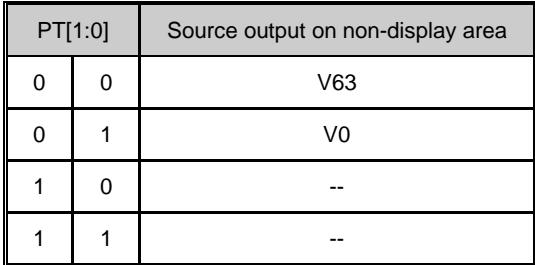

SS: Select the shift direction of outputs from the source driver.

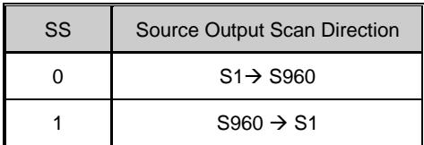

In addition to the shift direction, the settings for both SS and BGR bits are required to change the assignment of R, G, B dots to the source driver pins.

To assign R, G, B dots to the source driver pins from S1 to S960, set SS = 0.

To assign R, G, B dots to the source driver pins from S960 to S1, set SS = 1.

ICS[3:0] : Set the scan cycle when PTG selects interval scan in non-display area drive period. The scan cycle is defined by n frame periods, where n is an odd number from 3 to 31. The polarity of liquid crystal drive voltage from the gate driver is inverted in the same timing as the interval scan cycle.

<table><tr><td colspan="4">GS: Sets the direction of scan by the gate driver.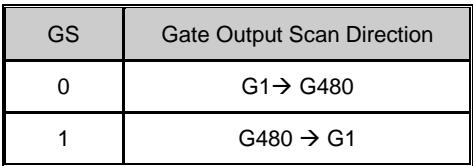SM: Sets the gate driver pin arrangement in combination with the GS to select the optimal scan mode for the module.</td></tr><tr><td>SM</td><td>GS</td><td>Scan Direction</td><td>Gate Output Sequence</td></tr><tr><td>0</td><td>0</td><td>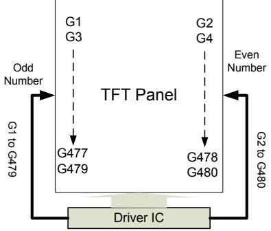</td><td>G1,G2,G3,G4......,G476G477,G478,G479,G480</td></tr><tr><td>0</td><td>1</td><td>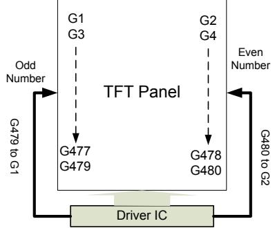</td><td>G480,G479......G8G7,G6,G5,G4,G3,G2,G1</td></tr><tr><td>1</td><td>0</td><td>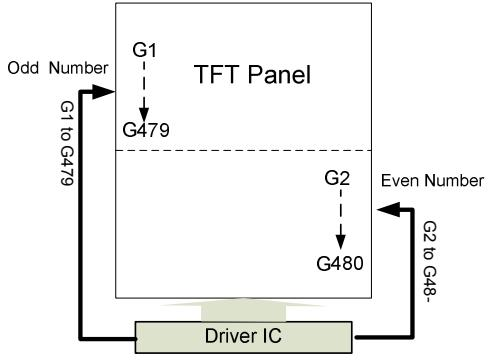</td><td>G1,G3,G5......G471G473,G475,G477,G479G2,G4,G6......G472G474,G476,G478,G480</td></tr></table>

<table><tr><td rowspan="6"></td><td colspan="2">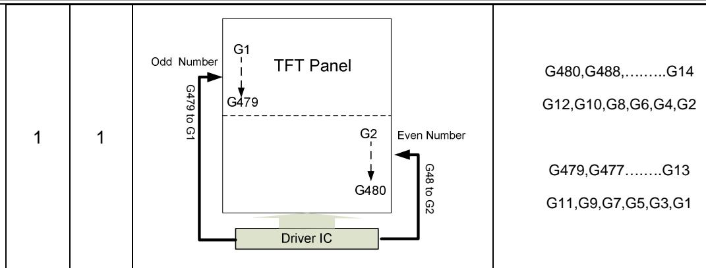</td></tr><tr><td colspan="2">NL [5:0]: Sets the number of lines to drive the LCD at an interval of 8 lines. The GRAM address mapping is not affected by the number of lines set by NL[5:0]. The number of lines must be the same or more than the number of lines necessary for the size of the liquid crystal panel.</td></tr><tr><td>NL[5:0]</td><td>LCD Drive Line</td></tr><tr><td>6&#x27;h00 ~ 6&#x27;h3B</td><td>8 * (NL5:0)+1) lines</td></tr><tr><td>other</td><td>Setting inhibited</td></tr><tr><td colspan="2">-&#x27;: Don&#x27;t care.</td></tr><tr><td>Restriction</td><td colspan="2">-</td></tr><tr><td rowspan="6">Register availability</td><td>Status</td><td>Availability</td></tr><tr><td>Normal Mode On, Idle Mode Off, Sleep Out</td><td>Yes</td></tr><tr><td>Normal Mode On, Idle Mode On, Sleep Out</td><td>Yes</td></tr><tr><td>Partial Mode On, Idle Mode Off, Sleep Out</td><td>Yes</td></tr><tr><td>Partial Mode On, Idle Mode On, Sleep Out</td><td>Yes</td></tr><tr><td>Sleep In</td><td>Yes</td></tr><tr><td rowspan="4">Default</td><td>Status</td><td>Default Value</td></tr><tr><td>Power On Sequence</td><td>N/A</td></tr><tr><td>S/W Reset</td><td>N/A</td></tr><tr><td>H/W Reset</td><td>N/A</td></tr><tr><td>Flow Chart</td><td colspan="2"></td></tr></table>

V1.0

9.3.8 EM(B7): Entry Mode Set

<table><tr><td>B7H</td><td colspan="13">Entry Mode Set</td></tr><tr><td>Inst / Para</td><td>D/CX</td><td>WRX</td><td>RDX</td><td>D17-8</td><td>D7</td><td>D6</td><td>D5</td><td>D4</td><td>D3</td><td>D2</td><td>D1</td><td>D0</td><td>HEX</td></tr><tr><td>EM</td><td>0</td><td>↑</td><td>1</td><td>-</td><td>1</td><td>0</td><td>1</td><td>1</td><td>0</td><td>1</td><td>1</td><td>1</td><td>(B7h)</td></tr><tr><td> $1^{st}$  parameter</td><td>1</td><td>↑</td><td>1</td><td>-</td><td colspan="2">EPF[1:0]</td><td>0</td><td>0</td><td>DSTB</td><td>GON</td><td>DTE</td><td>0</td><td>06h</td></tr><tr><td rowspan="14">Description</td><td colspan="13" rowspan="8">DSTB: In Deep Standby mode (DSTB=1), both internal logic power and SRAM power are turn off, the display data stored in the Frame Memory and the instructions are not saved. Rewrite Frame Memory content and instructions after the Deep Standby Mode is exited. Exit the Deep Standby Mode is as below,Exit Deep Standby Mode by pull down CSX to low ("0") 6 times.Exit Deep Standby Mode by input RESX pulse.GON/DTE: Set the output level of gate driver G1 ~ G480 as follows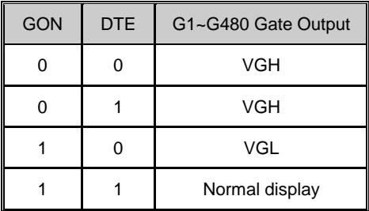EPF[1:0] Set the data format when 16bbp (R,G,B) to 18 bbp (r, g, b) is stored in the internal GRAMEPF[1:0] 65k (R, G, B) to 262k (r, g, b)00 r(0) = b(0) = "0"01 r(0) = b(0) = "1"10 The MSB value is written to the LSB.11 r(0) = b(0) = G(0)‘:- Don't care.</td></tr><tr></tr><tr></tr><tr></tr><tr></tr><tr></tr><tr></tr><tr></tr><tr><td colspan="13">Status Availability</td></tr><tr><td colspan="13">Normal Mode On, Idle Mode Off, Sleep Out Yes</td></tr><tr><td colspan="13">Normal Mode On, Idle Mode On, Sleep Out Yes</td></tr><tr><td colspan="13">Partial Mode On, Idle Mode Off, Sleep Out Yes</td></tr><tr><td colspan="13">Partial Mode On, Idle Mode On, Sleep Out Yes</td></tr><tr><td colspan="13">Sleep In Yes</td></tr><tr><td rowspan="5">Default</td><td colspan="13"></td></tr><tr><td>Status</td><td colspan="12">Default Value</td></tr><tr><td>Power On Sequence</td><td colspan="12">N/A</td></tr><tr><td>S/W Reset</td><td colspan="12">N/A</td></tr><tr><td>H/W Reset</td><td colspan="12">N/A</td></tr><tr><td>Flow Chart</td><td colspan="13"></td></tr></table>

## 9.3.9 PWR1(C0h): Power Control 1

<table><tr><td>C0H</td><td colspan="13">PWR1 (Power Control 1)</td></tr><tr><td>Inst / Para</td><td>D/CX</td><td>WRX</td><td>RDX</td><td>D17-8</td><td>D7</td><td>D6</td><td>D5</td><td>D4</td><td>D3</td><td>D2</td><td>D1</td><td>D0</td><td>HEX</td></tr><tr><td></td><td>0</td><td>↑</td><td>1</td><td>-</td><td>1</td><td>1</td><td>0</td><td>0</td><td>0</td><td>0</td><td>0</td><td>0</td><td>(C0h)</td></tr><tr><td> $1^{st}$ parameter</td><td>1</td><td>↑</td><td>1</td><td>-</td><td colspan="2">AVDDS[1:0]</td><td colspan="2">AVCLS[1:0]</td><td colspan="4"></td><td>80h</td></tr><tr><td> $2^{nd}$ parameter</td><td>1</td><td>↑</td><td>1</td><td>-</td><td>0</td><td colspan="3">VGHS[2:0]</td><td>0</td><td colspan="3">VGLS[2:0]</td><td>25h</td></tr><tr><td rowspan="13">Description</td><td colspan="13">AVDDS[1:0]/AVCLS[1:0]: AVDD/AVCL setting is as below.</td></tr><tr><td colspan="2">AVDDS[1:0]</td><td>AVDD</td><td>AVDDS[1:0]</td><td colspan="2">AVDD</td><td colspan="2">AVCLS[1:0]</td><td>AVCL</td><td colspan="2">AVCLS[1:0]</td><td colspan="2">AVCL</td></tr><tr><td colspan="2">0</td><td>6.20</td><td>2</td><td colspan="2">6.60</td><td colspan="2">0</td><td>-4.4</td><td colspan="2">2</td><td colspan="2">-4.8</td></tr><tr><td colspan="2">1</td><td>6.40</td><td>3</td><td colspan="2">6.80</td><td colspan="2">1</td><td>-4.6</td><td colspan="2">3</td><td colspan="2">-5.0</td></tr><tr><td rowspan="9" colspan="4">VGHS/ VGLS[2:0]: VGH/L voltage setting,VGHS[2:0]</td><td colspan="2">VGH</td><td colspan="2">VGLS[2:0]</td><td colspan="5">VGL</td></tr><tr><td>0</td><td>12.541</td><td colspan="2">0</td><td colspan="5">-7.158</td></tr><tr><td>1</td><td>12.889</td><td colspan="2">1</td><td colspan="5">-7.667</td></tr><tr><td>2</td><td>13.257</td><td colspan="2">2</td><td colspan="5">-8.235</td></tr><tr><td>3</td><td>13.647</td><td colspan="2">3</td><td colspan="5">-8.875</td></tr><tr><td>4</td><td>14.061</td><td colspan="2">4</td><td colspan="5">-9.600</td></tr><tr><td>5</td><td>14.500</td><td colspan="2">5</td><td colspan="5">-10.429</td></tr><tr><td>6</td><td>14.968</td><td colspan="2">6</td><td colspan="5">-11.385</td></tr><tr><td>7</td><td>15.467</td><td colspan="2">7</td><td colspan="5">-12.500</td></tr><tr><td>Restriction</td><td colspan="13">-</td></tr><tr><td rowspan="5">Register availability</td><td rowspan="5" colspan="13"></td></tr><tr></tr><tr></tr><tr></tr><tr></tr></table>

V1.0

## Sitronix

ST7796S

<table><tr><td></td><td></td><td colspan="2">Sleep In</td><td>Yes</td><td></td></tr><tr><td rowspan="5">Default</td><td rowspan="5" colspan="5"></td></tr><tr></tr><tr></tr><tr></tr><tr></tr><tr><td>Flow Chart</td><td colspan="5"></td></tr></table>

## 9.3.10 PWR2 (C1h): Power Control 2

<table><tr><td>C1H</td><td colspan="13">PWR2 (Power Control 2)</td></tr><tr><td>Inst / Para</td><td>D/CX</td><td>WRX</td><td>RDX</td><td>D17-8</td><td>D7</td><td>D6</td><td>D5</td><td>D4</td><td>D3</td><td>D2</td><td>D1</td><td>D0</td><td>HEX</td></tr><tr><td></td><td>0</td><td>↑</td><td>1</td><td>-</td><td>1</td><td>1</td><td>0</td><td>0</td><td>0</td><td>0</td><td>0</td><td>1</td><td>(C1h)</td></tr><tr><td> $1^{st}$ parameter</td><td>1</td><td>↑</td><td>1</td><td>-</td><td>0</td><td colspan="7">VRH[6:0]</td><td>13h</td></tr></table>

<table><tr><td rowspan="22">Description</td><td>VRH[6:0]</td><td>VAP(GVDD) (V)</td><td>VRH[6:0]</td><td>VAP(GVDD) (V)</td></tr><tr><td>00h</td><td>3.55+(vcom+vcom offset)</td><td>15h</td><td>4.6+( vcom+vcom offset)</td></tr><tr><td>01h</td><td>3.6+( vcom+vcom offset)</td><td>16h</td><td>4.65+( vcom+vcom offset)</td></tr><tr><td>02h</td><td>3.65+( vcom+vcom offset)</td><td>17h</td><td>4.7+( vcom+vcom offset)</td></tr><tr><td>03h</td><td>3.7+( vcom+vcom offset)</td><td>18h</td><td>4.75+( vcom+vcom offset)</td></tr><tr><td>04h</td><td>3.75+( vcom+vcom offset)</td><td>19h</td><td>4.8+( vcom+vcom offset)</td></tr><tr><td>05h</td><td>3.8+( vcom+vcom offset)</td><td>1Ah</td><td>4.85+( vcom+vcom offset)</td></tr><tr><td>06h</td><td>3.85+( vcom+vcom offset)</td><td>1Bh</td><td>4.9+( vcom+vcom offset)</td></tr><tr><td>07h</td><td>3.9+( vcom+vcom offset)</td><td>1Ch</td><td>4.95+( vcom+vcom offset)</td></tr><tr><td>08h</td><td>3.95+( vcom+vcom offset)</td><td>1Dh</td><td>5+( vcom+vcom offset)</td></tr><tr><td>09h</td><td>4+( vcom+vcom offset)</td><td>1Eh</td><td>5.05+( vcom+vcom offset)</td></tr><tr><td>0Ah</td><td>4.05+( vcom+vcom offset)</td><td>1Fh</td><td>5.1+( vcom+vcom offset)</td></tr><tr><td>0Bh</td><td>4.1+( vcom+vcom offset)</td><td>20h</td><td>5.15+( vcom+vcom offset)</td></tr><tr><td>0Ch</td><td>4.15+( vcom+vcom offset)</td><td>21h</td><td>5.2+( vcom+vcom offset)</td></tr><tr><td>0Dh</td><td>4.2+( vcom+vcom offset)</td><td>22h</td><td>5.25+( vcom+vcom offset)</td></tr><tr><td>0Eh</td><td>4.25+( vcom+vcom offset)</td><td>23h</td><td>5.3+( vcom+vcom offset)</td></tr><tr><td>0Fh</td><td>4.3+( vcom+vcom offset)</td><td>24h</td><td>5.35+( vcom+vcom offset)</td></tr><tr><td>10h</td><td>4.35+( vcom+vcom offset)</td><td>25h</td><td>5.4+( vcom+vcom offset)</td></tr><tr><td>11h</td><td>4.4+( vcom+vcom offset)</td><td>26h</td><td>5.45+( vcom+vcom offset)</td></tr><tr><td>12h</td><td>4.45+( vcom+vcom offset)</td><td>27h</td><td>5.5+( vcom+vcom offset)</td></tr><tr><td>13h</td><td>4.5+( vcom+vcom offset)</td><td>28h~3Fh</td><td>Reserved</td></tr><tr><td>14h</td><td>4.55+( vcom+vcom offset)</td><td>--</td><td>--</td></tr></table>

<table><tr><td>VRH[5:0]</td><td>VAN(GVCL) (V)</td><td>VRH[5:0]</td><td>VAN(GVCL) (V)</td></tr><tr><td>00h</td><td>-3.55+(vcom+vcom offset)</td><td>15h</td><td>-4.6+( vcom+vcom offset)</td></tr><tr><td>01h</td><td>-3.6+( vcom+vcom offset)</td><td>16h</td><td>-4.65+( vcom+vcom offset)</td></tr><tr><td>02h</td><td>-3.65+( vcom+vcom offset)</td><td>17h</td><td>-4.7+( vcom+vcom offset)</td></tr><tr><td>03h</td><td>-3.7+( vcom+vcom offset)</td><td>18h</td><td>-4.75+( vcom+vcom offset)</td></tr><tr><td>04h</td><td>-3.75+( vcom+vcom offset)</td><td>19h</td><td>-4.8+( vcom+vcom offset)</td></tr><tr><td>05h</td><td>-3.8+( vcom+vcom offset)</td><td>1Ah</td><td>-4.85+( vcom+vcom offset)</td></tr><tr><td>06h</td><td>-3.85+( vcom+vcom offset)</td><td>1Bh</td><td>-4.9+( vcom+vcom offset)</td></tr></table>

<table><tr><td rowspan="14"></td><td>07h</td><td>-3.9+(vcom+vcom offset)</td><td>1Ch</td><td>-4.95+(vcom+vcom offset)</td></tr><tr><td>08h</td><td>-3.95+(vcom+vcom offset)</td><td>1Dh</td><td>-5+(vcom+vcom offset)</td></tr><tr><td>09h</td><td>-4+(vcom+vcom offset)</td><td>1Eh</td><td>-5.05+(vcom+vcom offset)</td></tr><tr><td>0Ah</td><td>-4.05+(vcom+vcom offset)</td><td>1Fh</td><td>-5.1+(vcom+vcom offset)</td></tr><tr><td>0Bh</td><td>-4.1+(vcom+vcom offset)</td><td>20h</td><td>-5.15+(vcom+vcom offset)</td></tr><tr><td>0Ch</td><td>-4.15+(vcom+vcom offset)</td><td>21h</td><td>-5.2+(vcom+vcom offset)</td></tr><tr><td>0Dh</td><td>-4.2+(vcom+vcom offset)</td><td>22h</td><td>-5.25+(vcom+vcom offset)</td></tr><tr><td>0Eh</td><td>-4.25+(vcom+vcom offset)</td><td>23h</td><td>-5.3+(vcom+vcom offset)</td></tr><tr><td>0Fh</td><td>-4.3+(vcom+vcom offset)</td><td>24h</td><td>-5.35+(vcom+vcom offset)</td></tr><tr><td>10h</td><td>-4.35+(vcom+vcom offset)</td><td>25h</td><td>-5.4+(vcom+vcom offset)</td></tr><tr><td>11h</td><td>-4.4+(vcom+vcom offset)</td><td>26h</td><td>-5.45+(vcom+vcom offset)</td></tr><tr><td>12h</td><td>-4.45+(vcom+vcom offset)</td><td>27h</td><td>-5.5+(vcom+vcom offset)</td></tr><tr><td>13h</td><td>-4.5+(vcom+vcom offset)</td><td>28h~3Fh</td><td>Reserved</td></tr><tr><td>14h</td><td>-4.55+(vcom+vcom offset)</td><td>--</td><td>--</td></tr><tr><td colspan="5">Note:Vcom default value is 1ch(Vcom=1.0V)Vcom offset value is 00h(Vcom offset=0 step)*: Don&#x27;t care.</td></tr><tr><td>Restriction</td><td colspan="4">-</td></tr><tr><td rowspan="16">Register availability</td><td rowspan="16" colspan="4"></td></tr><tr></tr><tr></tr><tr></tr><tr></tr><tr></tr><tr></tr><tr></tr><tr></tr><tr></tr><tr></tr><tr></tr><tr></tr><tr></tr><tr></tr><tr></tr></table>

## 9.3.11 PWR3 (C2h): Power Control 3

<table><tr><td>C2H</td><td colspan="13">PWR3 (Power Control 3)</td></tr><tr><td>Inst / Para</td><td>D/CX</td><td>WRX</td><td>RDX</td><td>D17-8</td><td>D7</td><td>D6</td><td>D5</td><td>D4</td><td>D3</td><td>D2</td><td>D1</td><td>D0</td><td>HEX</td></tr><tr><td></td><td>0</td><td>↑</td><td>1</td><td>-</td><td>1</td><td>1</td><td>0</td><td>1</td><td>0</td><td>0</td><td>0</td><td>0</td><td>(C2h)</td></tr><tr><td> $1^{st}$ parameter</td><td>1</td><td>↑</td><td>1</td><td></td><td></td><td></td><td></td><td></td><td colspan="2">SOP[1:0]</td><td colspan="2">GOP[1:0]</td><td></td></tr><tr><td rowspan="14">Description</td><td rowspan="8" colspan="13">SOP[1:0]: Source driving current levelGOP[1:0]: Gamma driving current level‘-’: Don&#x27;t care.</td></tr><tr></tr><tr></tr><tr></tr><tr></tr><tr></tr><tr></tr><tr></tr><tr><td colspan="7">Status</td><td colspan="6">Availability</td></tr><tr><td colspan="7">Normal Mode On, Idle Mode Off, Sleep Out</td><td colspan="6">Yes</td></tr><tr><td colspan="7">Normal Mode On, Idle Mode On, Sleep Out</td><td colspan="6">Yes</td></tr><tr><td colspan="7">Partial Mode On, Idle Mode Off, Sleep Out</td><td colspan="6">Yes</td></tr><tr><td colspan="7">Partial Mode On, Idle Mode On, Sleep Out</td><td colspan="6">Yes</td></tr><tr><td colspan="7">Sleep In</td><td colspan="6">Yes</td></tr><tr><td rowspan="4">Default</td><td rowspan="4" colspan="2"></td><td colspan="3">Status</td><td colspan="6">Default Value</td><td rowspan="4" colspan="2"></td></tr><tr><td colspan="3">Power On Sequence</td><td colspan="6">N/A</td></tr><tr><td colspan="3">S/W Reset</td><td colspan="6">N/A</td></tr><tr><td colspan="3">H/W Reset</td><td colspan="6">N/A</td></tr><tr><td>Flow Chart</td><td colspan="13"></td></tr></table>

9.3.12 VCMPCTL(C5h): VCOM Control

<table><tr><td>C5H</td><td colspan="13">VCMPCTL (Vcom Control)</td></tr><tr><td>Inst / Para</td><td>D/CX</td><td>WRX</td><td>RDX</td><td>D17-8</td><td>D7</td><td>D6</td><td>D5</td><td>D4</td><td>D3</td><td>D2</td><td>D1</td><td>D0</td><td>HEX</td></tr><tr><td></td><td>0</td><td>↑</td><td>1</td><td>-</td><td>1</td><td>1</td><td>0</td><td>0</td><td>0</td><td>1</td><td>0</td><td>1</td><td>(C5h)</td></tr><tr><td> $1^{st}$ parameter</td><td>1</td><td>↑</td><td>1</td><td>-</td><td>-</td><td>-</td><td colspan="6">VCMP[5:0]</td><td>1Ch</td></tr></table>

V1.0

<table><tr><td rowspan="18">Description</td><td colspan="8">VCMP[5:0]: Set the relative of VCOM</td></tr><tr><td>VCMP[5:0]</td><td>VCOM</td><td>VCMP[5:0]</td><td>VCOM</td><td>VCMP[5:0]</td><td>VCOM</td><td>VCMP[5:0]</td><td>VCOM</td></tr><tr><td>0</td><td>0.300</td><td>16</td><td>0.700</td><td>32</td><td>1.100</td><td>48</td><td>1.500</td></tr><tr><td>1</td><td>0.325</td><td>17</td><td>0.725</td><td>33</td><td>1.125</td><td>49</td><td>1.525</td></tr><tr><td>2</td><td>0.350</td><td>18</td><td>0.750</td><td>34</td><td>1.150</td><td>50</td><td>1.550</td></tr><tr><td>3</td><td>0.375</td><td>19</td><td>0.775</td><td>35</td><td>1.175</td><td>51</td><td>1.575</td></tr><tr><td>4</td><td>0.400</td><td>20</td><td>0.800</td><td>36</td><td>1.200</td><td>52</td><td>1.600</td></tr><tr><td>5</td><td>0.425</td><td>21</td><td>0.825</td><td>37</td><td>1.225</td><td>53</td><td>1.625</td></tr><tr><td>6</td><td>0.450</td><td>22</td><td>0.850</td><td>38</td><td>1.250</td><td>54</td><td>1.650</td></tr><tr><td>7</td><td>0.475</td><td>23</td><td>0.875</td><td>39</td><td>1.275</td><td>55</td><td>1.675</td></tr><tr><td>8</td><td>0.500</td><td>24</td><td>0.900</td><td>40</td><td>1.300</td><td>56</td><td>1.700</td></tr><tr><td>9</td><td>0.525</td><td>25</td><td>0.925</td><td>41</td><td>1.325</td><td>57</td><td>1.725</td></tr><tr><td>10</td><td>0.550</td><td>26</td><td>0.950</td><td>42</td><td>1.350</td><td>58</td><td>1.750</td></tr><tr><td>11</td><td>0.575</td><td>27</td><td>0.975</td><td>43</td><td>1.375</td><td>59</td><td>1.775</td></tr><tr><td>12</td><td>0.600</td><td>28</td><td>1.000</td><td>44</td><td>1.400</td><td>60</td><td>1.800</td></tr><tr><td>13</td><td>0.625</td><td>29</td><td>1.025</td><td>45</td><td>1.425</td><td>61</td><td>1.825</td></tr><tr><td>14</td><td>0.650</td><td>30</td><td>1.050</td><td>46</td><td>1.450</td><td>62</td><td>1.850</td></tr><tr><td>15</td><td>0.675</td><td>31</td><td>1.075</td><td>47</td><td>1.475</td><td>63</td><td>1.875</td></tr><tr><td colspan="9">Note: VCOM = VCOMP + VMF_REG [5:0] &lt; 1.875</td></tr><tr><td colspan="9">* : Don&#x27;t care.</td></tr><tr><td>Restriction</td><td colspan="8">-</td></tr><tr><td rowspan="7">Register availability</td><td colspan="8"></td></tr><tr><td colspan="4">Status</td><td colspan="4">Availability</td></tr><tr><td colspan="4">Normal Mode On, Idle Mode Off, Sleep Out</td><td colspan="4">Yes</td></tr><tr><td colspan="4">Normal Mode On, Idle Mode On, Sleep Out</td><td colspan="4">Yes</td></tr><tr><td colspan="4">Partial Mode On, Idle Mode Off, Sleep Out</td><td colspan="4">Yes</td></tr><tr><td colspan="4">Partial Mode On, Idle Mode On, Sleep Out</td><td colspan="4">Yes</td></tr><tr><td colspan="4">Sleep In</td><td colspan="4">Yes</td></tr><tr><td rowspan="5">Default</td><td colspan="8"></td></tr><tr><td colspan="2">Status</td><td colspan="6">Default Value</td></tr><tr><td colspan="2">Power On Sequence</td><td colspan="6">N/A</td></tr><tr><td colspan="2">S/W Reset</td><td colspan="6">N/A</td></tr><tr><td colspan="2">H/W Reset</td><td colspan="6">N/A</td></tr><tr><td>Flow Chart</td><td colspan="8"></td></tr></table>

9.3.13 VCM Offset (C6h): Vcom Offset Register

<table><tr><td>C6H</td><td colspan="13">VCM Offset (Vcom Offset Register)</td></tr><tr><td>Inst / Para</td><td>D/CX</td><td>WRX</td><td>RDX</td><td>D17-8</td><td>D7</td><td>D6</td><td>D5</td><td>D4</td><td>D3</td><td>D2</td><td>D1</td><td>D0</td><td>HEX</td></tr><tr><td></td><td>0</td><td>↑</td><td>1</td><td>-</td><td>1</td><td>1</td><td>0</td><td>0</td><td>0</td><td>1</td><td>1</td><td>0</td><td>(C6h)</td></tr><tr><td> $1^{st}$ parameter</td><td>1</td><td>↑</td><td>1</td><td>-</td><td>VMFSEL</td><td>-</td><td colspan="6">VMF_REG [5:0]</td><td>00h</td></tr><tr><td rowspan="2">Description</td><td colspan="13">VMFSEL: &#x27;0&#x27; from NV memory; &#x27;1&#x27;: from VMF_REG[5:0] setting.VMF_REG[5:0]: add an offset to VCMP(for optimum display quality).VMF_REG [5:0]Offset011111b+31011110b+30: :000010b+2000001b+1000000b+0111111b-1111110b-2: :100010b-30100001b-31100000b-32</td></tr><tr><td colspan="13">Don&#x27;t care.</td></tr><tr><td>Restriction</td><td colspan="13">-</td></tr><tr><td rowspan="6">Register availability</td><td rowspan="6"></td><td colspan="7">Status</td><td colspan="5">Availability</td></tr><tr><td colspan="7">Normal Mode On, Idle Mode Off, Sleep Out</td><td colspan="5">Yes</td></tr><tr><td colspan="7">Normal Mode On, Idle Mode On, Sleep Out</td><td colspan="5">Yes</td></tr><tr><td colspan="7">Partial Mode On, Idle Mode Off, Sleep Out</td><td colspan="5">Yes</td></tr><tr><td colspan="7">Partial Mode On, Idle Mode On, Sleep Out</td><td colspan="5">Yes</td></tr><tr><td colspan="7">Sleep In</td><td colspan="5">Yes</td></tr></table>

<table><tr><td rowspan="5">Default</td><td colspan="2"></td></tr><tr><td>Status</td><td>Default Value</td></tr><tr><td>Power On Sequence</td><td>N/A</td></tr><tr><td>S/W Reset</td><td>N/A</td></tr><tr><td>H/W Reset</td><td>N/A</td></tr><tr><td>Flow Chart</td><td colspan="2"></td></tr></table>

## 9.3.14 NVMADW (D0h): NVM Address/Data Write

<table><tr><td>D0H</td><td colspan="13">NVMADW (NVM Address/Data Write)</td></tr><tr><td>Inst / Para</td><td>D/CX</td><td>WRX</td><td>RDX</td><td>D17-8</td><td>D7</td><td>D6</td><td>D5</td><td>D4</td><td>D3</td><td>D2</td><td>D1</td><td>D0</td><td>HEX</td></tr><tr><td></td><td>0</td><td>↑</td><td>1</td><td>-</td><td>1</td><td>1</td><td>0</td><td>1</td><td>0</td><td>0</td><td>0</td><td>0</td><td>(D0h)</td></tr><tr><td> $1^{st}$ parameter</td><td>1</td><td>↑</td><td>1</td><td>-</td><td>-</td><td>-</td><td>-</td><td colspan="5">PROG_ADDR [4:0]</td><td>00h</td></tr><tr><td> $2^{nd}$ parameter</td><td>1</td><td>↑</td><td>1</td><td>-</td><td colspan="8">PROG_DATA [7:0]</td><td>--</td></tr><tr><td rowspan="9">Description</td><td colspan="13">- This command is used to program the NVM data.- PROG_ADDR [4:0]: The select bits of ID1, ID2, ID3, VMF_REG[5:0] programming.</td></tr><tr><td colspan="5">PROG_ADDR [4:0]</td><td colspan="8">Description</td></tr><tr><td colspan="5">00000</td><td colspan="8">ID1 programming</td></tr><tr><td colspan="5">00001</td><td colspan="8">ID2 programming</td></tr><tr><td colspan="5">00010</td><td colspan="8">ID3 programming</td></tr><tr><td colspan="5">00011</td><td colspan="8">VMF_REG programming</td></tr><tr><td colspan="5">00100</td><td colspan="8">--</td></tr><tr><td colspan="5">Others</td><td colspan="8">Not allowed</td></tr><tr><td colspan="13">PROG_DATA [7:0]: PROG_DATA is set by user for NVM data.&quot;: Don&#x27;t care.</td></tr><tr><td>Restriction</td><td colspan="13">-</td></tr><tr><td rowspan="7">Register availability</td><td colspan="13"></td></tr><tr><td colspan="7">Status</td><td colspan="6">Availability</td></tr><tr><td colspan="7">Normal Mode On, Idle Mode Off, Sleep Out</td><td colspan="6">Yes</td></tr><tr><td colspan="7">Normal Mode On, Idle Mode On, Sleep Out</td><td colspan="6">Yes</td></tr><tr><td colspan="7">Partial Mode On, Idle Mode Off, Sleep Out</td><td colspan="6">Yes</td></tr><tr><td colspan="7">Partial Mode On, Idle Mode On, Sleep Out</td><td colspan="6">Yes</td></tr><tr><td colspan="7">Sleep In</td><td colspan="6">Yes</td></tr></table>

<table><tr><td rowspan="4">Default</td><td rowspan="4"></td><td>Status</td><td>Default Value</td></tr><tr><td>Power On Sequence</td><td>N/A</td></tr><tr><td>S/W Reset</td><td>N/A</td></tr><tr><td>H/W Reset</td><td>N/A</td></tr><tr><td>Flow Chart</td><td colspan="3"></td></tr></table>

## 9.3.15 NVMBPROG (D1h): NVM Byte Program

<table><tr><td>D1H</td><td colspan="13">NVMBPROG (NVM Byte Program)</td></tr><tr><td>Inst / Para</td><td>D/CX</td><td>WRX</td><td>RDX</td><td>D17-8</td><td>D7</td><td>D6</td><td>D5</td><td>D4</td><td>D3</td><td>D2</td><td>D1</td><td>D0</td><td>HEX</td></tr><tr><td></td><td>0</td><td>↑</td><td>1</td><td>-</td><td>1</td><td>1</td><td>0</td><td>1</td><td>0</td><td>0</td><td>0</td><td>1</td><td>(D1h)</td></tr><tr><td> $1^{st}$ parameter</td><td>1</td><td>↑</td><td>1</td><td>-</td><td colspan="8">PROGCODE[23:16]</td><td>-</td></tr><tr><td> $2^{nd}$ parameter</td><td>1</td><td>↑</td><td>1</td><td></td><td colspan="8">PROGCODE[15:8]</td><td>-</td></tr><tr><td> $3^{rd}$ parameter</td><td>1</td><td>↑</td><td>1</td><td>-</td><td colspan="8">PROGCODE[7:0]</td><td>-</td></tr><tr><td>Description</td><td colspan="13">PROGCODE[23:0:] NVM program enable code. C3AA3Ch to start an auto byte program operation.‘-’: Don&#x27;t care.</td></tr><tr><td>Restriction</td><td colspan="13">-</td></tr><tr><td rowspan="9">Register availability</td><td rowspan="8" colspan="13"></td></tr><tr></tr><tr></tr><tr></tr><tr></tr><tr></tr><tr></tr><tr></tr><tr><td colspan="8">Sleep In</td><td colspan="5">Yes</td></tr><tr><td rowspan="4">Default</td><td rowspan="4" colspan="2"></td><td colspan="3">Status</td><td colspan="6">Default Value</td><td rowspan="4" colspan="2"></td></tr><tr><td colspan="3">Power On Sequence</td><td colspan="6">N/A</td></tr><tr><td colspan="3">S/W Reset</td><td colspan="6">N/A</td></tr><tr><td colspan="3">H/W Reset</td><td colspan="6">N/A</td></tr><tr><td>Flow Chart</td><td colspan="13"></td></tr></table>

9.3.16 NVM Status Read(D2h)

<table><tr><td>D2H</td><td colspan="13">NVMSTRD (NVM Status Read)</td></tr><tr><td>Inst / Para</td><td>D/CX</td><td>WRX</td><td>RDX</td><td>D17-8</td><td>D7</td><td>D6</td><td>D5</td><td>D4</td><td>D3</td><td>D2</td><td>D1</td><td>D0</td><td>HEX</td></tr><tr><td></td><td>0</td><td>↑</td><td>1</td><td>-</td><td>1</td><td>1</td><td>0</td><td>1</td><td>0</td><td>0</td><td>0</td><td>1</td><td>(D2h)</td></tr><tr><td> $1^{st}$ parameter</td><td>1</td><td>1</td><td>↑</td><td>-</td><td>-</td><td>-</td><td>-</td><td>-</td><td>-</td><td>-</td><td>-</td><td>-</td><td></td></tr><tr><td> $2^{nd}$ parameter</td><td>1</td><td>1</td><td>↑</td><td>-</td><td colspan="4">ID2CNT[3:0]</td><td colspan="4">ID1CNT[3:0]</td><td>00h</td></tr><tr><td> $3^{rd}$ parameter</td><td>1</td><td>1</td><td>↑</td><td>-</td><td colspan="4">VMFCNT[3:0]</td><td colspan="4">ID3CNT[3:0]</td><td>00h</td></tr><tr><td> $4^{th}$ parameter</td><td>1</td><td>1</td><td>↑</td><td>-</td><td>BUSY</td><td>-</td><td>-</td><td>-</td><td>-</td><td>-</td><td>-</td><td>-</td><td>-</td></tr><tr><td> $5^{th}$ parameter</td><td>1</td><td>1</td><td>↑</td><td>-</td><td>-</td><td>-</td><td colspan="6">VMF[5:0]</td><td>00h</td></tr><tr><td rowspan="8">Description</td><td colspan="13">ID1CNT[3:0], ID2CNT[3:0], ID3CNT[3:0], VMFCNT[3:0]: Programmed times status.</td></tr><tr><td colspan="6">ID2CNT/ ID1CNT[3:0]VMFCNT/ ID3CNT[3:0]</td><td colspan="7">Description</td></tr><tr><td colspan="6">0000b</td><td colspan="7">No Programmed</td></tr><tr><td colspan="6">0001b</td><td colspan="7">1 time</td></tr><tr><td colspan="6">0011b</td><td colspan="7">2 times</td></tr><tr><td colspan="6">0111b</td><td colspan="7">3 times</td></tr><tr><td colspan="6">1111b</td><td colspan="7">4 times</td></tr><tr><td colspan="13">BUSY: This bit &#x27;1&#x27; means NVM is busy in programming. &#x27;0&#x27; is idle.VMF[4:0]: This byte returns the VMF[4:0] value, which was programmed to NVM by command D0h.&quot;: Don&#x27;t care.</td></tr><tr><td>Restriction</td><td colspan="13">-</td></tr><tr><td rowspan="7">Register availability</td><td colspan="13"></td></tr><tr><td colspan="7">Status</td><td colspan="6">Availability</td></tr><tr><td colspan="7">Normal Mode On, Idle Mode Off, Sleep Out</td><td colspan="6">Yes</td></tr><tr><td colspan="7">Normal Mode On, Idle Mode On, Sleep Out</td><td colspan="6">Yes</td></tr><tr><td colspan="7">Partial Mode On, Idle Mode Off, Sleep Out</td><td colspan="6">Yes</td></tr><tr><td colspan="7">Partial Mode On, Idle Mode On, Sleep Out</td><td colspan="6">Yes</td></tr><tr><td colspan="7">Sleep In</td><td colspan="6">Yes</td></tr><tr><td rowspan="4">Default</td><td rowspan="4" colspan="2"></td><td colspan="3">Status</td><td colspan="6">Default Value</td><td rowspan="4" colspan="2"></td></tr><tr><td colspan="3">Power On Sequence</td><td colspan="6">N/A</td></tr><tr><td colspan="3">S/W Reset</td><td colspan="6">N/A</td></tr><tr><td colspan="3">H/W Reset</td><td colspan="6">N/A</td></tr></table>

V1.0

<table><tr><td colspan="2">Sitronix</td><td>ST7796S</td></tr><tr><td>Flow Chart</td><td colspan="2"></td></tr></table>

## 9.3.17 RDID4 (D3h): Read ID4

<table><tr><td>D3H</td><td colspan="13">RDID4(Read ID4)</td></tr><tr><td>Inst / Para</td><td>D/CX</td><td>WRX</td><td>RDX</td><td>D17-8</td><td>D7</td><td>D6</td><td>D5</td><td>D4</td><td>D3</td><td>D2</td><td>D1</td><td>D0</td><td>HEX</td></tr><tr><td></td><td>0</td><td>↑</td><td>1</td><td>-</td><td>1</td><td>0</td><td>1</td><td>1</td><td>0</td><td>1</td><td>1</td><td>1</td><td>(D3h)</td></tr><tr><td> $1^{st}$ parameter</td><td>1</td><td>1</td><td>↑</td><td>-</td><td>X</td><td>X</td><td>X</td><td>X</td><td>X</td><td>X</td><td>X</td><td>X</td><td>-</td></tr><tr><td> $2^{nd}$ parameter</td><td>1</td><td>1</td><td>↑</td><td>-</td><td>0</td><td>0</td><td>0</td><td>0</td><td>0</td><td>0</td><td>0</td><td>0</td><td>-</td></tr><tr><td> $3^{rd}$ parameter</td><td>1</td><td>1</td><td>↑</td><td>-</td><td>ID4_15</td><td>ID4_14</td><td>ID4_13</td><td>ID4_12</td><td>ID4_11</td><td>ID4_10</td><td>ID4_9</td><td>ID4_8</td><td>77h</td></tr><tr><td> $4^{th}$ parameter</td><td>1</td><td>1</td><td>↑</td><td>-</td><td>ID4_7</td><td>ID4_6</td><td>ID4_5</td><td>ID4_4</td><td>ID4_3</td><td>ID4_2</td><td>ID4_1</td><td>ID4_0</td><td>96h</td></tr><tr><td>Description</td><td colspan="13">Read IC device code.The  $1^{st}$  parameter is dummy read period.The  $3^{rd}$  and  $4^{th}$  parameter mean the IC model name.&#x27;-: Don&#x27;t care.</td></tr><tr><td>Restriction</td><td colspan="13">-</td></tr><tr><td rowspan="9">Register availability</td><td rowspan="8" colspan="13"></td></tr><tr></tr><tr></tr><tr></tr><tr></tr><tr></tr><tr></tr><tr></tr><tr><td colspan="8">Sleep In</td><td colspan="5">Yes</td></tr><tr><td rowspan="5">Default</td><td rowspan="5" colspan="13"></td></tr><tr></tr><tr></tr><tr></tr><tr></tr><tr><td>Flow Chart</td><td colspan="13"></td></tr></table>

## 9.3.18 PGC (E0h): Positive Gamma Control

<table><tr><td>E0H</td><td colspan="2">PGC (Positive Voltage Gamma Control)</td></tr><tr><td>V1.0</td><td>Page 233 of 279</td><td>2014/11</td></tr></table>

Sitronix Confidential The information contained herein is the exclusive property of Sitronix and shall not be distributed, reproduced, or disclosed in whole or in part without prior written permission of Sitronix.

<table><tr><td>Inst / Para</td><td>D/CX</td><td>WRX</td><td>RDX</td><td>D17-8</td><td>D7</td><td>D6</td><td>D5</td><td>D4</td><td>D3</td><td>D2</td><td>D1</td><td>D0</td><td>HEX</td></tr><tr><td>PVGAMCTRL</td><td>0</td><td>↑</td><td>1</td><td>-</td><td>1</td><td>1</td><td>1</td><td>0</td><td>0</td><td>0</td><td>0</td><td>0</td><td>(E0h)</td></tr><tr><td> $1^{st}$  Parameter</td><td>1</td><td>↑</td><td>1</td><td>-</td><td>V63P3</td><td>V63P2</td><td>V63P1</td><td>V63P0</td><td>V0P3</td><td>V0P2</td><td>V0P1</td><td>V0P0</td><td></td></tr><tr><td> $2^{nd}$  Parameter</td><td>1</td><td>↑</td><td>1</td><td>-</td><td>0</td><td>0</td><td>V1P5</td><td>V1P4</td><td>V1P3</td><td>V1P2</td><td>V1P1</td><td>V1P0</td><td></td></tr><tr><td> $3^{rd}$  Parameter</td><td>1</td><td>↑</td><td>1</td><td>-</td><td>0</td><td>0</td><td>V2P5</td><td>V2P4</td><td>V2P3</td><td>V2P2</td><td>V2P1</td><td>V2P0</td><td></td></tr><tr><td> $4^{th}$  Parameter</td><td>1</td><td>↑</td><td>1</td><td>-</td><td>0</td><td>0</td><td>0</td><td>V4P4</td><td>V4P3</td><td>V4P2</td><td>V4P1</td><td>V4P0</td><td></td></tr><tr><td> $5^{th}$  Parameter</td><td>1</td><td>↑</td><td>1</td><td>-</td><td>0</td><td>0</td><td>0</td><td>V6P4</td><td>V6P3</td><td>V6P2</td><td>V6P1</td><td>V6P0</td><td></td></tr><tr><td> $6^{th}$  Parameter</td><td>1</td><td>↑</td><td>1</td><td>-</td><td>0</td><td>0</td><td>J0P1</td><td>J0P0</td><td>V13P3</td><td>V13P2</td><td>V13P1</td><td>V13P0</td><td></td></tr><tr><td> $7^{th}$  Parameter</td><td>1</td><td>↑</td><td>1</td><td>-</td><td>0</td><td>V20P6</td><td>V20P5</td><td>V20P4</td><td>V20P3</td><td>V20P2</td><td>V20P1</td><td>V20P0</td><td></td></tr><tr><td> $8^{th}$  Parameter</td><td>1</td><td>↑</td><td>1</td><td>-</td><td>0</td><td>V36P2</td><td>V36P1</td><td>V36P0</td><td>0</td><td>V27P2</td><td>V27P1</td><td>V27P0</td><td></td></tr><tr><td> $9^{th}$  Parameter</td><td>1</td><td>↑</td><td>1</td><td>-</td><td>0</td><td>V43P6</td><td>V43P5</td><td>V43P4</td><td>V43P3</td><td>V43P2</td><td>V43P1</td><td>V43P0</td><td></td></tr><tr><td> $10^{th}$  Parameter</td><td>1</td><td>↑</td><td>1</td><td>-</td><td>0</td><td>0</td><td>J1P1</td><td>J1P0</td><td>V50P3</td><td>V50P2</td><td>V50P1</td><td>V50P0</td><td></td></tr><tr><td> $11^{th}$  Parameter</td><td>1</td><td>↑</td><td>1</td><td>-</td><td>0</td><td>0</td><td>0</td><td>V57P4</td><td>V57P3</td><td>V57P2</td><td>V57P1</td><td>V57P0</td><td></td></tr><tr><td> $12^{th}$  Parameter</td><td>1</td><td>↑</td><td>1</td><td>-</td><td>0</td><td>0</td><td>0</td><td>V59P4</td><td>V59P3</td><td>V59P2</td><td>V59P1</td><td>V59P0</td><td></td></tr><tr><td> $13^{th}$  Parameter</td><td>1</td><td>↑</td><td>1</td><td>-</td><td>0</td><td>0</td><td>V61P5</td><td>V61P4</td><td>V61P3</td><td>V61P2</td><td>V61P1</td><td>V61P0</td><td></td></tr><tr><td> $14^{th}$  Parameter</td><td>1</td><td>↑</td><td>1</td><td>-</td><td>0</td><td>0</td><td>V62P5</td><td>V62P4</td><td>V62P3</td><td>V62P2</td><td>V62P1</td><td>V62P0</td><td></td></tr><tr><td>Description</td><td colspan="13">Adjust the gamma characteristics of the TFT panel.2. Positive Gamma Control</td></tr><tr><td rowspan="9">Register Availability</td><td rowspan="8" colspan="13"></td></tr><tr></tr><tr></tr><tr></tr><tr></tr><tr></tr><tr></tr><tr></tr><tr><td colspan="13">Sleep In</td></tr><tr><td rowspan="5">Default</td><td rowspan="5" colspan="13"></td></tr><tr></tr><tr></tr><tr></tr><tr></tr></table>

9.3.19 NGC (E1h): Negative Gamma Control

<table><tr><td>E1H</td><td colspan="13">NGC (Negative Voltage Gamma Control)</td></tr><tr><td>Inst / Para</td><td>D/CX</td><td>WRX</td><td>RDX</td><td>D17-8</td><td>D7</td><td>D6</td><td>D5</td><td>D4</td><td>D3</td><td>D2</td><td>D1</td><td>D0</td><td>HEX</td></tr><tr><td>NVGAMCTRL</td><td>0</td><td>↑</td><td>1</td><td>-</td><td>1</td><td>1</td><td>1</td><td>0</td><td>0</td><td>0</td><td>0</td><td>1</td><td>(E1h)</td></tr><tr><td> $1^{st}$  Parameter</td><td>1</td><td>↑</td><td>1</td><td>-</td><td>V63N3</td><td>V63N2</td><td>V63N1</td><td>V63N0</td><td>V0N3</td><td>V0N2</td><td>V0N1</td><td>V0N0</td><td></td></tr><tr><td> $2^{nd}$  Parameter</td><td>1</td><td>↑</td><td>1</td><td>-</td><td>0</td><td>0</td><td>V1N5</td><td>V1N4</td><td>V1N3</td><td>V1N2</td><td>V1N1</td><td>V1N0</td><td></td></tr><tr><td> $3^{rd}$  Parameter</td><td>1</td><td>↑</td><td>1</td><td>-</td><td>0</td><td>0</td><td>V2N5</td><td>V2N4</td><td>V2N3</td><td>V2N2</td><td>V2N1</td><td>V2N0</td><td></td></tr><tr><td> $4^{th}$  Parameter</td><td>1</td><td>↑</td><td>1</td><td>-</td><td>0</td><td>0</td><td>0</td><td>V4N4</td><td>V4N3</td><td>V4N2</td><td>V4N1</td><td>V4N0</td><td></td></tr><tr><td> $5^{th}$  Parameter</td><td>1</td><td>↑</td><td>1</td><td>-</td><td>0</td><td>0</td><td>0</td><td>V6N4</td><td>V6N3</td><td>V6N2</td><td>V6N1</td><td>V6N0</td><td></td></tr><tr><td> $6^{th}$  Parameter</td><td>1</td><td>↑</td><td>1</td><td>-</td><td>0</td><td>0</td><td>J0N1</td><td>J0N0</td><td>V13N3</td><td>V13N2</td><td>V13N1</td><td>V13N0</td><td></td></tr><tr><td> $7^{th}$  Parameter</td><td>1</td><td>↑</td><td>1</td><td>-</td><td>0</td><td>V20N6</td><td>V20N5</td><td>V20N4</td><td>V20N3</td><td>V20N2</td><td>V20N1</td><td>V20N0</td><td></td></tr><tr><td> $8^{th}$  Parameter</td><td>1</td><td>↑</td><td>1</td><td>-</td><td>0</td><td>V36N2</td><td>V36N1</td><td>V36N0</td><td>0</td><td>V27N2</td><td>V27N1</td><td>V27N0</td><td></td></tr><tr><td> $9^{th}$  Parameter</td><td>1</td><td>↑</td><td>1</td><td>-</td><td>0</td><td>V43N6</td><td>V43N5</td><td>V43N4</td><td>V43N3</td><td>V43N2</td><td>V43N1</td><td>V43N0</td><td></td></tr><tr><td> $10^{th}$  Parameter</td><td>1</td><td>↑</td><td>1</td><td>-</td><td>0</td><td>0</td><td>J1N1</td><td>J1N0</td><td>V50N3</td><td>V50N2</td><td>V50N1</td><td>V50N0</td><td></td></tr><tr><td> $11^{th}$  Parameter</td><td>1</td><td>↑</td><td>1</td><td>-</td><td>0</td><td>0</td><td>0</td><td>V57N4</td><td>V57N3</td><td>V57N2</td><td>V57N1</td><td>V57N0</td><td></td></tr><tr><td> $12^{th}$  Parameter</td><td>1</td><td>↑</td><td>1</td><td>-</td><td>0</td><td>0</td><td>0</td><td>V59N4</td><td>V59N3</td><td>V59N2</td><td>V59N1</td><td>V59N0</td><td></td></tr><tr><td> $13^{th}$  Parameter</td><td>1</td><td>↑</td><td>1</td><td>-</td><td>0</td><td>0</td><td>V61N5</td><td>V61N4</td><td>V61N3</td><td>V61N2</td><td>V61N1</td><td>V61N0</td><td></td></tr><tr><td> $14^{th}$  Parameter</td><td>1</td><td>↑</td><td>1</td><td>-</td><td>0</td><td>0</td><td>V62N5</td><td>V62N4</td><td>V62N3</td><td>V62N2</td><td>V62N1</td><td>V62N0</td><td></td></tr><tr><td>Description</td><td colspan="13">Adjust the gamma characteristics of the TFT panel.2. Negative Gamma Control</td></tr><tr><td rowspan="10">Register Availability</td><td rowspan="8" colspan="13"></td></tr><tr></tr><tr></tr><tr></tr><tr></tr><tr></tr><tr></tr><tr></tr><tr><td rowspan="2" colspan="13">Sleep In</td></tr><tr></tr><tr><td rowspan="4">Default</td><td rowspan="4" colspan="13"></td></tr><tr></tr><tr></tr><tr></tr></table>

V1.0

Page 235 of 279

<table><tr><td></td><td></td><td>H/W Reset</td><td>Refer to description</td></tr></table>

## 9.3.20 DGC1(E2h): Digital Gamma Control 1

<table><tr><td>E2H</td><td colspan="13">DGC1 (Digital Gamma Control 1)</td></tr><tr><td>Inst / Para</td><td>D/CX</td><td>WRX</td><td>RDX</td><td>D17-8</td><td>D7</td><td>D6</td><td>D5</td><td>D4</td><td>D3</td><td>D2</td><td>D1</td><td>D0</td><td>HEX</td></tr><tr><td></td><td>0</td><td>↑</td><td>1</td><td>-</td><td>1</td><td>1</td><td>1</td><td>0</td><td>0</td><td>0</td><td>1</td><td>0</td><td>(E2h)</td></tr><tr><td> $1^{st}$ parameter</td><td>1</td><td>↑</td><td>1</td><td>-</td><td colspan="4">RCA00[3:0]</td><td colspan="4">BCA00[3:0]</td><td>--</td></tr><tr><td> $2^{nd}$ parameter</td><td>1</td><td>↑</td><td>1</td><td>-</td><td colspan="4">RCA01[3:0]</td><td colspan="4">BCA01[3:0]</td><td>--</td></tr><tr><td></td><td>1</td><td>↑</td><td>1</td><td>-</td><td colspan="4">:</td><td colspan="4">:</td><td>--</td></tr><tr><td> $62^{nd}$ parameter</td><td>1</td><td>↑</td><td>1</td><td>-</td><td colspan="4">RCA62[3:0]</td><td colspan="4">BCA62[3:0]</td><td>--</td></tr><tr><td> $63^{rd}$ parameter</td><td>1</td><td>↑</td><td>1</td><td>-</td><td colspan="4">RCA63[3:0]</td><td colspan="4">BCA63[3:0]</td><td>--</td></tr><tr><td>Description</td><td colspan="13">RCAx [3:0]: Digital Gamma adjustment registers for red gamma curve.BCAx [3:0]: Digital Gamma adjustment registers for blue gamma curve.‘-’: Don’t care.</td></tr><tr><td>Restriction</td><td colspan="13">-</td></tr><tr><td rowspan="9">Register availability</td><td rowspan="8" colspan="13"></td></tr><tr></tr><tr></tr><tr></tr><tr></tr><tr></tr><tr></tr><tr></tr><tr><td colspan="8">Sleep In</td><td colspan="5">Yes</td></tr><tr><td rowspan="4">Default</td><td rowspan="4" colspan="3"></td><td colspan="3">Status</td><td colspan="5">Default Value</td><td rowspan="4" colspan="2"></td></tr><tr><td colspan="3">Power On Sequence</td><td colspan="5">N/A</td></tr><tr><td colspan="3">S/W Reset</td><td colspan="5">N/A</td></tr><tr><td colspan="3">H/W Reset</td><td colspan="5">N/A</td></tr><tr><td>Flow Chart</td><td colspan="13"></td></tr></table>

9.3.21 DGC2 (E3h): Digital Gamma Control 2

<table><tr><td>E3H</td><td colspan="13">DGC2 (Digital Gamma Control 2)</td></tr><tr><td>Inst / Para</td><td>D/CX</td><td>WRX</td><td>RDX</td><td>D17-8</td><td>D7</td><td>D6</td><td>D5</td><td>D4</td><td>D3</td><td>D2</td><td>D1</td><td>D0</td><td>HEX</td></tr><tr><td></td><td>0</td><td>↑</td><td>1</td><td>-</td><td>1</td><td>1</td><td>1</td><td>0</td><td>0</td><td>0</td><td>1</td><td>0</td><td>(E3h)</td></tr><tr><td> $1^{st}$ parameter</td><td>1</td><td>↑</td><td>1</td><td>-</td><td colspan="4">RAF00[3:0]</td><td colspan="4">BFA00[3:0]</td><td>--</td></tr><tr><td> $2^{nd}$ parameter</td><td>1</td><td>↑</td><td>1</td><td>-</td><td colspan="4">RAF01[3:0]</td><td colspan="4">BFA01[3:0]</td><td>--</td></tr><tr><td rowspan="2"></td><td rowspan="2">1</td><td rowspan="2">↑</td><td rowspan="2">1</td><td rowspan="2">-</td><td colspan="4">:</td><td colspan="4">:</td><td rowspan="2">--</td></tr><tr><td colspan="4">:</td><td colspan="4">:</td></tr><tr><td> $62^{nd}$ parameter</td><td>1</td><td>↑</td><td>1</td><td>-</td><td colspan="4">RAF62[3:0]</td><td colspan="4">BFA62[3:0]</td><td>--</td></tr><tr><td> $63^{rd}$ parameter</td><td>1</td><td>↑</td><td>1</td><td>-</td><td colspan="4">RAF63[3:0]</td><td colspan="4">BFA63[3:0]</td><td>--</td></tr><tr><td>Description</td><td colspan="13">RFAx [3:0]: Digital Gamma adjustment register for red gamma curve.BFAx [3:0]: Digital Gamma adjustment register for blue gamma curve.‘-’: Don&#x27;t care.</td></tr><tr><td>Restriction</td><td colspan="13">-</td></tr><tr><td rowspan="9">Register availability</td><td rowspan="8" colspan="13"></td></tr><tr></tr><tr></tr><tr></tr><tr></tr><tr></tr><tr></tr><tr></tr><tr><td colspan="8">Sleep In</td><td colspan="5">Yes</td></tr><tr><td rowspan="5">Default</td><td rowspan="5" colspan="13"></td></tr><tr></tr><tr></tr><tr></tr><tr></tr><tr><td>Flow Chart</td><td colspan="13"></td></tr></table>

9.3.22 DOCA (E8h): Display Output Ctrl Adjust

<table><tr><td>E8H</td><td colspan="13">DOCA (Display Output Ctrl Adjust)</td></tr><tr><td>Inst / Para</td><td>D/CX</td><td>WRX</td><td>RDX</td><td>D17-8</td><td>D7</td><td>D6</td><td>D5</td><td>D4</td><td>D3</td><td>D2</td><td>D1</td><td>D0</td><td>HEX</td></tr><tr><td></td><td>0</td><td>↑</td><td>1</td><td>-</td><td>1</td><td>1</td><td>1</td><td>0</td><td>1</td><td>0</td><td>0</td><td>0</td><td>(E8h)</td></tr><tr><td> $1^{st}$ parameter</td><td>1</td><td>↑</td><td>1</td><td>-</td><td>0</td><td>1</td><td>0</td><td>0</td><td>0</td><td>0</td><td>0</td><td>0</td><td>40h</td></tr><tr><td> $2^{nd}$ parameter</td><td>1</td><td>↑</td><td>1</td><td>-</td><td>1</td><td>0</td><td>0</td><td>0</td><td>1</td><td>0</td><td>1</td><td>0</td><td>8Ah</td></tr><tr><td> $3^{rd}$ parameter</td><td>1</td><td>↑</td><td>1</td><td>-</td><td>0</td><td>0</td><td>0</td><td>0</td><td>0</td><td>0</td><td>0</td><td>0</td><td>00h</td></tr><tr><td> $4^{th}$ parameter</td><td>1</td><td>↑</td><td>1</td><td>-</td><td>0</td><td>0</td><td>0</td><td>0</td><td>0</td><td>0</td><td>0</td><td>0</td><td>00h</td></tr><tr><td> $5^{th}$ parameter</td><td>1</td><td>↑</td><td>1</td><td>-</td><td>0</td><td>0</td><td>1</td><td>0</td><td colspan="4">S_END[3:0]</td><td>25h</td></tr><tr><td> $6^{th}$ parameter</td><td>1</td><td>↑</td><td>1</td><td>-</td><td>0</td><td>0</td><td colspan="6">G_START[5:0]</td><td>0Ah</td></tr><tr><td> $7^{th}$ parameter</td><td>1</td><td>↑</td><td>1</td><td>-</td><td>G_EQ</td><td>0</td><td colspan="6">G_END[5:0]</td><td>38h</td></tr><tr><td> $8^{th}$ parameter</td><td>1</td><td>↑</td><td>1</td><td>-</td><td>0</td><td>0</td><td>1</td><td>1</td><td>0</td><td>0</td><td>1</td><td>1</td><td>33h</td></tr><tr><td rowspan="3">Description</td><td colspan="13">S_END[3:0]: Set Source equalizing period time.S_END [3:0]Source timing Control(us)00h901h10.502h1203h13.5::0Eh300Fh31.5</td></tr><tr><td colspan="13">G_START[5:0]: To determine the timing “Gate start”.G_END[5:0]: To determine the timing “Gate End”.G_START[5:0]G_END[5:0]Gate timing Control (Tclk)00h00h101h01h202h02h303h03h4::::3Eh3Eh623Fh3Fh63</td></tr><tr><td colspan="13">G_EQ: Gate driver EQ function ON/OFF. '0' → OFF, '1' →ON. Default is OFF.Note:1. Tclk = 4/osc, Ta=25°C, Frame rate = 60Hz,VDDA=2.8V</td></tr></table>

V1.0

Page 238 of 279

<table><tr><td></td><td colspan="4">2. ‘-: Don&#x27;t care.</td></tr><tr><td>Restriction</td><td colspan="4">-</td></tr><tr><td rowspan="7">Register availability</td><td colspan="4"></td></tr><tr><td colspan="2">Status</td><td colspan="2">Availability</td></tr><tr><td colspan="2">Normal Mode On, Idle Mode Off, Sleep Out</td><td colspan="2">Yes</td></tr><tr><td colspan="2">Normal Mode On, Idle Mode On, Sleep Out</td><td colspan="2">Yes</td></tr><tr><td colspan="2">Partial Mode On, Idle Mode Off, Sleep Out</td><td colspan="2">Yes</td></tr><tr><td colspan="2">Partial Mode On, Idle Mode On, Sleep Out</td><td colspan="2">Yes</td></tr><tr><td colspan="2">Sleep In</td><td colspan="2">Yes</td></tr><tr><td rowspan="4">Default</td><td rowspan="4"></td><td>Status</td><td>Default Value</td><td rowspan="4"></td></tr><tr><td>Power On Sequence</td><td>N/A</td></tr><tr><td>S/W Reset</td><td>N/A</td></tr><tr><td>H/W Reset</td><td>N/A</td></tr><tr><td>Flow Chart</td><td colspan="4"></td></tr></table>

## 9.3.23 CSCON (F0h): Command Set Control

<table><tr><td>FBh</td><td colspan="13">CSCON (Command Set Control)</td></tr><tr><td>Inst / Para</td><td>D/CX</td><td>WRX</td><td>RDX</td><td>D17-8</td><td>D7</td><td>D6</td><td>D5</td><td>D4</td><td>D3</td><td>D2</td><td>D1</td><td>D0</td><td>HEX</td></tr><tr><td></td><td>0</td><td>↑</td><td>1</td><td>-</td><td>1</td><td>1</td><td>1</td><td>1</td><td>0</td><td>0</td><td>0</td><td>0</td><td>(F0h)</td></tr><tr><td> $1^{st}$ parameter</td><td>1</td><td>↑</td><td>1</td><td>-</td><td colspan="8">D[7:0]</td><td>00h</td></tr><tr><td>Description</td><td colspan="13">Enable command 2D[7:0] = C3h enable command 2 part ID[7:0] = 96h enable command 2 part IIDisable command 2D[7:0] = 3Ch disable command 2 part ID[7:0] = 69h disable command 2 part II‘-’: Don&#x27;t care.</td></tr><tr><td>Restriction</td><td colspan="13">-</td></tr><tr><td rowspan="3">Register availability</td><td rowspan="3" colspan="13"></td></tr><tr></tr><tr></tr></table>

V1.0

<table><tr><td rowspan="4"></td><td rowspan="4"></td><td colspan="2">Normal Mode On, Idle Mode On, Sleep Out</td><td>Yes</td><td rowspan="4"></td></tr><tr><td colspan="2">Partial Mode On, Idle Mode Off, Sleep Out</td><td>Yes</td></tr><tr><td colspan="2">Partial Mode On, Idle Mode On, Sleep Out</td><td>Yes</td></tr><tr><td colspan="2">Sleep In</td><td>Yes</td></tr><tr><td rowspan="5">Default</td><td rowspan="5" colspan="5"></td></tr><tr></tr><tr></tr><tr></tr><tr></tr><tr><td>Flow Chart</td><td colspan="5"></td></tr></table>

## 9.3.24 SPI Read Control (FBh)

<table><tr><td>FBh</td><td colspan="13">SPIRC (SPI Read Control)</td></tr><tr><td>Inst / Para</td><td>D/CX</td><td>WRX</td><td>RDX</td><td>D17-8</td><td>D7</td><td>D6</td><td>D5</td><td>D4</td><td>D3</td><td>D2</td><td>D1</td><td>D0</td><td>HEX</td></tr><tr><td></td><td>0</td><td>↑</td><td>1</td><td>-</td><td>1</td><td>1</td><td>1</td><td>1</td><td>1</td><td>0</td><td>1</td><td>1</td><td>(FBh)</td></tr><tr><td> $1^{st}$ parameter</td><td>1</td><td>↑</td><td>1</td><td></td><td></td><td></td><td></td><td>SPI_REN</td><td colspan="4">SPI_CNT[3:0]</td><td>00h</td></tr><tr><td>Description</td><td colspan="13">SPI_REN: SPI read enableSPI_CNT [3:0]: SPI read parameter number‘-’: Don&#x27;t care.</td></tr><tr><td>Restriction</td><td colspan="13">-</td></tr><tr><td rowspan="9">Register availability</td><td rowspan="8" colspan="13"></td></tr><tr></tr><tr></tr><tr></tr><tr></tr><tr></tr><tr></tr><tr></tr><tr><td colspan="8">Sleep In</td><td colspan="5">Yes</td></tr><tr><td rowspan="5">Default</td><td rowspan="5" colspan="13"></td></tr><tr></tr><tr></tr><tr></tr><tr></tr><tr><td>Flow Chart</td><td colspan="13"></td></tr></table>

V1.0  
2014/11  
Sitronix Confidential The information contained herein is the exclusive property of Sitronix and shall not be distributed, reproduced, o disclosed in whole or in part without prior written permission of Sitronix.

## 10 Function Description

## 10.1.. Display Data RAM

## 10.1.1 Configuration

The display module has an integrated 320x480x18-bit graphic type static RAM. This 2,764,800-bit memory allows storing on-chip a 320xRGBx480 image with an 18-bpp resolution (262K-color). There will be no abnormal visible effect on the display when there is a simultaneous Panel Read and Interface Read or Write to the same location of the Frame Memory.

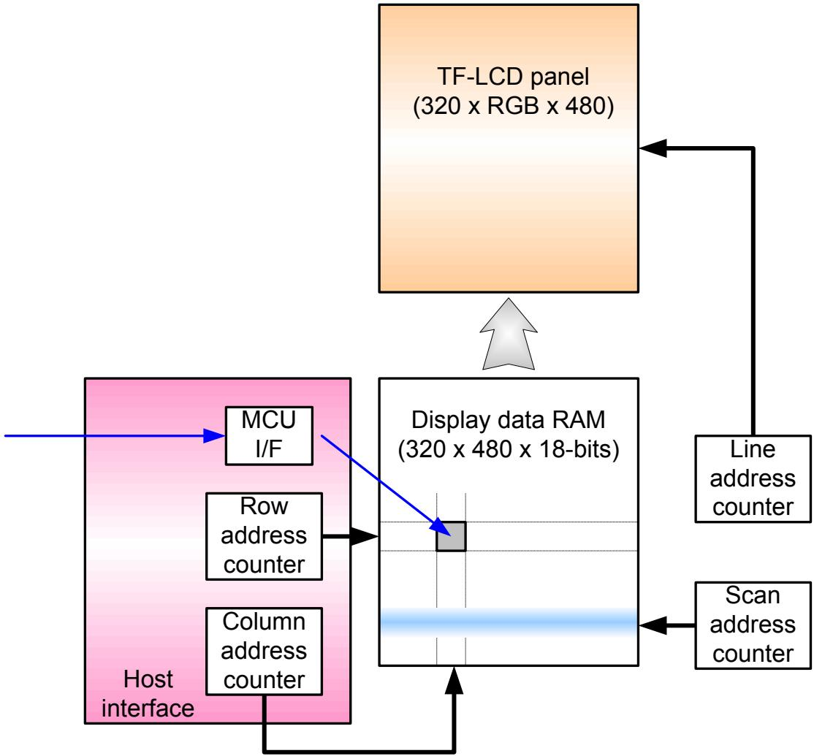  
Display data RAM organization

10.1.2 Memory to display address mapping

<table><tr><td colspan="13">RGB alignment</td><td></td></tr><tr><td colspan="4">Data control command</td><td colspan="9">Column</td><td></td></tr><tr><td rowspan="6"></td><td rowspan="2" colspan="3">(MADCTR) MX=0</td><td colspan="2">0</td><td colspan="3">1</td><td></td><td colspan="3">319</td><td></td></tr><tr><td colspan="9"></td><td></td></tr><tr><td rowspan="2" colspan="3">(MADCTR) MX=1</td><td colspan="2">319</td><td colspan="3">318</td><td></td><td colspan="3">0</td><td></td></tr><tr><td colspan="9"></td><td></td></tr><tr><td colspan="3">Color</td><td>R</td><td>G</td><td>B</td><td>R</td><td>G</td><td>B</td><td></td><td>R</td><td>G</td><td>B</td></tr><tr><td colspan="3">Data Page</td><td></td><td></td><td></td><td></td><td></td><td></td><td></td><td></td><td></td><td></td></tr><tr><td rowspan="18"></td><td colspan="2">(MADCTR) MY=0</td><td>(MADCTR) MY=1</td><td></td><td></td><td></td><td></td><td></td><td></td><td></td><td></td><td></td><td></td></tr><tr><td>0</td><td>479</td><td rowspan="17">↑</td><td></td><td></td><td></td><td></td><td></td><td></td><td></td><td></td><td></td><td></td></tr><tr><td>1</td><td>478</td><td></td><td></td><td></td><td></td><td></td><td></td><td></td><td></td><td></td><td></td></tr><tr><td>2</td><td>477</td><td></td><td></td><td></td><td></td><td></td><td></td><td></td><td></td><td></td><td></td></tr><tr><td>3</td><td>476</td><td></td><td></td><td></td><td></td><td></td><td></td><td></td><td></td><td></td><td></td></tr><tr><td>4</td><td>475</td><td></td><td></td><td></td><td></td><td></td><td></td><td></td><td></td><td></td><td></td></tr><tr><td>5</td><td>474</td><td></td><td></td><td></td><td></td><td></td><td></td><td></td><td></td><td></td><td></td></tr><tr><td>6</td><td>473</td><td></td><td></td><td></td><td></td><td></td><td></td><td></td><td></td><td></td><td></td></tr><tr><td>7</td><td>472</td><td></td><td></td><td></td><td></td><td></td><td></td><td></td><td></td><td></td><td></td></tr><tr><td>:</td><td>:</td><td></td><td></td><td></td><td></td><td></td><td></td><td></td><td></td><td></td><td></td></tr><tr><td>472</td><td>7</td><td></td><td></td><td></td><td></td><td></td><td></td><td></td><td></td><td></td><td></td></tr><tr><td>473</td><td>6</td><td></td><td></td><td></td><td></td><td></td><td></td><td></td><td></td><td></td><td></td></tr><tr><td>474</td><td>5</td><td></td><td></td><td></td><td></td><td></td><td></td><td></td><td></td><td></td><td></td></tr><tr><td>475</td><td>4</td><td></td><td></td><td></td><td></td><td></td><td></td><td></td><td></td><td></td><td></td></tr><tr><td>476</td><td>3</td><td></td><td></td><td></td><td></td><td></td><td></td><td></td><td></td><td></td><td></td></tr><tr><td>477</td><td>2</td><td></td><td></td><td></td><td></td><td></td><td></td><td></td><td></td><td></td><td></td></tr><tr><td>478</td><td>1</td><td></td><td></td><td></td><td></td><td></td><td></td><td></td><td></td><td></td><td></td></tr><tr><td>479</td><td>0</td><td></td><td></td><td></td><td></td><td></td><td></td><td></td><td></td><td></td><td></td></tr><tr><td colspan="4">Source output</td><td>0</td><td>1</td><td>2</td><td>3</td><td>4</td><td>5</td><td></td><td>957</td><td>958</td><td>959</td></tr></table>

## 10.2.. Address Control

The address counter sets the addresses of the display data RAM for writing and reading. Data is written pixel-wise into the RAM matrix of DRIVER. The data for one pixel or two pixels is collected (RGB 6-6-6-bit), according to the data formats. As soon as this pixel-data information is complete the “Write access” is activated on the RAM. The locations of RAM are addressed by the address pointers. The address ranges are X=0 to X=319 and Y=0 to Y=479. Addresses outside these ranges are not allowed. Before writing to the RAM, a window must be defined that will be written. The window is programmable via the command registers XS, YS designating the start address and XE, YE designating the end address.

For example the whole display contents will be written, the window is defined by the following values: XS=0 (0h) YS=0 (0h) and XE=319, YE=479.

In vertical addressing mode (MV=1), the Y-address increments after each byte, after the last Y-address (Y=YE), Y wraps around to YS and X increments to address the next column. In horizontal addressing mode (V=0), the X-address increments after each byte, after the last X-address (X=XE), X wraps around to XS and Y increments to address the next row. After the every last address (X=XE and Y=YE) the address pointers wrap around to address (X=XS and Y=YS).

For flexibility in handling a wide variety of display architectures, the commands “CASET, RASET and MADCTL”, define flags MX and MY, which allows mirroring of the X-address and Y-address. All combinations of flags are allowed.

For each image condition, the controls for the column and row counters apply as below

<table><tr><td>Condition</td><td>Column</td><td>Page</td></tr><tr><td>Command 2C/2E is accepted</td><td>Return to “Start Column”</td><td>Return to “Start Page”</td></tr><tr><td>Read/Write RAM action</td><td>Increment by 1</td><td>No change</td></tr><tr><td>Column value is large than “End Column”</td><td>Return to “Start Column”</td><td>Increment by 1</td></tr><tr><td>Page value is large than “End Page”</td><td>Return to “Start Column”</td><td>Return to “Start Page”</td></tr></table>

<table><tr><td rowspan="2">Display Data Direction</td><td colspan="3">MADCTR Parameter</td><td rowspan="2">Image in the Host (MPU)</td><td rowspan="2">Image in the Driver (DDRAM)</td></tr><tr><td>MV</td><td>MX</td><td>MY</td></tr><tr><td>Normal</td><td>0</td><td>0</td><td>0</td><td>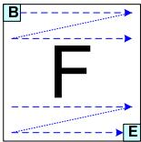</td><td>H/W position (0,0)X-Y address (0,0)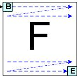</td></tr><tr><td>Y-Mirror</td><td>0</td><td>0</td><td>1</td><td>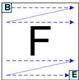</td><td>H/W position (0,0)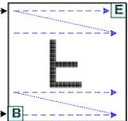X-Y address (0,0)</td></tr><tr><td>X-Mirror</td><td>0</td><td>1</td><td>0</td><td>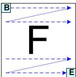</td><td>H/W position (0,0)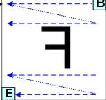</td></tr><tr><td>X-Mirror Y-Mirror</td><td>0</td><td>1</td><td>1</td><td>B----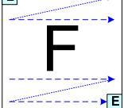</td><td>H/W position (0,0)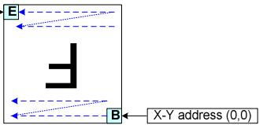</td></tr><tr><td>X-Y Exchange</td><td>1</td><td>0</td><td>0</td><td>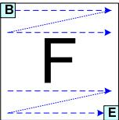</td><td>H/W position (0,0)X-Y address (0,0)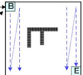</td></tr><tr><td>X-Y Exchange Y-Mirror</td><td>1</td><td>0</td><td>1</td><td>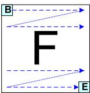</td><td>H/W position (0,0)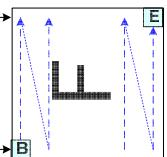X-Y address (0,0)</td></tr><tr><td>X-Y Exchange X-Mirror</td><td>1</td><td>1</td><td>0</td><td>B----</td><td>H/W position (0,0)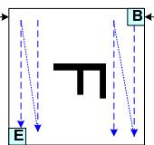</td></tr><tr><td>X-Y Exchange X-Mirror Y-Mirror</td><td>1</td><td>1</td><td>1</td><td>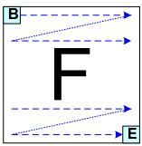</td><td>H/W position (0,0)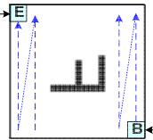X-Y address (0,0)</td></tr></table>

## 10.3.. Data Transfer Break and Recovery

If there is a break in data transmission by RESX pulse, while transferring a command or frame memory data or multiple parameter command data, before Bit D0 of the byte has been completed, then driver will reject the previous bits and have reset the interface such that it will be ready to receive command data again when the chip select line (CSX) is next activated after RESX have been HIGH state.

If there is a break in data transmission by CSX pulse, while transferring a command or frame memory data or multiple parameter command data, before Bit D0 of the byte has been completed, then driver will reject the previous bits and have reset the interface such that it will be ready to receive the same byte re-transmitted when the chip select line (CSX) is next activated.

If 1, 2 or more parameter commands are being sent and a break occurs while sending any parameter before the last one and if the host then sends a new command rather than re-transmitting the parameter that was interrupted, then the parameters that were successfully sent are stored and the parameter where the break occurred is rejected. The interface is ready to receive next byte as shown below.

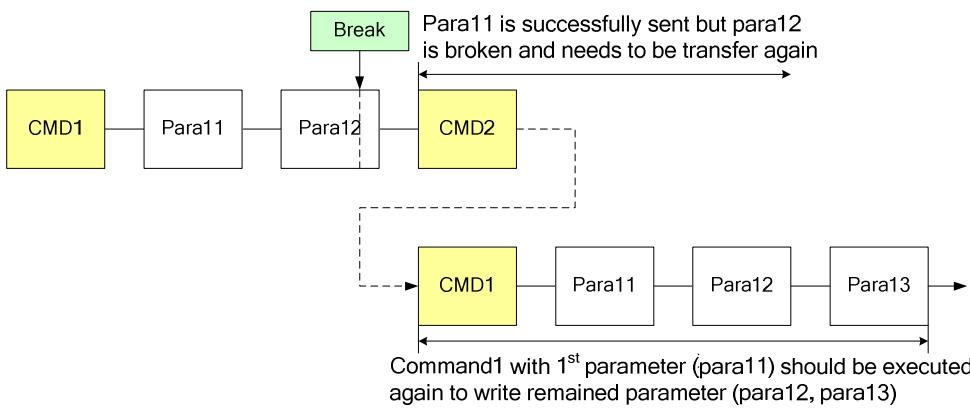

Write interrupts recovery (serial interface)  
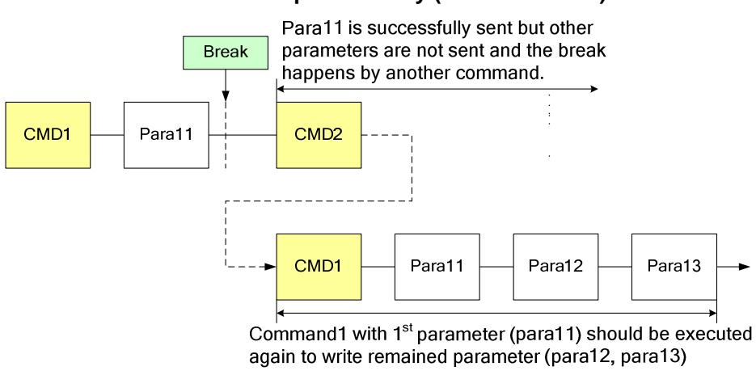  
Write interrupts recovery (both serial and parallel Interface)

## 10.4.. Data Transfer Pause

It will be possible when transferring a command, frame memory data or multiple parameter data to invoke a pause in the data transmission. If the chip select line is released after a whole byte of a frame memory data or multiple parameter data has been completed, then driver will wait and continue the frame memory data or parameter data transmission from the point where it was paused. If the chip select Line is released after a whole byte of a command has been completed, then the display module will receive either the command‘s parameters (if appropriate) or a new command when the chip select line is next enabled as shown below.

This applies to the following 4 conditions:

1) Command-Pause-Command

2) Command-Pause-Parameter

3) Parameter-Pause-Command

4) Parameter-Pause-Parameter

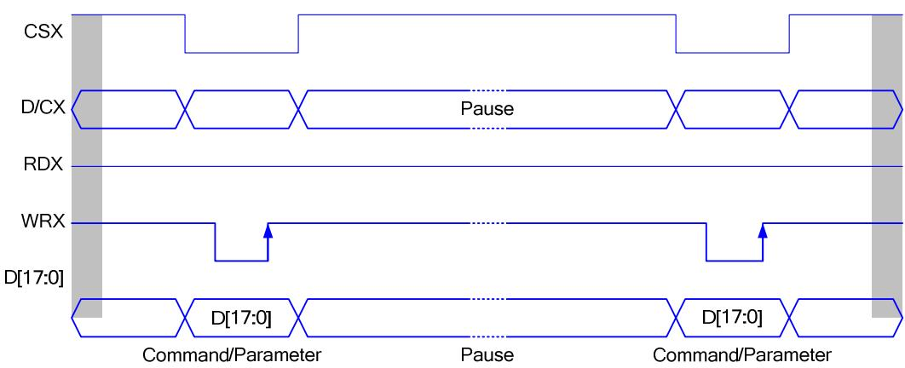  
Parallel bus pause protocol (paused by CSX)

## 10.5.. Data Transfer Mode

The module has three kinds color modes for transferring data to the display RAM. These are 16-bit color per pixel and 18-bit color per pixel. The data format is described for each interface. Data can be downloaded to the frame memory by 2 methods.

## 10.5.1 Method 1

The image data is sent to the frame memory in successive frame writes, each time the frame memory is filled, the frame memory pointer is reset to the start point and the next frame is written.

Start  
Stop

<table><tr><td>Start frame Memory write</td><td>Frame 1 Image data</td><td>Frame 2 Image data</td><td>Frame 3 Image data</td><td>......</td><td>Any command</td></tr></table>

V1.0  
Sitronix Confidential The information contained herein is the exclusive property of Sitronix and shall not be distributed, reproduced, or disclosed in whole or in part without prior written permission of Sitronix.  
2014/11

## 10.5.2 Method 2

The image data is sent and at the end of each frame memory download, a command is sent to stop frame memory write. Then start memory write command is sent, and a new frame is downloaded.

Start

<table><tr><td>Start frame Memory write</td><td>Frame 1 Image data</td><td>Any command</td><td>Start frame Memory write</td><td>Frame 2 Image data</td><td>Any command</td></tr></table>

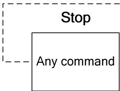  
Note 1: These apply to all data transfer Color modes on both serial and parallel interfaces.

Note 2: The frame memory can contain both odd and even number of pixels for both methods. Only complete pixel data will be stored in the frame memory.

## 10.6.. Normal Display On or Partial Mode On, Vertical Scroll Off

In this mode, contents of the frame memory within an area where column address is 00h to 83h and row address is 00h to 83h is displayed.

To display a dot on leftmost top corner, store the dot data at (column address, row address) = (0,0).

Example1: Normal Display On

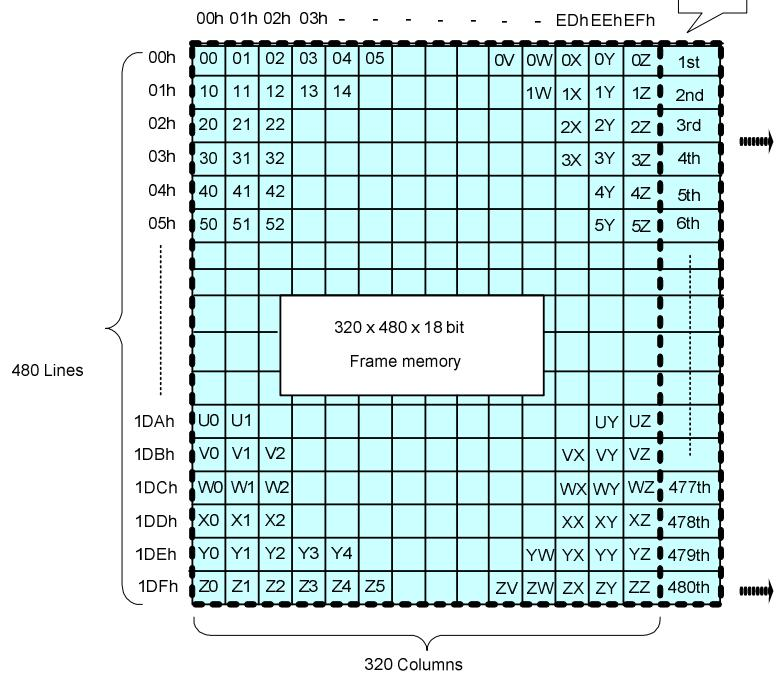

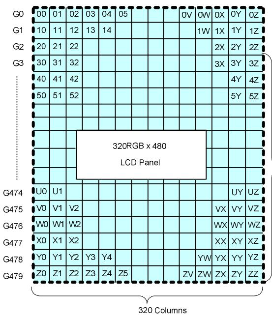  
Displaying - area = 480 lines

Example2) Partial Display On: PSL[15:0] = 0004h, PEL[15:0] = 01DBh, MADCTR (ML)=0  
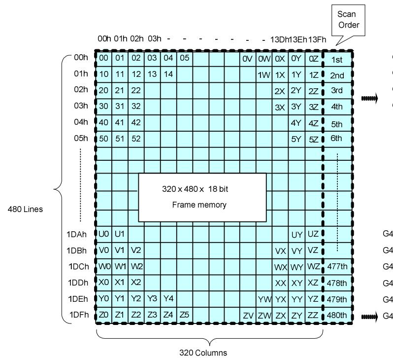

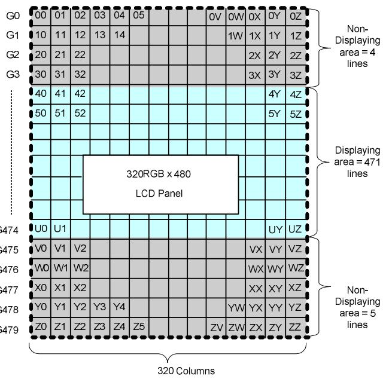

## 10.7.. Vertical Scroll Mode

## 10.7.1 Rolling scroll

There is just one types of vertical scrolling, which are determined by the commands “Vertical Scrolling Definition” (33h) and “Vertical Scrolling Start Address” (37h).

  
Rolling Scroll Definition

When Vertical Scrolling Definition Parameters (TFA+VSA+BFA) =480. In this case, ‘rolling’ scrolling is applied as shown below. All the memory contents will be used.

Example: Panel size=320 x 480, TFA =3, VSA=475, BFA=2, SSA=4, MADCTR ML=0: Rolling Scroll

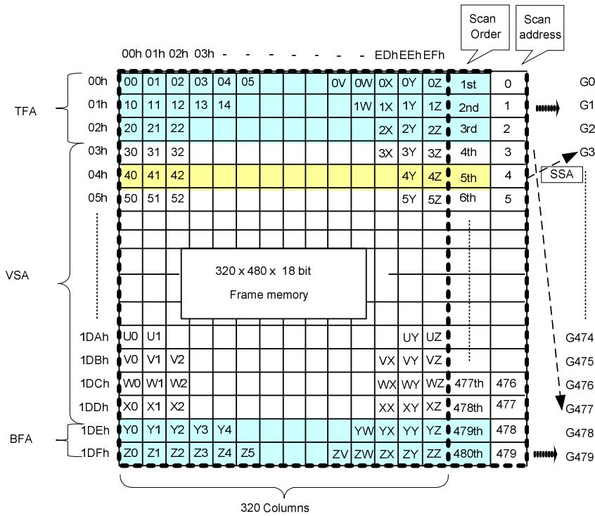

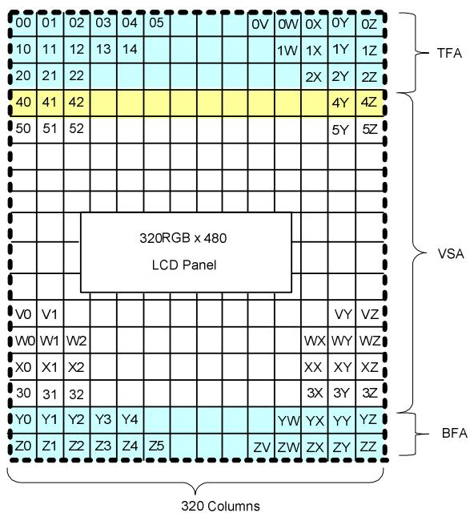

## 10.7.2 Vertical Scroll Example

There are 2 types of vertical scrolling, which are determined by the commands “Vertical Scrolling Definition” (33h) and “Vertical Scrolling Start Address” (37h).

Case 1: $\mathsf { T F A } + \mathsf { V S A } + \mathsf { B F A } \neq \mathsf { P a n e l }$ total scan lines. In this case, scrolling is applied as shown below.

N/A. Do not set $\mathsf { T F A } + \mathsf { V S A } + \mathsf { B F A } \neq \mathsf { P }$ anel total scan lines. In that case, unexpected picture will be shown.

Case 2: TFA + VSA + BFA= Panel total scan lines

Example1) When MADCTR parameter ${ \sf M L } = \mathrm { ^ { \prime \prime } } 0 ^ { \mathrm { \prime \prime } }$ , TFA=0, VSA=480, BFA=0 and VSCSAD=40.

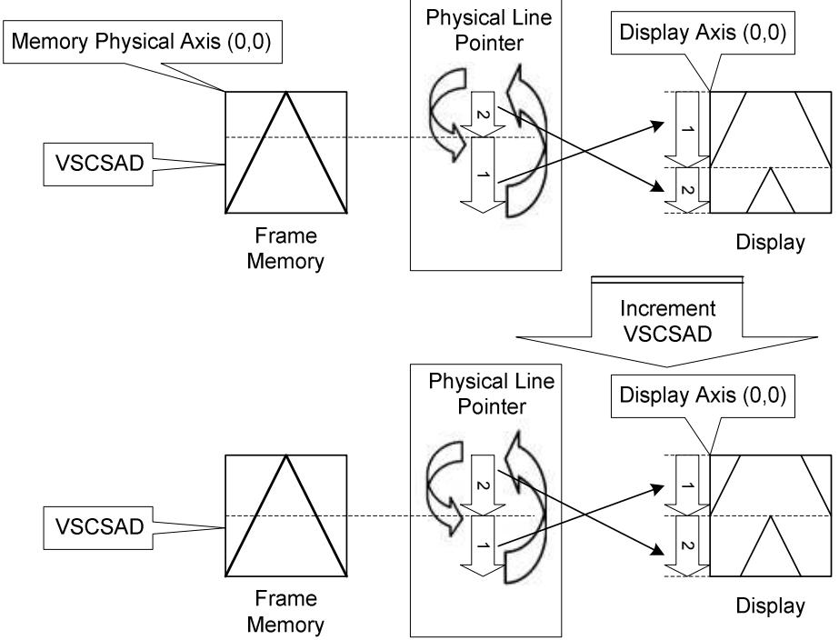  
Display of Vertical Scroll Example 1  
Example2) When MADCTR parameter ${ M L } = " { 1 } "$ , TFA=60, VSA=420, BFA=0 and $\mathsf { V S C S A D = } 1 6 0$

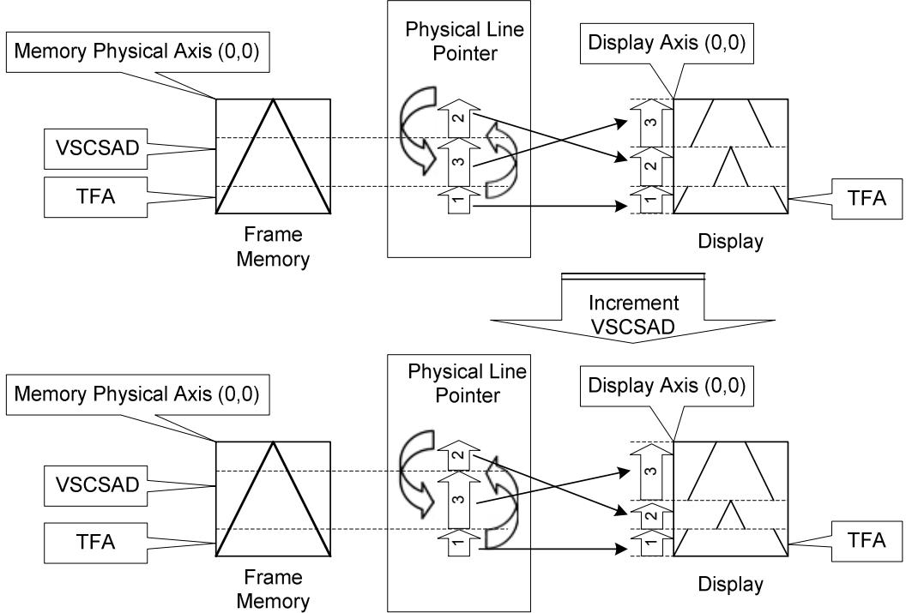  
Display of Vertical Scroll Example 2

## 10.8.. Tearing Effect

The Tearing Effect output line supplies to the MPU a Panel synchronization signal. This signal can be enabled or disabled by the Tearing Effect Line Off & On commands. The mode of the Tearing Effect signal is defined by the parameter of the Tearing Effect Line On command. The signal can be used by the MPU to synchronize Frame Memory Writing when displaying video images.

## 10.8.1 Tearing effect line modes

Mode 1, the Tearing Effect Output signal consists of V-Blanking Information only:

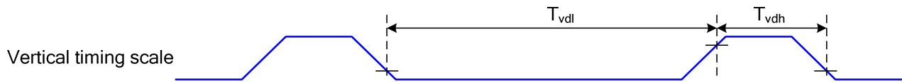

tvdh= The LCD display is not updated from the Frame Memory

tvdl= The LCD display is updated from the Frame Memory (except Invisible Line – see above)

Mode 2, the Tearing Effect Output signal consists of V-Blanking and H-Blanking Information, there is one V-sync and 480 H-sync pulses per field.

thdh= The LCD display is not updated from the Frame Memory

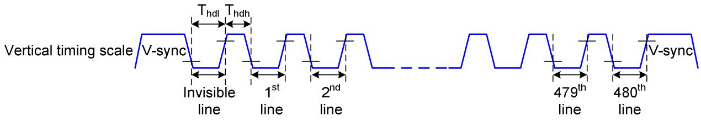

thdl= The LCD display is updated from the Frame Memory (except Invisible Line – see above)  
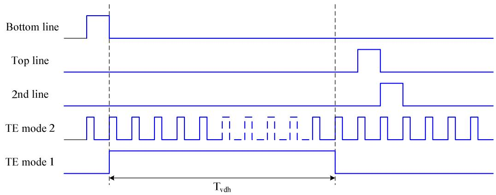  
Note: During Sleep In Mode, the Tearing Output Pin is active Low.

## 10.8.2 Tearign effect line timings

The Tearing Effect signal is described below:

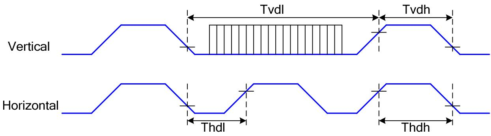

<table><tr><td>Symbol</td><td>Parameter</td><td>min</td><td>max</td><td>unit</td><td>description</td></tr><tr><td>tvdl</td><td>Vertical Timing Low Duration</td><td>13</td><td>-</td><td>ms</td><td></td></tr><tr><td>tvdh</td><td>Vertical Timing High Duration</td><td>1000</td><td>-</td><td>μs</td><td></td></tr><tr><td>thdl</td><td>Horizontal Timing Low Duration</td><td>16</td><td>-</td><td>μs</td><td></td></tr><tr><td>thdh</td><td>Horizontal Timing Low Duration</td><td>-</td><td>500</td><td>μs</td><td></td></tr></table>

Table AC characteristics of Tearing Effect Signal Idle Mode Off (Frame Rate = 60 Hz, Ta=25°C)

Note: The timings in Table 15 apply when MADCTL ML=0 and $M L = 1$

The signal’s rise and fall times (tf, tr) are stipulated to be equal to or less than 15ns.

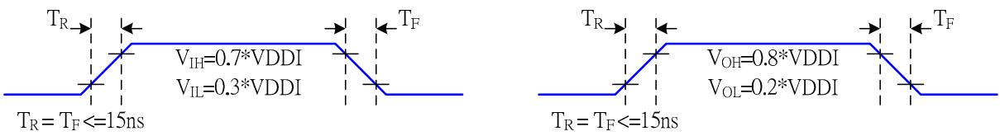

The Tearing Effect Output Line is fed back to the MPU and should be used as shown below to avoid Tearing Effect:

## 10.8.3 Example 1: MPU Write is faster than panel read

Data write to Frame Memory is now synchronized to the Panel Scan. It should be written during the vertical sync pulse of the Tearing Effect Output Line. This ensures that data is always written ahead of the panel scan and each Panel Frame refresh has a complete new image:

Data to be sent

Image on LCD

10.8.4 Example 2: MPU write is slower than panel read  

The MPU to Frame Memory write begins just after Panel Read has commenced i.e. after one horizonta sync pulse of the Tearing Effect Output Line. This allows time for the image to download behind the Panel Read pointer and finishing download during the subsequent Frame before the Read Pointer “catches” the MPU to Frame memory write position.

## 10.9.. Gamma Correction

ST7796S incorporate the gamma correction function to display 262,244 colors for the LCD panel. The gamma correction is performed with 3 groups of registers, which are gradient adjustment, contrast adjustment and fine- adjustment registers for positive and negative polarities, and RGB can be adjusted individually.

  
Gray scale Voltage Generation (Positive)

  
Relationship between Source Output and VCOM  
Percentage adjustment:

J0P[1:0], J1P[1:0], J0N[1:0], J1N[1:0] these register are used to adjust the voltage level of interpolation point. The following table is the detail description.

J0P[1:0]/J0N[1:0]:

<table><tr><td></td><td>00h</td><td>01h</td><td>02h</td><td>03h</td></tr><tr><td>VP3/VN3</td><td>50%</td><td>56%</td><td>50%</td><td>60%</td></tr><tr><td>VP5/VN5</td><td>50%</td><td>44%</td><td>50%</td><td>42%</td></tr><tr><td>VP7/VN7</td><td>86%</td><td>71%</td><td>80%</td><td>66%</td></tr><tr><td>VP8/VN8</td><td>71%</td><td>57%</td><td>63%</td><td>49%</td></tr><tr><td>VP9/VN9</td><td>57%</td><td>40%</td><td>49%</td><td>34%</td></tr><tr><td>VP10/VN10</td><td>43%</td><td>29%</td><td>34%</td><td>23%</td></tr><tr><td>VP11/VN11</td><td>29%</td><td>17%</td><td>20%</td><td>14%</td></tr><tr><td>VP12/VN12</td><td>14%</td><td>6%</td><td>9%</td><td>6%</td></tr></table>

J1P[1:0]/J1N[1:0]:

<table><tr><td></td><td>00h</td><td>01h</td><td>02h</td><td>03h</td></tr><tr><td>VP51/VN51</td><td>86%</td><td>86%</td><td>86%</td><td>89%</td></tr><tr><td>VP52/VN52</td><td>71%</td><td>71%</td><td>77%</td><td>80%</td></tr><tr><td>VP53/VN53</td><td>57%</td><td>60%</td><td>63%</td><td>69%</td></tr><tr><td>VP54/VN54</td><td>43%</td><td>46%</td><td>46%</td><td>51%</td></tr><tr><td>VP55/VN55</td><td>29%</td><td>34%</td><td>31%</td><td>37%</td></tr><tr><td>VP56/VN56</td><td>14%</td><td>17%</td><td>14%</td><td>20%</td></tr><tr><td>VP58/VN58</td><td>50%</td><td>56%</td><td>47%</td><td>47%</td></tr><tr><td>VP60/VN60</td><td>50%</td><td>50%</td><td>50%</td><td>53%</td></tr></table>

voltage level percentage adjustment description

V1.0

2014/11

Page 258 of 279  
Source voltage of positive gamma leve

<table><tr><td>Gamma level</td><td>Related Register</td><td>Formula</td></tr><tr><td>VP0</td><td>V0P[3:0]</td><td>(VAP-VBP)*(129R-V0P[3:0]R)/129R+VBP</td></tr><tr><td>VP1</td><td>V1P[5:0]</td><td>(VAP-VBP)*(128R-V1P[5:0]R)/129R+VBP</td></tr><tr><td>VP2</td><td>V2P[5:0]</td><td>(VAP-VBP)*(128R-V2P[5:0]R)/129R+VBP</td></tr><tr><td>VP3</td><td>J0P[1:0]</td><td>(VP2-VP4)*J0P[1:0]+VP4</td></tr><tr><td>VP4</td><td>V4P[4:0]</td><td>(VP2-VP20)*(57R-V4P[4:0])/60R+VP20</td></tr><tr><td>VP5</td><td>J0P[1:0]</td><td>(VP4-VP6)*J0P[1:0]+VP6</td></tr><tr><td>VP6</td><td>V6P[4:0]</td><td>(VP2-VP20)*(47R-V6P[4:0])/60R+VP20</td></tr><tr><td>VP7</td><td>J0P[1:0]</td><td>(VP6-VP13)*J0P[1:0]+VP13</td></tr><tr><td>VP8</td><td>J0P[1:0]</td><td>(VP6-VP13)*J0P[1:0]+VP13</td></tr><tr><td>VP9</td><td>J0P[1:0]</td><td>(VP6-VP13)*J0P[1:0]+VP13</td></tr><tr><td>VP10</td><td>J0P[1:0]</td><td>(VP6-VP13)*J0P[1:0]+VP13</td></tr><tr><td>VP11</td><td>J0P[1:0]</td><td>(VP6-VP13)*J0P[1:0]+VP13</td></tr><tr><td>VP12</td><td>J0P[1:0]</td><td>(VP6-VP13)*J0P[1:0]+VP13</td></tr><tr><td>VP13</td><td>V13P[3:0]</td><td>(VP2-VP20)*(21R-V13P[3:0])/60R+VP20</td></tr><tr><td>VP14</td><td>--</td><td>(VP13-VP20)/(20-13)*(20-14)+VP20</td></tr><tr><td>VP15</td><td>--</td><td>(VP13-VP20)/(20-13)*(20-15)+VP20</td></tr><tr><td>VP16</td><td>--</td><td>(VP13-VP20)/(20-13)*(20-16)+VP20</td></tr><tr><td>VP17</td><td>--</td><td>(VP13-VP20)/(20-13)*(20-17)+VP20</td></tr><tr><td>VP18</td><td>--</td><td>(VP13-VP20)/(20-13)*(20-18)+VP20</td></tr><tr><td>VP19</td><td>--</td><td>(VP13-VP20)/(20-13)*(20-19)+VP20</td></tr><tr><td>VP20</td><td>V20P[6:0]</td><td>(VAP-VBP)*(128R-V20P[6:0]R)/129R+VBP</td></tr><tr><td>VP21</td><td>--</td><td>(VP20-VP27)/(27-20)*(27-21)+VP27</td></tr><tr><td>VP22</td><td>--</td><td>(VP20-VP27)/(27-20)*(27-22)+VP27</td></tr><tr><td>VP23</td><td>--</td><td>(VP20-VP27)/(27-20)*(27-23)+VP27</td></tr><tr><td>VP24</td><td>--</td><td>(VP20-VP27)/(27-20)*(27-24)+VP27</td></tr><tr><td>VP25</td><td>--</td><td>(VP20-VP27)/(27-20)*(27-25)+VP27</td></tr><tr><td>VP26</td><td>--</td><td>(VP20-VP27)/(27-20)*(27-26)+VP27</td></tr><tr><td>VP27</td><td>V27P[2:0]</td><td>(VP20-VP43)*(20R-V27P[2:0])/25R+VP43</td></tr><tr><td>VP28</td><td>--</td><td>(VP27-VP36)/(36-27)*(36-28)+VP36</td></tr><tr><td>VP29</td><td>--</td><td>(VP27-VP36)/(36-27)*(36-29)+VP36</td></tr><tr><td>VP30</td><td>--</td><td>(VP27-VP36)/(36-27)*(36-30)+VP36</td></tr><tr><td>VP31</td><td>--</td><td>(VP27-VP36)/(36-27)*(36-31)+VP36</td></tr><tr><td>VP32</td><td>--</td><td>(VP27-VP36)/(36-27)*(36-32)+VP36</td></tr><tr><td>VP33</td><td>--</td><td>(VP27-VP36)/(36-27)*(36-33)+VP36</td></tr><tr><td>VP34</td><td>--</td><td>(VP27-VP36)/(36-27)*(36-34)+VP36</td></tr><tr><td>VP35</td><td>--</td><td>(VP27-VP36)/(36-27)*(36-35)+VP36</td></tr><tr><td>VP36</td><td>V36P[2:0]</td><td>(VP20-VP43)*(11R-V36P[2:0])/25R+VP43</td></tr><tr><td>VP37</td><td>--</td><td>(VP36-VP43)/(43-36)*(43-37)+VP43</td></tr><tr><td>VP38</td><td>--</td><td>(VP36-VP43)/(43-36)*(43-38)+VP43</td></tr><tr><td>VP39</td><td>--</td><td>(VP36-VP43)/(43-36)*(43-39)+VP43</td></tr><tr><td>VP40</td><td>--</td><td>(VP36-VP43)/(43-36)*(43-40)+VP43</td></tr><tr><td>VP41</td><td>--</td><td>(VP36-VP43)/(43-36)*(43-41)+VP43</td></tr><tr><td>VP42</td><td>--</td><td>(VP36-VP43)/(43-36)*(43-42)+VP43</td></tr><tr><td>VP43</td><td>V43P[6:0]</td><td>(VAP-VBP)*(128R-V43P[6:0]R)/129R+VBP</td></tr><tr><td>VP44</td><td>--</td><td>(VP43-VP50)/(50-43)*(50-44)+VP50</td></tr><tr><td>VP45</td><td>--</td><td>(VP43-VP50)/(50-43)*(50-45)+VP50</td></tr><tr><td>VP46</td><td>--</td><td>(VP43-VP50)/(50-43)*(50-46)+VP50</td></tr><tr><td>VP47</td><td>--</td><td>(VP43-VP50)/(50-43)*(50-47)+VP50</td></tr><tr><td>VP48</td><td>--</td><td>(VP43-VP50)/(50-43)*(50-48)+VP50</td></tr><tr><td>VP49</td><td>--</td><td>(VP43-VP50)/(50-43)*(50-49)+VP50</td></tr><tr><td>VP50</td><td>V50P[3:0]</td><td>(VP43-VP61)*(54R-V50P[3:0])/60R+VP61</td></tr><tr><td>VP51</td><td>J1P[1:0]</td><td>(V5P0-VP57)*J1P[1:0]+VP57</td></tr></table>

Sitronix Confidential The information contained herein is the exclusive property of Sitronix and shall not be distributed, reproduced, or disclosed in whole or in part without prior written permission of Sitronix.

<table><tr><td>VP52</td><td>J1P[1:0]</td><td>(VP50-VP57)*J1P[1:0]+VP57</td></tr><tr><td>VP53</td><td>J1P[1:0]</td><td>(VP50-VP57)*J1P[1:0]+VP57</td></tr><tr><td>VP54</td><td>J1P[1:0]</td><td>(VP50-VP57)*J1P[1:0]+VP57</td></tr><tr><td>VP55</td><td>J1P[1:0]</td><td>(VP50-VP57)*J1P[1:0]+VP57</td></tr><tr><td>VP56</td><td>J1P[1:0]</td><td>(VP50-VP57)*J1P[1:0]+VP57</td></tr><tr><td>VP57</td><td>V57P[4:0]</td><td>(VP43-VP61)*(44R-V57P[4:0])/60R+VP61</td></tr><tr><td>VP58</td><td>J1P[1:0]</td><td>(VP57-VP59)*J1P[1:0]+VP59</td></tr><tr><td>VP59</td><td>V59P[4:0]</td><td>(VP43-VP61)*(34R-V59P[4:0])/60R+VP61</td></tr><tr><td>VP60</td><td>J1P[1:0]</td><td>(VP59-VP61)*J1P[1:0]+VP61</td></tr><tr><td>VP61</td><td>V61P[5:0]</td><td>(VAP-VBP)*(64R-V61P[5:0]R)/129R+VBP</td></tr><tr><td>VP62</td><td>V62P[5:0]</td><td>(VAP-VBP)*(64R-V62P[5:0]R)/129R+VBP</td></tr><tr><td>VP63</td><td>V63P[3:0]</td><td>(VAP-VBP)*(23R-V63P[3:0]R)/129R+VBP</td></tr></table>

Source voltage of negative gamma level

<table><tr><td>Gamma level</td><td>Related Register</td><td>Formula</td></tr><tr><td>VN0</td><td>V0N[3:0]</td><td>VBN-(VBN-VAN)*(129R-V0N[3:0]R)/129R</td></tr><tr><td>VN1</td><td>V1N[5:0]</td><td>VBN-(VBN-VAN)*(128R-V1N[5:0]R)/129R</td></tr><tr><td>VN2</td><td>V2N[5:0]</td><td>VBN-(VBN-VAN)*(128R-V2N[5:0]R)/129R</td></tr><tr><td>VN3</td><td>J0N[1:0]</td><td>(VN2-VN4)*J0N[1:0]+VN4</td></tr><tr><td>VN4</td><td>V4N[4:0]</td><td>(VN2-VN20)*(57R-V4N[4:0])/60R+VN20</td></tr><tr><td>VN5</td><td>J0N[1:0]</td><td>(VN4-VN6)*J0N[1:0]+VN6</td></tr><tr><td>VN6</td><td>V6N[4:0]</td><td>(VN2-VN20)*(47R-V6N[4:0])/60R+VN20</td></tr><tr><td>VN7</td><td>J0N[1:0]</td><td>(VN6-VN13)*J0N[1:0]+VN13</td></tr><tr><td>VN8</td><td>J0N[1:0]</td><td>(VN6-VN13)*J0N[1:0]+VN13</td></tr><tr><td>VN9</td><td>J0N[1:0]</td><td>(VN6-VN13)*J0N[1:0]+VN13</td></tr><tr><td>VN10</td><td>J0N[1:0]</td><td>(VN6-VN13)*J0N[1:0]+VN13</td></tr><tr><td>VN11</td><td>J0N[1:0]</td><td>(VN6-VN13)*J0N[1:0]+VN13</td></tr><tr><td>VN12</td><td>J0N[1:0]</td><td>(VN6-VN13)*J0N[1:0]+VN13</td></tr><tr><td>VN13</td><td>V13N[3:0]</td><td>(VN2-VN20)*(21R-V13N[3:0])/60R+VN20</td></tr><tr><td>VN14</td><td>--</td><td>(VN13-VN20)/(20-13)*(20-14)+VN20</td></tr><tr><td>VN15</td><td>--</td><td>(VN13-VN20)/(20-13)*(20-15)+VN20</td></tr><tr><td>VN16</td><td>--</td><td>(VN13-VN20)/(20-13)*(20-16)+VN20</td></tr><tr><td>VN17</td><td>--</td><td>(VN13-VN20)/(20-13)*(20-17)+VN20</td></tr><tr><td>VN18</td><td>--</td><td>(VN13-VN20)/(20-13)*(20-18)+VN20</td></tr><tr><td>VN19</td><td>--</td><td>(VN13-VN20)/(20-13)*(20-19)+VN20</td></tr><tr><td>VN20</td><td>V20N[6:0]</td><td>VBN-(VBN-VAN)*(128R-V20N[6:0]R)/129R</td></tr><tr><td>VN21</td><td>--</td><td>(VN20-VN27)/(27-20)*(27-21)+VN27</td></tr><tr><td>VN22</td><td>--</td><td>(VN20-VN27)/(27-20)*(27-22)+VN27</td></tr><tr><td>VN23</td><td>--</td><td>(VN20-VN27)/(27-20)*(27-23)+VN27</td></tr><tr><td>VN24</td><td>--</td><td>(VN20-VN27)/(27-20)*(27-24)+VN27</td></tr><tr><td>VN25</td><td>--</td><td>(VN20-VN27)/(27-20)*(27-25)+VN27</td></tr><tr><td>VN26</td><td>--</td><td>(VN20-VN27)/(27-20)*(27-26)+VN27</td></tr><tr><td>VN27</td><td>V27N[2:0]</td><td>(VN20-VN43)*(20R-V27N[2:0])/25R+VN43</td></tr><tr><td>VN28</td><td>--</td><td>(VN27-VN36)/(36-27)*(36-28)+VN36</td></tr><tr><td>VN29</td><td>--</td><td>(VN27-VN36)/(36-27)*(36-29)+VN36</td></tr><tr><td>VN30</td><td>--</td><td>(VN27-VN36)/(36-27)*(36-30)+VN36</td></tr><tr><td>VN31</td><td>--</td><td>(VN27-VN36)/(36-27)*(36-31)+VN36</td></tr><tr><td>VN32</td><td>--</td><td>(VN27-VN36)/(36-27)*(36-32)+VN36</td></tr><tr><td>VN33</td><td>--</td><td>(VN27-VN36)/(36-27)*(36-33)+VN36</td></tr><tr><td>VN34</td><td>--</td><td>(VN27-VN36)/(36-27)*(36-34)+VN36</td></tr><tr><td>VN35</td><td>--</td><td>(VN27-VN36)/(36-27)*(36-35)+VN36</td></tr><tr><td>VN36</td><td>V36N[2:0]</td><td>(VN20-VN43)*(11R-V36N[2:0])/25R+VN43</td></tr><tr><td>VN37</td><td>--</td><td>(VN36-VN43)/(43-36)*(43-37)+VN43</td></tr><tr><td>VN38</td><td>--</td><td>(VN36-VN43)/(43-36)*(43-38)+VN43</td></tr><tr><td>VN39</td><td>--</td><td>(VN36-VN43)/(43-36)*(43-39)+VN43</td></tr><tr><td>VN40</td><td>--</td><td>(VN36-VN43)/(43-36)*(43-40)+VN43</td></tr><tr><td>VN41</td><td>--</td><td>(VN36-VN43)/(43-36)*(43-41)+VN43</td></tr><tr><td>VN42</td><td>--</td><td>(VN36-VN43)/(43-36)*(43-42)+VN43</td></tr><tr><td>VN43</td><td>V43N[6:0]</td><td>VBN-(VBN-VAN)*(128R-V43N[6:0]R)/129R</td></tr><tr><td>VN44</td><td>--</td><td>(VN43-VN50)/(50-43)*(50-44)+VN50</td></tr><tr><td>VN45</td><td>--</td><td>(VN43-VN50)/(50-43)*(50-45)+VN50</td></tr><tr><td>VN46</td><td>--</td><td>(VN43-VN50)/(50-43)*(50-46)+VN50</td></tr><tr><td>VN47</td><td>--</td><td>(VN43-VN50)/(50-43)*(50-47)+VN50</td></tr><tr><td>VN48</td><td>--</td><td>(VN43-VN50)/(50-43)*(50-48)+VN50</td></tr><tr><td>VN49</td><td>--</td><td>(VN43-VN50)/(50-43)*(50-49)+VN50</td></tr><tr><td>VN50</td><td>V50N[3:0]</td><td>(VN43-VN61)*(54R-V50N[3:0])/60R+VN61</td></tr><tr><td>VN51</td><td>J1N[1:0]</td><td>(V5N0-VN57)*J1N[1:0]+VN57</td></tr><tr><td>VN52</td><td>J1N[1:0]</td><td>(VN50-VN57)*J1N[1:0]+VN57</td></tr><tr><td>VN53</td><td>J1N[1:0]</td><td>(VN50-VN57)*J1N[1:0]+VN57</td></tr><tr><td>VN54</td><td>J1N[1:0]</td><td>(VN50-VN57)*J1N[1:0]+VN57</td></tr><tr><td>VN55</td><td>J1N[1:0]</td><td>(VN50-VN57)*J1N[1:0]+VN57</td></tr><tr><td>VN56</td><td>J1N[1:0]</td><td>(VN50-VN57)*J1N[1:0]+VN57</td></tr><tr><td>VN57</td><td>V57N[4:0]</td><td>(VN43-VN61)*(44R-V57N[4:0])/60R+VN61</td></tr><tr><td>VN58</td><td>J1N[1:0]</td><td>(VN57-VN59)*J1N[1:0]+VN59</td></tr><tr><td>VN59</td><td>V59N[4:0]</td><td>(VN43-VN61)*(34R-V59N[4:0])/60R+VN61</td></tr><tr><td>VN60</td><td>J1N[1:0]</td><td>(VN59-VN61)*J1N[1:0]+VN61</td></tr><tr><td>VN61</td><td>V61N[5:0]</td><td>VBN-(VBN-VAN)*(64R-V61N[5:0]R)/129R</td></tr><tr><td>VN62</td><td>V62N[5:0]</td><td>VBN-(VBN-VAN)*(64R-V62N[5:0]R)/129R</td></tr><tr><td>VN63</td><td>V63N[3:0]</td><td>VBN-(VBN-VAN)*(23R-V63N[3:0]R)/129R</td></tr></table>

## 10.10.. Gray voltage generator for digital gamma correction

ST7796S digital gamma function can implement the RGB gamma correction independently. ST7796S utilizes look-up table of digital gamma to change ram data, and then display the changed data from source driver. The following diagram shows the data flow of digital gamma.

  
Block diagram of digital gamma

There are 2 registers and each register has 64 bytes to set R, G, B gamma independently. When bit DGMEN be set to 1, R and B gamma will be mapped via look-up table of digital gamma to gray level voltage.

## 10.11.. Display Dimming

A dimming function (how fast to change the brightness from old to new level and what are brightness levels during the change) is used when changing from one brightness level to another. This dimming function curve is the same in increment and decrement. The basic idea is described below.

  
Dimming function can be enable and disable. See “Write CTRL Display (53h)” (bit DD) for more information.

## 10.11.1 Dimming Requirement

Dimming function in the display module should be implemented so that 400-600ms is used for the transition between the original brightness value and the target brightness value. The transferring time steps between these two brightness values are equal making the transition linear.

The dimming function is working similarly in both upward and downward directions.

An upward example is illustrate below

## 10.11.2 Definition of brightness transition time

 Shorter transition time than 500ms.

There is some stable time between transitions. Below drawing is for transition time: 400ms.

##  Longer transition time than 500ms

There is no any stable time between transitions. Below drawing is for transition time: 600ms.

## 10.12.. Content Adaptive Brightness Control (CABC)

## 10.12.1 Definition of CABC

A Content Adaptive Brightness Control function can be used to reduce the power consumption of the luminance source. Content adaptation means that content gray level scale can be increased while simultaneously lowering brightness of the backlight to achieve same perceived brightness. The adjusted gray level scale and thus the power consumption reduction

Definition of Modes and target power reduction ratio:

 Off mode: Content Adaptive Brightness Control functionality is totally off.

 UI [User interface] image mode: Optimized for UI image. It is kept image quality as much as possible. Target power consumption reduction ratio: 10% or less

Still picture mode: Optimized for still picture. Some image quality degradation would be acceptable. Target power consumption reduction ratio: more than 30%.

 Moving image mode: Optimized for moving image. It is focused on the biggest power reduction with image quality degradation. Target power consumption reduction ratio: more than 30%.

Note 1: Updating partial area of the image data should be supported by CABC functionality.

Note 2: Processing power consumption of CABC should be minimized.

The transition time for dimming function is illustrated below.

 Content Adaptive Brightness Control

Display brightness is changed, according to the image contents. The following graph mentions the case of displaying three different images.

 Image A: -20% brightness reduction

 Image B: -30% brightness reduction

 Image C: -30% brightness reduction

Transition time from the previous image to the current displayed image is “transition time A”.  

##  Manual brightness setting and Dimming function

##  Combine Display brightness

Green line in the following graph is for the output brightness of display. It is combined with both display brightness, which are defined in the above graphs.

Maximum transition time is transition time A+B.

  
Brightness level calculates with the following formula.

Display Output brightness = Manual Brightness setting \* CABC brightness ratio

<table><tr><td></td><td>Manual Brightness setting</td><td>Brightness ratio [CABC]</td><td>Display Output brightness</td></tr><tr><td>Case 1</td><td>85%</td><td>80%</td><td>68%</td></tr><tr><td>Case 2</td><td>60%</td><td>70%</td><td>42%</td></tr><tr><td>Case 3</td><td>85%</td><td>90%</td><td>76.5%</td></tr></table>

Transition time from the current brightness to target brightness is A+B in the worst case.

## 10.12.2 Minimum brightness setting of CABC function

CABC function is automatically reduced backlight brightness based on image contents. In the case of the combination with the LABC or manual brightness setting, display brightness is too dark. It must affect to image quality degradation. CABC minimum brightness setting is to avoid too much brightness reduction. When CABC is active, CABC can not reduce the display brightness to less than CABC minimum brightness setting. If CABC algorithm works without any abnormal visual effect, image processing function can operate even when the brightness can not be changed.

This function does not affect to the other function, manual brightness setting. Manual brightness can be set the display brightness to less than CABC minimum brightness. Smooth transition and dimming function can be worked as normal.

When display brightness is turned off (BCTRL=0 of “9.2.39 Write CTRL Display (53h)”), CABC minimum brightness setting is ignored. “9.2.44 Read CABC minimum brightness (5Fh)” always read the setting value of “9.2.43 Write CABC minimum brightness (5Eh)”.

<table><tr><td></td><td>WRCABC (55h)</td><td>Function</td><td>RDCABCMB (5Fh)</td><td>Image</td></tr><tr><td>Sleep-in</td><td></td><td>NA</td><td>WRCABCMB (5Eh)</td><td></td></tr><tr><td>CABC off</td><td>00b</td><td>Disable</td><td>WRCABCMB (5Eh)</td><td>Original</td></tr><tr><td>CABC on</td><td>01b/10b/11b</td><td>Enable</td><td>WRCABCMB (5Eh)</td><td>CABC modified</td></tr></table>

Brightness level calculates with the following formula.

Display Output Brightness = Manual brightness setting \* CABC brightness ratio

Below drawing is for the explanation of the CABC minimum brightness setting.

CABC minimum brightness value = 51 (33h: 20% display brightness)

<table><tr><td></td><td>Display Brightness [manual setting]</td><td>Brightness ratio [CABC]</td><td>Calculation result of the display brightness formula</td><td>Display Output Brightness</td><td>Image</td></tr><tr><td>Case 1</td><td>50%</td><td>70%</td><td>35%</td><td>35%</td><td>CABC modified</td></tr><tr><td>Case 2</td><td>20%</td><td>70%</td><td>14%</td><td>20%</td><td>CABC modified</td></tr><tr><td>Case 3</td><td>50%</td><td>70%</td><td>35%</td><td>35%</td><td>CABC modified</td></tr></table>

At the case 2, the calculation result of the display brightness is 14%. CABC minimum brightness value is set to 20% brightness. Actual display brightness is 20% as the CABC minimum brightness setting.

## 11 Power Definition

## 11.1.. Power Level

6 level modes are defined they are in order of Maximum Power consumption to Minimum Power Consumption

## 1. Normal Mode On (full display), Idle Mode Off, Sleep Out.

In this mode, the display is able to show maximum 262,144 colors.

## 2. Partial Mode On, Idle Mode Off, Sleep Out.

In this mode part of the display is used with maximum 262,144 colors.

## 3. Normal Mode On (full display), Idle Mode On, Sleep Out.

In this mode, the full display area is used but with 8 colors.

## 4. Partial Mode On, Idle Mode On, Sleep Out.

In this mode, part of the display is used but with 8 colors.

## 5. Sleep In Mode

In this mode, the DC: DC converter, internal oscillator and panel driver circuit are stopped. Only the MCU interface and memory works with VDDI power supply. Contents of the memory are safe.

## 3. Power Off Mode

In this mode, both VDD and VDDI are removed.

Note: Transition between modes 1-5 is controllable by MCU commands. Mode 6 is entered only when both Power supplies are removed.

## 11.2.. Power ON/OFF Sequence

VDDI and VDD can be applied in any order.

VDD and VDDI can be power down in any order.

During power off, if LCD is in the Sleep Out mode, VDD and VDDI must be powered down minimum 120msec after RESX has been released.

During power off, if LCD is in the Sleep In mode, VDDI or VDD can be powered down minimum 0msec after RESX has been released.

CSX can be applied at any timing or can be permanently grounded. RESX has priority over CSX.

Note 1: There will be no damage to the display module if the power sequences are not met.

Note 2: There will be no abnormal visible effects on the display panel during the Power On/Off Sequences.

Note 3: There will be no abnormal visible effects on the display between end of Power On Sequence and before receiving Sleep Out command. Also between receiving Sleep In command and Power Off Sequence.

Note 4: If RESX line is not held stable by host during Power On Sequence as defined in the sequence below, then it will be necessary to apply a Hardware Reset (RESX) after Host Power On Sequence is complete to ensure correct operation. Otherwise function is not guaranteed.

The power on/off sequence is illustrated below  

## 11.3.. Uncontrolled Power OFF

The uncontrolled power-off means a situation which removed a battery without the controlled power off sequence. It will neither damage the module or the host interface.

If uncontrolled power-off happened, the display will go blank and there will not any visible effect on the display (blank display) and remains blank until “Power On Sequence” powers it up.

## 11.4.. Power Flow Chart

## 11.5.. Voltage Generation

## 11.6.. Relationship about source voltage

The relationship about source voltage is shown as below:

## 11.7.. Applied Voltage to the TFT panel

## 12 NVM Programming Flow

## 13 Application Note

## 13.1.. FPC Suggestion

## 13.2.. Layout Resistance Suggestion

<table><tr><td>Pin Name</td><td>Type</td><td colspan="2">Maximum Resistance</td></tr><tr><td>VDDI, VDDA, AGND, DGND</td><td>Power supply</td><td>10</td><td>Ω</td></tr><tr><td>VPP</td><td>Power supply</td><td>10</td><td>Ω</td></tr><tr><td>VCOM</td><td>Common Electrode</td><td>10</td><td>Ω</td></tr><tr><td>MIPI_CLK_PMIPI_CLK_NMIPI_DATA_PMIPI_DATA_N</td><td>MIPI</td><td>10</td><td>Ω</td></tr><tr><td>IM[2:0], RESET, CSX, DCX, RDX, WRX, VSYNC, HSYNC, ENABLE, DOTCLK</td><td>I</td><td>100</td><td>Ω</td></tr><tr><td>TE, CABC_PWM, CABC_ON, SDO</td><td>O</td><td>100</td><td>Ω</td></tr><tr><td>DB[17:0], SDA</td><td>I/O</td><td>100</td><td>Ω</td></tr></table>

## 14 REVISION HISTORY

<table><tr><td>Version</td><td>Date</td><td>Description</td></tr><tr><td>V1.0</td><td>2014/11</td><td>First Issue</td></tr></table>