# 320RGB x 480 dot 262K Color with Frame Memory Single-Chip TFT Controller/Driver

## Datasheet

Sitronix reserves the right to change the contents in this document without prior notice, please contact Sitronix to obtain the latest version of datasheet before placing your order. No responsibility is assumed by Sitronix for any infringement of patent or other rights of third parties which may result from its use.

 2013 Sitronix Technology Corporation. All rights reserved.

Version V1.0

2014/11

## LIST OF CONTENT

LIST OF CONTENT
1 GENERAL DESCRIPTION....7
2 FEATURES....8
3 PAD ARRANGEMENT....10
3.1.. Output Bump Dimension....10
3.2.. Bump Dimension....11
3.3.. Alignment Mark Dimension....12
3.4.. Chip Information....12
4 PAD CENTER COORDINATES....13
5 BLOCK DIAGRAM....40
6 PIN DESCRIPTION....41
6.1.. Power Supply Pins....41
6.2.. Interface Logic Pins....42
6.3.. Driver Output Pins....44
6.4.. Test and Other Pins....45
7 DRIVER ELECTRICAL CHARACTERISTICS....46
7.1.. Absolute Operation Range....46
7.2.. DC Characteristics....47
7.2.1 DC characteristics for MIPI DSI....47
7.2.2 DC Characteristics for Panel Driving....48
7.3.. Power Consumption....50
7.4.. AC Characteristics....51
7.4.1 8080 Series MCU Parallel Interface Characteristics: 18/16/9/8-bit Bus....51
7.4.2 3-SPI Serial Data Transfer Interface Characteristics:....53
7.4.3 4-SPI Serial Data Transfer Interface Characteristics:....54
7.4.4 RGB Interface Characteristics:....55
7.4.5 MIPI Interface Characteristics....56
8 INTERFACE....59
8.1.. MPU Interface Type Selection....59
8.2.. 8080-Series MCU Interface....60
8.2.1 8080-Series MCU Write Cycle Sequence....60
8.2.2 18-bit 8080-Series Interface Write Format....61
8.2.3 16-bit 8080-Series Interface Write Format....63
8.2.4 9-bit 8080-Series Interface Write Format....67
8.2.5 8-bit 8080-Series Interface Write Format....69
8.2.6 8080-series MCU Read Cycle Sequence....73
8.2.7 18-bit 8080-Series Interface Read Format....74
8.2.8 16-bit 8080-Series Interface Read Format....75

8.2.9 9-bit 8080-Series Interface Read Format....76
8.2.10 8-bit 8080-Series Interface Read Format....77
8.3.. RGB Interface....78
8.3.1 RGB Color Format....78
8.3.2 RGB Interface Definition....80
8.3.3 RGB Interface Timing....82
8.4.. Serial Peripheral Interface (SPI)....85
8.4.1 3-Line Interface....85
8.4.2 4-Line Interface....89
8.5.. Mobile Industry Processor Interface (MIPI)....94
8.5.1 Display Serial Interface (DSI)....94
8.5.2 DSI protocol....110
9 COMMAND....131
9.1.. Command Table List....131
9.2.. Command Table 1....141
9.2.1 NOP (00h)....141
9.2.2 SWRESET (01h): Software Reset....141
9.2.3 RDDID (04h): Read Display ID....143
9.2.4 Read Number of the Errors on DSI (05h)....144
9.2.5 RDDST (09h): Read Display Status....146
9.2.6 RDDPM (0Ah): Read Display Power Mode....149
9.2.7 RDDMADCTL (0Bh): Read Display MADCTL....151
9.2.8 RDDCOLMOD (0Ch): Read Display Pixel Format....153
9.2.9 RDDIM (0Dh): Read Display Image Mode....155
9.2.10 RDDSM (0Eh): Read Display Signal Mode....156
9.2.11 RDDSDR (0Fh): Read Display Self-Diagnostic Result....158
9.2.12 SLPIN (10h): Sleep in....159
9.2.13 SLPOUT (11h): Sleep Out....160
9.2.14 PTLON (12h): Partial Display Mode On....163
9.2.15 NORON (13h): Normal Display Mode On....164
9.2.16 INVOFF (20h): Display Inversion Off....165
9.2.17 INVON (21h): Display Inversion On....166
9.2.18 DISPOFF (28h): Display Off....167
9.2.19 DISPON (29h): Display On....169
9.2.20 CASET (2Ah): Column Address Set....170
9.2.21 RASET (2Bh): Row Address Set....172
9.2.22 RAMWR (2Ch): Memory Write....173
9.2.23 RAMRD (2Eh): Memory Read....174
V1.0 Page 3 of 279 2014/11

9.2.24 PTLAR (30h): Partial Area.... 176
9.2.25 VSCRDEF (33h): Vertical Scrolling Definition.... 178
9.2.26 TEOFF (34h): Tearing Effect Line OFF.... 180
9.2.27 TEON (35h): Tearing Effect Line On.... 181
9.2.28 MADCTL (36h): Memory Data Access Control.... 183
9.2.29 VSCSAD (37h): Vertical Scroll Start Address of RAM.... 185
9.2.30 IDMOFF (38h): Idle Mode Off.... 187
9.2.31 IDMON (39h): Idle mode on.... 188
9.2.32 COLMOD (3Ah): Interface Pixel Format.... 190
9.2.33 WRMEMC (3Ch): Write Memory Continue.... 191
9.2.34 RDMEMC (3Eh): Read Memory Continue.... 193
9.2.35 STE (44h): Set Tear Scanline.... 194
9.2.36 GSCAN (45h): Get Scanline.... 196
9.2.37 WRDISBV (51h): Write Display Brightness.... 197
9.2.38 RDDISBV (52h): Read Display Brightness Value.... 198
9.2.39 WRCTRLD (53h): Write CTRL Display.... 199
9.2.40 RDCTRLD (54h): Read CTRL value Display.... 201
9.2.41 WRCABC (55h): Write Adaptive Brightness Control.... 202
9.2.42 RDCABC (56h): Read Content Adaptive Brightness Control.... 204
9.2.43 WRCABCMB (5Eh): Write CABC Minimum Brightness.... 205
9.2.44 RDCABCMB (5Fh): Read CABC Minimum Brightness.... 207
9.2.45 RDFCS (Aah): Read First Checksum.... 208
9.2.46 RDCFCS (Afh): Read Continue Checksum.... 208
9.2.47 RDID1 (Dah): Read ID1.... 209
9.2.48 RDID2 (DBh): Read ID2.... 210
9.2.49 RDID3 (DCh): Read ID3.... 211
9.3.. Command Table 2.... 212
9.3.1 IFMODE (B0h): Interface Mode Control.... 212
9.3.2 FRMCTR1 (B1h): Frame Rate Control (In Normal Mode/Full Colors).... 213
9.3.3 FRMCTR2 (B2h): Frame Rate Control 2 (In Idle Mode/8 colors).... 214
9.3.4 FRMCTR3 (B3h): Frame Rate Control3 (In Partial Mode/Full Colors).... 215
9.3.5 DIC (B4): Display Inversion Control.... 216
9.3.6 BPC(B5): Blanking Porch Control.... 217
9.3.7 DFC(B6): Display Function Control.... 218
9.3.8 EM(B7): Entry Mode Set.... 222
9.3.9 PWR1(C0h): Power Control 1.... 223
9.3.10 PWR2 (C1h): Power Control 2.... 224
9.3.11 PWR3 (C2h): Power Control 3.... 227

9.3.12 VCMPCTL(C5h): VCOM Control.... 227
9.3.13 VCM Offset (C6h): Vcom Offset Register.... 229
9.3.14 NVMADW (D0h): NVM Address/Data Write.... 230
9.3.15 NVMBPROG (D1h): NVM Byte Program.... 231
9.3.16 NVM Status Read(D2h).... 232
9.3.17 RDID4 (D3h): Read ID4.... 233
9.3.18 PGC (E0h): Positive Gamma Control.... 233
9.3.19 NGC (E1h): Negative Gamma Control.... 235
9.3.20 DGC1(E2h): Digital Gamma Control 1.... 236
9.3.21 DGC2 (E3h): Digital Gamma Control 2.... 237
9.3.22 DOCA (E8h): Display Output Ctrl Adjust.... 237
9.3.23 CSCON (F0h): Command Set Control.... 239
9.3.24 SPI Read Control (FBh).... 240
10 Function Description.... 241
10.1.. Display Data RAM.... 241
10.1.1 Configuration.... 241
10.1.2 Memory to display address mapping.... 242
10.2.. Address Control.... 243
10.3.. Data Transfer Break and Recovery.... 245
10.4.. Data Transfer Pause.... 246
10.5.. Data Transfer Mode.... 246
10.5.1 Method 1.... 246
10.5.2 Method 2.... 247
10.6.. Normal Display On or Partial Mode On, Vertical Scroll Off.... 247
10.7.. Vertical Scroll Mode.... 249
10.7.1 Rolling scroll.... 249
10.7.2 Vertical Scroll Example.... 250
10.8.. Tearing Effect.... 251
10.8.1 Tearing effect line modes.... 251
10.8.2 Tearign effect line timings.... 252
10.8.3 Example 1: MPU Write is faster than panel read.... 254
10.8.4 Example 2: MPU write is slower than panel read.... 255
10.9.. Gamma Correction.... 255
10.10.. Gray voltage generator for digital gamma correction.... 260
10.11.. Display Dimming.... 261
10.11.1 Dimming Requirement.... 261
10.11.2 Definition of brightness transition time.... 262
10.12.. Content Adaptive Brightness Control (CABC).... 264
V1.0 Page 5 of 279 2014/11

10.12.1 Definition of CABC 264  
10.12.2 Minimum brightness setting of CABC function 268  
11 Power Definition 270  
11.1.. Power Level 270  
11.2.. Power ON/OFF Sequence 271  
11.3.. Uncontrolled Power OFF 272  
11.4.. Power Flow Chart 272  
11.5.. Voltage Generation 273  
11.6.. Relationship about source voltage 274  
11.7.. Applied Voltage to the TFT panel 275  
12 NVM Programming Flow 276  
13 Application Note 277  
13.1.. FPC Suggestion 277  
13.2.. Layout Resistance Suggestion 278  
14 REVISION HISTORY 279

## 1 GENERAL DESCRIPTION

The ST7796S is a single-chip controller/driver for 262K-color, graphic type TFT-LCD. It consists of 960 source lines and 480 gate lines driving circuits. The ST7796S is capable of connecting directly to an external microprocessor, and accepts 8-bit/9-bit/16-bit/18-bit parallel interface, SPI, and the ST7796S also provides MIPI interface. Display data can be stored in the on-chip display data RAM of 320x480x18 bits. It can perform display data RAM read-/write-operation with no external clock to minimize power consumption. In addition, because of the integrated power supply circuit necessary to drive liquid crystal; it is possible to make a display system with fewest components.

## 2 FEATURES

 Single chip TFT-LCD Controller/Driver with On-chip Frame Memory

 Display Resolution: 320\*RGB (H) \*480(V)

 Frame Memory Size: 320 x 480 x 18-bit = 2,764,800 bits

 LCD Driver Output Circuits

Source Outputs: 320 RGB Channels

Gate Outputs: 480 Channels

\- Common Electrode Output

 Display Colors (Color Mode)

Full Color: 16M, RGB=(888) max., Idle Mode Off

Color Reduce: 8-color, RGB=(111), Idle Mode On

 Programmable Pixel Color Format (Color Depth) for Various Display Data Input Format

16-bit/pixel: RGB=(565) 65K color

18-bit/pixel: RGB=(666) 262K color

24-bit/pixel: RGB=(888) 16M color

Interface

Parallel 8080-series MCU Interface (8-bit, 9-bit, 16-bit, and 18-bit)

16/18 RGB Interface (VSYNCX, HSYNCX, DOTCLK, ENABLE, DB[17:0])

Serial Peripheral Interface (SPI Interface)

MIPI

 Display Features

Partial Display Function

8-color Display Function

Vertical Scroll Function

 Support LC Type Option

MVA LC Type

\- Transflective LC Type

\- Transmissive LC Type

 On Chip Build-In Circuits

DC/DC Converter

Non-Volatile (NV) Memory to Store Initial Register Setting and Factory Default Value (Module ID,

Module Version, etc)

Internal Oscillator for Display Clock Generation

Timing Controller

 Build-In NV Memory for LCD Initial Register Setting

8-bit for ID1

8-bit for ID2

V1.0

8-bit for ID3

6-bit for flicker adjustment

 Driving Algorithm

Dot Inversion

Column Inversion

 Wide Supply Voltage Range

I/O Voltage (VDDI to DGND): 1.65V \~ 3.3V (VDDI≦VDD)

\- Voltage for Digital Circuit (VDD to DGND): 2.5V \~ 3.3V

Voltage for Analog Circuit (VDDA to AGND): 2.5V \~ 3.3V

 On-Chip Power System

VCOM Level: AGND

 Optimized layout for COG Assembly

 Operate temperature range: −30ºC to +85 ºC

 Lower Power Consumption

## 3 PAD ARRANGEMENT

## 3.1.. Output Bump Dimension

<table><tr><td>Au bump height</td><td>9μm</td></tr><tr><td rowspan="2">Au bump size</td><td>15μmx80μmGate : G1~G480Source : S1~S960</td></tr><tr><td>50μmx66μm(Pad1 to Pad320)</td></tr></table>

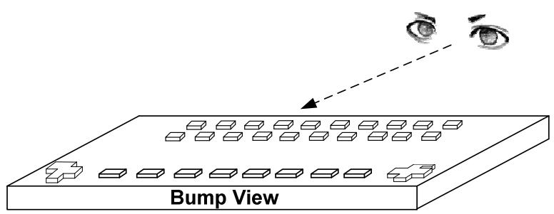

<table><tr><td rowspan="4"></td><td colspan="101">Driver IC Face Up</td><td></td><td></td><td></td></tr><tr><td rowspan="3">G10000000000000000000000000000000000000000000000000000000000000000000000000000000000000000000000000000</td><td rowspan="3">G2000000000000000000000000000000000000000000000000000000000000000000000000000000000000000000000000000</td><td rowspan="3"></td><td rowspan="3"></td><td rowspan="3"></td><td rowspan="3"></td><td rowspan="3"></td><td rowspan="3"></td><td rowspan="3"></td><td rowspan="3"></td><td rowspan="3"></td><td rowspan="3"></td><td rowspan="3"></td><td rowspan="3"></td><td rowspan="3"></td><td rowspan="3"></td><td rowspan="3"></td><td rowspan="3"></td><td rowspan="3"></td><td rowspan="3"></td><td rowspan="3"></td><td rowspan="3"></td><td rowspan="3"></td><td rowspan="3"></td><td rowspan="3"></td><td rowspan="3"></td><td rowspan="3"></td><td rowspan="3"></td><td rowspan="3"></td><td rowspan="3"></td><td rowspan="3"></td><td rowspan="3"></td><td rowspan="3"></td><td rowspan="3"></td><td rowspan="3"></td><td rowspan="3"></td><td rowspan="3"></td><td rowspan="3"></td><td rowspan="3"></td><td rowspan="3"></td><td rowspan="3"></td><td rowspan="3"></td><td rowspan="3"></td><td rowspan="3"></td><td rowspan="3"></td><td rowspan="3"></td><td rowspan="3"></td><td rowspan="3"></td><td rowspan="3"></td><td rowspan="3"></td><td rowspan="3"></td><td rowspan="3"></td><td rowspan="3"></td><td rowspan="3"></td><td rowspan="3"></td><td rowspan="3"></td><td rowspan="3"></td><td rowspan="3"></td><td rowspan="3"></td><td rowspan="3"></td><td rowspan="3"></td><td rowspan="3"></td><td rowspan="3"></td><td rowspan="3"></td><td rowspan="3"></td><td rowspan="3"></td><td rowspan="3"></td><td rowspan="3"></td><td rowspan="3"></td><td rowspan="3"></td><td rowspan="3"></td><td rowspan="3"></td><td rowspan="3"></td><td rowspan="3"></td><td rowspan="3"></td><td rowspan="3"></td><td rowspan="3"></td><td rowspan="3"></td><td rowspan="3"></td><td rowspan="3"></td><td rowspan="3"></td><td rowspan="3"></td><td rowspan="3"></td><td rowspan="3"></td><td rowspan="3"></td><td rowspan="3"></td><td rowspan="3"></td><td rowspan="3"></td><td rowspan="3"></td><td rowspan="3"></td><td rowspan="3"></td><td rowspan="3"></td><td rowspan="2"></td><td rowspan="2"></td><td rowspan="2"></td><td rowspan="2"></td><td rowspan="2"></td><td rowspan="2"></td><td rowspan="2"></td><td></td><td></td><td></td><td></td><td></td></tr><tr><td>G100000000000000000000000000000000000000000000000000000000000000000000000000000000000000000000000</td><td></td><td></td><td></td><td></td></tr><tr><td>G10008000000000000000000000000000000000000000000000000000000000000000000000000000000000000000000000000000</td><td></td><td></td><td></td><td></td><td></td><td></td><td></td><td></td><td></td><td></td><td></td></tr></table>

## 3.2.. Bump Dimension

##  Output Pads

Pad No.

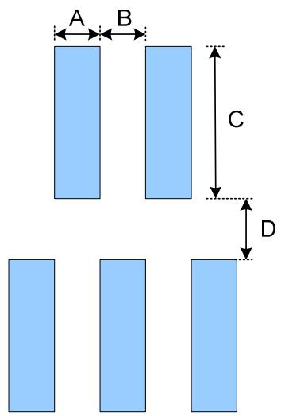

<table><tr><td>Symbol</td><td>Item</td><td>Size</td></tr><tr><td>A</td><td>Bump Width</td><td>15 um</td></tr><tr><td>B</td><td>Bump Gap 1 (Horizontal)</td><td>15 um</td></tr><tr><td>C</td><td>Bump Height</td><td>80um</td></tr><tr><td>D</td><td>Bump Gap 2 (Vertical)</td><td>25um</td></tr></table>

##  Input Pads

Pad No.1\~320

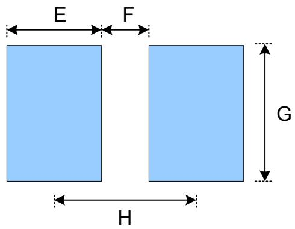

<table><tr><td>Symbol</td><td>Item</td><td>Size</td></tr><tr><td>E</td><td>Bump Width</td><td>50 um</td></tr><tr><td>F</td><td>Bump Gap</td><td>20 um</td></tr><tr><td>G</td><td>Bump Height</td><td>66um</td></tr><tr><td>H</td><td>Bump Pitch</td><td>70 um</td></tr></table>

## 3.3.. Alignment Mark Dimension

 Alignment Mark Left: L(X,Y)=( -11300, -277)

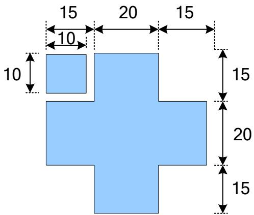

 Alignment Mark Right: R(X,Y)= ( 11300, -277)

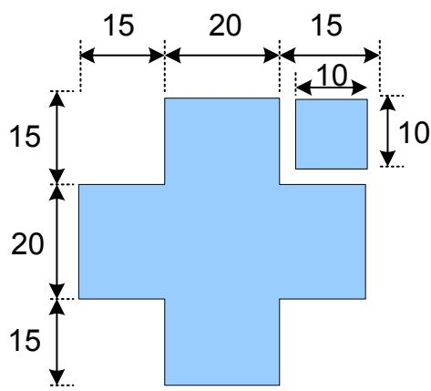

## 3.4.. Chip Information

<table><tr><td>Chip size</td><td>22742um x 696um</td></tr><tr><td>Chip thickness</td><td>250um</td></tr><tr><td>Pad Location</td><td>Pad center</td></tr><tr><td>Coordinate Origin</td><td>Chip center</td></tr></table>

4 PAD CENTER COORDINATES

<table><tr><td>PAD No.</td><td>PIN Name</td><td>X</td><td>Y</td><td>PAD No.</td><td>PIN Name</td><td>X</td><td>Y</td></tr><tr><td>1</td><td>VPP</td><td>-11165</td><td>-279</td><td>34</td><td>CABC_PWN</td><td>-8855</td><td>-279</td></tr><tr><td>2</td><td>VPP</td><td>-11095</td><td>-279</td><td>35</td><td>IM0/ID</td><td>-8785</td><td>-279</td></tr><tr><td>3</td><td>DGND</td><td>-11025</td><td>-279</td><td>36</td><td>IM1</td><td>-8715</td><td>-279</td></tr><tr><td>4</td><td>DGND</td><td>-10955</td><td>-279</td><td>37</td><td>IM2</td><td>-8645</td><td>-279</td></tr><tr><td>5</td><td>DUMMY</td><td>-10885</td><td>-279</td><td>38</td><td>RESET</td><td>-8575</td><td>-279</td></tr><tr><td>6</td><td>DUMMY</td><td>-10815</td><td>-279</td><td>39</td><td>VSYNC</td><td>-8505</td><td>-279</td></tr><tr><td>7</td><td>TEST2</td><td>-10745</td><td>-279</td><td>40</td><td>HSYNC</td><td>-8435</td><td>-279</td></tr><tr><td>8</td><td>DUMMY</td><td>-10675</td><td>-279</td><td>41</td><td>DOTCLK</td><td>-8365</td><td>-279</td></tr><tr><td>9</td><td>EXTC</td><td>-10605</td><td>-279</td><td>42</td><td>ENABLE</td><td>-8295</td><td>-279</td></tr><tr><td>10</td><td>TEST3</td><td>-10535</td><td>-279</td><td>43</td><td>DB17</td><td>-8225</td><td>-279</td></tr><tr><td>11</td><td>TEST4</td><td>-10465</td><td>-279</td><td>44</td><td>DB16</td><td>-8155</td><td>-279</td></tr><tr><td>12</td><td>TEST5</td><td>-10395</td><td>-279</td><td>45</td><td>DB15</td><td>-8085</td><td>-279</td></tr><tr><td>13</td><td>MIPI_LDO</td><td>-10325</td><td>-279</td><td>46</td><td>DB14</td><td>-8015</td><td>-279</td></tr><tr><td>14</td><td>MIPI_LDO</td><td>-10255</td><td>-279</td><td>47</td><td>DB13</td><td>-7945</td><td>-279</td></tr><tr><td>15</td><td>DUMMY</td><td>-10185</td><td>-279</td><td>48</td><td>DB12</td><td>-7875</td><td>-279</td></tr><tr><td>16</td><td>MIPI_DATA_N</td><td>-10115</td><td>-279</td><td>49</td><td>DB11</td><td>-7805</td><td>-279</td></tr><tr><td>17</td><td>MIPI_DATA_N</td><td>-10045</td><td>-279</td><td>50</td><td>DB10</td><td>-7735</td><td>-279</td></tr><tr><td>18</td><td>MIPI_DATA_P</td><td>-9975</td><td>-279</td><td>51</td><td>DB9</td><td>-7665</td><td>-279</td></tr><tr><td>19</td><td>MIPI_DATA_P</td><td>-9905</td><td>-279</td><td>52</td><td>DB8</td><td>-7595</td><td>-279</td></tr><tr><td>20</td><td>MIPI_CLOCK_N</td><td>-9835</td><td>-279</td><td>53</td><td>DB7</td><td>-7525</td><td>-279</td></tr><tr><td>21</td><td>MIPI_CLOCK_N</td><td>-9765</td><td>-279</td><td>54</td><td>DB6</td><td>-7455</td><td>-279</td></tr><tr><td>22</td><td>MIPI_CLOCK_P</td><td>-9695</td><td>-279</td><td>55</td><td>DB5</td><td>-7385</td><td>-279</td></tr><tr><td>23</td><td>MIPI_CLOCK_P</td><td>-9625</td><td>-279</td><td>56</td><td>DB4</td><td>-7315</td><td>-279</td></tr><tr><td>24</td><td>TS0</td><td>-9555</td><td>-279</td><td>57</td><td>DB3</td><td>-7245</td><td>-279</td></tr><tr><td>25</td><td>TS1</td><td>-9485</td><td>-279</td><td>58</td><td>DB2</td><td>-7175</td><td>-279</td></tr><tr><td>26</td><td>TS2</td><td>-9415</td><td>-279</td><td>59</td><td>DB1</td><td>-7105</td><td>-279</td></tr><tr><td>27</td><td>TEST0</td><td>-9345</td><td>-279</td><td>60</td><td>DB0</td><td>-7035</td><td>-279</td></tr><tr><td>28</td><td>TEST1</td><td>-9275</td><td>-279</td><td>61</td><td>DOUT</td><td>-6965</td><td>-279</td></tr><tr><td>29</td><td>OSCP</td><td>-9205</td><td>-279</td><td>62</td><td>DIN/SDA</td><td>-6895</td><td>-279</td></tr><tr><td>30</td><td>DUMMY</td><td>-9135</td><td>-279</td><td>63</td><td>RDX</td><td>-6825</td><td>-279</td></tr><tr><td>31</td><td>DUMMY</td><td>-9065</td><td>-279</td><td>64</td><td>WRX/SCL</td><td>-6755</td><td>-279</td></tr><tr><td>32</td><td>DUMMY</td><td>-8995</td><td>-279</td><td>65</td><td>DCX</td><td>-6685</td><td>-279</td></tr><tr><td>33</td><td>CABC_ON</td><td>-8925</td><td>-279</td><td>66</td><td>CSX</td><td>-6615</td><td>-279</td></tr><tr><td>67</td><td>TE</td><td>-6545</td><td>-279</td><td>101</td><td>AGND</td><td>-4165</td><td>-279</td></tr><tr><td>68</td><td>VDDI</td><td>-6475</td><td>-279</td><td>102</td><td>AGND</td><td>-4095</td><td>-279</td></tr><tr><td>69</td><td>VDDI</td><td>-6405</td><td>-279</td><td>103</td><td>AGND</td><td>-4025</td><td>-279</td></tr><tr><td>70</td><td>VDDI</td><td>-6335</td><td>-279</td><td>104</td><td>AGND</td><td>-3955</td><td>-279</td></tr><tr><td>71</td><td>VDDI</td><td>-6265</td><td>-279</td><td>105</td><td>AGND</td><td>-3885</td><td>-279</td></tr><tr><td>72</td><td>VDDI</td><td>-6195</td><td>-279</td><td>106</td><td>AGND</td><td>-3815</td><td>-279</td></tr><tr><td>73</td><td>VDDI</td><td>-6125</td><td>-279</td><td>107</td><td>VCOM</td><td>-3745</td><td>-279</td></tr><tr><td>74</td><td>VDDI</td><td>-6055</td><td>-279</td><td>108</td><td>VCOM</td><td>-3675</td><td>-279</td></tr><tr><td>75</td><td>VCC</td><td>-5985</td><td>-279</td><td>109</td><td>VCOM</td><td>-3605</td><td>-279</td></tr><tr><td>76</td><td>VCC</td><td>-5915</td><td>-279</td><td>110</td><td>VCOM</td><td>-3535</td><td>-279</td></tr><tr><td>77</td><td>VCC</td><td>-5845</td><td>-279</td><td>111</td><td>VCOM</td><td>-3465</td><td>-279</td></tr><tr><td>78</td><td>VCC</td><td>-5775</td><td>-279</td><td>112</td><td>VCOM</td><td>-3395</td><td>-279</td></tr><tr><td>79</td><td>VCC</td><td>-5705</td><td>-279</td><td>113</td><td>VCOM</td><td>-3325</td><td>-279</td></tr><tr><td>80</td><td>VCC</td><td>-5635</td><td>-279</td><td>114</td><td>VCOM</td><td>-3255</td><td>-279</td></tr><tr><td>81</td><td>VCC</td><td>-5565</td><td>-279</td><td>115</td><td>VCOM</td><td>-3185</td><td>-279</td></tr><tr><td>82</td><td>VCC</td><td>-5495</td><td>-279</td><td>116</td><td>VCOM</td><td>-3115</td><td>-279</td></tr><tr><td>83</td><td>VCC</td><td>-5425</td><td>-279</td><td>117</td><td>VCOM</td><td>-3045</td><td>-279</td></tr><tr><td>84</td><td>VCC</td><td>-5355</td><td>-279</td><td>118</td><td>VCOM</td><td>-2975</td><td>-279</td></tr><tr><td>85</td><td>VCC</td><td>-5285</td><td>-279</td><td>119</td><td>VCOM</td><td>-2905</td><td>-279</td></tr><tr><td>86</td><td>DGND</td><td>-5215</td><td>-279</td><td>120</td><td>VCOM</td><td>-2835</td><td>-279</td></tr><tr><td>87</td><td>DGND</td><td>-5145</td><td>-279</td><td>121</td><td>VCOM</td><td>-2765</td><td>-279</td></tr><tr><td>88</td><td>DGND</td><td>-5075</td><td>-279</td><td>122</td><td>VCOM</td><td>-2695</td><td>-279</td></tr><tr><td>89</td><td>DGND</td><td>-5005</td><td>-279</td><td>123</td><td>VAP</td><td>-2625</td><td>-279</td></tr><tr><td>90</td><td>DGND</td><td>-4935</td><td>-279</td><td>124</td><td>VAP</td><td>-2555</td><td>-279</td></tr><tr><td>91</td><td>DGND</td><td>-4865</td><td>-279</td><td>125</td><td>VAP</td><td>-2485</td><td>-279</td></tr><tr><td>92</td><td>DGND</td><td>-4795</td><td>-279</td><td>126</td><td>VAP</td><td>-2415</td><td>-279</td></tr><tr><td>93</td><td>DGND</td><td>-4725</td><td>-279</td><td>127</td><td>VAP</td><td>-2345</td><td>-279</td></tr><tr><td>94</td><td>DUMMY</td><td>-4655</td><td>-279</td><td>128</td><td>VAP</td><td>-2275</td><td>-279</td></tr><tr><td>95</td><td>DUMMY</td><td>-4585</td><td>-279</td><td>129</td><td>VAP</td><td>-2205</td><td>-279</td></tr><tr><td>96</td><td>DUMMY</td><td>-4515</td><td>-279</td><td>130</td><td>VAP</td><td>-2135</td><td>-279</td></tr><tr><td>97</td><td>AGND</td><td>-4445</td><td>-279</td><td>131</td><td>VAP</td><td>-2065</td><td>-279</td></tr><tr><td>98</td><td>AGND</td><td>-4375</td><td>-279</td><td>132</td><td>VAP</td><td>-1995</td><td>-279</td></tr><tr><td>99</td><td>AGND</td><td>-4305</td><td>-279</td><td>133</td><td>VAN</td><td>-1925</td><td>-279</td></tr><tr><td>100</td><td>AGND</td><td>-4235</td><td>-279</td><td>134</td><td>VAN</td><td>-1855</td><td>-279</td></tr></table>

<table><tr><td>PAD No.</td><td>PIN Name</td><td>X</td><td>Y</td><td rowspan="35"></td><td>PAD No.</td><td>PIN Name</td><td>X</td><td>Y</td></tr><tr><td>135</td><td>VAN</td><td>-1785</td><td>-279</td><td>169</td><td>DUMMY</td><td>595</td><td>-279</td></tr><tr><td>136</td><td>VAN</td><td>-1715</td><td>-279</td><td>170</td><td>DUMMY</td><td>665</td><td>-279</td></tr><tr><td>137</td><td>VAN</td><td>-1645</td><td>-279</td><td>171</td><td>DUMMY</td><td>735</td><td>-279</td></tr><tr><td>138</td><td>VAN</td><td>-1575</td><td>-279</td><td>172</td><td>DUMMY</td><td>805</td><td>-279</td></tr><tr><td>139</td><td>VAN</td><td>-1505</td><td>-279</td><td>173</td><td>DUMMY</td><td>875</td><td>-279</td></tr><tr><td>140</td><td>DUMMY</td><td>-1435</td><td>-279</td><td>174</td><td>VDDA</td><td>945</td><td>-279</td></tr><tr><td>141</td><td>DUMMY</td><td>-1365</td><td>-279</td><td>175</td><td>VDDA</td><td>1015</td><td>-279</td></tr><tr><td>142</td><td>DUMMY</td><td>-1295</td><td>-279</td><td>176</td><td>VDDA</td><td>1085</td><td>-279</td></tr><tr><td>143</td><td>DUMMY</td><td>-1225</td><td>-279</td><td>177</td><td>VDDA</td><td>1155</td><td>-279</td></tr><tr><td>144</td><td>V22</td><td>-1155</td><td>-279</td><td>178</td><td>VDDA</td><td>1225</td><td>-279</td></tr><tr><td>145</td><td>AVCL</td><td>-1085</td><td>-279</td><td>179</td><td>VDDA</td><td>1295</td><td>-279</td></tr><tr><td>146</td><td>AVCL</td><td>-1015</td><td>-279</td><td>180</td><td>VDDA</td><td>1365</td><td>-279</td></tr><tr><td>147</td><td>AVCL</td><td>-945</td><td>-279</td><td>181</td><td>VDDA</td><td>1435</td><td>-279</td></tr><tr><td>148</td><td>AVCL</td><td>-875</td><td>-279</td><td>182</td><td>VDDA</td><td>1505</td><td>-279</td></tr><tr><td>149</td><td>AVCL</td><td>-805</td><td>-279</td><td>183</td><td>VDDA</td><td>1575</td><td>-279</td></tr><tr><td>150</td><td>AVCL</td><td>-735</td><td>-279</td><td>184</td><td>VDDA</td><td>1645</td><td>-279</td></tr><tr><td>151</td><td>AVCL</td><td>-665</td><td>-279</td><td>185</td><td>VDDA</td><td>1715</td><td>-279</td></tr><tr><td>152</td><td>AVCL</td><td>-595</td><td>-279</td><td>186</td><td>VDDA</td><td>1785</td><td>-279</td></tr><tr><td>153</td><td>AVCL</td><td>-525</td><td>-279</td><td>187</td><td>VDDA</td><td>1855</td><td>-279</td></tr><tr><td>154</td><td>AVDD</td><td>-455</td><td>-279</td><td>188</td><td>VDDA</td><td>1925</td><td>-279</td></tr><tr><td>155</td><td>AVDD</td><td>-385</td><td>-279</td><td>189</td><td>VDDA</td><td>1995</td><td>-279</td></tr><tr><td>156</td><td>AVDD</td><td>-315</td><td>-279</td><td>190</td><td>VDDA</td><td>2065</td><td>-279</td></tr><tr><td>157</td><td>AVDD</td><td>-245</td><td>-279</td><td>191</td><td>VDDA</td><td>2135</td><td>-279</td></tr><tr><td>158</td><td>AVDD</td><td>-175</td><td>-279</td><td>192</td><td>VDDA</td><td>2205</td><td>-279</td></tr><tr><td>159</td><td>AVDD</td><td>-105</td><td>-279</td><td>193</td><td>DUMMY</td><td>2275</td><td>-279</td></tr><tr><td>160</td><td>AVDD</td><td>-35</td><td>-279</td><td>194</td><td>DUMMY</td><td>2345</td><td>-279</td></tr><tr><td>161</td><td>AVDD</td><td>35</td><td>-279</td><td>195</td><td>DUMMY</td><td>2415</td><td>-279</td></tr><tr><td>162</td><td>AVDD</td><td>105</td><td>-279</td><td>196</td><td>DUMMY</td><td>2485</td><td>-279</td></tr><tr><td>163</td><td>DUMMY</td><td>175</td><td>-279</td><td>197</td><td>DUMMY</td><td>2555</td><td>-279</td></tr><tr><td>164</td><td>DUMMY</td><td>245</td><td>-279</td><td>198</td><td>DUMMY</td><td>2625</td><td>-279</td></tr><tr><td>165</td><td>DUMMY</td><td>315</td><td>-279</td><td>199</td><td>DUMMY</td><td>2695</td><td>-279</td></tr><tr><td>166</td><td>DUMMY</td><td>385</td><td>-279</td><td>200</td><td>DUMMY</td><td>2765</td><td>-279</td></tr><tr><td>167</td><td>DUMMY</td><td>455</td><td>-279</td><td>201</td><td>DUMMY</td><td>2835</td><td>-279</td></tr><tr><td>168</td><td>DUMMY</td><td>525</td><td>-279</td><td>202</td><td>DUMMY</td><td>2905</td><td>-279</td></tr><tr><td>203</td><td>DUMMY</td><td>2975</td><td>-279</td><td></td><td>237</td><td>VGL</td><td>5355</td><td>-279</td></tr><tr><td>204</td><td>DUMMY</td><td>3045</td><td>-279</td><td></td><td>238</td><td>VGL</td><td>5425</td><td>-279</td></tr><tr><td>205</td><td>DUMMY</td><td>3115</td><td>-279</td><td></td><td>239</td><td>VGL</td><td>5495</td><td>-279</td></tr><tr><td>206</td><td>DUMMY</td><td>3185</td><td>-279</td><td></td><td>240</td><td>VGL</td><td>5565</td><td>-279</td></tr><tr><td>207</td><td>DUMMY</td><td>3255</td><td>-279</td><td></td><td>241</td><td>VGL</td><td>5635</td><td>-279</td></tr><tr><td>208</td><td>DUMMY</td><td>3325</td><td>-279</td><td></td><td>242</td><td>VGL</td><td>5705</td><td>-279</td></tr><tr><td>209</td><td>DUMMY</td><td>3395</td><td>-279</td><td></td><td>243</td><td>VGL</td><td>5775</td><td>-279</td></tr><tr><td>210</td><td>DUMMY</td><td>3465</td><td>-279</td><td></td><td>244</td><td>VGL</td><td>5845</td><td>-279</td></tr><tr><td>211</td><td>DUMMY</td><td>3535</td><td>-279</td><td></td><td>245</td><td>VGL</td><td>5915</td><td>-279</td></tr><tr><td>212</td><td>DUMMY</td><td>3605</td><td>-279</td><td></td><td>246</td><td>AGND</td><td>5985</td><td>-279</td></tr><tr><td>213</td><td>DUMMY</td><td>3675</td><td>-279</td><td></td><td>247</td><td>AGND</td><td>6055</td><td>-279</td></tr><tr><td>214</td><td>DUMMY</td><td>3745</td><td>-279</td><td></td><td>248</td><td>AGND</td><td>6125</td><td>-279</td></tr><tr><td>215</td><td>DUMMY</td><td>3815</td><td>-279</td><td></td><td>249</td><td>VGH</td><td>6195</td><td>-279</td></tr><tr><td>216</td><td>DUMMY</td><td>3885</td><td>-279</td><td></td><td>250</td><td>VGH</td><td>6265</td><td>-279</td></tr><tr><td>217</td><td>DUMMY</td><td>3955</td><td>-279</td><td></td><td>251</td><td>VGH</td><td>6335</td><td>-279</td></tr><tr><td>218</td><td>DUMMY</td><td>4025</td><td>-279</td><td></td><td>252</td><td>VGH</td><td>6405</td><td>-279</td></tr><tr><td>219</td><td>DUMMY</td><td>4095</td><td>-279</td><td></td><td>253</td><td>VGH</td><td>6475</td><td>-279</td></tr><tr><td>220</td><td>DUMMY</td><td>4165</td><td>-279</td><td></td><td>254</td><td>VGH</td><td>6545</td><td>-279</td></tr><tr><td>221</td><td>DUMMY</td><td>4235</td><td>-279</td><td></td><td>255</td><td>VGH</td><td>6615</td><td>-279</td></tr><tr><td>222</td><td>DUMMY</td><td>4305</td><td>-279</td><td></td><td>256</td><td>VGH</td><td>6685</td><td>-279</td></tr><tr><td>223</td><td>DUMMY</td><td>4375</td><td>-279</td><td></td><td>257</td><td>DUMMY</td><td>6755</td><td>-279</td></tr><tr><td>224</td><td>DUMMY</td><td>4445</td><td>-279</td><td></td><td>258</td><td>DUMMY</td><td>6825</td><td>-279</td></tr><tr><td>225</td><td>DUMMY</td><td>4515</td><td>-279</td><td></td><td>259</td><td>DUMMY</td><td>6895</td><td>-279</td></tr><tr><td>226</td><td>DUMMY</td><td>4585</td><td>-279</td><td></td><td>260</td><td>DUMMY</td><td>6965</td><td>-279</td></tr><tr><td>227</td><td>DUMMY</td><td>4655</td><td>-279</td><td></td><td>261</td><td>DUMMY</td><td>7035</td><td>-279</td></tr><tr><td>228</td><td>DUMMY</td><td>4725</td><td>-279</td><td></td><td>262</td><td>DUMMY</td><td>7105</td><td>-279</td></tr><tr><td>229</td><td>DUMMY</td><td>4795</td><td>-279</td><td></td><td>263</td><td>DUMMY</td><td>7175</td><td>-279</td></tr><tr><td>230</td><td>DUMMY</td><td>4865</td><td>-279</td><td></td><td>264</td><td>DUMMY</td><td>7245</td><td>-279</td></tr><tr><td>231</td><td>DUMMY</td><td>4935</td><td>-279</td><td></td><td>265</td><td>DUMMY</td><td>7315</td><td>-279</td></tr><tr><td>232</td><td>DUMMY</td><td>5005</td><td>-279</td><td></td><td>266</td><td>DUMMY</td><td>7385</td><td>-279</td></tr><tr><td>233</td><td>DUMMY</td><td>5075</td><td>-279</td><td></td><td>267</td><td>DUMMY</td><td>7455</td><td>-279</td></tr><tr><td>234</td><td>DUMMY</td><td>5145</td><td>-279</td><td></td><td>268</td><td>DUMMY</td><td>7525</td><td>-279</td></tr><tr><td>235</td><td>DUMMY</td><td>5215</td><td>-279</td><td></td><td>269</td><td>DUMMY</td><td>7595</td><td>-279</td></tr><tr><td>236</td><td>VGL</td><td>5285</td><td>-279</td><td></td><td>270</td><td>DUMMY</td><td>7665</td><td>-279</td></tr><tr><td>271</td><td>DUMMY</td><td>7735</td><td>-279</td><td></td><td>305</td><td>DUMMY</td><td>10115</td><td>-279</td></tr><tr><td>272</td><td>DUMMY</td><td>7805</td><td>-279</td><td></td><td>306</td><td>DUMMY</td><td>10185</td><td>-279</td></tr><tr><td>273</td><td>DUMMY</td><td>7875</td><td>-279</td><td></td><td>307</td><td>DUMMY</td><td>10255</td><td>-279</td></tr><tr><td>274</td><td>DUMMY</td><td>7945</td><td>-279</td><td></td><td>308</td><td>DUMMY</td><td>10325</td><td>-279</td></tr><tr><td>275</td><td>DUMMY</td><td>8015</td><td>-279</td><td></td><td>309</td><td>DUMMY</td><td>10395</td><td>-279</td></tr><tr><td>276</td><td>DUMMY</td><td>8085</td><td>-279</td><td></td><td>310</td><td>DUMMY</td><td>10465</td><td>-279</td></tr><tr><td>277</td><td>DUMMY</td><td>8155</td><td>-279</td><td></td><td>311</td><td>DUMMY</td><td>10535</td><td>-279</td></tr><tr><td>278</td><td>DUMMY</td><td>8225</td><td>-279</td><td></td><td>312</td><td>DUMMY</td><td>10605</td><td>-279</td></tr><tr><td>279</td><td>DUMMY</td><td>8295</td><td>-279</td><td></td><td>313</td><td>DUMMY</td><td>10675</td><td>-279</td></tr><tr><td>280</td><td>DUMMY</td><td>8365</td><td>-279</td><td></td><td>314</td><td>DUMMY</td><td>10745</td><td>-279</td></tr><tr><td>281</td><td>DUMMY</td><td>8435</td><td>-279</td><td></td><td>315</td><td>DUMMY</td><td>10815</td><td>-279</td></tr><tr><td>282</td><td>DUMMY</td><td>8505</td><td>-279</td><td></td><td>316</td><td>DUMMY</td><td>10885</td><td>-279</td></tr><tr><td>283</td><td>DUMMY</td><td>8575</td><td>-279</td><td></td><td>317</td><td>DUMMY</td><td>10955</td><td>-279</td></tr><tr><td>284</td><td>DUMMY</td><td>8645</td><td>-279</td><td></td><td>318</td><td>DUMMY</td><td>11025</td><td>-279</td></tr><tr><td>285</td><td>DUMMY</td><td>8715</td><td>-279</td><td></td><td>319</td><td>DUMMY</td><td>11095</td><td>-279</td></tr><tr><td>286</td><td>DUMMY</td><td>8785</td><td>-279</td><td></td><td>320</td><td>DUMMY</td><td>11165</td><td>-279</td></tr><tr><td>287</td><td>DUMMY</td><td>8855</td><td>-279</td><td></td><td>321</td><td>ALIGN_R</td><td>11300</td><td>-277</td></tr><tr><td>288</td><td>DUMMY</td><td>8925</td><td>-279</td><td></td><td>322</td><td>DUMMY</td><td>11205</td><td>167</td></tr><tr><td>289</td><td>DUMMY</td><td>8995</td><td>-279</td><td></td><td>323</td><td>DUMMY</td><td>11190</td><td>272</td></tr><tr><td>290</td><td>DUMMY</td><td>9065</td><td>-279</td><td></td><td>324</td><td>G1</td><td>11175</td><td>167</td></tr><tr><td>291</td><td>DUMMY</td><td>9135</td><td>-279</td><td></td><td>325</td><td>G3</td><td>11160</td><td>272</td></tr><tr><td>292</td><td>DUMMY</td><td>9205</td><td>-279</td><td></td><td>326</td><td>G5</td><td>11145</td><td>167</td></tr><tr><td>293</td><td>DUMMY</td><td>9275</td><td>-279</td><td></td><td>327</td><td>G7</td><td>11130</td><td>272</td></tr><tr><td>294</td><td>DUMMY</td><td>9345</td><td>-279</td><td></td><td>328</td><td>G9</td><td>11115</td><td>167</td></tr><tr><td>295</td><td>DUMMY</td><td>9415</td><td>-279</td><td></td><td>329</td><td>G11</td><td>11100</td><td>272</td></tr><tr><td>296</td><td>DUMMY</td><td>9485</td><td>-279</td><td></td><td>330</td><td>G13</td><td>11085</td><td>167</td></tr><tr><td>297</td><td>DUMMY</td><td>9555</td><td>-279</td><td></td><td>331</td><td>G15</td><td>11070</td><td>272</td></tr><tr><td>298</td><td>DUMMY</td><td>9625</td><td>-279</td><td></td><td>332</td><td>G17</td><td>11055</td><td>167</td></tr><tr><td>299</td><td>DUMMY</td><td>9695</td><td>-279</td><td></td><td>333</td><td>G19</td><td>11040</td><td>272</td></tr><tr><td>300</td><td>DUMMY</td><td>9765</td><td>-279</td><td></td><td>334</td><td>G21</td><td>11025</td><td>167</td></tr><tr><td>301</td><td>DUMMY</td><td>9835</td><td>-279</td><td></td><td>335</td><td>G23</td><td>11010</td><td>272</td></tr><tr><td>302</td><td>DUMMY</td><td>9905</td><td>-279</td><td></td><td>336</td><td>G25</td><td>10995</td><td>167</td></tr><tr><td>303</td><td>DUMMY</td><td>9975</td><td>-279</td><td></td><td>337</td><td>G27</td><td>10980</td><td>272</td></tr><tr><td>304</td><td>DUMMY</td><td>10045</td><td>-279</td><td></td><td>338</td><td>G29</td><td>10965</td><td>167</td></tr><tr><td>339</td><td>G31</td><td>10950</td><td>272</td><td></td><td>373</td><td>G99</td><td>10440</td><td>272</td></tr><tr><td>340</td><td>G33</td><td>10935</td><td>167</td><td></td><td>374</td><td>G101</td><td>10425</td><td>167</td></tr><tr><td>341</td><td>G35</td><td>10920</td><td>272</td><td></td><td>375</td><td>G103</td><td>10410</td><td>272</td></tr><tr><td>342</td><td>G37</td><td>10905</td><td>167</td><td></td><td>376</td><td>G105</td><td>10395</td><td>167</td></tr><tr><td>343</td><td>G39</td><td>10890</td><td>272</td><td></td><td>377</td><td>G107</td><td>10380</td><td>272</td></tr><tr><td>344</td><td>G41</td><td>10875</td><td>167</td><td></td><td>378</td><td>G109</td><td>10365</td><td>167</td></tr><tr><td>345</td><td>G43</td><td>10860</td><td>272</td><td></td><td>379</td><td>G111</td><td>10350</td><td>272</td></tr><tr><td>346</td><td>G45</td><td>10845</td><td>167</td><td></td><td>380</td><td>G113</td><td>10335</td><td>167</td></tr><tr><td>347</td><td>G47</td><td>10830</td><td>272</td><td></td><td>381</td><td>G115</td><td>10320</td><td>272</td></tr><tr><td>348</td><td>G49</td><td>10815</td><td>167</td><td></td><td>382</td><td>G117</td><td>10305</td><td>167</td></tr><tr><td>349</td><td>G51</td><td>10800</td><td>272</td><td></td><td>383</td><td>G119</td><td>10290</td><td>272</td></tr><tr><td>350</td><td>G53</td><td>10785</td><td>167</td><td></td><td>384</td><td>G121</td><td>10275</td><td>167</td></tr><tr><td>351</td><td>G55</td><td>10770</td><td>272</td><td></td><td>385</td><td>G123</td><td>10260</td><td>272</td></tr><tr><td>352</td><td>G57</td><td>10755</td><td>167</td><td></td><td>386</td><td>G125</td><td>10245</td><td>167</td></tr><tr><td>353</td><td>G59</td><td>10740</td><td>272</td><td></td><td>387</td><td>G127</td><td>10230</td><td>272</td></tr><tr><td>354</td><td>G61</td><td>10725</td><td>167</td><td></td><td>388</td><td>G129</td><td>10215</td><td>167</td></tr><tr><td>355</td><td>G63</td><td>10710</td><td>272</td><td></td><td>389</td><td>G131</td><td>10200</td><td>272</td></tr><tr><td>356</td><td>G65</td><td>10695</td><td>167</td><td></td><td>390</td><td>G133</td><td>10185</td><td>167</td></tr><tr><td>357</td><td>G67</td><td>10680</td><td>272</td><td></td><td>391</td><td>G135</td><td>10170</td><td>272</td></tr><tr><td>358</td><td>G69</td><td>10665</td><td>167</td><td></td><td>392</td><td>G137</td><td>10155</td><td>167</td></tr><tr><td>359</td><td>G71</td><td>10650</td><td>272</td><td></td><td>393</td><td>G139</td><td>10140</td><td>272</td></tr><tr><td>360</td><td>G73</td><td>10635</td><td>167</td><td></td><td>394</td><td>G141</td><td>10125</td><td>167</td></tr><tr><td>361</td><td>G75</td><td>10620</td><td>272</td><td></td><td>395</td><td>G143</td><td>10110</td><td>272</td></tr><tr><td>362</td><td>G77</td><td>10605</td><td>167</td><td></td><td>396</td><td>G145</td><td>10095</td><td>167</td></tr><tr><td>363</td><td>G79</td><td>10590</td><td>272</td><td></td><td>397</td><td>G147</td><td>10080</td><td>272</td></tr><tr><td>364</td><td>G81</td><td>10575</td><td>167</td><td></td><td>398</td><td>G149</td><td>10065</td><td>167</td></tr><tr><td>365</td><td>G83</td><td>10560</td><td>272</td><td></td><td>399</td><td>G151</td><td>10050</td><td>272</td></tr><tr><td>366</td><td>G85</td><td>10545</td><td>167</td><td></td><td>400</td><td>G153</td><td>10035</td><td>167</td></tr><tr><td>367</td><td>G87</td><td>10530</td><td>272</td><td></td><td>401</td><td>G155</td><td>10020</td><td>272</td></tr><tr><td>368</td><td>G89</td><td>10515</td><td>167</td><td></td><td>402</td><td>G157</td><td>10005</td><td>167</td></tr><tr><td>369</td><td>G91</td><td>10500</td><td>272</td><td></td><td>403</td><td>G159</td><td>9990</td><td>272</td></tr><tr><td>370</td><td>G93</td><td>10485</td><td>167</td><td></td><td>404</td><td>G161</td><td>9975</td><td>167</td></tr><tr><td>371</td><td>G95</td><td>10470</td><td>272</td><td></td><td>405</td><td>G163</td><td>9960</td><td>272</td></tr><tr><td>372</td><td>G97</td><td>10455</td><td>167</td><td></td><td>406</td><td>G165</td><td>9945</td><td>167</td></tr><tr><td>407</td><td>G167</td><td>9930</td><td>272</td><td></td><td>441</td><td>G235</td><td>9420</td><td>272</td></tr><tr><td>408</td><td>G169</td><td>9915</td><td>167</td><td></td><td>442</td><td>G237</td><td>9405</td><td>167</td></tr><tr><td>409</td><td>G171</td><td>9900</td><td>272</td><td></td><td>443</td><td>G239</td><td>9390</td><td>272</td></tr><tr><td>410</td><td>G173</td><td>9885</td><td>167</td><td></td><td>444</td><td>G241</td><td>9375</td><td>167</td></tr><tr><td>411</td><td>G175</td><td>9870</td><td>272</td><td></td><td>445</td><td>G243</td><td>9360</td><td>272</td></tr><tr><td>412</td><td>G177</td><td>9855</td><td>167</td><td></td><td>446</td><td>G245</td><td>9345</td><td>167</td></tr><tr><td>413</td><td>G179</td><td>9840</td><td>272</td><td></td><td>447</td><td>G247</td><td>9330</td><td>272</td></tr><tr><td>414</td><td>G181</td><td>9825</td><td>167</td><td></td><td>448</td><td>G249</td><td>9315</td><td>167</td></tr><tr><td>415</td><td>G183</td><td>9810</td><td>272</td><td></td><td>449</td><td>G251</td><td>9300</td><td>272</td></tr><tr><td>416</td><td>G185</td><td>9795</td><td>167</td><td></td><td>450</td><td>G253</td><td>9285</td><td>167</td></tr><tr><td>417</td><td>G187</td><td>9780</td><td>272</td><td></td><td>451</td><td>G255</td><td>9270</td><td>272</td></tr><tr><td>418</td><td>G189</td><td>9765</td><td>167</td><td></td><td>452</td><td>G257</td><td>9255</td><td>167</td></tr><tr><td>419</td><td>G191</td><td>9750</td><td>272</td><td></td><td>453</td><td>G259</td><td>9240</td><td>272</td></tr><tr><td>420</td><td>G193</td><td>9735</td><td>167</td><td></td><td>454</td><td>G261</td><td>9225</td><td>167</td></tr><tr><td>421</td><td>G195</td><td>9720</td><td>272</td><td></td><td>455</td><td>G263</td><td>9210</td><td>272</td></tr><tr><td>422</td><td>G197</td><td>9705</td><td>167</td><td></td><td>456</td><td>G265</td><td>9195</td><td>167</td></tr><tr><td>423</td><td>G199</td><td>9690</td><td>272</td><td></td><td>457</td><td>G267</td><td>9180</td><td>272</td></tr><tr><td>424</td><td>G201</td><td>9675</td><td>167</td><td></td><td>458</td><td>G269</td><td>9165</td><td>167</td></tr><tr><td>425</td><td>G203</td><td>9660</td><td>272</td><td></td><td>459</td><td>G271</td><td>9150</td><td>272</td></tr><tr><td>426</td><td>G205</td><td>9645</td><td>167</td><td></td><td>460</td><td>G273</td><td>9135</td><td>167</td></tr><tr><td>427</td><td>G207</td><td>9630</td><td>272</td><td></td><td>461</td><td>G275</td><td>9120</td><td>272</td></tr><tr><td>428</td><td>G209</td><td>9615</td><td>167</td><td></td><td>462</td><td>G277</td><td>9105</td><td>167</td></tr><tr><td>429</td><td>G211</td><td>9600</td><td>272</td><td></td><td>463</td><td>G279</td><td>9090</td><td>272</td></tr><tr><td>430</td><td>G213</td><td>9585</td><td>167</td><td></td><td>464</td><td>G281</td><td>9075</td><td>167</td></tr><tr><td>431</td><td>G215</td><td>9570</td><td>272</td><td></td><td>465</td><td>G283</td><td>9060</td><td>272</td></tr><tr><td>432</td><td>G217</td><td>9555</td><td>167</td><td></td><td>466</td><td>G285</td><td>9045</td><td>167</td></tr><tr><td>433</td><td>G219</td><td>9540</td><td>272</td><td></td><td>467</td><td>G287</td><td>9030</td><td>272</td></tr><tr><td>434</td><td>G221</td><td>9525</td><td>167</td><td></td><td>468</td><td>G289</td><td>9015</td><td>167</td></tr><tr><td>435</td><td>G223</td><td>9510</td><td>272</td><td></td><td>469</td><td>G291</td><td>9000</td><td>272</td></tr><tr><td>436</td><td>G225</td><td>9495</td><td>167</td><td></td><td>470</td><td>G293</td><td>8985</td><td>167</td></tr><tr><td>437</td><td>G227</td><td>9480</td><td>272</td><td></td><td>471</td><td>G295</td><td>8970</td><td>272</td></tr><tr><td>438</td><td>G229</td><td>9465</td><td>167</td><td></td><td>472</td><td>G297</td><td>8955</td><td>167</td></tr><tr><td>439</td><td>G231</td><td>9450</td><td>272</td><td></td><td>473</td><td>G299</td><td>8940</td><td>272</td></tr><tr><td>440</td><td>G233</td><td>9435</td><td>167</td><td></td><td>474</td><td>G301</td><td>8925</td><td>167</td></tr><tr><td>475</td><td>G303</td><td>8910</td><td>272</td><td></td><td>509</td><td>G371</td><td>8400</td><td>272</td></tr><tr><td>476</td><td>G305</td><td>8895</td><td>167</td><td></td><td>510</td><td>G373</td><td>8385</td><td>167</td></tr><tr><td>477</td><td>G307</td><td>8880</td><td>272</td><td></td><td>511</td><td>G375</td><td>8370</td><td>272</td></tr><tr><td>478</td><td>G309</td><td>8865</td><td>167</td><td></td><td>512</td><td>G377</td><td>8355</td><td>167</td></tr><tr><td>479</td><td>G311</td><td>8850</td><td>272</td><td></td><td>513</td><td>G379</td><td>8340</td><td>272</td></tr><tr><td>480</td><td>G313</td><td>8835</td><td>167</td><td></td><td>514</td><td>G381</td><td>8325</td><td>167</td></tr><tr><td>481</td><td>G315</td><td>8820</td><td>272</td><td></td><td>515</td><td>G383</td><td>8310</td><td>272</td></tr><tr><td>482</td><td>G317</td><td>8805</td><td>167</td><td></td><td>516</td><td>G385</td><td>8295</td><td>167</td></tr><tr><td>483</td><td>G319</td><td>8790</td><td>272</td><td></td><td>517</td><td>G387</td><td>8280</td><td>272</td></tr><tr><td>484</td><td>G321</td><td>8775</td><td>167</td><td></td><td>518</td><td>G389</td><td>8265</td><td>167</td></tr><tr><td>485</td><td>G323</td><td>8760</td><td>272</td><td></td><td>519</td><td>G391</td><td>8250</td><td>272</td></tr><tr><td>486</td><td>G325</td><td>8745</td><td>167</td><td></td><td>520</td><td>G393</td><td>8235</td><td>167</td></tr><tr><td>487</td><td>G327</td><td>8730</td><td>272</td><td></td><td>521</td><td>G395</td><td>8220</td><td>272</td></tr><tr><td>488</td><td>G329</td><td>8715</td><td>167</td><td></td><td>522</td><td>G397</td><td>8205</td><td>167</td></tr><tr><td>489</td><td>G331</td><td>8700</td><td>272</td><td></td><td>523</td><td>G399</td><td>8190</td><td>272</td></tr><tr><td>490</td><td>G333</td><td>8685</td><td>167</td><td></td><td>524</td><td>G401</td><td>8175</td><td>167</td></tr><tr><td>491</td><td>G335</td><td>8670</td><td>272</td><td></td><td>525</td><td>G403</td><td>8160</td><td>272</td></tr><tr><td>492</td><td>G337</td><td>8655</td><td>167</td><td></td><td>526</td><td>G405</td><td>8145</td><td>167</td></tr><tr><td>493</td><td>G339</td><td>8640</td><td>272</td><td></td><td>527</td><td>G407</td><td>8130</td><td>272</td></tr><tr><td>494</td><td>G341</td><td>8625</td><td>167</td><td></td><td>528</td><td>G409</td><td>8115</td><td>167</td></tr><tr><td>495</td><td>G343</td><td>8610</td><td>272</td><td></td><td>529</td><td>G411</td><td>8100</td><td>272</td></tr><tr><td>496</td><td>G345</td><td>8595</td><td>167</td><td></td><td>530</td><td>G413</td><td>8085</td><td>167</td></tr><tr><td>497</td><td>G347</td><td>8580</td><td>272</td><td></td><td>531</td><td>G415</td><td>8070</td><td>272</td></tr><tr><td>498</td><td>G349</td><td>8565</td><td>167</td><td></td><td>532</td><td>G417</td><td>8055</td><td>167</td></tr><tr><td>499</td><td>G351</td><td>8550</td><td>272</td><td></td><td>533</td><td>G419</td><td>8040</td><td>272</td></tr><tr><td>500</td><td>G353</td><td>8535</td><td>167</td><td></td><td>534</td><td>G421</td><td>8025</td><td>167</td></tr><tr><td>501</td><td>G355</td><td>8520</td><td>272</td><td></td><td>535</td><td>G423</td><td>8010</td><td>272</td></tr><tr><td>502</td><td>G357</td><td>8505</td><td>167</td><td></td><td>536</td><td>G425</td><td>7995</td><td>167</td></tr><tr><td>503</td><td>G359</td><td>8490</td><td>272</td><td></td><td>537</td><td>G427</td><td>7980</td><td>272</td></tr><tr><td>504</td><td>G361</td><td>8475</td><td>167</td><td></td><td>538</td><td>G429</td><td>7965</td><td>167</td></tr><tr><td>505</td><td>G363</td><td>8460</td><td>272</td><td></td><td>539</td><td>G431</td><td>7950</td><td>272</td></tr><tr><td>506</td><td>G365</td><td>8445</td><td>167</td><td></td><td>540</td><td>G433</td><td>7935</td><td>167</td></tr><tr><td>507</td><td>G367</td><td>8430</td><td>272</td><td></td><td>541</td><td>G435</td><td>7920</td><td>272</td></tr><tr><td>508</td><td>G369</td><td>8415</td><td>167</td><td></td><td>542</td><td>G437</td><td>7905</td><td>167</td></tr><tr><td>543</td><td>G439</td><td>7890</td><td>272</td><td></td><td>577</td><td>S951</td><td>7230</td><td>272</td></tr><tr><td>544</td><td>G441</td><td>7875</td><td>167</td><td></td><td>578</td><td>S950</td><td>7215</td><td>167</td></tr><tr><td>545</td><td>G443</td><td>7860</td><td>272</td><td></td><td>579</td><td>S949</td><td>7200</td><td>272</td></tr><tr><td>546</td><td>G445</td><td>7845</td><td>167</td><td></td><td>580</td><td>S948</td><td>7185</td><td>167</td></tr><tr><td>547</td><td>G447</td><td>7830</td><td>272</td><td></td><td>581</td><td>S947</td><td>7170</td><td>272</td></tr><tr><td>548</td><td>G449</td><td>7815</td><td>167</td><td></td><td>582</td><td>S946</td><td>7155</td><td>167</td></tr><tr><td>549</td><td>G451</td><td>7800</td><td>272</td><td></td><td>583</td><td>S945</td><td>7140</td><td>272</td></tr><tr><td>550</td><td>G453</td><td>7785</td><td>167</td><td></td><td>584</td><td>S944</td><td>7125</td><td>167</td></tr><tr><td>551</td><td>G455</td><td>7770</td><td>272</td><td></td><td>585</td><td>S943</td><td>7110</td><td>272</td></tr><tr><td>552</td><td>G457</td><td>7755</td><td>167</td><td></td><td>586</td><td>S942</td><td>7095</td><td>167</td></tr><tr><td>553</td><td>G459</td><td>7740</td><td>272</td><td></td><td>587</td><td>S941</td><td>7080</td><td>272</td></tr><tr><td>554</td><td>G461</td><td>7725</td><td>167</td><td></td><td>588</td><td>S940</td><td>7065</td><td>167</td></tr><tr><td>555</td><td>G463</td><td>7710</td><td>272</td><td></td><td>589</td><td>S939</td><td>7050</td><td>272</td></tr><tr><td>556</td><td>G465</td><td>7695</td><td>167</td><td></td><td>590</td><td>S938</td><td>7035</td><td>167</td></tr><tr><td>557</td><td>G467</td><td>7680</td><td>272</td><td></td><td>591</td><td>S937</td><td>7020</td><td>272</td></tr><tr><td>558</td><td>G469</td><td>7665</td><td>167</td><td></td><td>592</td><td>S936</td><td>7005</td><td>167</td></tr><tr><td>559</td><td>G471</td><td>7650</td><td>272</td><td></td><td>593</td><td>S935</td><td>6990</td><td>272</td></tr><tr><td>560</td><td>G473</td><td>7635</td><td>167</td><td></td><td>594</td><td>S934</td><td>6975</td><td>167</td></tr><tr><td>561</td><td>G475</td><td>7620</td><td>272</td><td></td><td>595</td><td>S933</td><td>6960</td><td>272</td></tr><tr><td>562</td><td>G477</td><td>7605</td><td>167</td><td></td><td>596</td><td>S932</td><td>6945</td><td>167</td></tr><tr><td>563</td><td>G479</td><td>7590</td><td>272</td><td></td><td>597</td><td>S931</td><td>6930</td><td>272</td></tr><tr><td>564</td><td>DUMMY</td><td>7575</td><td>167</td><td></td><td>598</td><td>S930</td><td>6915</td><td>167</td></tr><tr><td>565</td><td>DUMMY</td><td>7560</td><td>272</td><td></td><td>599</td><td>S929</td><td>6900</td><td>272</td></tr><tr><td>566</td><td>DUMMY</td><td>7395</td><td>167</td><td></td><td>600</td><td>S928</td><td>6885</td><td>167</td></tr><tr><td>567</td><td>DUMMY</td><td>7380</td><td>272</td><td></td><td>601</td><td>S927</td><td>6870</td><td>272</td></tr><tr><td>568</td><td>S960</td><td>7365</td><td>167</td><td></td><td>602</td><td>S926</td><td>6855</td><td>167</td></tr><tr><td>569</td><td>S959</td><td>7350</td><td>272</td><td></td><td>603</td><td>S925</td><td>6840</td><td>272</td></tr><tr><td>570</td><td>S958</td><td>7335</td><td>167</td><td></td><td>604</td><td>S924</td><td>6825</td><td>167</td></tr><tr><td>571</td><td>S957</td><td>7320</td><td>272</td><td></td><td>605</td><td>S923</td><td>6810</td><td>272</td></tr><tr><td>572</td><td>S956</td><td>7305</td><td>167</td><td></td><td>606</td><td>S922</td><td>6795</td><td>167</td></tr><tr><td>573</td><td>S955</td><td>7290</td><td>272</td><td></td><td>607</td><td>S921</td><td>6780</td><td>272</td></tr><tr><td>574</td><td>S954</td><td>7275</td><td>167</td><td></td><td>608</td><td>S920</td><td>6765</td><td>167</td></tr><tr><td>575</td><td>S953</td><td>7260</td><td>272</td><td></td><td>609</td><td>S919</td><td>6750</td><td>272</td></tr><tr><td>576</td><td>S952</td><td>7245</td><td>167</td><td></td><td>610</td><td>S918</td><td>6735</td><td>167</td></tr><tr><td>747</td><td>S781</td><td>4680</td><td>272</td><td></td><td>781</td><td>S747</td><td>4170</td><td>272</td></tr><tr><td>748</td><td>S780</td><td>4665</td><td>167</td><td></td><td>782</td><td>S746</td><td>4155</td><td>167</td></tr><tr><td>749</td><td>S779</td><td>4650</td><td>272</td><td></td><td>783</td><td>S745</td><td>4140</td><td>272</td></tr><tr><td>750</td><td>S778</td><td>4635</td><td>167</td><td></td><td>784</td><td>S744</td><td>4125</td><td>167</td></tr><tr><td>751</td><td>S777</td><td>4620</td><td>272</td><td></td><td>785</td><td>S743</td><td>4110</td><td>272</td></tr><tr><td>752</td><td>S776</td><td>4605</td><td>167</td><td></td><td>786</td><td>S742</td><td>4095</td><td>167</td></tr><tr><td>753</td><td>S775</td><td>4590</td><td>272</td><td></td><td>787</td><td>S741</td><td>4080</td><td>272</td></tr><tr><td>754</td><td>S774</td><td>4575</td><td>167</td><td></td><td>788</td><td>S740</td><td>4065</td><td>167</td></tr><tr><td>755</td><td>S773</td><td>4560</td><td>272</td><td></td><td>789</td><td>S739</td><td>4050</td><td>272</td></tr><tr><td>756</td><td>S772</td><td>4545</td><td>167</td><td></td><td>790</td><td>S738</td><td>4035</td><td>167</td></tr><tr><td>757</td><td>S771</td><td>4530</td><td>272</td><td></td><td>791</td><td>S737</td><td>4020</td><td>272</td></tr><tr><td>758</td><td>S770</td><td>4515</td><td>167</td><td></td><td>792</td><td>S736</td><td>4005</td><td>167</td></tr><tr><td>759</td><td>S769</td><td>4500</td><td>272</td><td></td><td>793</td><td>S735</td><td>3990</td><td>272</td></tr><tr><td>760</td><td>S768</td><td>4485</td><td>167</td><td></td><td>794</td><td>S734</td><td>3975</td><td>167</td></tr><tr><td>761</td><td>S767</td><td>4470</td><td>272</td><td></td><td>795</td><td>S733</td><td>3960</td><td>272</td></tr><tr><td>762</td><td>S766</td><td>4455</td><td>167</td><td></td><td>796</td><td>S732</td><td>3945</td><td>167</td></tr><tr><td>763</td><td>S765</td><td>4440</td><td>272</td><td></td><td>797</td><td>S731</td><td>3930</td><td>272</td></tr><tr><td>764</td><td>S764</td><td>4425</td><td>167</td><td></td><td>798</td><td>S730</td><td>3915</td><td>167</td></tr><tr><td>765</td><td>S763</td><td>4410</td><td>272</td><td></td><td>799</td><td>S729</td><td>3900</td><td>272</td></tr><tr><td>766</td><td>S762</td><td>4395</td><td>167</td><td></td><td>800</td><td>S728</td><td>3885</td><td>167</td></tr><tr><td>767</td><td>S761</td><td>4380</td><td>272</td><td></td><td>801</td><td>S727</td><td>3870</td><td>272</td></tr><tr><td>768</td><td>S760</td><td>4365</td><td>167</td><td></td><td>802</td><td>S726</td><td>3855</td><td>167</td></tr><tr><td>769</td><td>S759</td><td>4350</td><td>272</td><td></td><td>803</td><td>S725</td><td>3840</td><td>272</td></tr><tr><td>770</td><td>S758</td><td>4335</td><td>167</td><td></td><td>804</td><td>S724</td><td>3825</td><td>167</td></tr><tr><td>771</td><td>S757</td><td>4320</td><td>272</td><td></td><td>805</td><td>S723</td><td>3810</td><td>272</td></tr><tr><td>772</td><td>S756</td><td>4305</td><td>167</td><td></td><td>806</td><td>S722</td><td>3795</td><td>167</td></tr><tr><td>773</td><td>S755</td><td>4290</td><td>272</td><td></td><td>807</td><td>S721</td><td>3780</td><td>272</td></tr><tr><td>774</td><td>S754</td><td>4275</td><td>167</td><td></td><td>808</td><td>S720</td><td>3765</td><td>167</td></tr><tr><td>775</td><td>S753</td><td>4260</td><td>272</td><td></td><td>809</td><td>S719</td><td>3750</td><td>272</td></tr><tr><td>776</td><td>S752</td><td>4245</td><td>167</td><td></td><td>810</td><td>S718</td><td>3735</td><td>167</td></tr><tr><td>777</td><td>S751</td><td>4230</td><td>272</td><td></td><td>811</td><td>S717</td><td>3720</td><td>272</td></tr><tr><td>778</td><td>S750</td><td>4215</td><td>167</td><td></td><td>812</td><td>S716</td><td>3705</td><td>167</td></tr><tr><td>779</td><td>S749</td><td>4200</td><td>272</td><td></td><td>813</td><td>S715</td><td>3690</td><td>272</td></tr><tr><td>780</td><td>S748</td><td>4185</td><td>167</td><td></td><td>814</td><td>S714</td><td>3675</td><td>167</td></tr><tr><td>815</td><td>S713</td><td>3660</td><td>272</td><td></td><td>849</td><td>S679</td><td>3150</td><td>272</td></tr><tr><td>816</td><td>S712</td><td>3645</td><td>167</td><td></td><td>850</td><td>S678</td><td>3135</td><td>167</td></tr><tr><td>817</td><td>S711</td><td>3630</td><td>272</td><td></td><td>851</td><td>S677</td><td>3120</td><td>272</td></tr><tr><td>818</td><td>S710</td><td>3615</td><td>167</td><td></td><td>852</td><td>S676</td><td>3105</td><td>167</td></tr><tr><td>819</td><td>S709</td><td>3600</td><td>272</td><td></td><td>853</td><td>S675</td><td>3090</td><td>272</td></tr><tr><td>820</td><td>S708</td><td>3585</td><td>167</td><td></td><td>854</td><td>S674</td><td>3075</td><td>167</td></tr><tr><td>821</td><td>S707</td><td>3570</td><td>272</td><td></td><td>855</td><td>S673</td><td>3060</td><td>272</td></tr><tr><td>822</td><td>S706</td><td>3555</td><td>167</td><td></td><td>856</td><td>S672</td><td>3045</td><td>167</td></tr><tr><td>823</td><td>S705</td><td>3540</td><td>272</td><td></td><td>857</td><td>S671</td><td>3030</td><td>272</td></tr><tr><td>824</td><td>S704</td><td>3525</td><td>167</td><td></td><td>858</td><td>S670</td><td>3015</td><td>167</td></tr><tr><td>825</td><td>S703</td><td>3510</td><td>272</td><td></td><td>859</td><td>S669</td><td>3000</td><td>272</td></tr><tr><td>826</td><td>S702</td><td>3495</td><td>167</td><td></td><td>860</td><td>S668</td><td>2985</td><td>167</td></tr><tr><td>827</td><td>S701</td><td>3480</td><td>272</td><td></td><td>861</td><td>S667</td><td>2970</td><td>272</td></tr><tr><td>828</td><td>S700</td><td>3465</td><td>167</td><td></td><td>862</td><td>S666</td><td>2955</td><td>167</td></tr><tr><td>829</td><td>S699</td><td>3450</td><td>272</td><td></td><td>863</td><td>S665</td><td>2940</td><td>272</td></tr><tr><td>830</td><td>S698</td><td>3435</td><td>167</td><td></td><td>864</td><td>S664</td><td>2925</td><td>167</td></tr><tr><td>831</td><td>S697</td><td>3420</td><td>272</td><td></td><td>865</td><td>S663</td><td>2910</td><td>272</td></tr><tr><td>832</td><td>S696</td><td>3405</td><td>167</td><td></td><td>866</td><td>S662</td><td>2895</td><td>167</td></tr><tr><td>833</td><td>S695</td><td>3390</td><td>272</td><td></td><td>867</td><td>S661</td><td>2880</td><td>272</td></tr><tr><td>834</td><td>S694</td><td>3375</td><td>167</td><td></td><td>868</td><td>S660</td><td>2865</td><td>167</td></tr><tr><td>835</td><td>S693</td><td>3360</td><td>272</td><td></td><td>869</td><td>S659</td><td>2850</td><td>272</td></tr><tr><td>836</td><td>S692</td><td>3345</td><td>167</td><td></td><td>870</td><td>S658</td><td>2835</td><td>167</td></tr><tr><td>837</td><td>S691</td><td>3330</td><td>272</td><td></td><td>871</td><td>S657</td><td>2820</td><td>272</td></tr><tr><td>838</td><td>S690</td><td>3315</td><td>167</td><td></td><td>872</td><td>S656</td><td>2805</td><td>167</td></tr><tr><td>839</td><td>S689</td><td>3300</td><td>272</td><td></td><td>873</td><td>S655</td><td>2790</td><td>272</td></tr><tr><td>840</td><td>S688</td><td>3285</td><td>167</td><td></td><td>874</td><td>S654</td><td>2775</td><td>167</td></tr><tr><td>841</td><td>S687</td><td>3270</td><td>272</td><td></td><td>875</td><td>S653</td><td>2760</td><td>272</td></tr><tr><td>842</td><td>S686</td><td>3255</td><td>167</td><td></td><td>876</td><td>S652</td><td>2745</td><td>167</td></tr><tr><td>843</td><td>S685</td><td>3240</td><td>272</td><td></td><td>877</td><td>S651</td><td>2730</td><td>272</td></tr><tr><td>844</td><td>S684</td><td>3225</td><td>167</td><td></td><td>878</td><td>S650</td><td>2715</td><td>167</td></tr><tr><td>845</td><td>S683</td><td>3210</td><td>272</td><td></td><td>879</td><td>S649</td><td>2700</td><td>272</td></tr><tr><td>846</td><td>S682</td><td>3195</td><td>167</td><td></td><td>880</td><td>S648</td><td>2685</td><td>167</td></tr><tr><td>847</td><td>S681</td><td>3180</td><td>272</td><td></td><td>881</td><td>S647</td><td>2670</td><td>272</td></tr><tr><td>848</td><td>S680</td><td>3165</td><td>167</td><td></td><td>882</td><td>S646</td><td>2655</td><td>167</td></tr><tr><td>1019</td><td>S509</td><td>600</td><td>272</td><td></td><td>1053</td><td>S479</td><td>-195</td><td>167</td></tr><tr><td>1020</td><td>S508</td><td>585</td><td>167</td><td></td><td>1054</td><td>S478</td><td>-210</td><td>272</td></tr><tr><td>1021</td><td>S507</td><td>570</td><td>272</td><td></td><td>1055</td><td>S477</td><td>-225</td><td>167</td></tr><tr><td>1022</td><td>S506</td><td>555</td><td>167</td><td></td><td>1056</td><td>S476</td><td>-240</td><td>272</td></tr><tr><td>1023</td><td>S505</td><td>540</td><td>272</td><td></td><td>1057</td><td>S475</td><td>-255</td><td>167</td></tr><tr><td>1024</td><td>S504</td><td>525</td><td>167</td><td></td><td>1058</td><td>S474</td><td>-270</td><td>272</td></tr><tr><td>1025</td><td>S503</td><td>510</td><td>272</td><td></td><td>1059</td><td>S473</td><td>-285</td><td>167</td></tr><tr><td>1026</td><td>S502</td><td>495</td><td>167</td><td></td><td>1060</td><td>S472</td><td>-300</td><td>272</td></tr><tr><td>1027</td><td>S501</td><td>480</td><td>272</td><td></td><td>1061</td><td>S471</td><td>-315</td><td>167</td></tr><tr><td>1028</td><td>S500</td><td>465</td><td>167</td><td></td><td>1062</td><td>S470</td><td>-330</td><td>272</td></tr><tr><td>1029</td><td>S499</td><td>450</td><td>272</td><td></td><td>1063</td><td>S469</td><td>-345</td><td>167</td></tr><tr><td>1030</td><td>S498</td><td>435</td><td>167</td><td></td><td>1064</td><td>S468</td><td>-360</td><td>272</td></tr><tr><td>1031</td><td>S497</td><td>420</td><td>272</td><td></td><td>1065</td><td>S467</td><td>-375</td><td>167</td></tr><tr><td>1032</td><td>S496</td><td>405</td><td>167</td><td></td><td>1066</td><td>S466</td><td>-390</td><td>272</td></tr><tr><td>1033</td><td>S495</td><td>390</td><td>272</td><td></td><td>1067</td><td>S465</td><td>-405</td><td>167</td></tr><tr><td>1034</td><td>S494</td><td>375</td><td>167</td><td></td><td>1068</td><td>S464</td><td>-420</td><td>272</td></tr><tr><td>1035</td><td>S493</td><td>360</td><td>272</td><td></td><td>1069</td><td>S463</td><td>-435</td><td>167</td></tr><tr><td>1036</td><td>S492</td><td>345</td><td>167</td><td></td><td>1070</td><td>S462</td><td>-450</td><td>272</td></tr><tr><td>1037</td><td>S491</td><td>330</td><td>272</td><td></td><td>1071</td><td>S461</td><td>-465</td><td>167</td></tr><tr><td>1038</td><td>S490</td><td>315</td><td>167</td><td></td><td>1072</td><td>S460</td><td>-480</td><td>272</td></tr><tr><td>1039</td><td>S489</td><td>300</td><td>272</td><td></td><td>1073</td><td>S459</td><td>-495</td><td>167</td></tr><tr><td>1040</td><td>S488</td><td>285</td><td>167</td><td></td><td>1074</td><td>S458</td><td>-510</td><td>272</td></tr><tr><td>1041</td><td>S487</td><td>270</td><td>272</td><td></td><td>1075</td><td>S457</td><td>-525</td><td>167</td></tr><tr><td>1042</td><td>S486</td><td>255</td><td>167</td><td></td><td>1076</td><td>S456</td><td>-540</td><td>272</td></tr><tr><td>1043</td><td>S485</td><td>240</td><td>272</td><td></td><td>1077</td><td>S455</td><td>-555</td><td>167</td></tr><tr><td>1044</td><td>S484</td><td>225</td><td>167</td><td></td><td>1078</td><td>S454</td><td>-570</td><td>272</td></tr><tr><td>1045</td><td>S483</td><td>210</td><td>272</td><td></td><td>1079</td><td>S453</td><td>-585</td><td>167</td></tr><tr><td>1046</td><td>S482</td><td>195</td><td>167</td><td></td><td>1080</td><td>S452</td><td>-600</td><td>272</td></tr><tr><td>1047</td><td>S481</td><td>180</td><td>272</td><td></td><td>1081</td><td>S451</td><td>-615</td><td>167</td></tr><tr><td>1048</td><td>DUMMY</td><td>165</td><td>167</td><td></td><td>1082</td><td>S450</td><td>-630</td><td>272</td></tr><tr><td>1049</td><td>DUMMY</td><td>150</td><td>272</td><td></td><td>1083</td><td>S449</td><td>-645</td><td>167</td></tr><tr><td>1050</td><td>DUMMY</td><td>-150</td><td>272</td><td></td><td>1084</td><td>S448</td><td>-660</td><td>272</td></tr><tr><td>1051</td><td>DUMMY</td><td>-165</td><td>167</td><td></td><td>1085</td><td>S447</td><td>-675</td><td>167</td></tr><tr><td>1052</td><td>S480</td><td>-180</td><td>272</td><td></td><td>1086</td><td>S446</td><td>-690</td><td>272</td></tr><tr><td>1087</td><td>S445</td><td>-705</td><td>167</td><td></td><td>1121</td><td>S411</td><td>-1215</td><td>167</td></tr><tr><td>1088</td><td>S444</td><td>-720</td><td>272</td><td></td><td>1122</td><td>S410</td><td>-1230</td><td>272</td></tr><tr><td>1089</td><td>S443</td><td>-735</td><td>167</td><td></td><td>1123</td><td>S409</td><td>-1245</td><td>167</td></tr><tr><td>1090</td><td>S442</td><td>-750</td><td>272</td><td></td><td>1124</td><td>S408</td><td>-1260</td><td>272</td></tr><tr><td>1091</td><td>S441</td><td>-765</td><td>167</td><td></td><td>1125</td><td>S407</td><td>-1275</td><td>167</td></tr><tr><td>1092</td><td>S440</td><td>-780</td><td>272</td><td></td><td>1126</td><td>S406</td><td>-1290</td><td>272</td></tr><tr><td>1093</td><td>S439</td><td>-795</td><td>167</td><td></td><td>1127</td><td>S405</td><td>-1305</td><td>167</td></tr><tr><td>1094</td><td>S438</td><td>-810</td><td>272</td><td></td><td>1128</td><td>S404</td><td>-1320</td><td>272</td></tr><tr><td>1095</td><td>S437</td><td>-825</td><td>167</td><td></td><td>1129</td><td>S403</td><td>-1335</td><td>167</td></tr><tr><td>1096</td><td>S436</td><td>-840</td><td>272</td><td></td><td>1130</td><td>S402</td><td>-1350</td><td>272</td></tr><tr><td>1097</td><td>S435</td><td>-855</td><td>167</td><td></td><td>1131</td><td>S401</td><td>-1365</td><td>167</td></tr><tr><td>1098</td><td>S434</td><td>-870</td><td>272</td><td></td><td>1132</td><td>S400</td><td>-1380</td><td>272</td></tr><tr><td>1099</td><td>S433</td><td>-885</td><td>167</td><td></td><td>1133</td><td>S399</td><td>-1395</td><td>167</td></tr><tr><td>1100</td><td>S432</td><td>-900</td><td>272</td><td></td><td>1134</td><td>S398</td><td>-1410</td><td>272</td></tr><tr><td>1101</td><td>S431</td><td>-915</td><td>167</td><td></td><td>1135</td><td>S397</td><td>-1425</td><td>167</td></tr><tr><td>1102</td><td>S430</td><td>-930</td><td>272</td><td></td><td>1136</td><td>S396</td><td>-1440</td><td>272</td></tr><tr><td>1103</td><td>S429</td><td>-945</td><td>167</td><td></td><td>1137</td><td>S395</td><td>-1455</td><td>167</td></tr><tr><td>1104</td><td>S428</td><td>-960</td><td>272</td><td></td><td>1138</td><td>S394</td><td>-1470</td><td>272</td></tr><tr><td>1105</td><td>S427</td><td>-975</td><td>167</td><td></td><td>1139</td><td>S393</td><td>-1485</td><td>167</td></tr><tr><td>1106</td><td>S426</td><td>-990</td><td>272</td><td></td><td>1140</td><td>S392</td><td>-1500</td><td>272</td></tr><tr><td>1107</td><td>S425</td><td>-1005</td><td>167</td><td></td><td>1141</td><td>S391</td><td>-1515</td><td>167</td></tr><tr><td>1108</td><td>S424</td><td>-1020</td><td>272</td><td></td><td>1142</td><td>S390</td><td>-1530</td><td>272</td></tr><tr><td>1109</td><td>S423</td><td>-1035</td><td>167</td><td></td><td>1143</td><td>S389</td><td>-1545</td><td>167</td></tr><tr><td>1110</td><td>S422</td><td>-1050</td><td>272</td><td></td><td>1144</td><td>S388</td><td>-1560</td><td>272</td></tr><tr><td>1111</td><td>S421</td><td>-1065</td><td>167</td><td></td><td>1145</td><td>S387</td><td>-1575</td><td>167</td></tr><tr><td>1112</td><td>S420</td><td>-1080</td><td>272</td><td></td><td>1146</td><td>S386</td><td>-1590</td><td>272</td></tr><tr><td>1113</td><td>S419</td><td>-1095</td><td>167</td><td></td><td>1147</td><td>S385</td><td>-1605</td><td>167</td></tr><tr><td>1114</td><td>S418</td><td>-1110</td><td>272</td><td></td><td>1148</td><td>S384</td><td>-1620</td><td>272</td></tr><tr><td>1115</td><td>S417</td><td>-1125</td><td>167</td><td></td><td>1149</td><td>S383</td><td>-1635</td><td>167</td></tr><tr><td>1116</td><td>S416</td><td>-1140</td><td>272</td><td></td><td>1150</td><td>S382</td><td>-1650</td><td>272</td></tr><tr><td>1117</td><td>S415</td><td>-1155</td><td>167</td><td></td><td>1151</td><td>S381</td><td>-1665</td><td>167</td></tr><tr><td>1118</td><td>S414</td><td>-1170</td><td>272</td><td></td><td>1152</td><td>S380</td><td>-1680</td><td>272</td></tr><tr><td>1119</td><td>S413</td><td>-1185</td><td>167</td><td></td><td>1153</td><td>S379</td><td>-1695</td><td>167</td></tr><tr><td>1120</td><td>S412</td><td>-1200</td><td>272</td><td></td><td>1154</td><td>S378</td><td>-1710</td><td>272</td></tr><tr><td>1223</td><td>S309</td><td>-2745</td><td>167</td><td></td><td>1257</td><td>S275</td><td>-3255</td><td>167</td></tr><tr><td>1224</td><td>S308</td><td>-2760</td><td>272</td><td></td><td>1258</td><td>S274</td><td>-3270</td><td>272</td></tr><tr><td>1225</td><td>S307</td><td>-2775</td><td>167</td><td></td><td>1259</td><td>S273</td><td>-3285</td><td>167</td></tr><tr><td>1226</td><td>S306</td><td>-2790</td><td>272</td><td></td><td>1260</td><td>S272</td><td>-3300</td><td>272</td></tr><tr><td>1227</td><td>S305</td><td>-2805</td><td>167</td><td></td><td>1261</td><td>S271</td><td>-3315</td><td>167</td></tr><tr><td>1228</td><td>S304</td><td>-2820</td><td>272</td><td></td><td>1262</td><td>S270</td><td>-3330</td><td>272</td></tr><tr><td>1229</td><td>S303</td><td>-2835</td><td>167</td><td></td><td>1263</td><td>S269</td><td>-3345</td><td>167</td></tr><tr><td>1230</td><td>S302</td><td>-2850</td><td>272</td><td></td><td>1264</td><td>S268</td><td>-3360</td><td>272</td></tr><tr><td>1231</td><td>S301</td><td>-2865</td><td>167</td><td></td><td>1265</td><td>S267</td><td>-3375</td><td>167</td></tr><tr><td>1232</td><td>S300</td><td>-2880</td><td>272</td><td></td><td>1266</td><td>S266</td><td>-3390</td><td>272</td></tr><tr><td>1233</td><td>S299</td><td>-2895</td><td>167</td><td></td><td>1267</td><td>S265</td><td>-3405</td><td>167</td></tr><tr><td>1234</td><td>S298</td><td>-2910</td><td>272</td><td></td><td>1268</td><td>S264</td><td>-3420</td><td>272</td></tr><tr><td>1235</td><td>S297</td><td>-2925</td><td>167</td><td></td><td>1269</td><td>S263</td><td>-3435</td><td>167</td></tr><tr><td>1236</td><td>S296</td><td>-2940</td><td>272</td><td></td><td>1270</td><td>S262</td><td>-3450</td><td>272</td></tr><tr><td>1237</td><td>S295</td><td>-2955</td><td>167</td><td></td><td>1271</td><td>S261</td><td>-3465</td><td>167</td></tr><tr><td>1238</td><td>S294</td><td>-2970</td><td>272</td><td></td><td>1272</td><td>S260</td><td>-3480</td><td>272</td></tr><tr><td>1239</td><td>S293</td><td>-2985</td><td>167</td><td></td><td>1273</td><td>S259</td><td>-3495</td><td>167</td></tr><tr><td>1240</td><td>S292</td><td>-3000</td><td>272</td><td></td><td>1274</td><td>S258</td><td>-3510</td><td>272</td></tr><tr><td>1241</td><td>S291</td><td>-3015</td><td>167</td><td></td><td>1275</td><td>S257</td><td>-3525</td><td>167</td></tr><tr><td>1242</td><td>S290</td><td>-3030</td><td>272</td><td></td><td>1276</td><td>S256</td><td>-3540</td><td>272</td></tr><tr><td>1243</td><td>S289</td><td>-3045</td><td>167</td><td></td><td>1277</td><td>S255</td><td>-3555</td><td>167</td></tr><tr><td>1244</td><td>S288</td><td>-3060</td><td>272</td><td></td><td>1278</td><td>S254</td><td>-3570</td><td>272</td></tr><tr><td>1245</td><td>S287</td><td>-3075</td><td>167</td><td></td><td>1279</td><td>S253</td><td>-3585</td><td>167</td></tr><tr><td>1246</td><td>S286</td><td>-3090</td><td>272</td><td></td><td>1280</td><td>S252</td><td>-3600</td><td>272</td></tr><tr><td>1247</td><td>S285</td><td>-3105</td><td>167</td><td></td><td>1281</td><td>S251</td><td>-3615</td><td>167</td></tr><tr><td>1248</td><td>S284</td><td>-3120</td><td>272</td><td></td><td>1282</td><td>S250</td><td>-3630</td><td>272</td></tr><tr><td>1249</td><td>S283</td><td>-3135</td><td>167</td><td></td><td>1283</td><td>S249</td><td>-3645</td><td>167</td></tr><tr><td>1250</td><td>S282</td><td>-3150</td><td>272</td><td></td><td>1284</td><td>S248</td><td>-3660</td><td>272</td></tr><tr><td>1251</td><td>S281</td><td>-3165</td><td>167</td><td></td><td>1285</td><td>S247</td><td>-3675</td><td>167</td></tr><tr><td>1252</td><td>S280</td><td>-3180</td><td>272</td><td></td><td>1286</td><td>S246</td><td>-3690</td><td>272</td></tr><tr><td>1253</td><td>S279</td><td>-3195</td><td>167</td><td></td><td>1287</td><td>S245</td><td>-3705</td><td>167</td></tr><tr><td>1254</td><td>S278</td><td>-3210</td><td>272</td><td></td><td>1288</td><td>S244</td><td>-3720</td><td>272</td></tr><tr><td>1255</td><td>S277</td><td>-3225</td><td>167</td><td></td><td>1289</td><td>S243</td><td>-3735</td><td>167</td></tr><tr><td>1256</td><td>S276</td><td>-3240</td><td>272</td><td></td><td>1290</td><td>S242</td><td>-3750</td><td>272</td></tr><tr><td>1291</td><td>S241</td><td>-3765</td><td>167</td><td></td><td>1325</td><td>S207</td><td>-4275</td><td>167</td></tr><tr><td>1292</td><td>S240</td><td>-3780</td><td>272</td><td></td><td>1326</td><td>S206</td><td>-4290</td><td>272</td></tr><tr><td>1293</td><td>S239</td><td>-3795</td><td>167</td><td></td><td>1327</td><td>S205</td><td>-4305</td><td>167</td></tr><tr><td>1294</td><td>S238</td><td>-3810</td><td>272</td><td></td><td>1328</td><td>S204</td><td>-4320</td><td>272</td></tr><tr><td>1295</td><td>S237</td><td>-3825</td><td>167</td><td></td><td>1329</td><td>S203</td><td>-4335</td><td>167</td></tr><tr><td>1296</td><td>S236</td><td>-3840</td><td>272</td><td></td><td>1330</td><td>S202</td><td>-4350</td><td>272</td></tr><tr><td>1297</td><td>S235</td><td>-3855</td><td>167</td><td></td><td>1331</td><td>S201</td><td>-4365</td><td>167</td></tr><tr><td>1298</td><td>S234</td><td>-3870</td><td>272</td><td></td><td>1332</td><td>S200</td><td>-4380</td><td>272</td></tr><tr><td>1299</td><td>S233</td><td>-3885</td><td>167</td><td></td><td>1333</td><td>S199</td><td>-4395</td><td>167</td></tr><tr><td>1300</td><td>S232</td><td>-3900</td><td>272</td><td></td><td>1334</td><td>S198</td><td>-4410</td><td>272</td></tr><tr><td>1301</td><td>S231</td><td>-3915</td><td>167</td><td></td><td>1335</td><td>S197</td><td>-4425</td><td>167</td></tr><tr><td>1302</td><td>S230</td><td>-3930</td><td>272</td><td></td><td>1336</td><td>S196</td><td>-4440</td><td>272</td></tr><tr><td>1303</td><td>S229</td><td>-3945</td><td>167</td><td></td><td>1337</td><td>S195</td><td>-4455</td><td>167</td></tr><tr><td>1304</td><td>S228</td><td>-3960</td><td>272</td><td></td><td>1338</td><td>S194</td><td>-4470</td><td>272</td></tr><tr><td>1305</td><td>S227</td><td>-3975</td><td>167</td><td></td><td>1339</td><td>S193</td><td>-4485</td><td>167</td></tr><tr><td>1306</td><td>S226</td><td>-3990</td><td>272</td><td></td><td>1340</td><td>S192</td><td>-4500</td><td>272</td></tr><tr><td>1307</td><td>S225</td><td>-4005</td><td>167</td><td></td><td>1341</td><td>S191</td><td>-4515</td><td>167</td></tr><tr><td>1308</td><td>S224</td><td>-4020</td><td>272</td><td></td><td>1342</td><td>S190</td><td>-4530</td><td>272</td></tr><tr><td>1309</td><td>S223</td><td>-4035</td><td>167</td><td></td><td>1343</td><td>S189</td><td>-4545</td><td>167</td></tr><tr><td>1310</td><td>S222</td><td>-4050</td><td>272</td><td></td><td>1344</td><td>S188</td><td>-4560</td><td>272</td></tr><tr><td>1311</td><td>S221</td><td>-4065</td><td>167</td><td></td><td>1345</td><td>S187</td><td>-4575</td><td>167</td></tr><tr><td>1312</td><td>S220</td><td>-4080</td><td>272</td><td></td><td>1346</td><td>S186</td><td>-4590</td><td>272</td></tr><tr><td>1313</td><td>S219</td><td>-4095</td><td>167</td><td></td><td>1347</td><td>S185</td><td>-4605</td><td>167</td></tr><tr><td>1314</td><td>S218</td><td>-4110</td><td>272</td><td></td><td>1348</td><td>S184</td><td>-4620</td><td>272</td></tr><tr><td>1315</td><td>S217</td><td>-4125</td><td>167</td><td></td><td>1349</td><td>S183</td><td>-4635</td><td>167</td></tr><tr><td>1316</td><td>S216</td><td>-4140</td><td>272</td><td></td><td>1350</td><td>S182</td><td>-4650</td><td>272</td></tr><tr><td>1317</td><td>S215</td><td>-4155</td><td>167</td><td></td><td>1351</td><td>S181</td><td>-4665</td><td>167</td></tr><tr><td>1318</td><td>S214</td><td>-4170</td><td>272</td><td></td><td>1352</td><td>S180</td><td>-4680</td><td>272</td></tr><tr><td>1319</td><td>S213</td><td>-4185</td><td>167</td><td></td><td>1353</td><td>S179</td><td>-4695</td><td>167</td></tr><tr><td>1320</td><td>S212</td><td>-4200</td><td>272</td><td></td><td>1354</td><td>S178</td><td>-4710</td><td>272</td></tr><tr><td>1321</td><td>S211</td><td>-4215</td><td>167</td><td></td><td>1355</td><td>S177</td><td>-4725</td><td>167</td></tr><tr><td>1322</td><td>S210</td><td>-4230</td><td>272</td><td></td><td>1356</td><td>S176</td><td>-4740</td><td>272</td></tr><tr><td>1323</td><td>S209</td><td>-4245</td><td>167</td><td></td><td>1357</td><td>S175</td><td>-4755</td><td>167</td></tr><tr><td>1324</td><td>S208</td><td>-4260</td><td>272</td><td></td><td>1358</td><td>S174</td><td>-4770</td><td>272</td></tr><tr><td>1359</td><td>S173</td><td>-4785</td><td>167</td><td></td><td>1393</td><td>S139</td><td>-5295</td><td>167</td></tr><tr><td>1360</td><td>S172</td><td>-4800</td><td>272</td><td></td><td>1394</td><td>S138</td><td>-5310</td><td>272</td></tr><tr><td>1361</td><td>S171</td><td>-4815</td><td>167</td><td></td><td>1395</td><td>S137</td><td>-5325</td><td>167</td></tr><tr><td>1362</td><td>S170</td><td>-4830</td><td>272</td><td></td><td>1396</td><td>S136</td><td>-5340</td><td>272</td></tr><tr><td>1363</td><td>S169</td><td>-4845</td><td>167</td><td></td><td>1397</td><td>S135</td><td>-5355</td><td>167</td></tr><tr><td>1364</td><td>S168</td><td>-4860</td><td>272</td><td></td><td>1398</td><td>S134</td><td>-5370</td><td>272</td></tr><tr><td>1365</td><td>S167</td><td>-4875</td><td>167</td><td></td><td>1399</td><td>S133</td><td>-5385</td><td>167</td></tr><tr><td>1366</td><td>S166</td><td>-4890</td><td>272</td><td></td><td>1400</td><td>S132</td><td>-5400</td><td>272</td></tr><tr><td>1367</td><td>S165</td><td>-4905</td><td>167</td><td></td><td>1401</td><td>S131</td><td>-5415</td><td>167</td></tr><tr><td>1368</td><td>S164</td><td>-4920</td><td>272</td><td></td><td>1402</td><td>S130</td><td>-5430</td><td>272</td></tr><tr><td>1369</td><td>S163</td><td>-4935</td><td>167</td><td></td><td>1403</td><td>S129</td><td>-5445</td><td>167</td></tr><tr><td>1370</td><td>S162</td><td>-4950</td><td>272</td><td></td><td>1404</td><td>S128</td><td>-5460</td><td>272</td></tr><tr><td>1371</td><td>S161</td><td>-4965</td><td>167</td><td></td><td>1405</td><td>S127</td><td>-5475</td><td>167</td></tr><tr><td>1372</td><td>S160</td><td>-4980</td><td>272</td><td></td><td>1406</td><td>S126</td><td>-5490</td><td>272</td></tr><tr><td>1373</td><td>S159</td><td>-4995</td><td>167</td><td></td><td>1407</td><td>S125</td><td>-5505</td><td>167</td></tr><tr><td>1374</td><td>S158</td><td>-5010</td><td>272</td><td></td><td>1408</td><td>S124</td><td>-5520</td><td>272</td></tr><tr><td>1375</td><td>S157</td><td>-5025</td><td>167</td><td></td><td>1409</td><td>S123</td><td>-5535</td><td>167</td></tr><tr><td>1376</td><td>S156</td><td>-5040</td><td>272</td><td></td><td>1410</td><td>S122</td><td>-5550</td><td>272</td></tr><tr><td>1377</td><td>S155</td><td>-5055</td><td>167</td><td></td><td>1411</td><td>S121</td><td>-5565</td><td>167</td></tr><tr><td>1378</td><td>S154</td><td>-5070</td><td>272</td><td></td><td>1412</td><td>S120</td><td>-5580</td><td>272</td></tr><tr><td>1379</td><td>S153</td><td>-5085</td><td>167</td><td></td><td>1413</td><td>S119</td><td>-5595</td><td>167</td></tr><tr><td>1380</td><td>S152</td><td>-5100</td><td>272</td><td></td><td>1414</td><td>S118</td><td>-5610</td><td>272</td></tr><tr><td>1381</td><td>S151</td><td>-5115</td><td>167</td><td></td><td>1415</td><td>S117</td><td>-5625</td><td>167</td></tr><tr><td>1382</td><td>S150</td><td>-5130</td><td>272</td><td></td><td>1416</td><td>S116</td><td>-5640</td><td>272</td></tr><tr><td>1383</td><td>S149</td><td>-5145</td><td>167</td><td></td><td>1417</td><td>S115</td><td>-5655</td><td>167</td></tr><tr><td>1384</td><td>S148</td><td>-5160</td><td>272</td><td></td><td>1418</td><td>S114</td><td>-5670</td><td>272</td></tr><tr><td>1385</td><td>S147</td><td>-5175</td><td>167</td><td></td><td>1419</td><td>S113</td><td>-5685</td><td>167</td></tr><tr><td>1386</td><td>S146</td><td>-5190</td><td>272</td><td></td><td>1420</td><td>S112</td><td>-5700</td><td>272</td></tr><tr><td>1387</td><td>S145</td><td>-5205</td><td>167</td><td></td><td>1421</td><td>S111</td><td>-5715</td><td>167</td></tr><tr><td>1388</td><td>S144</td><td>-5220</td><td>272</td><td></td><td>1422</td><td>S110</td><td>-5730</td><td>272</td></tr><tr><td>1389</td><td>S143</td><td>-5235</td><td>167</td><td></td><td>1423</td><td>S109</td><td>-5745</td><td>167</td></tr><tr><td>1390</td><td>S142</td><td>-5250</td><td>272</td><td></td><td>1424</td><td>S108</td><td>-5760</td><td>272</td></tr><tr><td>1391</td><td>S141</td><td>-5265</td><td>167</td><td></td><td></td><td></td><td></td><td></td></tr><tr><td>1392</td><td>S140</td><td>-5280</td><td>272</td><td></td><td></td><td></td><td></td><td></td></tr><tr><td>1425</td><td>S107</td><td>-5775</td><td>167</td><td></td><td>1459</td><td>S73</td><td>-6285</td><td>167</td></tr><tr><td>1426</td><td>S106</td><td>-5790</td><td>272</td><td></td><td>1460</td><td>S72</td><td>-6300</td><td>272</td></tr><tr><td>1427</td><td>S105</td><td>-5805</td><td>167</td><td></td><td>1461</td><td>S71</td><td>-6315</td><td>167</td></tr><tr><td>1428</td><td>S104</td><td>-5820</td><td>272</td><td></td><td>1462</td><td>S70</td><td>-6330</td><td>272</td></tr><tr><td>1429</td><td>S103</td><td>-5835</td><td>167</td><td></td><td>1463</td><td>S69</td><td>-6345</td><td>167</td></tr><tr><td>1430</td><td>S102</td><td>-5850</td><td>272</td><td></td><td>1464</td><td>S68</td><td>-6360</td><td>272</td></tr><tr><td>1431</td><td>S101</td><td>-5865</td><td>167</td><td></td><td>1465</td><td>S67</td><td>-6375</td><td>167</td></tr><tr><td>1432</td><td>S100</td><td>-5880</td><td>272</td><td></td><td>1466</td><td>S66</td><td>-6390</td><td>272</td></tr><tr><td>1433</td><td>S99</td><td>-5895</td><td>167</td><td></td><td>1467</td><td>S65</td><td>-6405</td><td>167</td></tr><tr><td>1434</td><td>S98</td><td>-5910</td><td>272</td><td></td><td>1468</td><td>S64</td><td>-6420</td><td>272</td></tr><tr><td>1435</td><td>S97</td><td>-5925</td><td>167</td><td></td><td>1469</td><td>S63</td><td>-6435</td><td>167</td></tr><tr><td>1436</td><td>S96</td><td>-5940</td><td>272</td><td></td><td>1470</td><td>S62</td><td>-6450</td><td>272</td></tr><tr><td>1437</td><td>S95</td><td>-5955</td><td>167</td><td></td><td>1471</td><td>S61</td><td>-6465</td><td>167</td></tr><tr><td>1438</td><td>S94</td><td>-5970</td><td>272</td><td></td><td>1472</td><td>S60</td><td>-6480</td><td>272</td></tr><tr><td>1439</td><td>S93</td><td>-5985</td><td>167</td><td></td><td>1473</td><td>S59</td><td>-6495</td><td>167</td></tr><tr><td>1440</td><td>S92</td><td>-6000</td><td>272</td><td></td><td>1474</td><td>S58</td><td>-6510</td><td>272</td></tr><tr><td>1441</td><td>S91</td><td>-6015</td><td>167</td><td></td><td>1475</td><td>S57</td><td>-6525</td><td>167</td></tr><tr><td>1442</td><td>S90</td><td>-6030</td><td>272</td><td></td><td>1476</td><td>S56</td><td>-6540</td><td>272</td></tr><tr><td>1443</td><td>S89</td><td>-6045</td><td>167</td><td></td><td>1477</td><td>S55</td><td>-6555</td><td>167</td></tr><tr><td>1444</td><td>S88</td><td>-6060</td><td>272</td><td></td><td>1478</td><td>S54</td><td>-6570</td><td>272</td></tr><tr><td>1445</td><td>S87</td><td>-6075</td><td>167</td><td></td><td>1479</td><td>S53</td><td>-6585</td><td>167</td></tr><tr><td>1446</td><td>S86</td><td>-6090</td><td>272</td><td></td><td>1480</td><td>S52</td><td>-6600</td><td>272</td></tr><tr><td>1447</td><td>S85</td><td>-6105</td><td>167</td><td></td><td>1481</td><td>S51</td><td>-6615</td><td>167</td></tr><tr><td>1448</td><td>S84</td><td>-6120</td><td>272</td><td></td><td>1482</td><td>S50</td><td>-6630</td><td>272</td></tr><tr><td>1449</td><td>S83</td><td>-6135</td><td>167</td><td></td><td>1483</td><td>S49</td><td>-6645</td><td>167</td></tr><tr><td>1450</td><td>S82</td><td>-6150</td><td>272</td><td></td><td>1484</td><td>S48</td><td>-6660</td><td>272</td></tr><tr><td>1451</td><td>S81</td><td>-6165</td><td>167</td><td></td><td>1485</td><td>S47</td><td>-6675</td><td>167</td></tr><tr><td>1452</td><td>S80</td><td>-6180</td><td>272</td><td></td><td>1486</td><td>S46</td><td>-6690</td><td>272</td></tr><tr><td>1453</td><td>S79</td><td>-6195</td><td>167</td><td></td><td>1487</td><td>S45</td><td>-6705</td><td>167</td></tr><tr><td>1454</td><td>S78</td><td>-6210</td><td>272</td><td></td><td>1488</td><td>S44</td><td>-6720</td><td>272</td></tr><tr><td>1455</td><td>S77</td><td>-6225</td><td>167</td><td></td><td>1489</td><td>S43</td><td>-6735</td><td>167</td></tr><tr><td>1456</td><td>S76</td><td>-6240</td><td>272</td><td></td><td>1490</td><td>S42</td><td>-6750</td><td>272</td></tr><tr><td>1457</td><td>S75</td><td>-6255</td><td>167</td><td></td><td>1491</td><td>S41</td><td>-6765</td><td>167</td></tr><tr><td>1458</td><td>S74</td><td>-6270</td><td>272</td><td></td><td>1492</td><td>S40</td><td>-6780</td><td>272</td></tr><tr><td>1493</td><td>S39</td><td>-6795</td><td>167</td><td></td><td>1527</td><td>S5</td><td>-7305</td><td>167</td></tr><tr><td>1494</td><td>S38</td><td>-6810</td><td>272</td><td></td><td>1528</td><td>S4</td><td>-7320</td><td>272</td></tr><tr><td>1495</td><td>S37</td><td>-6825</td><td>167</td><td></td><td>1529</td><td>S3</td><td>-7335</td><td>167</td></tr><tr><td>1496</td><td>S36</td><td>-6840</td><td>272</td><td></td><td>1530</td><td>S2</td><td>-7350</td><td>272</td></tr><tr><td>1497</td><td>S35</td><td>-6855</td><td>167</td><td></td><td>1531</td><td>S1</td><td>-7365</td><td>167</td></tr><tr><td>1498</td><td>S34</td><td>-6870</td><td>272</td><td></td><td>1532</td><td>DUMMY</td><td>-7380</td><td>272</td></tr><tr><td>1499</td><td>S33</td><td>-6885</td><td>167</td><td></td><td>1533</td><td>DUMMY</td><td>-7395</td><td>167</td></tr><tr><td>1500</td><td>S32</td><td>-6900</td><td>272</td><td></td><td>1534</td><td>DUMMY</td><td>-7560</td><td>272</td></tr><tr><td>1501</td><td>S31</td><td>-6915</td><td>167</td><td></td><td>1535</td><td>DUMMY</td><td>-7575</td><td>167</td></tr><tr><td>1502</td><td>S30</td><td>-6930</td><td>272</td><td></td><td>1536</td><td>G480</td><td>-7590</td><td>272</td></tr><tr><td>1503</td><td>S29</td><td>-6945</td><td>167</td><td></td><td>1537</td><td>G478</td><td>-7605</td><td>167</td></tr><tr><td>1504</td><td>S28</td><td>-6960</td><td>272</td><td></td><td>1538</td><td>G476</td><td>-7620</td><td>272</td></tr><tr><td>1505</td><td>S27</td><td>-6975</td><td>167</td><td></td><td>1539</td><td>G474</td><td>-7635</td><td>167</td></tr><tr><td>1506</td><td>S26</td><td>-6990</td><td>272</td><td></td><td>1540</td><td>G472</td><td>-7650</td><td>272</td></tr><tr><td>1507</td><td>S25</td><td>-7005</td><td>167</td><td></td><td>1541</td><td>G470</td><td>-7665</td><td>167</td></tr><tr><td>1508</td><td>S24</td><td>-7020</td><td>272</td><td></td><td>1542</td><td>G468</td><td>-7680</td><td>272</td></tr><tr><td>1509</td><td>S23</td><td>-7035</td><td>167</td><td></td><td>1543</td><td>G466</td><td>-7695</td><td>167</td></tr><tr><td>1510</td><td>S22</td><td>-7050</td><td>272</td><td></td><td>1544</td><td>G464</td><td>-7710</td><td>272</td></tr><tr><td>1511</td><td>S21</td><td>-7065</td><td>167</td><td></td><td>1545</td><td>G462</td><td>-7725</td><td>167</td></tr><tr><td>1512</td><td>S20</td><td>-7080</td><td>272</td><td></td><td>1546</td><td>G460</td><td>-7740</td><td>272</td></tr><tr><td>1513</td><td>S19</td><td>-7095</td><td>167</td><td></td><td>1547</td><td>G458</td><td>-7755</td><td>167</td></tr><tr><td>1514</td><td>S18</td><td>-7110</td><td>272</td><td></td><td>1548</td><td>G456</td><td>-7770</td><td>272</td></tr><tr><td>1515</td><td>S17</td><td>-7125</td><td>167</td><td></td><td>1549</td><td>G454</td><td>-7785</td><td>167</td></tr><tr><td>1516</td><td>S16</td><td>-7140</td><td>272</td><td></td><td>1550</td><td>G452</td><td>-7800</td><td>272</td></tr><tr><td>1517</td><td>S15</td><td>-7155</td><td>167</td><td></td><td>1551</td><td>G450</td><td>-7815</td><td>167</td></tr><tr><td>1518</td><td>S14</td><td>-7170</td><td>272</td><td></td><td>1552</td><td>G448</td><td>-7830</td><td>272</td></tr><tr><td>1519</td><td>S13</td><td>-7185</td><td>167</td><td></td><td>1553</td><td>G446</td><td>-7845</td><td>167</td></tr><tr><td>1520</td><td>S12</td><td>-7200</td><td>272</td><td></td><td>1554</td><td>G444</td><td>-7860</td><td>272</td></tr><tr><td>1521</td><td>S11</td><td>-7215</td><td>167</td><td></td><td>1555</td><td>G442</td><td>-7875</td><td>167</td></tr><tr><td>1522</td><td>S10</td><td>-7230</td><td>272</td><td></td><td>1556</td><td>G440</td><td>-7890</td><td>272</td></tr><tr><td>1523</td><td>S9</td><td>-7245</td><td>167</td><td></td><td>1557</td><td>G438</td><td>-7905</td><td>167</td></tr><tr><td>1524</td><td>S8</td><td>-7260</td><td>272</td><td></td><td>1558</td><td>G436</td><td>-7920</td><td>272</td></tr><tr><td>1525</td><td>S7</td><td>-7275</td><td>167</td><td></td><td>1559</td><td>G434</td><td>-7935</td><td>167</td></tr><tr><td>1526</td><td>S6</td><td>-7290</td><td>272</td><td></td><td>1560</td><td>G432</td><td>-7950</td><td>272</td></tr><tr><td>1561</td><td>G430</td><td>-7965</td><td>167</td><td></td><td>1595</td><td>G362</td><td>-8475</td><td>167</td></tr><tr><td>1562</td><td>G428</td><td>-7980</td><td>272</td><td></td><td>1596</td><td>G360</td><td>-8490</td><td>272</td></tr><tr><td>1563</td><td>G426</td><td>-7995</td><td>167</td><td></td><td>1597</td><td>G358</td><td>-8505</td><td>167</td></tr><tr><td>1564</td><td>G424</td><td>-8010</td><td>272</td><td></td><td>1598</td><td>G356</td><td>-8520</td><td>272</td></tr><tr><td>1565</td><td>G422</td><td>-8025</td><td>167</td><td></td><td>1599</td><td>G354</td><td>-8535</td><td>167</td></tr><tr><td>1566</td><td>G420</td><td>-8040</td><td>272</td><td></td><td>1600</td><td>G352</td><td>-8550</td><td>272</td></tr><tr><td>1567</td><td>G418</td><td>-8055</td><td>167</td><td></td><td>1601</td><td>G350</td><td>-8565</td><td>167</td></tr><tr><td>1568</td><td>G416</td><td>-8070</td><td>272</td><td></td><td>1602</td><td>G348</td><td>-8580</td><td>272</td></tr><tr><td>1569</td><td>G414</td><td>-8085</td><td>167</td><td></td><td>1603</td><td>G346</td><td>-8595</td><td>167</td></tr><tr><td>1570</td><td>G412</td><td>-8100</td><td>272</td><td></td><td>1604</td><td>G344</td><td>-8610</td><td>272</td></tr><tr><td>1571</td><td>G410</td><td>-8115</td><td>167</td><td></td><td>1605</td><td>G342</td><td>-8625</td><td>167</td></tr><tr><td>1572</td><td>G408</td><td>-8130</td><td>272</td><td></td><td>1606</td><td>G340</td><td>-8640</td><td>272</td></tr><tr><td>1573</td><td>G406</td><td>-8145</td><td>167</td><td></td><td>1607</td><td>G338</td><td>-8655</td><td>167</td></tr><tr><td>1574</td><td>G404</td><td>-8160</td><td>272</td><td></td><td>1608</td><td>G336</td><td>-8670</td><td>272</td></tr><tr><td>1575</td><td>G402</td><td>-8175</td><td>167</td><td></td><td>1609</td><td>G334</td><td>-8685</td><td>167</td></tr><tr><td>1576</td><td>G400</td><td>-8190</td><td>272</td><td></td><td>1610</td><td>G332</td><td>-8700</td><td>272</td></tr><tr><td>1577</td><td>G398</td><td>-8205</td><td>167</td><td></td><td>1611</td><td>G330</td><td>-8715</td><td>167</td></tr><tr><td>1578</td><td>G396</td><td>-8220</td><td>272</td><td></td><td>1612</td><td>G328</td><td>-8730</td><td>272</td></tr><tr><td>1579</td><td>G394</td><td>-8235</td><td>167</td><td></td><td>1613</td><td>G326</td><td>-8745</td><td>167</td></tr><tr><td>1580</td><td>G392</td><td>-8250</td><td>272</td><td></td><td>1614</td><td>G324</td><td>-8760</td><td>272</td></tr><tr><td>1581</td><td>G390</td><td>-8265</td><td>167</td><td></td><td>1615</td><td>G322</td><td>-8775</td><td>167</td></tr><tr><td>1582</td><td>G388</td><td>-8280</td><td>272</td><td></td><td>1616</td><td>G320</td><td>-8790</td><td>272</td></tr><tr><td>1583</td><td>G386</td><td>-8295</td><td>167</td><td></td><td>1617</td><td>G318</td><td>-8805</td><td>167</td></tr><tr><td>1584</td><td>G384</td><td>-8310</td><td>272</td><td></td><td>1618</td><td>G316</td><td>-8820</td><td>272</td></tr><tr><td>1585</td><td>G382</td><td>-8325</td><td>167</td><td></td><td>1619</td><td>G314</td><td>-8835</td><td>167</td></tr><tr><td>1586</td><td>G380</td><td>-8340</td><td>272</td><td></td><td>1620</td><td>G312</td><td>-8850</td><td>272</td></tr><tr><td>1587</td><td>G378</td><td>-8355</td><td>167</td><td></td><td>1621</td><td>G310</td><td>-8865</td><td>167</td></tr><tr><td>1588</td><td>G376</td><td>-8370</td><td>272</td><td></td><td>1622</td><td>G308</td><td>-8880</td><td>272</td></tr><tr><td>1589</td><td>G374</td><td>-8385</td><td>167</td><td></td><td>1623</td><td>G306</td><td>-8895</td><td>167</td></tr><tr><td>1590</td><td>G372</td><td>-8400</td><td>272</td><td></td><td>1624</td><td>G304</td><td>-8910</td><td>272</td></tr><tr><td>1591</td><td>G370</td><td>-8415</td><td>167</td><td></td><td>1625</td><td>G302</td><td>-8925</td><td>167</td></tr><tr><td>1592</td><td>G368</td><td>-8430</td><td>272</td><td></td><td>1626</td><td>G300</td><td>-8940</td><td>272</td></tr><tr><td>1593</td><td>G366</td><td>-8445</td><td>167</td><td></td><td>1627</td><td>G298</td><td>-8955</td><td>167</td></tr><tr><td>1594</td><td>G364</td><td>-8460</td><td>272</td><td></td><td>1628</td><td>G296</td><td>-8970</td><td>272</td></tr><tr><td>1629</td><td>G294</td><td>-8985</td><td>167</td><td></td><td>1663</td><td>G226</td><td>-9495</td><td>167</td></tr><tr><td>1630</td><td>G292</td><td>-9000</td><td>272</td><td></td><td>1664</td><td>G224</td><td>-9510</td><td>272</td></tr><tr><td>1631</td><td>G290</td><td>-9015</td><td>167</td><td></td><td>1665</td><td>G222</td><td>-9525</td><td>167</td></tr><tr><td>1632</td><td>G288</td><td>-9030</td><td>272</td><td></td><td>1666</td><td>G220</td><td>-9540</td><td>272</td></tr><tr><td>1633</td><td>G286</td><td>-9045</td><td>167</td><td></td><td>1667</td><td>G218</td><td>-9555</td><td>167</td></tr><tr><td>1634</td><td>G284</td><td>-9060</td><td>272</td><td></td><td>1668</td><td>G216</td><td>-9570</td><td>272</td></tr><tr><td>1635</td><td>G282</td><td>-9075</td><td>167</td><td></td><td>1669</td><td>G214</td><td>-9585</td><td>167</td></tr><tr><td>1636</td><td>G280</td><td>-9090</td><td>272</td><td></td><td>1670</td><td>G212</td><td>-9600</td><td>272</td></tr><tr><td>1637</td><td>G278</td><td>-9105</td><td>167</td><td></td><td>1671</td><td>G210</td><td>-9615</td><td>167</td></tr><tr><td>1638</td><td>G276</td><td>-9120</td><td>272</td><td></td><td>1672</td><td>G208</td><td>-9630</td><td>272</td></tr><tr><td>1639</td><td>G274</td><td>-9135</td><td>167</td><td></td><td>1673</td><td>G206</td><td>-9645</td><td>167</td></tr><tr><td>1640</td><td>G272</td><td>-9150</td><td>272</td><td></td><td>1674</td><td>G204</td><td>-9660</td><td>272</td></tr><tr><td>1641</td><td>G270</td><td>-9165</td><td>167</td><td></td><td>1675</td><td>G202</td><td>-9675</td><td>167</td></tr><tr><td>1642</td><td>G268</td><td>-9180</td><td>272</td><td></td><td>1676</td><td>G200</td><td>-9690</td><td>272</td></tr><tr><td>1643</td><td>G266</td><td>-9195</td><td>167</td><td></td><td>1677</td><td>G198</td><td>-9705</td><td>167</td></tr><tr><td>1644</td><td>G264</td><td>-9210</td><td>272</td><td></td><td>1678</td><td>G196</td><td>-9720</td><td>272</td></tr><tr><td>1645</td><td>G262</td><td>-9225</td><td>167</td><td></td><td>1679</td><td>G194</td><td>-9735</td><td>167</td></tr><tr><td>1646</td><td>G260</td><td>-9240</td><td>272</td><td></td><td>1680</td><td>G192</td><td>-9750</td><td>272</td></tr><tr><td>1647</td><td>G258</td><td>-9255</td><td>167</td><td></td><td>1681</td><td>G190</td><td>-9765</td><td>167</td></tr><tr><td>1648</td><td>G256</td><td>-9270</td><td>272</td><td></td><td>1682</td><td>G188</td><td>-9780</td><td>272</td></tr><tr><td>1649</td><td>G254</td><td>-9285</td><td>167</td><td></td><td>1683</td><td>G186</td><td>-9795</td><td>167</td></tr><tr><td>1650</td><td>G252</td><td>-9300</td><td>272</td><td></td><td>1684</td><td>G184</td><td>-9810</td><td>272</td></tr><tr><td>1651</td><td>G250</td><td>-9315</td><td>167</td><td></td><td>1685</td><td>G182</td><td>-9825</td><td>167</td></tr><tr><td>1652</td><td>G248</td><td>-9330</td><td>272</td><td></td><td>1686</td><td>G180</td><td>-9840</td><td>272</td></tr><tr><td>1653</td><td>G246</td><td>-9345</td><td>167</td><td></td><td>1687</td><td>G178</td><td>-9855</td><td>167</td></tr><tr><td>1654</td><td>G244</td><td>-9360</td><td>272</td><td></td><td>1688</td><td>G176</td><td>-9870</td><td>272</td></tr><tr><td>1655</td><td>G242</td><td>-9375</td><td>167</td><td></td><td>1689</td><td>G174</td><td>-9885</td><td>167</td></tr><tr><td>1656</td><td>G240</td><td>-9390</td><td>272</td><td></td><td>1690</td><td>G172</td><td>-9900</td><td>272</td></tr><tr><td>1657</td><td>G238</td><td>-9405</td><td>167</td><td></td><td>1691</td><td>G170</td><td>-9915</td><td>167</td></tr><tr><td>1658</td><td>G236</td><td>-9420</td><td>272</td><td></td><td>1692</td><td>G168</td><td>-9930</td><td>272</td></tr><tr><td>1659</td><td>G234</td><td>-9435</td><td>167</td><td></td><td>1693</td><td>G166</td><td>-9945</td><td>167</td></tr><tr><td>1660</td><td>G232</td><td>-9450</td><td>272</td><td></td><td>1694</td><td>G164</td><td>-9960</td><td>272</td></tr><tr><td>1661</td><td>G230</td><td>-9465</td><td>167</td><td></td><td>1695</td><td>G162</td><td>-9975</td><td>167</td></tr><tr><td>1662</td><td>G228</td><td>-9480</td><td>272</td><td></td><td>1696</td><td>G160</td><td>-9990</td><td>272</td></tr><tr><td>1697</td><td>G158</td><td>-10005</td><td>167</td><td></td><td>1731</td><td>G90</td><td>-10515</td><td>167</td></tr><tr><td>1698</td><td>G156</td><td>-10020</td><td>272</td><td></td><td>1732</td><td>G88</td><td>-10530</td><td>272</td></tr><tr><td>1699</td><td>G154</td><td>-10035</td><td>167</td><td></td><td>1733</td><td>G86</td><td>-10545</td><td>167</td></tr><tr><td>1700</td><td>G152</td><td>-10050</td><td>272</td><td></td><td>1734</td><td>G84</td><td>-10560</td><td>272</td></tr><tr><td>1701</td><td>G150</td><td>-10065</td><td>167</td><td></td><td>1735</td><td>G82</td><td>-10575</td><td>167</td></tr><tr><td>1702</td><td>G148</td><td>-10080</td><td>272</td><td></td><td>1736</td><td>G80</td><td>-10590</td><td>272</td></tr><tr><td>1703</td><td>G146</td><td>-10095</td><td>167</td><td></td><td>1737</td><td>G78</td><td>-10605</td><td>167</td></tr><tr><td>1704</td><td>G144</td><td>-10110</td><td>272</td><td></td><td>1738</td><td>G76</td><td>-10620</td><td>272</td></tr><tr><td>1705</td><td>G142</td><td>-10125</td><td>167</td><td></td><td>1739</td><td>G74</td><td>-10635</td><td>167</td></tr><tr><td>1706</td><td>G140</td><td>-10140</td><td>272</td><td></td><td>1740</td><td>G72</td><td>-10650</td><td>272</td></tr><tr><td>1707</td><td>G138</td><td>-10155</td><td>167</td><td></td><td>1741</td><td>G70</td><td>-10665</td><td>167</td></tr><tr><td>1708</td><td>G136</td><td>-10170</td><td>272</td><td></td><td>1742</td><td>G68</td><td>-10680</td><td>272</td></tr><tr><td>1709</td><td>G134</td><td>-10185</td><td>167</td><td></td><td>1743</td><td>G66</td><td>-10695</td><td>167</td></tr><tr><td>1710</td><td>G132</td><td>-10200</td><td>272</td><td></td><td>1744</td><td>G64</td><td>-10710</td><td>272</td></tr><tr><td>1711</td><td>G130</td><td>-10215</td><td>167</td><td></td><td>1745</td><td>G62</td><td>-10725</td><td>167</td></tr><tr><td>1712</td><td>G128</td><td>-10230</td><td>272</td><td></td><td>1746</td><td>G60</td><td>-10740</td><td>272</td></tr><tr><td>1713</td><td>G126</td><td>-10245</td><td>167</td><td></td><td>1747</td><td>G58</td><td>-10755</td><td>167</td></tr><tr><td>1714</td><td>G124</td><td>-10260</td><td>272</td><td></td><td>1748</td><td>G56</td><td>-10770</td><td>272</td></tr><tr><td>1715</td><td>G122</td><td>-10275</td><td>167</td><td></td><td>1749</td><td>G54</td><td>-10785</td><td>167</td></tr><tr><td>1716</td><td>G120</td><td>-10290</td><td>272</td><td></td><td>1750</td><td>G52</td><td>-10800</td><td>272</td></tr><tr><td>1717</td><td>G118</td><td>-10305</td><td>167</td><td></td><td>1751</td><td>G50</td><td>-10815</td><td>167</td></tr><tr><td>1718</td><td>G116</td><td>-10320</td><td>272</td><td></td><td>1752</td><td>G48</td><td>-10830</td><td>272</td></tr><tr><td>1719</td><td>G114</td><td>-10335</td><td>167</td><td></td><td>1753</td><td>G46</td><td>-10845</td><td>167</td></tr><tr><td>1720</td><td>G112</td><td>-10350</td><td>272</td><td></td><td>1754</td><td>G44</td><td>-10860</td><td>272</td></tr><tr><td>1721</td><td>G110</td><td>-10365</td><td>167</td><td></td><td>1755</td><td>G42</td><td>-10875</td><td>167</td></tr><tr><td>1722</td><td>G108</td><td>-10380</td><td>272</td><td></td><td>1756</td><td>G40</td><td>-10890</td><td>272</td></tr><tr><td>1723</td><td>G106</td><td>-10395</td><td>167</td><td></td><td>1757</td><td>G38</td><td>-10905</td><td>167</td></tr><tr><td>1724</td><td>G104</td><td>-10410</td><td>272</td><td></td><td>1758</td><td>G36</td><td>-10920</td><td>272</td></tr><tr><td>1725</td><td>G102</td><td>-10425</td><td>167</td><td></td><td>1759</td><td>G34</td><td>-10935</td><td>167</td></tr><tr><td>1726</td><td>G100</td><td>-10440</td><td>272</td><td></td><td>1760</td><td>G32</td><td>-10950</td><td>272</td></tr><tr><td>1727</td><td>G98</td><td>-10455</td><td>167</td><td></td><td>1761</td><td>G30</td><td>-10965</td><td>167</td></tr><tr><td>1728</td><td>G96</td><td>-10470</td><td>272</td><td></td><td>1762</td><td>G28</td><td>-10980</td><td>272</td></tr><tr><td>1729</td><td>G94</td><td>-10485</td><td>167</td><td></td><td>1763</td><td>G26</td><td>-10995</td><td>167</td></tr><tr><td>1730</td><td>G92</td><td>-10500</td><td>272</td><td></td><td>1764</td><td>G24</td><td>-11010</td><td>272</td></tr></table>

<table><tr><td>PAD No.</td><td>PIN Name</td><td>X</td><td>Y</td></tr><tr><td>1765</td><td>G22</td><td>-11025</td><td>167</td></tr><tr><td>1766</td><td>G20</td><td>-11040</td><td>272</td></tr><tr><td>1767</td><td>G18</td><td>-11055</td><td>167</td></tr><tr><td>1768</td><td>G16</td><td>-11070</td><td>272</td></tr><tr><td>1769</td><td>G14</td><td>-11085</td><td>167</td></tr><tr><td>1770</td><td>G12</td><td>-11100</td><td>272</td></tr><tr><td>1771</td><td>G10</td><td>-11115</td><td>167</td></tr><tr><td>1772</td><td>G8</td><td>-11130</td><td>272</td></tr><tr><td>1773</td><td>G6</td><td>-11145</td><td>167</td></tr><tr><td>1774</td><td>G4</td><td>-11160</td><td>272</td></tr><tr><td>1775</td><td>G2</td><td>-11175</td><td>167</td></tr><tr><td>1776</td><td>DUMMY</td><td>-11190</td><td>272</td></tr><tr><td>1777</td><td>DUMMY</td><td>-11205</td><td>167</td></tr><tr><td>1778</td><td>ALIGN_L</td><td>-11300</td><td>-277</td></tr></table>

Unit: µm

## 5 BLOCK DIAGRAM

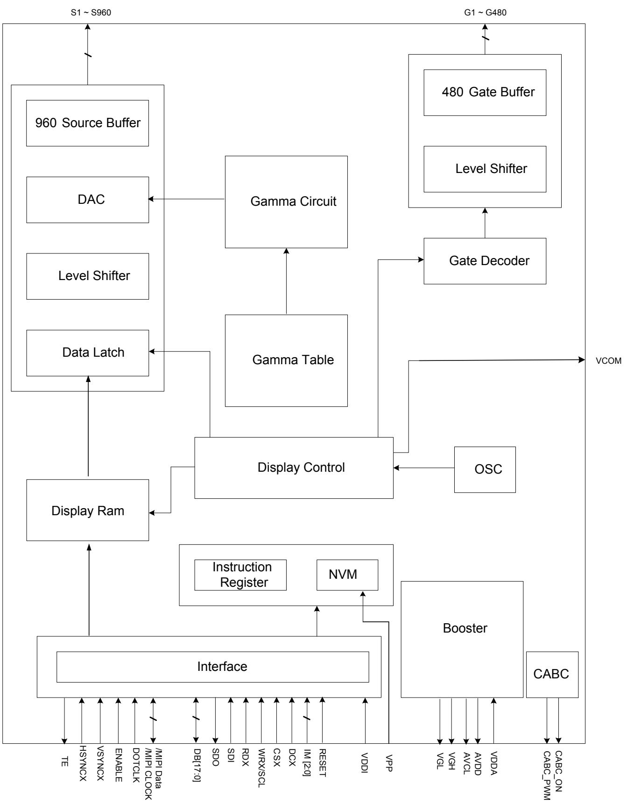  
V1.0  
Page 40 of 279  
2014/11  
Sitronix Confidential The information contained herein is the exclusive property of Sitronix and shall not be distributed, reproduced, or disclosed in whole or in part without prior written permission of Sitronix.

## 6 PIN DESCRIPTION

## 6.1.. Power Supply Pins

<table><tr><td>Name</td><td>I/O</td><td>Description</td><td>Connect Pin</td></tr><tr><td>VDDI</td><td>I</td><td>- Power supply for I/O system.- VDDI must be lower than or equal to VDD.</td><td>VDDI</td></tr><tr><td>VDDA</td><td>I</td><td>- Power supply for analog and booster circuits. Input voltage level should be the same as VDD.</td><td>VDDA</td></tr><tr><td>AGND</td><td>I</td><td>- System ground for analog system and booster circuit.</td><td>GND</td></tr><tr><td>DGND</td><td>I</td><td>- System ground for I/O system and digital system.</td><td>GND</td></tr><tr><td>VPP</td><td>I</td><td>- Power supply for internal NVM.- Writing NVM needs external power supply voltage with 7.5V.- The current of Ivpp must be more than 10mA.- Leaves these pins open if not used.</td><td>-</td></tr></table>

6.2.. Interface Logic Pins

<table><tr><td>Name</td><td>I/O</td><td colspan="5">Description</td><td>Connect Pin</td></tr><tr><td rowspan="10">IM2, IM1,IM0</td><td rowspan="10">I</td><td colspan="5">-The MCU interface mode select.</td><td rowspan="10">GND / VDDI</td></tr><tr><td>IM2</td><td>IM1</td><td>IMO</td><td>MPU Interface Mode</td><td>Data pin</td></tr><tr><td>0</td><td>0</td><td>0</td><td>8080 18-bit Interface</td><td>DB[17:0]</td></tr><tr><td>0</td><td>0</td><td>1</td><td>8080 9-bit Interface</td><td>DB[8:0]</td></tr><tr><td>0</td><td>1</td><td>0</td><td>8080 16-bit Interface</td><td>DB[15:0]</td></tr><tr><td>0</td><td>1</td><td>1</td><td>8080 8-bit Interface</td><td>DB[7:0],</td></tr><tr><td>1</td><td>0</td><td>0</td><td>Reserve</td><td>--</td></tr><tr><td>1</td><td>0</td><td>1</td><td>3SPI</td><td>SDA, SDO</td></tr><tr><td>1</td><td>1</td><td>0</td><td>MIPI</td><td>MIPI_DATA MIPI_CLOCK</td></tr><tr><td>1</td><td>1</td><td>1</td><td>4Line SPI</td><td>SDA, SDO</td></tr><tr><td>RESET</td><td>I</td><td colspan="5">- This signal will reset the device and it must be applied to properly initialize the chip.- Signal is active low.</td><td>MCU</td></tr><tr><td>CSX</td><td>I</td><td colspan="5">- Chip selection pin. Low-active.- If not used, please fix this pin at VDDI or DGND level.</td><td>MCU</td></tr><tr><td>DCX</td><td>I</td><td colspan="5">-Display data/command selection (RS) pin in MCU interface.DCX=&#x27;1&#x27;: display data or parameter.DCX=&#x27;0&#x27;: register index / command.- If not used, please fix this pin at VDDI or DGND level.</td><td>MCU / GND</td></tr><tr><td>RDX</td><td>I</td><td colspan="5">- Read enable in 8080 MCU parallel interface. Low-active.- If not used, please fix this pin at VDDI or DGND level.</td><td>MCU / GND</td></tr><tr><td>WRX/SCL</td><td>I</td><td colspan="5">- Write enable in MCU parallel interface.- In SPI mode, this pin is used as SCL.- If not used, please fix this pin at VDDI or DGND level.</td><td>MCU</td></tr><tr><td>VSYNC</td><td>I</td><td colspan="5">-Vertical synchronizing input signal for RGB interface operation.-If not used, please fix to the VDDI or DGND.</td><td>MCU</td></tr><tr><td>HSYNC</td><td>I</td><td colspan="5">-Horizontal synchronizing input signal for RGB interface operation.- If not used, please fix to VDDI or DGND.</td><td>MCU</td></tr><tr><td>ENABLE</td><td>I</td><td colspan="5">-Data enable signal for RGB interface operation.-If not used, please fix this pin at VDDI or DGND.</td><td>MCU</td></tr><tr><td>DOTCLK</td><td>I</td><td colspan="5">-Dot clock signal for RGB interface operation.-If not used, please fix this pin at VDDI or DGND.</td><td>MCU</td></tr></table>

V1.0

<table><tr><td>Name</td><td>I/O</td><td>Description</td><td>Connect Pin</td></tr><tr><td>SDA</td><td>I/O</td><td>- SPI interface input/output pin.- The data is latched on the rising edge of the SCL signal.- If not used, please fix this pin at VDDI or DGND level.</td><td>MCU</td></tr><tr><td>SDO</td><td>O</td><td>- SPI interface output pin.- The data is outputted on the falling edge of the SCL signal.- If not used, please fix this pin at floating.</td><td>MCU</td></tr><tr><td>MIPI_CLK_P</td><td>I</td><td>-Positive polarity of low voltage differential clock signal-Leave the pin to open when not in use.</td><td>MIPI</td></tr><tr><td>MIPI_CLK_N</td><td>I</td><td>-Negative polarity of low voltage differential clock signal-Leave the pin to open when not in use.</td><td>MIPI</td></tr><tr><td>MIPI_DATA_P</td><td>I/O</td><td>-Positive polarity of low voltage differential data signal-Leave the pin to open when not in use.</td><td>MIPI</td></tr><tr><td>MIPI_DATA_N</td><td>I/O</td><td>-Negative polarity of low voltage differential data signal-Leave the pin to open when not in use.</td><td>MIPI</td></tr><tr><td>DB[17:0]</td><td>I/O</td><td>- In MCU 8080 parallel interface, DB[17:0] are used as data bus.8-bit I/F: DB[7:0] is used.9-bit I/F: DB[8:0] is used.16-bit I/F: DB[15:0] is used.18-bit I/F: DB[17:0] is used.- In RGB interface, DB[17:0] are used as data bus.16-bit RGB I/F: DB[15:0] are used.18-bit RGB I/F: DB[17:0] are used.- If not used, please fix this pin at VDDI or DGND level.</td><td>MCU /DGND/VDDI</td></tr><tr><td>TE</td><td>O</td><td>- Tearing effect output.- If not used, leave this pin open</td><td>MCU</td></tr><tr><td>EXTC</td><td>I</td><td>-When programming NVM, this pin should connect to high level.-During normal operation, please open this pin.</td><td>DGND/VDDI</td></tr></table>

Note1. “1” = VDDI level, “0” = DGND level.  
Note2. When in parallel mode, unused data pins must be connected to “1” or “0”.

Note3. When CSX=”1”, there is no influence to the parallel and serial interface.

6.3.. Driver Output Pins

<table><tr><td>Name</td><td>I/O</td><td>Description</td><td>Connect pin</td></tr><tr><td>S1 to S960</td><td>O</td><td>Source output voltage signals applied to liquid crystal.</td><td>LCD</td></tr><tr><td>G1 to G480</td><td>O</td><td>-Gate driver output pins.VGH: Selecting Gate Lines Level.VGL: Non-selecting Gate Lines Level.</td><td>LCD</td></tr><tr><td>AVDD</td><td>O</td><td>- Power output pin for monitoring analogy circuit.- Leave open when not in use.</td><td>-</td></tr><tr><td>AVCL</td><td>O</td><td>- Power output pin for monitoring analogy circuit.- Leave open when not in use.</td><td>-</td></tr><tr><td>VAP(GVDD)</td><td>O</td><td>- Used for monitoring- Leave open.</td><td></td></tr><tr><td>VAN(GVCL)</td><td>O</td><td>- Used for monitoring- Leave open.</td><td></td></tr><tr><td>V22</td><td>O</td><td>- Used for monitoring- Leave open.</td><td></td></tr><tr><td>VGH</td><td>O</td><td>- Power output pin for gate driver- Leave open when not in use.</td><td>-</td></tr><tr><td>VGL</td><td>O</td><td>- Power output (Negative) pin for gate driver- Leave open when not in use.</td><td>-</td></tr><tr><td>VCC</td><td>O</td><td>- Monitoring pin of internal digital reference voltage.- Leave open when not in use.</td><td>-</td></tr><tr><td>VCOM</td><td>O</td><td>- A power supply for the TFT-LCD common electrode.</td><td>Common Electrode</td></tr><tr><td>CABC_PWM</td><td>O</td><td>-Output pad for PWM output signal to driving LED.-If not used, keep it open.</td><td>-</td></tr><tr><td>CABC_ON</td><td>O</td><td>-Output pad for enabling LED.-If not used, keep it open.</td><td>-</td></tr></table>

6.4.. Test and Other Pins

<table><tr><td>Name</td><td>I/O</td><td>Description</td><td>Connect pin</td></tr><tr><td>Dummy</td><td>-</td><td>- These pins are dummy-Leave the pin open.</td><td>-</td></tr><tr><td>OSCP</td><td></td><td>- This pin is for testing.-Leave the pin open.</td><td></td></tr><tr><td>TS[0:2]</td><td></td><td>- Test pins, these pins are internal weak pull low.-Leave the pin open.</td><td></td></tr><tr><td>TEST[0:5]</td><td></td><td>- This pin is for testing-Leave the pin open.</td><td></td></tr></table>

## 7 DRIVER ELECTRICAL CHARACTERISTICS

7.1.. Absolute Operation Range

<table><tr><td>Item</td><td>Symbol</td><td>Range</td><td>Unit</td></tr><tr><td>Supply Voltage (Analog)</td><td>VDDA</td><td>-0.3 ~ +4.6</td><td>V</td></tr><tr><td>Supply Voltage (I/O)</td><td>VDDI</td><td>-0.3 ~ +4.6</td><td>V</td></tr><tr><td>Supply Voltage (Logic)</td><td>VCC</td><td>-0.3 ~ +2</td><td>V</td></tr><tr><td>Driver Supply Voltage</td><td>VGH-VGL</td><td>-0.3 ~ +30.0</td><td>V</td></tr><tr><td>Logic Input Voltage Range</td><td>VIN</td><td>0.5 ~ VDDI + 0.5</td><td>V</td></tr><tr><td>Logic Output Voltage Range</td><td>VO</td><td>0.5 ~ VDDI + 0.5</td><td>V</td></tr><tr><td>Operating Temperature Range</td><td>TOPR</td><td>-30 ~ +85</td><td>°C</td></tr><tr><td>Storage Temperature Range</td><td>TSTG</td><td>-40 ~ +125</td><td>°C</td></tr></table>

Absolute Operation Range

Note: If one of the above items is exceeded its maximum limitation momentarily, the quality of the product may be degraded. Absolute maximum limitation, therefore, specify the values exceeding which the product may be physically damaged. Be sure to use the product within the recommend range.

## 7.2.. DC Characteristics

## 7.2.1 DC characteristics for MIPI DSI

 MIPI Signaling Voltage Levels

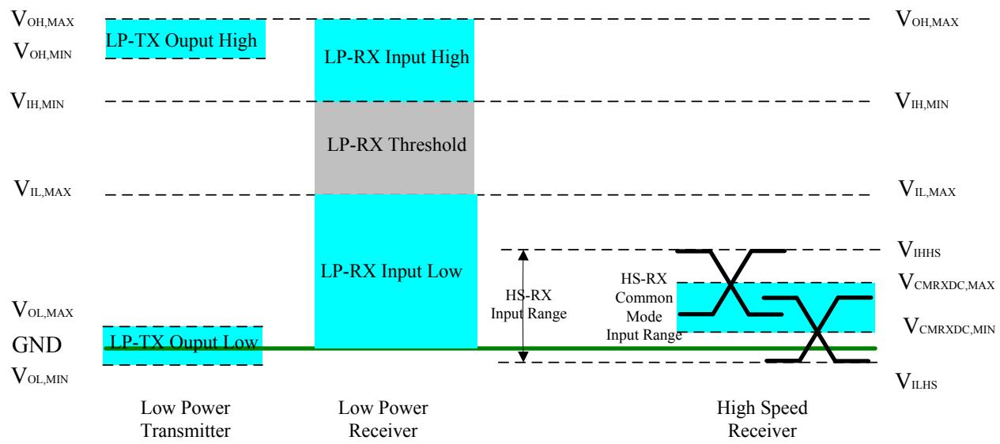

 MIPI DC characteristics

<table><tr><td rowspan="2">Parameter</td><td rowspan="2">Symbol</td><td colspan="3">Specification</td><td rowspan="2">Unit</td></tr><tr><td>MIN</td><td>TYP</td><td>MAX</td></tr><tr><td colspan="6">Operation Voltage for MIPI Receiver</td></tr><tr><td>Low power mode operating voltage</td><td> $V_{LPH}$ </td><td>1.1</td><td>1.2</td><td>1.3</td><td>V</td></tr><tr><td colspan="6">MIPI Characteristics for High Speed Receiver</td></tr><tr><td>Single-ended input low voltage</td><td> $V_{ILHS}$ </td><td>-40</td><td>-</td><td>-</td><td>mV</td></tr><tr><td>Single-ended input high voltage</td><td> $V_{IHHS}$ </td><td>-</td><td>-</td><td>460</td><td>mV</td></tr><tr><td>Common-mode voltage</td><td> $V_{CMRXDC}$ </td><td>70</td><td>-</td><td>330</td><td>mV</td></tr><tr><td>Differential input impedance</td><td> $Z_{ID}$ </td><td>80</td><td>100</td><td>125</td><td>ohm</td></tr><tr><td colspan="6">MIPI Characteristics for Low Power Mode</td></tr><tr><td>Pad signal voltage range</td><td> $V_I$ </td><td>-50</td><td>-</td><td>1350</td><td>mV</td></tr><tr><td>Logic 0 input threshold</td><td> $V_{IL}$ </td><td>0</td><td>-</td><td>550</td><td>mV</td></tr><tr><td>Logic 1 input threshold</td><td> $V_{IH}$ </td><td>880</td><td>-</td><td>1350</td><td>mV</td></tr><tr><td>Output low level</td><td> $V_{OL}$ </td><td>-50</td><td>-</td><td>50</td><td>mV</td></tr><tr><td>Output high level</td><td> $V_{OH}$ </td><td>1.1</td><td>1.2</td><td>1.3</td><td>V</td></tr></table>

7.2.2 DC Characteristics for Panel Driving

<table><tr><td rowspan="2">Parameter</td><td rowspan="2">Symbol</td><td rowspan="2">Condition</td><td colspan="3">Specification</td><td rowspan="2">Unit</td><td rowspan="2">Related Pins</td></tr><tr><td>MIN.</td><td>TYP.</td><td>MAX.</td></tr><tr><td colspan="8">Power &amp; Operation Voltage</td></tr><tr><td>System Voltage</td><td>VDD / VDDA</td><td>Operating voltage</td><td>2.5</td><td>2.75</td><td>3.3</td><td>V</td><td></td></tr><tr><td>Interface Operation Voltage</td><td>VDDI</td><td>I/O Supply Voltage</td><td>1.65</td><td>1.8</td><td>3.3</td><td>V</td><td></td></tr><tr><td>Gate Driver High Voltage</td><td>VGH</td><td></td><td>12.54</td><td></td><td>15.46</td><td>V</td><td></td></tr><tr><td>Gate Driver Low Voltage</td><td>VGL</td><td></td><td>-12.5</td><td></td><td>-7.15</td><td>V</td><td></td></tr><tr><td>Gate Driver Supply Voltage</td><td></td><td>| VGH-VGL |</td><td></td><td></td><td>27.96</td><td>V</td><td></td></tr><tr><td colspan="8">Input / Output</td></tr><tr><td>Logic-High Input Voltage</td><td>VIH</td><td></td><td>0.7VDDI</td><td></td><td>VDDI</td><td>V</td><td>Note 1</td></tr><tr><td>Logic-Low Input Voltage</td><td>VIL</td><td></td><td>VSS</td><td></td><td>0.3VDDI</td><td>V</td><td>Note 1</td></tr><tr><td>Differential Input High Threshold Voltage</td><td>VIT+</td><td></td><td></td><td>0</td><td>50</td><td>mV</td><td rowspan="3">MIPI_CLK, MIPI_DATA</td></tr><tr><td>Differential Input Low Threshold Voltage</td><td>VIT-</td><td></td><td>-50</td><td>0</td><td></td><td>mV</td></tr><tr><td>Single-ended Receiver Input Operation Voltage Range</td><td>VIR</td><td></td><td>0.5</td><td></td><td>1.2</td><td>V</td></tr><tr><td>Logic-High Output Voltage</td><td>VOH</td><td>IOH = -1.0mA</td><td>0.8VDDI</td><td></td><td>VDDI</td><td>V</td><td>Note 1</td></tr><tr><td>Logic-Low Output Voltage</td><td>VOL</td><td>IOL = +1.0mA</td><td>VSS</td><td></td><td>0.2VDDI</td><td>V</td><td>Note 1</td></tr><tr><td>Logic-High Input Current</td><td>IIH</td><td>VIN = VDDI</td><td></td><td></td><td>1</td><td>uA</td><td>Note 1</td></tr><tr><td>Logic-Low Input Current</td><td>IIL</td><td>VIN = VSS</td><td>-1</td><td></td><td></td><td>uA</td><td>Note 1</td></tr><tr><td>Input Leakage Current</td><td>ILI</td><td>IOH = -1.0mA</td><td>-0.1</td><td></td><td>+0.1</td><td>uA</td><td>Note 1</td></tr><tr><td colspan="8">VCOM Voltage</td></tr><tr><td>VCOM Voltage</td><td>VCOM</td><td></td><td></td><td>VSS</td><td></td><td>V</td><td></td></tr><tr><td colspan="8">Source Driver</td></tr><tr><td>Gamma Reference Voltage(Positive)</td><td>VAP</td><td></td><td>4.45</td><td></td><td>6.4</td><td>V</td><td></td></tr><tr><td>Gamma Reference Voltage(Negative)</td><td>VAN</td><td></td><td>-4.6</td><td></td><td>-2.65</td><td></td><td></td></tr><tr><td>Source Output Settling Time</td><td>Tr</td><td>Below with 99% precision</td><td></td><td></td><td>20</td><td>us</td><td>Note 2</td></tr><tr><td>Output Offset Voltage</td><td>VOFFSET</td><td></td><td></td><td></td><td>35</td><td>mV</td><td>Note 3</td></tr></table>

## Basic DC Characteristics

Notes:

1. TA= -30 to 85℃.

2. Source channel loading= 2KΩ+12pF/channel, Gate channel loading=5KΩ+40pF/channel.

3. The max. value is between measured point of source output and gamma setting value.

## 7.3.. Power Consumption

Ta=25℃, Frame rate = 60Hz, Registers setting are IC default setting.

<table><tr><td rowspan="3">Operation Mode</td><td rowspan="3">Image</td><td colspan="4">Current Consumption</td></tr><tr><td colspan="2">Typical</td><td colspan="2">Maximum</td></tr><tr><td>IDDI (mA)</td><td>IDD (mA)</td><td>IDDI (mA)</td><td>IDD (mA)</td></tr><tr><td>Normal Mode</td><td>Note 1</td><td>0.005</td><td>12</td><td>0.01</td><td>16</td></tr><tr><td>Stand by Mode</td><td>Note 1</td><td>0.005</td><td>0.025</td><td>0.01</td><td>0.050</td></tr></table>

Power Consumption

Notes:

1. All pixels black.

2. All pixels white.

3. The Current Consumption is DC characteristics of ST7796S.

4. Typical: VDDI=1.8V, VDDA=2.8V; Maximum: VDDI=3.3V, VDDA=3.3V

## 7.4.. AC Characteristics

## 7.4.1 8080 Series MCU Parallel Interface Characteristics: 18/16/9/8-bit Bus

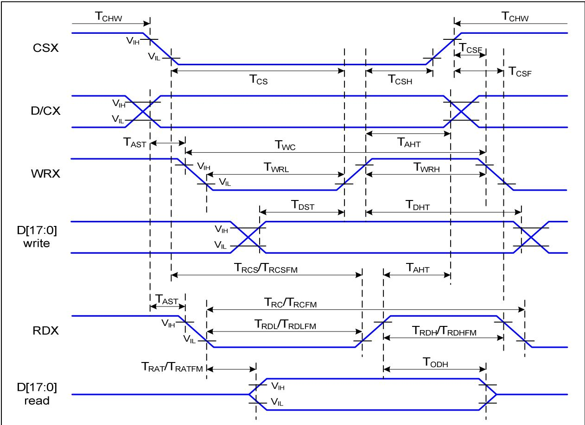  
Parallel Interface Timing Characteristics (8080-Series MCU Interface)

VDDI=1.8V,VDDA=2.8V, AGND=DGND=0V, Ta=25 ℃

<table><tr><td>Signal</td><td>Symbol</td><td>Parameter</td><td>Min</td><td>Max</td><td>Unit</td><td>Description</td></tr><tr><td rowspan="2">D/CX</td><td> $T_{AST}$ </td><td>Address setup time</td><td>0</td><td></td><td>ns</td><td rowspan="2">-</td></tr><tr><td> $T_{AHT}$ </td><td>Address hold time (Write/Read)</td><td>10</td><td></td><td>ns</td></tr><tr><td rowspan="6">CSX</td><td> $T_{CHW}$ </td><td>Chip select “H” pulse width</td><td>0</td><td></td><td>ns</td><td rowspan="6">-</td></tr><tr><td> $T_{CS}$ </td><td>Chip select setup time (Write)</td><td>15</td><td></td><td>ns</td></tr><tr><td> $T_{RCS}$ </td><td>Chip select setup time (Read ID)</td><td>45</td><td></td><td>ns</td></tr><tr><td> $T_{RCSFM}$ </td><td>Chip select setup time (Read FM)</td><td>355</td><td></td><td>ns</td></tr><tr><td> $T_{CSF}$ </td><td>Chip select wait time (Write/Read)</td><td>10</td><td></td><td>ns</td></tr><tr><td> $T_{CSH}$ </td><td>Chip select hold time</td><td>10</td><td></td><td>ns</td></tr><tr><td rowspan="2">WRX</td><td> $T_{WC}$ </td><td>Write cycle</td><td>66</td><td></td><td>ns</td><td rowspan="2"></td></tr><tr><td> $T_{WRH}$ </td><td>Control pulse “H” duration</td><td>15</td><td></td><td>ns</td></tr></table>

ST7796S

<table><tr><td></td><td> $T_{WRL}$ </td><td>Control pulse “L” duration</td><td>15</td><td></td><td>ns</td><td></td></tr><tr><td rowspan="3">RDX (ID)</td><td> $T_{RC}$ </td><td>Read cycle (ID)</td><td>160</td><td></td><td>ns</td><td rowspan="3">When read ID data</td></tr><tr><td> $T_{RDH}$ </td><td>Control pulse “H” duration (ID)</td><td>90</td><td></td><td>ns</td></tr><tr><td> $T_{RDL}$ </td><td>Control pulse “L” duration (ID)</td><td>45</td><td></td><td>ns</td></tr><tr><td rowspan="3">RDX(FM)</td><td> $T_{RCFM}$ </td><td>Read cycle (FM)</td><td>450</td><td></td><td>ns</td><td rowspan="3">When read from frame memory</td></tr><tr><td> $T_{RDHFM}$ </td><td>Control pulse “H” duration (FM)</td><td>90</td><td></td><td>ns</td></tr><tr><td> $T_{RDLFM}$ </td><td>Control pulse “L” duration (FM)</td><td>355</td><td></td><td>ns</td></tr><tr><td rowspan="5">D[17:0]</td><td> $T_{DST}$ </td><td>Data setup time</td><td>10</td><td></td><td>ns</td><td rowspan="5">For CL=30pF</td></tr><tr><td> $T_{DHT}$ </td><td>Data hold time</td><td>10</td><td></td><td>ns</td></tr><tr><td> $T_{RAT}$ </td><td>Read access time (ID)</td><td>-</td><td>40</td><td>ns</td></tr><tr><td> $T_{RATFM}$ </td><td>Read access time (FM)</td><td>-</td><td>340</td><td>ns</td></tr><tr><td> $T_{ODH}$ </td><td>Output disable time</td><td>20</td><td>80</td><td>ns</td></tr></table>

8080 Parallel Interface Characteristics  
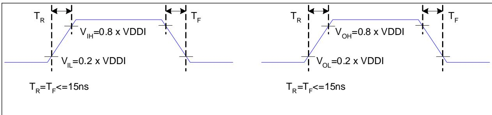  
Rising and Falling Timing for I/O Signal

Note: The rising time and falling time (Tr, Tf) of input signal and fall time are specified at 15 ns or less. Logic high and low levels are specified as 20% and 80% of VDDI for Input signals.

## 7.4.2 3-SPI Serial Data Transfer Interface Characteristics:

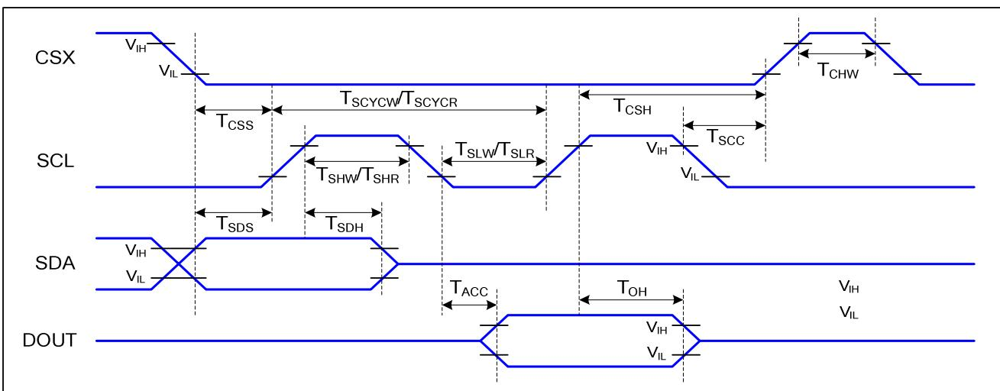  
3-SPI Interface Timing Characteristics

VDDI=1.8V,VDDA=2.8V, AGND=DGND=0V, Ta=25 ℃

<table><tr><td>Signal</td><td>Symbol</td><td>Parameter</td><td>Min</td><td>Max</td><td>Unit</td><td>Description</td></tr><tr><td rowspan="5">CSX</td><td> $T_{CSS}$ </td><td>Chip select setup time (write)</td><td>15</td><td></td><td>ns</td><td rowspan="5"></td></tr><tr><td> $T_{CSH}$ </td><td>Chip select hold time (write)</td><td>15</td><td></td><td>ns</td></tr><tr><td> $T_{CSS}$ </td><td>Chip select setup time (read)</td><td>60</td><td></td><td>ns</td></tr><tr><td> $T_{SCC}$ </td><td>Chip select hold time (read)</td><td>65</td><td></td><td>ns</td></tr><tr><td> $T_{CHW}$ </td><td>Chip select “H” pulse width</td><td>40</td><td></td><td>ns</td></tr><tr><td rowspan="6">SCL</td><td> $T_{SCYCW}$ </td><td>Serial clock cycle (Write)</td><td>66</td><td></td><td>ns</td><td rowspan="6"></td></tr><tr><td> $T_{SHW}$ </td><td>SCL “H” pulse width (Write)</td><td>15</td><td></td><td>ns</td></tr><tr><td> $T_{SLW}$ </td><td>SCL “L” pulse width (Write)</td><td>15</td><td></td><td>ns</td></tr><tr><td> $T_{SCYCR}$ </td><td>Serial clock cycle (Read)</td><td>150</td><td></td><td>ns</td></tr><tr><td> $T_{SHR}$ </td><td>SCL “H” pulse width (Read)</td><td>60</td><td></td><td>ns</td></tr><tr><td> $T_{SLR}$ </td><td>SCL “L” pulse width (Read)</td><td>60</td><td></td><td>ns</td></tr><tr><td rowspan="2">SDA(DIN)</td><td> $T_{SDS}$ </td><td>Data setup time</td><td>10</td><td></td><td>ns</td><td rowspan="2"></td></tr><tr><td> $T_{SDH}$ </td><td>Data hold time</td><td>10</td><td></td><td>ns</td></tr><tr><td rowspan="2">DOUT</td><td> $T_{ACC}$ </td><td>Access time</td><td>10</td><td>50</td><td>ns</td><td rowspan="2">For maximum CL=30pFFor minimum CL=8pF</td></tr><tr><td> $T_{OH}$ </td><td>Output disable time</td><td>15</td><td>50</td><td>ns</td></tr></table>

3-SPI Interface Characteristics

## 7.4.3 4-SPI Serial Data Transfer Interface Characteristics:

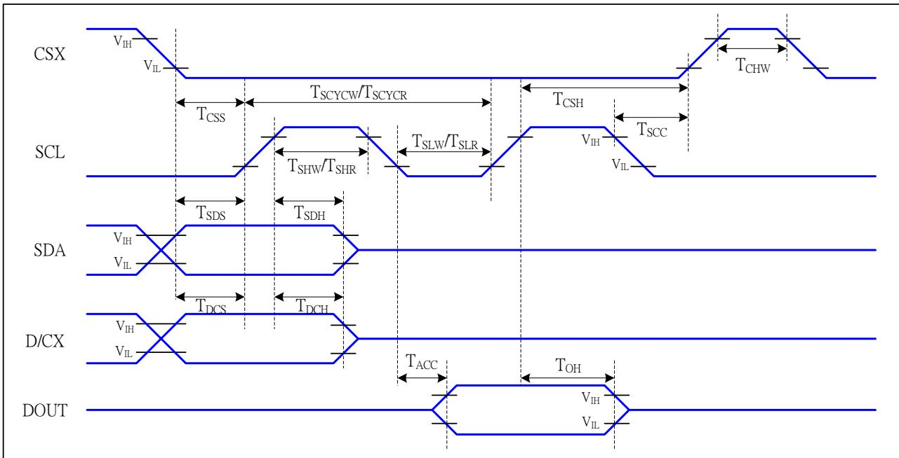  
4-SPI Interface Timing Characteristics

VDDI=1.8V,VDDA=2.8V, AGND=DGND=0V, Ta=25 ℃

<table><tr><td>Signal</td><td>Symbol</td><td>Parameter</td><td>MIN</td><td>MAX</td><td>Unit</td><td>Description</td></tr><tr><td rowspan="5">CSX</td><td> $T_{CSS}$ </td><td>Chip select setup time (write)</td><td>15</td><td></td><td>ns</td><td rowspan="5"></td></tr><tr><td> $T_{CSH}$ </td><td>Chip select hold time (write)</td><td>15</td><td></td><td>ns</td></tr><tr><td> $T_{CSS}$ </td><td>Chip select setup time (read)</td><td>60</td><td></td><td>ns</td></tr><tr><td> $T_{SCC}$ </td><td>Chip select hold time (read)</td><td>65</td><td></td><td>ns</td></tr><tr><td> $T_{CHW}$ </td><td>Chip select “H” pulse width</td><td>40</td><td></td><td>ns</td></tr><tr><td rowspan="6">SCL</td><td> $T_{SCYCW}$ </td><td>Serial clock cycle (Write)</td><td>66</td><td></td><td>ns</td><td rowspan="3">-write command &amp; data ram</td></tr><tr><td> $T_{SHW}$ </td><td>SCL “H” pulse width (Write)</td><td>15</td><td></td><td>ns</td></tr><tr><td> $T_{SLW}$ </td><td>SCL “L” pulse width (Write)</td><td>15</td><td></td><td>ns</td></tr><tr><td> $T_{SCYCR}$ </td><td>Serial clock cycle (Read)</td><td>150</td><td></td><td>ns</td><td rowspan="3">-read command &amp; data ram</td></tr><tr><td> $T_{SHR}$ </td><td>SCL “H” pulse width (Read)</td><td>60</td><td></td><td>ns</td></tr><tr><td> $T_{SLR}$ </td><td>SCL “L” pulse width (Read)</td><td>60</td><td></td><td>ns</td></tr><tr><td rowspan="2">D/CX</td><td> $T_{DCS}$ </td><td>D/CX setup time</td><td>10</td><td></td><td>ns</td><td rowspan="2"></td></tr><tr><td> $T_{DCH}$ </td><td>D/CX hold time</td><td>10</td><td></td><td>ns</td></tr><tr><td rowspan="2">SDA(DIN)</td><td> $T_{SDS}$ </td><td>Data setup time</td><td>10</td><td></td><td>ns</td><td rowspan="2"></td></tr><tr><td> $T_{SDH}$ </td><td>Data hold time</td><td>10</td><td></td><td>ns</td></tr><tr><td rowspan="2">DOUT</td><td> $T_{ACC}$ </td><td>Access time</td><td>10</td><td>50</td><td>ns</td><td rowspan="2">For maximum CL=30pF For minimum CL=8pF</td></tr><tr><td> $T_{OH}$ </td><td>Output disable time</td><td>15</td><td>50</td><td>ns</td></tr></table>

## 7.4.4 RGB Interface Characteristics:

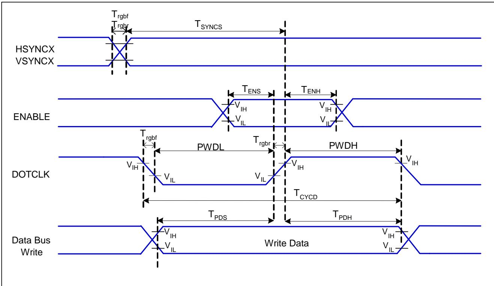

VDDI=1.8V,VDDA=2.8V, AGND=DGND=0V, Ta=25℃

<table><tr><td>Signal</td><td>Symbol</td><td>Parameter</td><td>MIN</td><td>MAX</td><td>Unit</td><td>Description</td></tr><tr><td>HSYNC, VSYNC</td><td> $T_{SYNCS}$ </td><td>VSYNC, HSYNC Setup Time</td><td>15</td><td>-</td><td>ns</td><td></td></tr><tr><td rowspan="2">ENABLE</td><td> $T_{ENS}$ </td><td>Enable Setup Time</td><td>15</td><td>-</td><td>ns</td><td rowspan="2"></td></tr><tr><td> $T_{ENH}$ </td><td>Enable Hold Time</td><td>15</td><td>-</td><td>ns</td></tr><tr><td rowspan="4">DOTCLK</td><td>PWDH</td><td>DOTCLK High-level Pulse Width</td><td>30</td><td>-</td><td>ns</td><td rowspan="4"></td></tr><tr><td>PWDL</td><td>DOTCLK Low-level Pulse Width</td><td>30</td><td>-</td><td>ns</td></tr><tr><td> $T_{CYCD}$ </td><td>DOTCLK Cycle Time</td><td>66</td><td>-</td><td>ns</td></tr><tr><td>Trghr, Trghf</td><td>DOTCLK Rise/Fall time</td><td>-</td><td>15</td><td>ns</td></tr><tr><td rowspan="2">DB</td><td> $T_{PDS}$ </td><td>PD Data Setup Time</td><td>15</td><td>-</td><td>ns</td><td rowspan="2"></td></tr><tr><td> $T_{PDH}$ </td><td>PD Data Hold Time</td><td>15</td><td>-</td><td>ns</td></tr></table>

RGB Interface Timing Characteristics

## 7.4.5 MIPI Interface Characteristics

High Speed Mode – Clock Channel Timing  
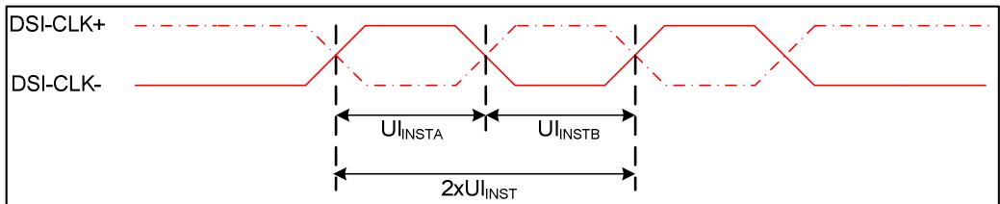

<table><tr><td>Signal</td><td>Symbol</td><td>Parameter</td><td>MIN</td><td>MAX</td><td>Unit</td><td>Description</td></tr><tr><td>DSI-DATA_P/N</td><td>2xUI INST</td><td>Double UI instantaneous</td><td>4</td><td>25</td><td>ns</td><td></td></tr><tr><td>DSI-DATA_P/N</td><td>UI INSTA ,UI INSTB</td><td>UI instantaneous Half</td><td>2</td><td>12.5</td><td>ns</td><td></td></tr></table>

High-Speed Data Transmission  
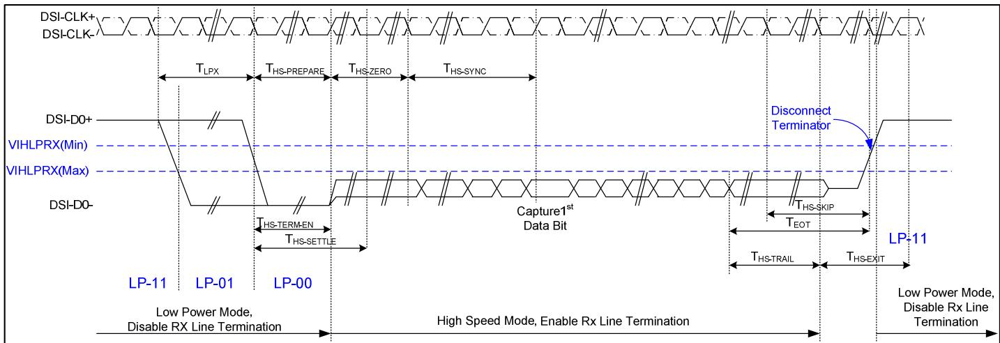

<table><tr><td>Parameter</td><td>Symbol</td><td>MIN</td><td>TYP</td><td>MAX</td><td>Unit</td></tr><tr><td>Time to drive LP-00 to prepare for HS transmission</td><td> $T_{HS-PREPARE}$ </td><td>40+4UI</td><td></td><td>85+6UI</td><td>ns</td></tr><tr><td>Time from start of t HS-TRAIL or t CLK-TRAIL period to start of LP-11 state</td><td> $T_{EOT}$ </td><td></td><td></td><td>105+12UI</td><td>ns</td></tr><tr><td>Time to enable data receiver line termination measured from when Dn crosses VILMAX</td><td> $T_{HS-TERM-EN}$ </td><td></td><td></td><td>35+4UI</td><td>ns</td></tr><tr><td>Time to drive flipped differential state after last payload data bit of a HS transmission</td><td> $T_{HS-TRAIL}$ </td><td>60+4UI</td><td></td><td></td><td>ns</td></tr><tr><td>Time-out at RX to ignore transition period of EoT</td><td> $T_{HS-SKIP}$ </td><td>40</td><td></td><td>55+4UI</td><td>ns</td></tr><tr><td>Time to drive LP-11 after HS burst</td><td> $T_{HS-EXIT}$ </td><td>100</td><td></td><td></td><td>ns</td></tr><tr><td>Length of any Low-Power state period</td><td> $T_{LPX}$ </td><td>50</td><td></td><td></td><td>ns</td></tr><tr><td>Sync sequence period</td><td> $T_{HS-SYNC}$ </td><td></td><td>8UI</td><td></td><td>ns</td></tr><tr><td>Minimum lead HS-0 drive period before the Sync sequence</td><td> $T_{HS-ZERO}$ </td><td>105+6UI</td><td></td><td></td><td>ns</td></tr></table>

Page 56 of 279  
2014/11

V1.0

Sitronix Confidential The information contained herein is the exclusive property of Sitronix and shall not be distributed, reproduced, or disclosed in whole or in part without prior written permission of Sitronix.

Switching the Clock Lane between Clock Transmission and Low-Power Mode  
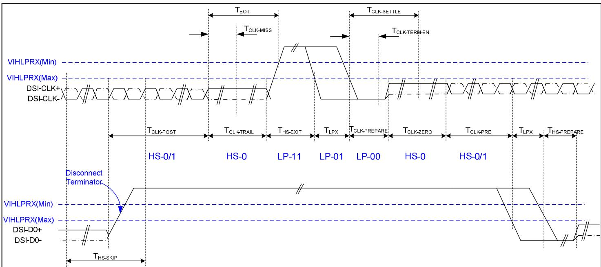

<table><tr><td>Parameter</td><td>Symbol</td><td>MIN</td><td>TYP</td><td>MAX</td><td>Unit</td></tr><tr><td>Time that the transmitter shall continue sending HS clock after the last associated Data Lane has transitioned to LP mode</td><td> $T_{CLK-POST}$ </td><td>60+52UI</td><td></td><td></td><td>ns</td></tr><tr><td>Detection time that the clock has stopped toggling</td><td> $T_{CLK-MISS}$ </td><td></td><td></td><td>60</td><td>ns</td></tr><tr><td>Time to drive LP-00 to prepare for HS clock transmission</td><td> $T_{CLK-PREPARE}$ </td><td>38</td><td></td><td>95</td><td>ns</td></tr><tr><td>Minimum lead HS-0 drive period before starting Clock</td><td> $T_{CLK-PREPARE} + T_{CLK-ZERO}$ </td><td>300</td><td></td><td></td><td>ns</td></tr><tr><td>Time to enable Clock Lane receiver line termination measured from when Dn cross VIL,MAX</td><td> $T_{HS-TERM-EN}$ </td><td></td><td></td><td>38</td><td>ns</td></tr><tr><td>Minimum time that the HS clock must be set prior to any associated date lane beginning the transmission from LP to HS mode</td><td> $T_{CLK-PRE}$ </td><td>8</td><td></td><td></td><td>UI</td></tr><tr><td>Time to drive HS differential state after last payload clock bit of a HS transmission burst</td><td> $T_{CLK-TRAIL}$ </td><td>60</td><td></td><td></td><td>ns</td></tr></table>

Bus Turnaround Procedure  
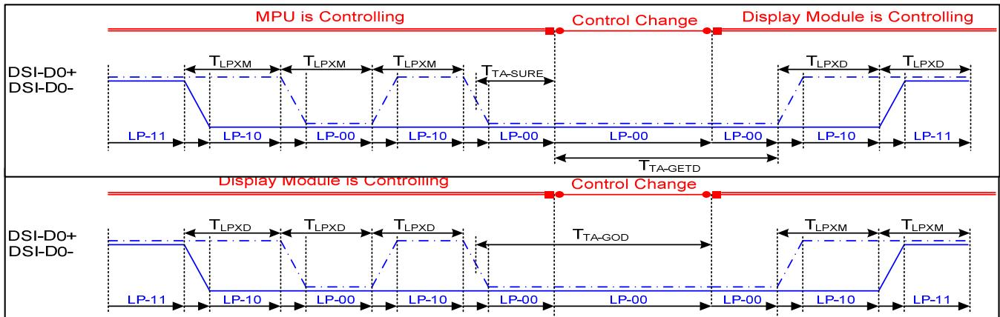

<table><tr><td>Parameter</td><td>Symbol</td><td>MIN</td><td>TYP</td><td>MAX</td><td>Unit</td></tr><tr><td>Length of any Low-Power state period : Master side</td><td> $T_{LPX}$ </td><td>50</td><td></td><td>75</td><td>ns</td></tr><tr><td>Length of any Low-Power state period : Slave side</td><td> $T_{LPX}$ </td><td>47.5</td><td>50</td><td>52.5</td><td>ns</td></tr><tr><td>Ratio of  $T_{LPX}$ (MASTER)/  $T_{LPX}$ (SLAVE) between Master and Slave side</td><td>Ratio  $T_{LPX}$ </td><td>2/3</td><td></td><td>3/2</td><td></td></tr><tr><td>Time-out before new TX side start driving</td><td> $T_{TA-SURE}$ </td><td> $T_{LPX}$ </td><td></td><td>2  $T_{LPX}$ </td><td>ns</td></tr><tr><td>Time to drive LP-00 by new TX</td><td> $T_{TA-GET}$ </td><td></td><td>5  $T_{LPX}$ </td><td></td><td>ns</td></tr><tr><td>Time to drive LP-00 after Turnaround Request</td><td> $T_{TA-GO}$ </td><td></td><td>4  $T_{LPX}$ </td><td></td><td>ns</td></tr></table>

## 8 INTERFACE

## 8.1.. MPU Interface Type Selection

For communicating with MCU, ST7796S supports 8-/9-/16-/18-bit 8080-series interface, SPI, MIPI. Selection of these interfaces are set by IM[2:0] pins as shown below.

<table><tr><td>IM2</td><td>IM1</td><td>IMO</td><td>Interface</td><td>Read Back Data Bus Selection</td></tr><tr><td>0</td><td>0</td><td>0</td><td>8080-series MCU 18-bit</td><td>DB[17:0]</td></tr><tr><td>0</td><td>0</td><td>1</td><td>8080-series MCU 9-bit</td><td>DB[8:0]</td></tr><tr><td>0</td><td>1</td><td>0</td><td>8080-series MCU 16-bit</td><td>DB[15:0]</td></tr><tr><td>0</td><td>1</td><td>1</td><td>8080-series MCU 8-bit</td><td>DB[7:0]</td></tr><tr><td>1</td><td>0</td><td>0</td><td>Reserve</td><td>--</td></tr><tr><td>1</td><td>0</td><td>1</td><td>Serial Peripheral Interface(3-Line SPI)</td><td>SDA, SDO</td></tr><tr><td>1</td><td>1</td><td>0</td><td>MIPI</td><td>MIPI_DATA_P/N, MIPI_CLOCK_P/N</td></tr><tr><td>1</td><td>1</td><td>1</td><td>Serial Peripheral Interface(4-Line SPI)</td><td>SDA, SDO</td></tr></table>

Interface Type Selection

## 8.2.. 8080-Series MCU Interface

## 8.2.1 8080-Series MCU Write Cycle Sequence

The write cycle means that the host writes information (register index / parameter) to the display via the interface. Each write cycle (WRX high-low-high sequence) consists of 3 control signals (DCX, RDX, WRX) and data signals (DB[17:0]). DCX is a control signal, which tells if the data is an index or a parameter. The data signals represent index number if the signal is low (DCX=’0’) and vice versa the data signals represent parameter (DCX=’1’).

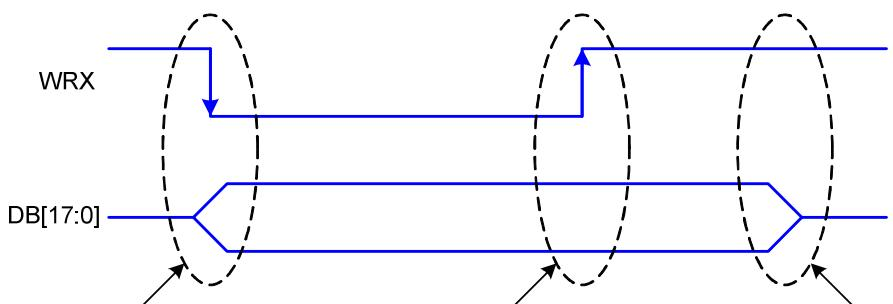  
8080-Series WRX Protocol

Note: WRX is an synchronized signal (It can be stopped).

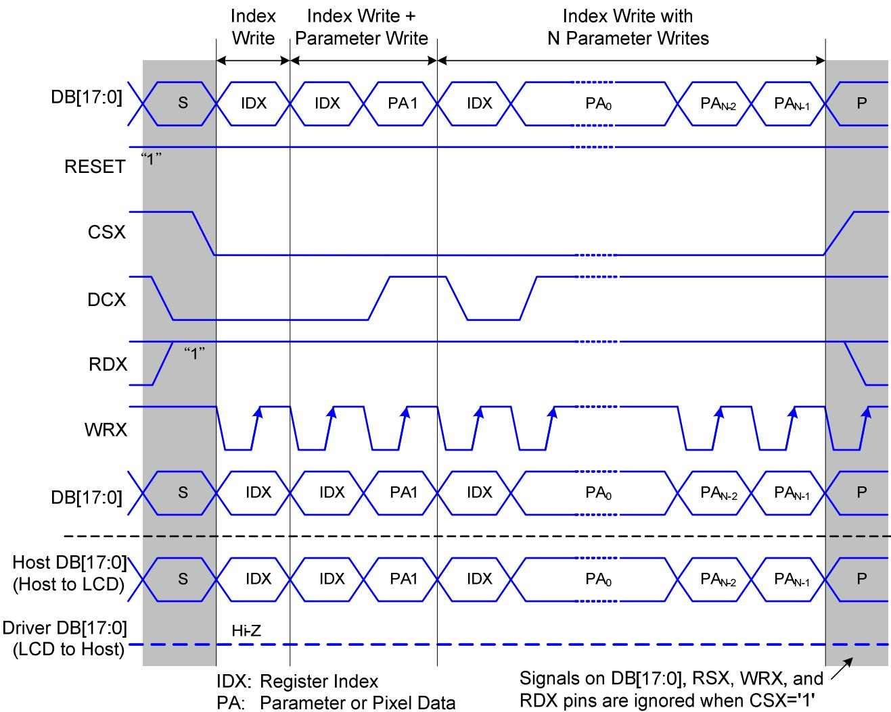  
8080-Series Parallel Bus Protocol, Write to Register or Display RAM

## 8.2.2 18-bit 8080-Series Interface Write Format

The 18-bit 8080-series interface is selected by setting the IM [2:0] =”000”.

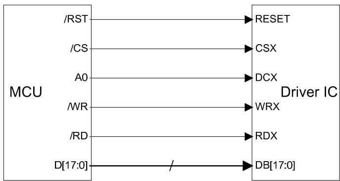  
18-bit 8080-Series Interface Connection

This mode accepts only 262k colors format in display. In this interface, index, parameter, and pixel-data should be written according to the following figures.

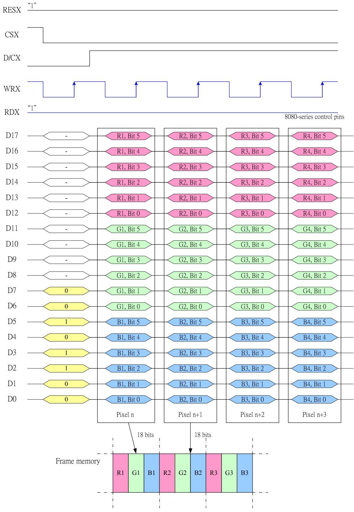  
18-bit 8080-Series Interface Data Format (Index/Parameter/Pixel Data Write)

## 8.2.3 16-bit 8080-Series Interface Write Format

The 16-bit 8080-series interface is selected by setting $1 \mathsf { M } [ 2 : 0 ] = " 0 1 0 "$

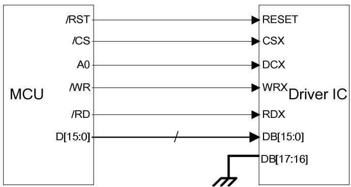  
16-bit 8080-Series Interface Connection

ST7796S accepts 262k-color or 65k-color format in this mode. When the 262k-color format is used, two transfers for each pixel are required.

16-bit data bus for 24-bit/pixel (RGB-8-8-8-bit input), 16M-Colors, 3Ah=”07h”)

There are 2 pixels (6 sub-pixels) per 3 bytes

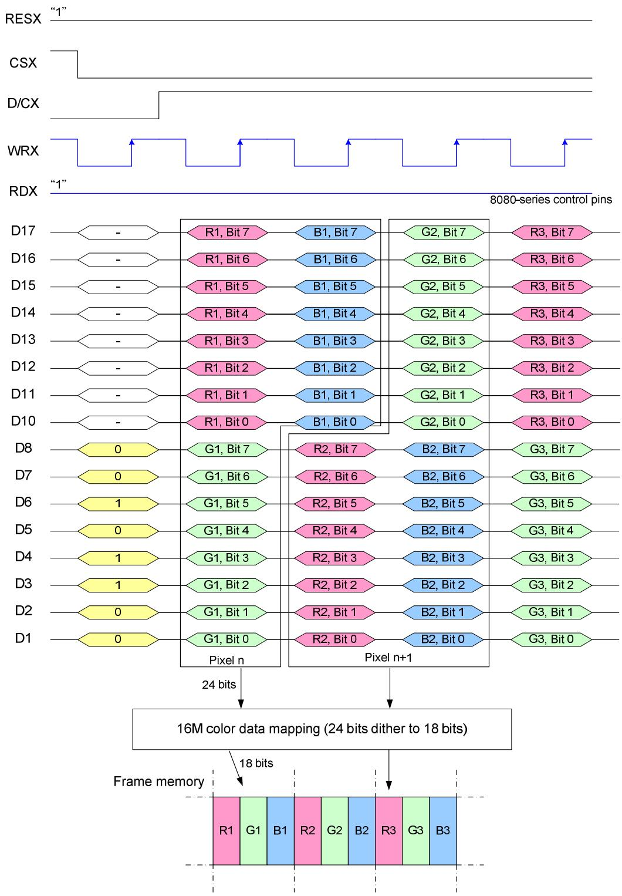

16-bit data bus for 18-bit/pixel (RGB-6-6-6-bit input), 262K-Colors, 3Ah=”06h”) There are 2 pixels (6 sub-pixels) per 3 bytes  
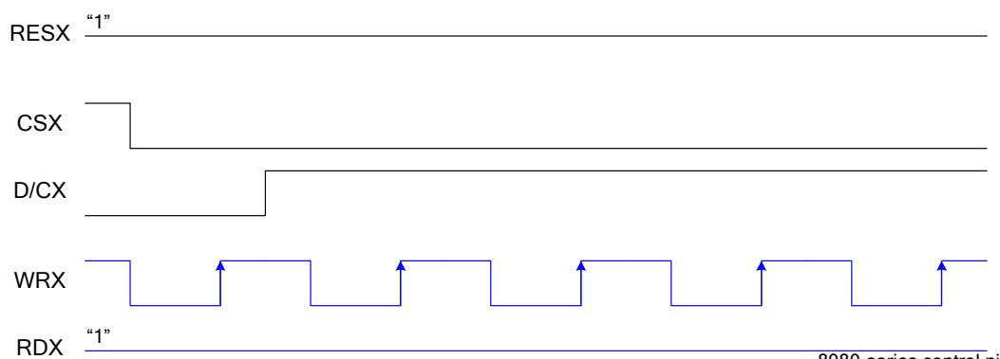

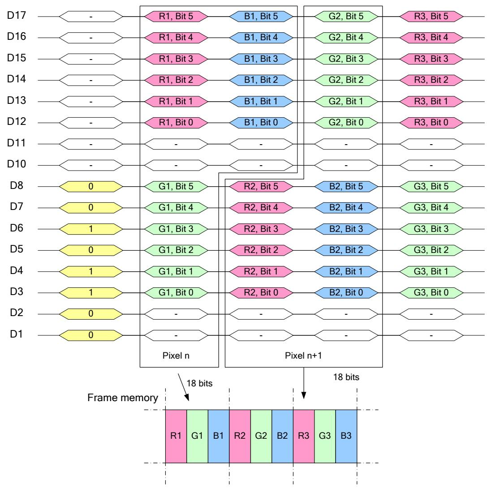  
Note 1: The data order is as follows, MSB=D17, LSB=D1 and picture data is MSB=Bits 5, LSB=Bit 0 for Red, Green and Blue data. Note 2: 3-times transfer is used to transmit 1 pixel data with the 18-bit color depth information. Note 3: ‘-‘ = Don’t care – Can be set to ‘0’ or ‘1’

16-bit data bus for 16-bit/pixel (RGB 5-6-5-bit input) 65K-Color, 3Ah=”05h)  
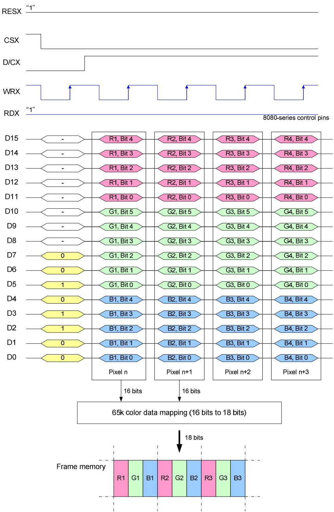

Note 1: The data order is as follows, MSB=D15, LSB=D0 and picture data is MSB=Bit 5, LSB=Bit 0 for Green, and MSB=Bit 4, LSB=Bit 0 for Red and Blue data.

Note 2: 1-times transfer (D15 to D0) is used to transmit 1 pixel data with the 16-bit color depth information.

Note 3: ‘-‘ = Don’t care – Can be set to ‘0’ or ‘1’

## 8.2.4 9-bit 8080-Series Interface Write Format

The 9-bit 8080-series interface is selected by setting the IM $[ 2 ; 0 ] = { } ^ { \mathfrak { a } } 0 1 1 ^ { \mathfrak { n } }$ and the DB [17:9] pins are used to transfer data. The display data is divided into upper part and lower part (9-bit for each part), and the upper part is transferred first. The unused DB [8:0] pins must be tied to either VDDI or DGND.

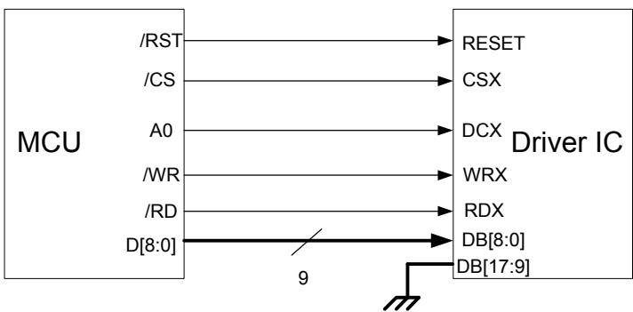  
9-bit 8080-Series Interface Connection

9-bit data bus for 18-bit/pixel (RGB 6-6-6-bit input), 262K-Colors, $3 \mathsf { A h } = ^ { \prime \prime } 0 6 \mathsf { h } ^ { \prime \prime }$  
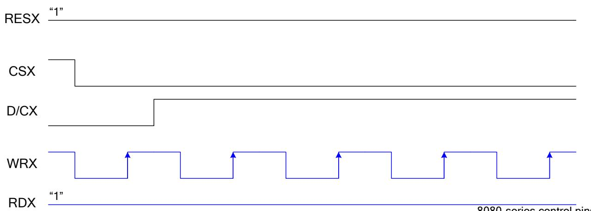  
8080-series control pins

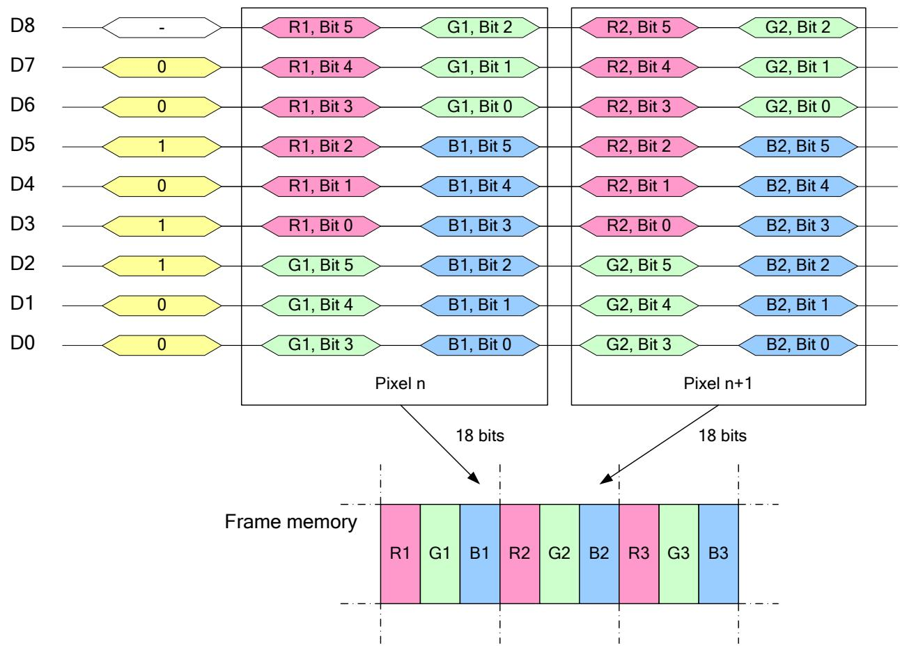  
9-bit 8080-Series Interface Data Format (Index/Parameter/Pixel Data Write)

## 8.2.5 8-bit 8080-Series Interface Write Format

The 8080 8-bit interface is selected by setting the IM [2:0] as $^ { 6 6 } 0 1 1 \ '$ and the DB [7:0] pins are used to transfer data. The mode accepts 262k-color or 65k-color format. The display data is divided into upper byte and lower byte, and the upper byte is transferred first. The written data is expanded into 18-bit internally (see the figure below) and then written into DRAM. The unused DB [17:8] pins must be tied to either VDDI or DGND.

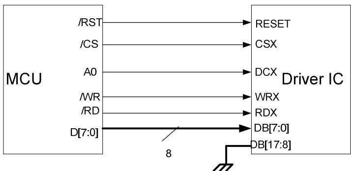  
8-bit 8080-Series Interface Connection

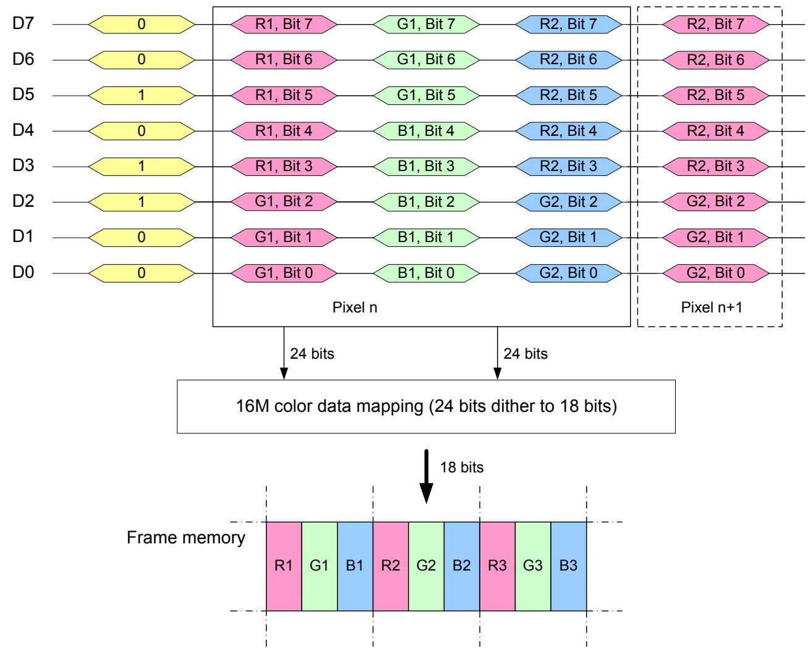

8-bit data bus for 24-bit/pixel (RGB 8-8-8-bit input), 16M-Colors, 3Ah=”07h”  
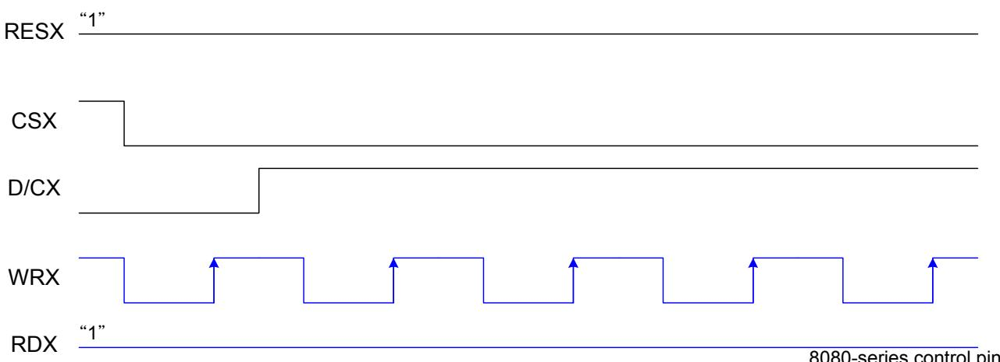  
8080-series control pins

8-bit data bus for 18-bit/pixel (RGB 6-6-6-bit input), 262K-Colors, 3Ah=”06h”  
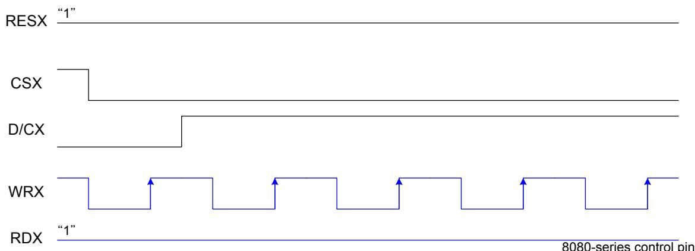  
8080-series control pins

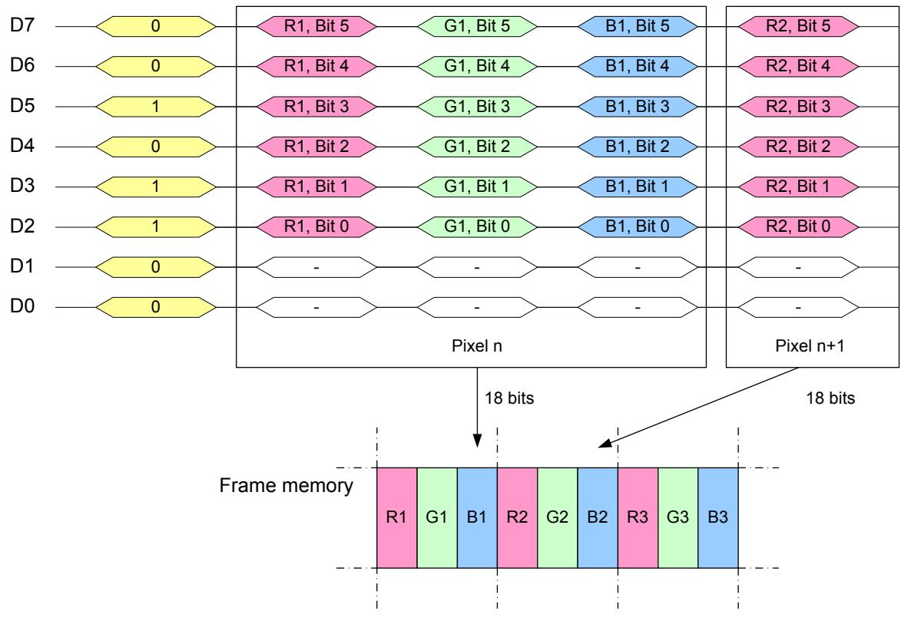  
8-bit 8080-Series Interface Data Format (Index/Parameter/Pixel Data Write)

Note 1: The data order is as follows, MSB=D17, LSB=D10 and picture data is MSB=Bit 5, LSB=Bit 0 for Green, and MSB=Bit 4, LSB=Bit 0 for Red and Blue data.

8-bit data bus for 16-bit/pixel (RGB 5-6-5-bit input), 65K-Colors, 3Ah=”05h”  
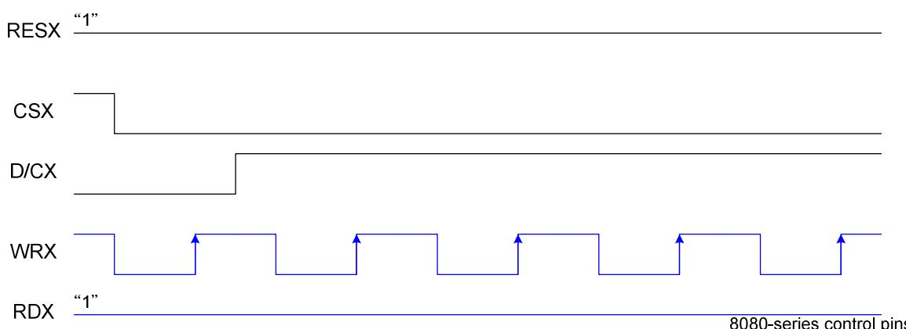  
8080-series control pins

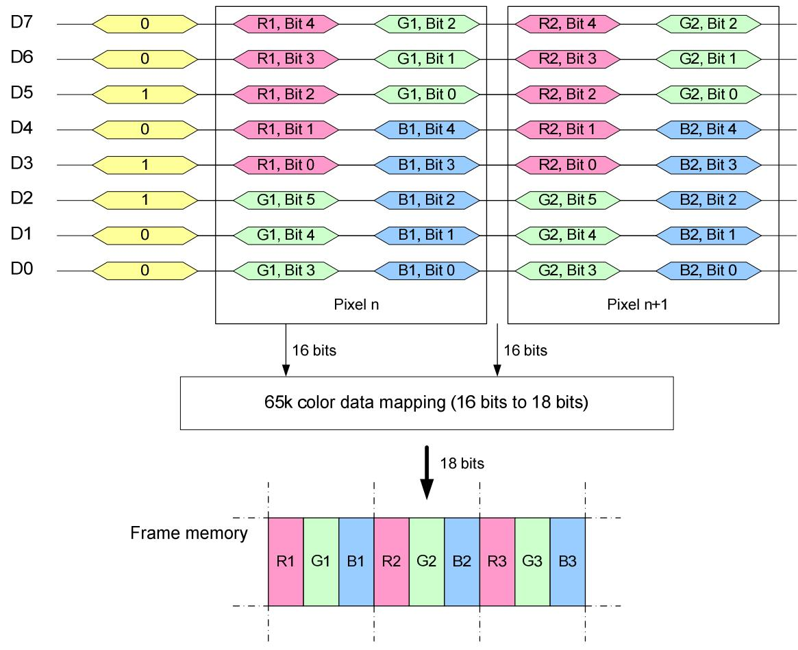

Note 2: 2-times transfer transmit 1 pixel data with the 16-bit color depth information.

Note 3: ‘-‘ = Don’t care – Can be set to ‘0’ or ‘1

## 8.2.6 8080-series MCU Read Cycle Sequence

The read cycle (RDX high-low-high sequence) means that the host reads information from display via interface. The driver sends data (DB [17:0]) to the host when there is a falling edge of RDX and the host reads data when there is a rising edge of RDX.

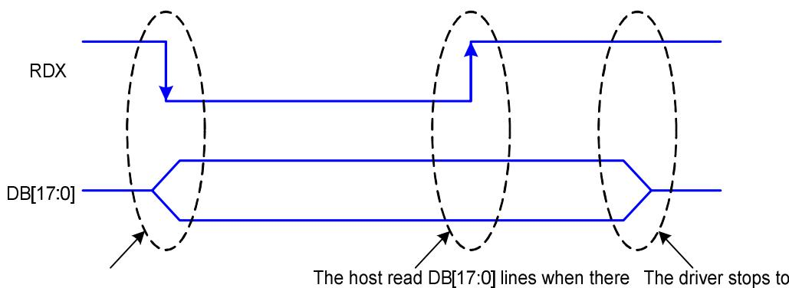  
The driver starts to control DB[17:0] linesis a rising edge of RDX when there is a falling edge of the RDX

8080-Series RDX Protocol  
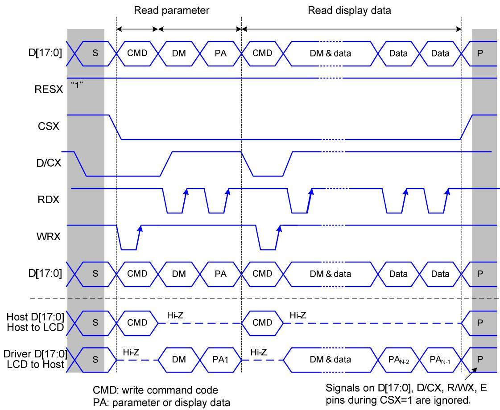  
8080-Series Parallel Bus Protocol, Read from Register or Display RAM

8.2.7 18-bit 8080-Series Interface Read Format  
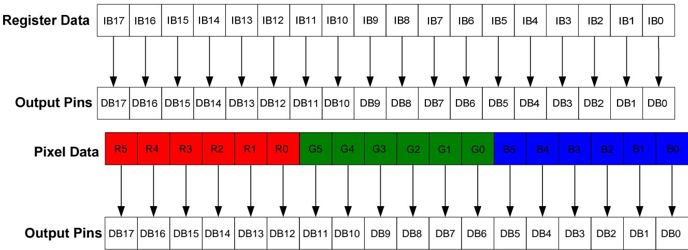  
18-bit 8080-Series Interface Data Format (Register/Pixel Data Read)

## 8.2.8 16-bit 8080-Series Interface Read Format

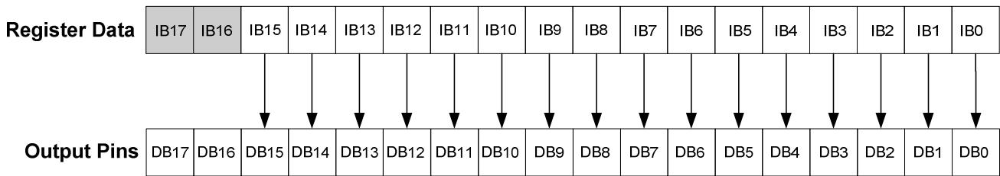

16-bit data bus for 18-bit/pixel, 262K-Colors, $3 \mathsf { A h } = ^ { \prime \prime } 0 6 \mathsf { h } ^ { \prime \prime }$

<table><tr><td>D15</td><td>D14</td><td>D13</td><td>D12</td><td>D11</td><td>D10</td><td>D9</td><td>D8</td><td>D7</td><td>D6</td><td>D5</td><td>D4</td><td>D3</td><td>D2</td><td>D1</td><td>D0</td><td>BUS width</td></tr><tr><td>X</td><td>X</td><td>X</td><td>X</td><td>X</td><td>X</td><td>X</td><td>X</td><td>X</td><td>X</td><td>X</td><td>X</td><td>X</td><td>X</td><td>X</td><td>X</td><td>Dummy Read</td></tr><tr><td>R5</td><td>R4</td><td>R3</td><td>R2</td><td>R1</td><td>R0</td><td>X</td><td>X</td><td>G5</td><td>G4</td><td>G3</td><td>G2</td><td>G1</td><td>G0</td><td>X</td><td>X</td><td rowspan="3">3 Transfer2 Pixel</td></tr><tr><td>B5</td><td>B4</td><td>B3</td><td>B2</td><td>B1</td><td>B0</td><td>X</td><td>X</td><td>R5</td><td>R4</td><td>R3</td><td>R2</td><td>R1</td><td>R0</td><td>X</td><td>X</td></tr><tr><td>G5</td><td>G4</td><td>G3</td><td>G2</td><td>G1</td><td>G0</td><td>X</td><td>X</td><td>B5</td><td>B4</td><td>B3</td><td>B2</td><td>B1</td><td>B0</td><td>X</td><td>X</td></tr></table>

16-bit 8080-Series Interface Data Format 262K (Register/Pixel Data Read)

16-bit data bus for 16-bit/pixel, 65K-Colors, $3 A h = ^ { \prime \prime } 0 5 h ^ { \prime \prime }$

<table><tr><td>D15</td><td>D14</td><td>D13</td><td>D12</td><td>D11</td><td>D10</td><td>D9</td><td>D8</td><td>D7</td><td>D6</td><td>D5</td><td>D4</td><td>D3</td><td>D2</td><td>D1</td><td>D0</td><td>BUS width</td></tr><tr><td>X</td><td>X</td><td>X</td><td>X</td><td>X</td><td>X</td><td>X</td><td>X</td><td>X</td><td>X</td><td>X</td><td>X</td><td>X</td><td>X</td><td>X</td><td>X</td><td>Dummy Read</td></tr><tr><td>R4</td><td>R3</td><td>R2</td><td>R1</td><td>R0</td><td>G5</td><td>G4</td><td>G3</td><td>G2</td><td>G1</td><td>G0</td><td>B4</td><td>B3</td><td>B2</td><td>B1</td><td>B0</td><td>1 Transfer 1 Pixel</td></tr></table>

16-bit 8080-Series Interface Data Format 65K (Register/Pixel Data Read)

8.2.9 9-bit 8080-Series Interface Read Format  
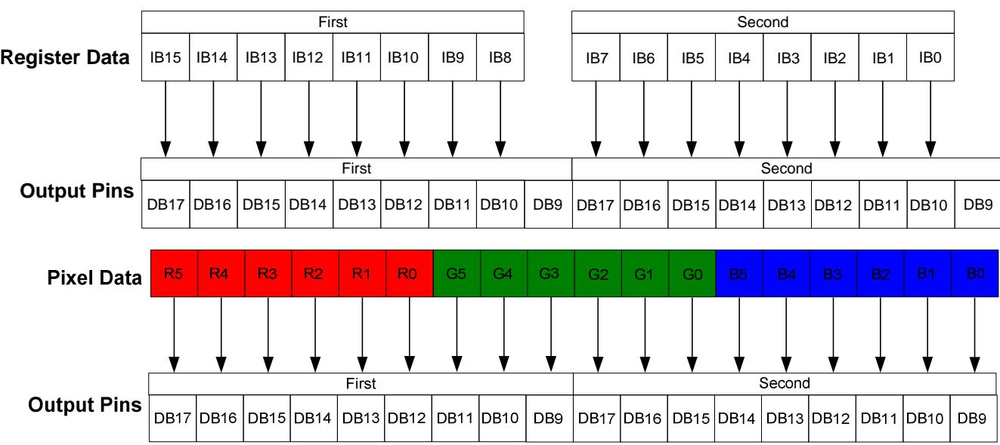  
9-bit 8080-Series Interface Data Format (Register/Pixel Data Read)

## 8.2.10 8-bit 8080-Series Interface Read Format

Output Pins

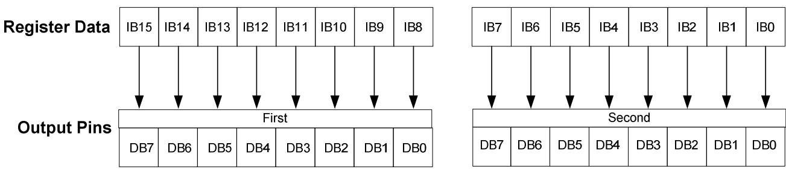

8-bit data bus for 18-bit/pixel, 262K-Colors, 3Ah=”06h”

<table><tr><td>D15</td><td>D14</td><td>D13</td><td>D12</td><td>D11</td><td>D10</td><td>D9</td><td>D8</td><td>D7</td><td>D6</td><td>D5</td><td>D4</td><td>D3</td><td>D2</td><td>D1</td><td>D0</td><td>BUS width</td></tr><tr><td>X</td><td>X</td><td>X</td><td>X</td><td>X</td><td>X</td><td>X</td><td>X</td><td>X</td><td>X</td><td>X</td><td>X</td><td>X</td><td>X</td><td>X</td><td>X</td><td>Dummy Read</td></tr><tr><td>X</td><td>X</td><td>X</td><td>X</td><td>X</td><td>X</td><td>X</td><td>X</td><td>R5</td><td>R4</td><td>R3</td><td>R2</td><td>R1</td><td>R0</td><td>X</td><td>X</td><td rowspan="3">3 Transfer1 Pixel</td></tr><tr><td>X</td><td>X</td><td>X</td><td>X</td><td>X</td><td>X</td><td>X</td><td>X</td><td>G5</td><td>G4</td><td>G3</td><td>G2</td><td>G1</td><td>G0</td><td>X</td><td>X</td></tr><tr><td>X</td><td>X</td><td>X</td><td>X</td><td>X</td><td>X</td><td>X</td><td>X</td><td>B5</td><td>B4</td><td>B3</td><td>B2</td><td>B1</td><td>B0</td><td>X</td><td>X</td></tr></table>

8-bit 8080-Series Interface Data Format (Register/Pixel Data Read)

8-bit data bus for 16-bit/pixel, 65K-Colors, 3Ah=”05h”

<table><tr><td>D15</td><td>D14</td><td>D13</td><td>D12</td><td>D11</td><td>D10</td><td>D9</td><td>D8</td><td>D7</td><td>D6</td><td>D5</td><td>D4</td><td>D3</td><td>D2</td><td>D1</td><td>D0</td><td>BUS width</td></tr><tr><td>X</td><td>X</td><td>X</td><td>X</td><td>X</td><td>X</td><td>X</td><td>X</td><td>X</td><td>X</td><td>X</td><td>X</td><td>X</td><td>X</td><td>X</td><td>X</td><td>Dummy Read</td></tr><tr><td>X</td><td>X</td><td>X</td><td>X</td><td>X</td><td>X</td><td>X</td><td>X</td><td>R4</td><td>R3</td><td>R2</td><td>R1</td><td>R0</td><td>G5</td><td>G4</td><td>G3</td><td>2 Transfer</td></tr><tr><td>X</td><td>X</td><td>X</td><td>X</td><td>X</td><td>X</td><td>X</td><td>X</td><td>G2</td><td>G1</td><td>G0</td><td>B4</td><td>B3</td><td>B2</td><td>B1</td><td>B0</td><td>1 Pixel</td></tr></table>

## 8.3.. RGB Interface

## 8.3.1 RGB Color Format

ST7796S supports two kinds of RGB interface, DE mode and HV mode, and 16bit/18bit data format. When DE mode is selected and the VSYNC, HSYNC, DOTCLK, DE, D[17:0] pins can be used; when HV mode is selected and the VSYNC, HSYNC, DOTCLK, D[17:0] pins can be used.When using RGB interface, only seria interface can be selected.

Write data for 16-bit/pixel (RGB 5-6-5-bit input), 65K-Colors

<table><tr><td>D17</td><td>-</td><td>-</td><td>-</td><td>-</td><td>-</td></tr><tr><td>D16</td><td>-</td><td>-</td><td>-</td><td>-</td><td>-</td></tr><tr><td>D15</td><td>R1, Bit 4</td><td>R2, Bit 4</td><td>R3, Bit 4</td><td>R4, Bit 4</td><td>R5, Bit 4</td></tr><tr><td>D14</td><td>R1, Bit 3</td><td>R2, Bit 3</td><td>R3, Bit 3</td><td>R4, Bit 3</td><td>R5, Bit 3</td></tr><tr><td>D13</td><td>R1, Bit 2</td><td>R2, Bit 2</td><td>R3, Bit 2</td><td>R4, Bit 2</td><td>R5, Bit 2</td></tr><tr><td>D12</td><td>R1, Bit 1</td><td>R2, Bit 1</td><td>R3, Bit 1</td><td>R4, Bit 1</td><td>R5, Bit 1</td></tr><tr><td>D11</td><td>R1, Bit 0</td><td>R2, Bit 0</td><td>R3, Bit 0</td><td>R4, Bit 0</td><td>R5, Bit 0</td></tr><tr><td>D10</td><td>G1, Bit 5</td><td>G2, Bit 5</td><td>G3, Bit 5</td><td>G4, Bit 5</td><td>G5, Bit 5</td></tr><tr><td>D9</td><td>G1, Bit 4</td><td>G2, Bit 4</td><td>G3, Bit 4</td><td>G4, Bit 4</td><td>G5, Bit 4</td></tr><tr><td>D8</td><td>G1, Bit 3</td><td>G2, Bit 3</td><td>G3, Bit 3</td><td>G4, Bit 3</td><td>G5, Bit 3</td></tr><tr><td>D7</td><td>G1, Bit 2</td><td>G2, Bit 2</td><td>G3, Bit 2</td><td>G4, Bit 2</td><td>G5, Bit 2</td></tr><tr><td>D6</td><td>G1, Bit 1</td><td>G2, Bit 1</td><td>G3, Bit 1</td><td>G4, Bit 1</td><td>G5, Bit 1</td></tr><tr><td>D5</td><td>G1, Bit 0</td><td>G2, Bit 0</td><td>G3, Bit 0</td><td>G4, Bit 0</td><td>G5, Bit 0</td></tr><tr><td>D4</td><td>B1, Bit 4</td><td>B2, Bit 4</td><td>B3, Bit 4</td><td>B4, Bit 4</td><td>B5, Bit 4</td></tr><tr><td>D3</td><td>B1, Bit 3</td><td>B2, Bit 3</td><td>B3, Bit 3</td><td>B4, Bit 3</td><td>B5, Bit 3</td></tr><tr><td>D2</td><td>B1, Bit 2</td><td>B2, Bit 2</td><td>B3, Bit 2</td><td>B4, Bit 2</td><td>B5, Bit 2</td></tr><tr><td>D1</td><td>B1, Bit 1</td><td>B2, Bit 1</td><td>B3, Bit 1</td><td>B4, Bit 1</td><td>B5, Bit 1</td></tr><tr><td>D0</td><td>B1, Bit 0</td><td>B2, Bit 0</td><td>B3, Bit 0</td><td>B4, Bit 0</td><td>B5, Bit 0</td></tr><tr><td></td><td>Pixel n</td><td>Pixel n+1</td><td>Pixel n+2</td><td>Pixel n+3</td><td>Pixel n+4</td></tr></table>

<table><tr><td>D17</td><td>R1, Bit 5</td><td>R2, Bit 5</td><td>R3, Bit 5</td><td>R4, Bit 5</td><td>R5, Bit 5</td></tr><tr><td>D16</td><td>R1, Bit 4</td><td>R2, Bit 4</td><td>R3, Bit 4</td><td>R4, Bit 4</td><td>R5, Bit 4</td></tr><tr><td>D15</td><td>R1, Bit 3</td><td>R2, Bit 3</td><td>R3, Bit 3</td><td>R4, Bit 3</td><td>R5, Bit 3</td></tr><tr><td>D14</td><td>R1, Bit 2</td><td>R2, Bit 2</td><td>R3, Bit 2</td><td>R4, Bit 2</td><td>R5, Bit 2</td></tr><tr><td>D13</td><td>R1, Bit 1</td><td>R2, Bit 1</td><td>R3, Bit 1</td><td>R4, Bit 1</td><td>R5, Bit 1</td></tr><tr><td>D12</td><td>R1, Bit 0</td><td>R2, Bit 0</td><td>R3, Bit 0</td><td>R4, Bit 0</td><td>R5, Bit 0</td></tr><tr><td>D11</td><td>G1, Bit 5</td><td>G2, Bit 5</td><td>G3, Bit 5</td><td>G4, Bit 5</td><td>G5, Bit 5</td></tr><tr><td>D10</td><td>G1, Bit 4</td><td>G2, Bit 4</td><td>G3, Bit 4</td><td>G4, Bit 4</td><td>G5, Bit 4</td></tr><tr><td>D9</td><td>G1, Bit 3</td><td>G2, Bit 3</td><td>G3, Bit 3</td><td>G4, Bit 3</td><td>G5, Bit 3</td></tr><tr><td>D8</td><td>G1, Bit 2</td><td>G2, Bit 2</td><td>G3, Bit 2</td><td>G4, Bit 2</td><td>G5, Bit 2</td></tr><tr><td>D7</td><td>G1, Bit 1</td><td>G2, Bit 1</td><td>G3, Bit 1</td><td>G4, Bit 1</td><td>G5, Bit 1</td></tr><tr><td>D6</td><td>G1, Bit 0</td><td>G2, Bit 0</td><td>G3, Bit 0</td><td>G4, Bit 0</td><td>G5, Bit 0</td></tr><tr><td>D5</td><td>B1, Bit 5</td><td>B2, Bit 5</td><td>B3, Bit 5</td><td>B4, Bit 5</td><td>B5, Bit 5</td></tr><tr><td>D4</td><td>B1, Bit 4</td><td>B2, Bit 4</td><td>B3, Bit 4</td><td>B4, Bit 4</td><td>B5, Bit 4</td></tr><tr><td>D3</td><td>B1, Bit 3</td><td>B2, Bit 3</td><td>B3, Bit 3</td><td>B4, Bit 3</td><td>B5, Bit 3</td></tr><tr><td>D2</td><td>B1, Bit 2</td><td>B2, Bit 2</td><td>B3, Bit 2</td><td>B4, Bit 2</td><td>B5, Bit 2</td></tr><tr><td>D1</td><td>B1, Bit 1</td><td>B2, Bit 1</td><td>B3, Bit 1</td><td>B4, Bit 1</td><td>B5, Bit 1</td></tr><tr><td>D0</td><td>B1, Bit 0</td><td>B2, Bit 0</td><td>B3, Bit 0</td><td>B4, Bit 0</td><td>B5, Bit 0</td></tr><tr><td></td><td>Pixel n</td><td>Pixel n+1</td><td>Pixel n+2</td><td>Pixel n+3</td><td>Pixel n+4</td></tr></table>

Write data for 18-bit/pixel (RGB 6-6-6-bit input), 262K-Colors

## 8.3.2 RGB Interface Definition

The display operation via the RGB interface is synchronized with the VSYNC, HSYNC, and DOTCLK signals. The data can be written only within the specified area with low power consumption by using window address function. The back porch and front porch are used to set the RGB interface timing.

Vertical Sync.  
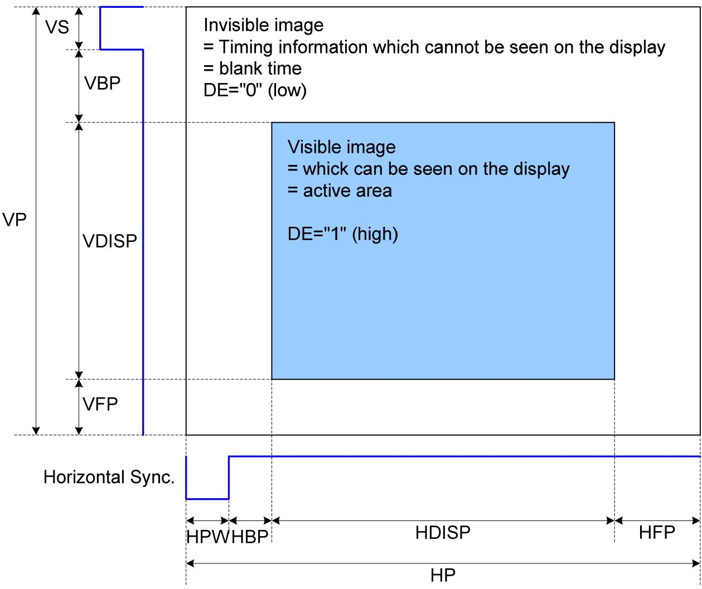  
DRAM Access Area by RGB Interface

Please refer to the following table for the setting limitation of RGB interface signals.

<table><tr><td>Parameter</td><td>Symbol</td><td>Min.</td><td>Typ.</td><td>Max.</td><td>Unit</td></tr><tr><td>Horizontal Sync. Width</td><td>hpw</td><td>2</td><td>-</td><td rowspan="2">hpw + hbp = 75</td><td>Clock</td></tr><tr><td>Horizontal Sync. Back Porch</td><td>hbp</td><td>4</td><td>-</td><td>Clock</td></tr><tr><td>Horizontal Sync. Front Porch</td><td>hfp</td><td>2</td><td>38</td><td>-</td><td>Clock</td></tr><tr><td>Vertical Sync. Width</td><td>vs</td><td>2</td><td>4</td><td rowspan="2">-</td><td>Line</td></tr><tr><td>Vertical Sync. Back Porch</td><td>vbp</td><td>2</td><td>4</td><td>Line</td></tr><tr><td>Vertical Sync. Front Porch</td><td>vfp</td><td>2</td><td>8</td><td>-</td><td>Line</td></tr></table>

Note:

## 8.3.3 RGB Interface Timing

The timing chart of RGB interface DE mode is shown as follows.  
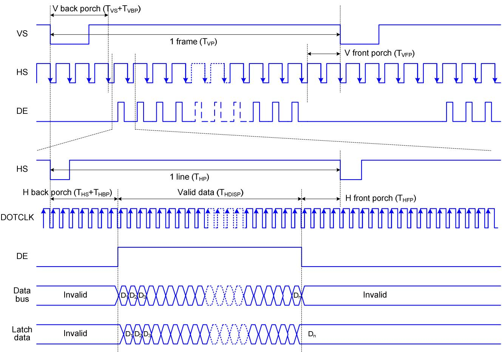  
Note: The setting of front porch and back porch in host must match that in IC as this mode.

Timing Chart of Signals in RGB Interface DE Mode

The timing chart of RGB interface HV mode is shown as follows.  
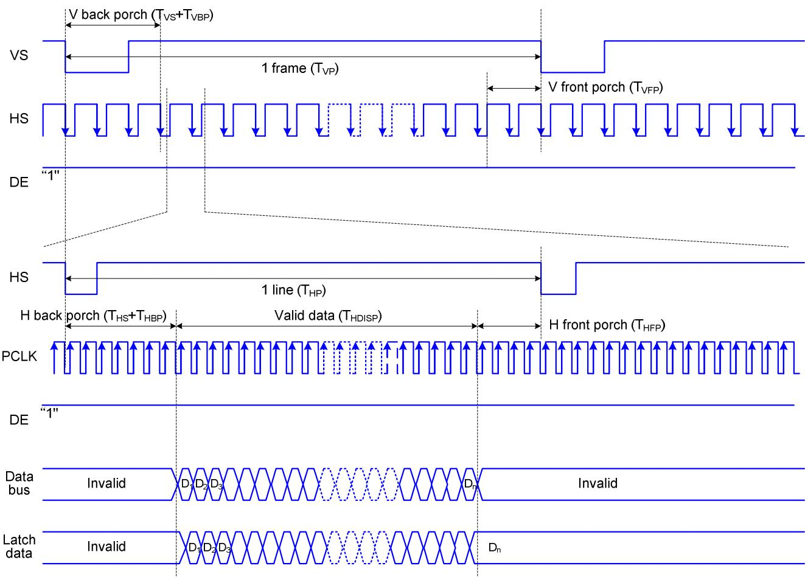  
Timing chart of RGB interface HV mode

The following are the functions not available in RGB Input Interface mode.

<table><tr><td>Function</td><td>RGB Interface</td><td>I80 System Interface</td></tr><tr><td>Partial display</td><td>Not available</td><td>Available</td></tr><tr><td>Scroll function</td><td>Not available</td><td>Available</td></tr><tr><td>Interlaced scan</td><td>Not available</td><td>Available</td></tr><tr><td>Graphics operation function</td><td>Not available</td><td>Available</td></tr></table>

VSYNC, HSYNC, and DOTCLK signals must be supplied during a display operation period.

In RGB interface mode, the panel controlling signals are generated from DOTCLK, not the internal clock generated from the internal oscillator.

When switching between the internal operation mode and the external display interface operation mode, follow the sequences below in setting instruction.

In RGB interface mode, the front porch period continues until the next VSYNC input is detected after drawing one frame.

In RGB interface mode, a RAM address is set in the address counter every frame on the falling edge of VSYNC.

## 8.4.. Serial Peripheral Interface (SPI)

## 8.4.1 3-Line Interface

The Serial Peripheral Interface (SPI) is selected by setting the IM[2:0] pins as “101” level. The chip select pin (CSX), the serial transfer clock pin (SCL), the serial data input pin (SDI) and the serial data output pin (SDO) are used in SPI mode. The ID pin sets the least significant bit of the identification code. The DB[17:0] pins, which are not used, must be tied to GND

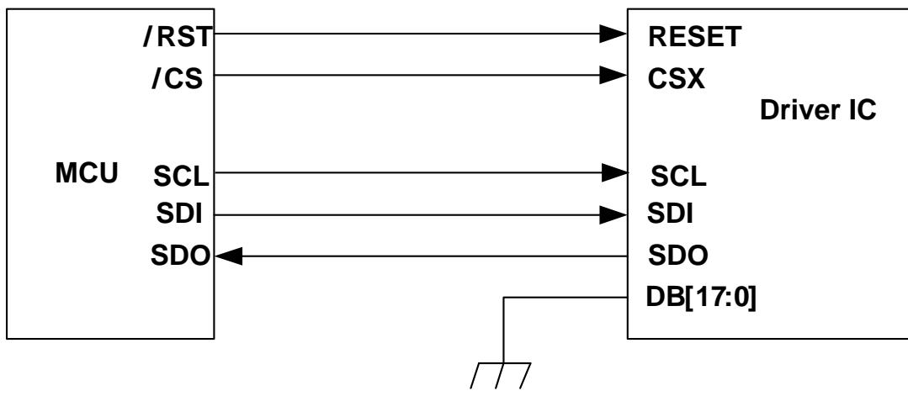

## 8.4.1.1 Write Sequence.

In the write mode of 3-line serial interface contains a D/CX (data/command) select bit and a transmission byte. If the D/C bit is “0”, the transmission byte is interpreted as a command byte. If the D/C bit is “1”, the transmission byte is display data, or stored in the command register as parameter data.

Transmission byte (TB) may be command or data  
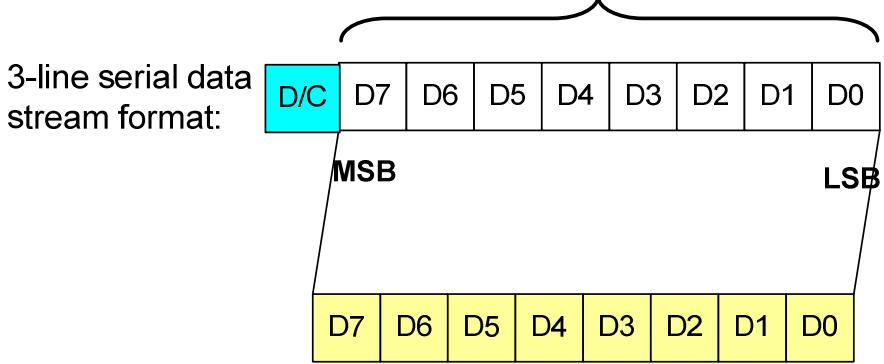  
8 Bit Data Trasmission Byte

The instruction of ST7796s can be sent in any order, and the MSB is transmitted first. The 3-line serial interface is initialized when the CSX keeps high level. In this state, the SCL clock pulse and SDA data have no effect. A falling edge on CSX enables the serial interface and indicates the start of data transmission.

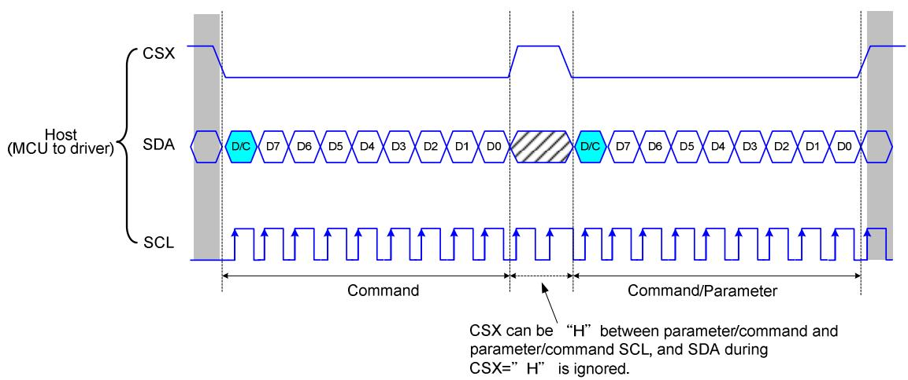

## 8.4.1.2 Read Sequence

In the read mode of the interface, the host reads the register value from the ST7796s. The host sends out a command (Read ID or register command), then a byte is (bytes are) transmitted in the opposite direction. The ST7796s samples the SDA (input data) at the rising edges of the SCL (serial clock), and shifts to SDO (output data) at the falling edges of the SCL (serial clock). The read mode has three types of transmitted command data (8-/24-/32-bit) according to the command code.

4-line serial protocol (for RDID1/RDID2/RDID3/0Ah/0Bh/0Ch/0Dh/0Eh/0Fh command: 8-bit read):  
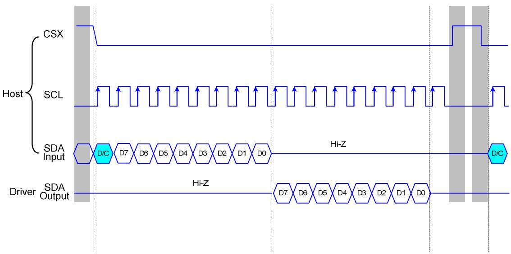

4-line serial protocol (for RDDID command: 24-bit read)  
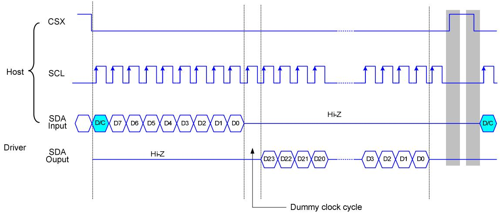

4-line serial protocol (for RDDST command: 32-bit read)  
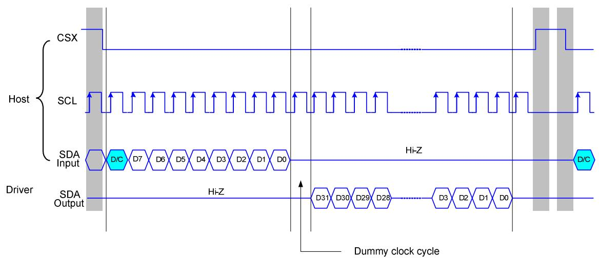

## 8.4.1.3 3-SPI Color format

Different display data formats are available for three colors depth supported by the LCM listed below. 65k colors, RGB 5-6-5-bit input

262k colors, RGB 6-6-6-bit input

Write data for 16-bit/pixel (RGB 5-6-5-bit input), 65K-Colors, 3Ah=”05h”  

Write data for 18-bit/pixel (RGB-6-6-6-bit input), 262K-Colors, 3Ah=”06h”  
  
The SPI interface operation enables from the falling edge of CSX and ends of data transfer on the rising

edge of CSX. The start byte is transferred to start the SPI interface and the read/write operation and RS information are also included in the start byte. When the start byte is matched, the subsequent data is received by ST7796S.

## 8.4.2 4-Line Interface

The Serial Peripheral Interface (SPI) is selected by setting the IM[2:0] pins as “111” level. The chip select pin (CSX), the serial transfer clock pin (SCL), the display data/command selection (DCX), the serial data input pin (SDI) and the serial data output pin (SDO) are used in SPI mode. The ID pin sets the least significant bit of the identification code. The DB[17:0] pins, which are not used, must be tied to GND

## 8.4.2.1 Write Sequence

The write mode of the interface means the host writes commands and data to ST7796S. The 4-lines serial data packet contains a data/command and a transmission byte. If D/CX is “low”, the transmission byte is interpreted as a command byte. If D/CX is “high”, the transmission byte is stored in the display data RAM (Memory write command), or command register as parameter.

Transmission byte (TB) may be command or data  
  
8 Bit Data Trasmission Byte

The host drives the CSX pin to low and the MSB data bit (D7) is set on SDA by the host. On the next falling edge of SCL the next bit (D6) is set on SDA. If the optional D/CX signal is used, a byte is eight read cycle long. The 4-line serial interface writes sequence described in the Figure as below.

## 8.4.2.2 Read Sequence

The read mode of the interface means that the micro controller reads register value from the driver. To achieve read function, the micro controller first has to send a command (read ID or register command) and then the following byte is transmitted in the opposite direction. After that CSX is required to go to high before a new command is send (see the below figure). The driver samples the SDA (input data) at rising edge of SCL, but shifts SDA (output data) at the falling edge of SCL. Thus the micro controller is supported to read at the rising edge of SCL.

4-line serial protocol (for RDID1/RDID2/RDID3/0Ah/0Bh/0Ch/0Dh/0Eh/0Fh command: 8-bit read):  

4-line serial protocol (for RDDID command: 24-bit read)  

4-line serial protocol (for RDDST command: 32-bit read)  

## 8.4.2.3 4-SPI Color format

Different display data formats are available for three colors depth supported by the LCM listed below. 65k colors, RGB 5-6-5-bit input

262k colors, RGB 6-6-6-bit input

Write data for 16-bit/pixel (RGB-5-6-5-bit input), 65K-Colors, 3Ah=”05h”  

Write data for 18-bit/pixel (RGB-6-6-6-bit input), 262K-Colors, 3Ah=”06h”

## 8.5.. Mobile Industry Processor Interface (MIPI)

## 8.5.1 Display Serial Interface (DSI)

## 8.5.1.1 GENERAL DESCRIPTION

The communication can be separated 2 different levels between the MCU and the display module:

1. Low level communication what is done on the interface level

2. High level communication what is done on the packet level

## 8.5.1.2 Interface Level Communication

The display module uses data and clock lane differential pairs for DSI (DSI-1M). Both differential lane pairs can be driven Low Power (LP) or High Speed (HS) mode.

Low Power mode means that each line of the differential pair is used in single end mode and a differential receiver is disable (A termination resistor of the receiver is disable) and it can be driven into a low power mode. High Speed mode means that differential pairs (The termination resistor of the receiver is enable) are not used in the single end mode. There are used different modes and protocols in each mode when there wanted to transfer information from the MCU to the display module and vice versa.

The State Codes of the High Speed (HS) and Low Power (LP) lane pair are defined below.

<table><tr><td rowspan="2">Lane Pair State</td><td colspan="2">Line DC Voltage Levels</td><td>High Speed (HS)</td><td colspan="2">Low Power</td></tr><tr><td>DATA_P</td><td>DATA_N</td><td>Burst Mode</td><td>CLOCK_P</td><td>CLOCK_N</td></tr><tr><td>HS-0</td><td>Low (HS)</td><td>High (HS)</td><td>Differential – 0</td><td>Note 1</td><td>Note1</td></tr><tr><td>HS-1</td><td>High (HS)</td><td>Low (HS)</td><td>Differential – 1</td><td>Note 1</td><td>Note 1</td></tr><tr><td>LP-00</td><td>Low (LP)</td><td>Low (LP)</td><td>Not Defined</td><td>Bridge</td><td>Space</td></tr><tr><td>LP-01</td><td>Low (LP)</td><td>High (LP)</td><td>Not Defined</td><td>HS – Request</td><td>Mark – 0</td></tr><tr><td>LP-10</td><td>High (LP)</td><td>Low (LP)</td><td>Not Defined</td><td>LP – Request</td><td>Mark – 1</td></tr><tr><td>LP-11</td><td>High (LP)</td><td>High (LP)</td><td>Not Defined</td><td>Stop</td><td>Note 2</td></tr></table>

## Notes:

(1) Low-Power Receivers (LP-Rx) of the lane pair are checking the LP-00 state code, when the Lane Pair is in the High Speed (HS) mode.

(2 If Low-Power Receivers (LP-Rx) of the lane pair recognizes LP-11 state code, the lane pair returns to LP-11 of the Control Mode.

## 8.5.1.3 DSI-CLOCK Lanes

DSI-CLOCK\_P/N lanes can be driven into three different power modes:

\- Low Power Mode (LPM)

\- Ultra Low Power Mode (ULPM)

## - High Speed Clock Mode (HSCM)

Clock lanes are in a single end mode (LP = Low Power) when there is entering or leaving Low Power Mode (LPM) or Ultra Low Power Mode (ULPM).

Clock lanes are in the single end mode (LP = Low Power) when there is entering in or leaving out High Speed Clock Mode (HSCM). These entering and leaving protocols are using clock lanes in the single end mode to generate an entering or leaving sequences.

The principal flow chart of the different clock lanes power modes is illustrated below.

  
Flow chart of the different clock lanes

## 1. Low Power Mode (LPM)

DSI-CLOCK\_P/N lanes can be driven to the Low Power Mode (LPM), when DSI-CLOCK lanes are entering LP-11 State Code, in three different ways:

\- After SW Reset, HW Reset or Power On Sequence =>LP-11 After DSI-CLOCK\_P/N lanes are leaving Ultra Low Power Mode (ULPM, LP-00 State Code) =>LP-10

\- LP-11 (LPM). This sequence is illustrated below.

  
From ULPM to LPM

- After DSI-CLK+/- lanes are leaving High Speed Clock Mode (HSCM, HS-0 or HS-1 State Code) =>HS-0=>LP-11 (LPM). This sequence is illustrated below.  
  
From High Speed Clock Mode (HSCM) to LPM

All three mode changes are illustrated a flow chart below.

  
All Three Mode Changes to LPM on the Flow Chart

## 2. Ultra Low Power Mode (ULPM)

  
From LPM to ULPM

  
Mode Change from LPM to ULPM on the Flow Chart

3. High Speed Clock Mode (HSCM)  
  
From LPM to HSCM  
The mode change is also illustrated below.

  
Mode Change from LPM to HSCM on the Flow Chart

The high speed clock (DSI-CLOCK\_P/N) is started before high speed data is sent via DSI-DATA\_P/N lanes. The high speed clock continues clocking after the high speed data sending has been stopped.

The burst of the high speed clock consists of:

 Even number of transitions

Start state is HS-0

End state is HS-0

  
High Speed Clock Burst

## Note:

If the last load bit is HS-0, the transmitter changes from HS-0 to HS-1

If the last load bit is HS-1, the transmitter changes from HS-1 to HS-0

## 8.5.1.4 DSI-DATA Lanes

DSI-DATA\_P/N Data Lanes can be driven in different modes which are:

\- Escape Mode

\- High-Speed Data Transmission

\- Bus Turnaround Request

These modes and their entering codes are defined on the following table.

<table><tr><td>Mode</td><td>Entering Mode Sequence</td><td>Leaving Mode Sequence</td></tr><tr><td>Escape Mode</td><td>LP-11=&gt;LP-10=&gt;LP-00=&gt;LP-01=&gt;LP-00</td><td>LP-00=&gt;LP-10=&gt;LP-11(Mark-1)</td></tr><tr><td>High-Speed Data Transmission</td><td>LP-11=&gt;LP-01=&gt;LP-00=&gt;HS-0</td><td>(HS-0 or HS-1) =&gt;LP-11</td></tr><tr><td>Bus Turnaround Request</td><td>LP-11=&gt;LP-10=&gt;LP-00=&gt;LP-10=&gt;LP-00</td><td>High-Z, Note</td></tr></table>

## 1. Escape Mode

Data lanes (DSI-DATA\_P/N) can be used in different Escape Modes when data lanes are in Low Power (LP) mode.

These Escape Modes are used to:

 Send “Low-Power Data Transmission” (LPDT) e.g. from the MCU to the display module

 Drive data lanes to “Ultra-Low Power State” (ULPS)

 Indicate “Remote Application Reset” (RAR), which is reset the display module

 Indicate “Tearing Effect”, which is used for a TE line event from the display module to the MCU

● Indicate (ACK), which is used for a non-error event from the display module to the MCU The basic sequence of the Escape Mode is as follow

 Start: LP-11

 Escape Mode Entry (EME): LP-11 =>LP-10 =>LP-00 =>LP-01 =>LP-00

Escape Command (EC), which is coded, when one of the data lanes is changing from low-to-high-to-low then this changed data lane is presenting a value of the current data bit (DSI-D0+ = 1, DSI-D0- = 0) e.g. when DSI-D0- is changing from low-to-high-to-low, the receiver is latching a data bit, which value is logical 0. The receiver is using this low-to-high-to-low transition for its internal clock.

 A load if it is needed

 Exit Escape (Mark-1) LP-00 =>LP-10 =>LP-11

 End: LP-11

This basic construction is illustrated below:  
  
General Escape Mode Sequence

The number of the different Escape Commands (EC) is eight. These eight different Escape Commands (EC) can be divided 2 different groups: Mode or Trigger. The MCU is informing to the display module that it is controlling data lanes (RX\_D0P/N) with the mode e.g. The MCU can inform to the display module that it can put data lanes in the low power mode. The MCU is waiting from the display module an event information, which has been set by the MCU, with the trigger e.g. when the display module reaches a new V-synch, the display module sent to the MCU a TE trigger (TEE), if the MCU has been requested it. Escape commands are defined on the next table.

<table><tr><td>Escape command</td><td>Command Type Mode / Trigger</td><td>Entry command Pattern (First Last Bit Transmitted)</td></tr><tr><td>Low-Power Data</td><td>Mode</td><td>1110 0001 b</td></tr><tr><td>Ultra-Low Power Mode</td><td>Mode</td><td>0001 1110 b</td></tr><tr><td>Undefined-1, Note</td><td>Mode</td><td>1001 1111 b</td></tr><tr><td>Undefined-2, Note</td><td>Mode</td><td>1101 1110 b</td></tr><tr><td>Remote Application Reset</td><td>Trigger</td><td>0110 0010 b</td></tr><tr><td>Tearing Effect</td><td>Trigger</td><td>0101 1101 b</td></tr><tr><td>Acknowledge</td><td>Trigger</td><td>0010 0001 b</td></tr><tr><td>Unknown-5, Note</td><td>Trigger</td><td>1010 0000 b</td></tr></table>

Note: This Escape command support has not been implemented on the display module.

## Low-Power Data Transmission (LPDT)

The MCU can send data to the display module in Low-Power Data Transmission (LPDT) mode when data lanes are entering in Escape Mode and Low-Power Data Transmission (LPDT) command has been sen to the display module. The display module is also using the same sequence when it is sending data to the MCU.

The Low Power Data Transmission (LPDT) is using a following sequence:

Start: LP-11

 Escape Mode Entry (EME): LP-11 =>LP-10 =>LP-00 =>LP-01 =>LP-00

 Low-Power Data Transmission (LPDT) command in Escape Mode: 1110 0001 (First to Last bit)

 Load (Data):

One or more bytes (8 bit)

Data lanes are in pause mode when data lanes are stopped (Both lanes are low) between bytes

 Mark-1: LP-00 =>LP-10 =>LP-11

 End: LP-11

The Low-Power Data Transmission (LPDT) is as below,

  
Note : Load (Data) is presenting that the first bit is logical“1” in this Exsample  
Low-Power Data Transmission (LPDT)

Ultra-Low Power State (ULPS)

The MCU can force data lanes in Ultra-Low Power State (ULPS) mode when data lanes are entering in Escape Mode. The Ultra-Low Power State (ULPS) is using a following sequence:

 Start: LP-11

 Escape Mode Entry (EME): LP-11 =>LP-10 =>LP-00 =>LP-01 =>LP-00

 Ultra-Low Power State (ULPS) command in Escape Mode: 0001 1110 (First to Last bit)

Ultra-Low Power State (ULPS) when the MCU is keeping data lanes low

 Mark-1: LP-00 =>LP-10 =>LP-11

End: LP-11

This sequence is illustrated for reference purposes below:  
  
Ultra-Low Power State (ULPS)

Remote Application Reset (RAR)

The MCU can inform to the display module that it should be reseted in Remote Application Reset (RAR) trigger when data lanes are entering in Escape Mode.

The Remote Application Reset (RAR) is using a following sequence:

 Start: LP-11

 Escape Mode Entry (EME): LP-11 =>LP-10 =>LP-00 =>LP-01 =>LP-00

● Remote Application Reset (RAR) command in Escape Mode: 0110 0010 (First to Last bit)

 Mark-1: LP-00 =>LP-10 =>LP-11

 End: LP-11

This sequence is illustrated for reference purposes below:  
  
Remote Application Reset (RAR)  
Tearing Effect (TEE)

The display module can inform to the MCU when a tearing effect event (New V-synch) has been appened on the display module by Tearing Effect (TEE).

The display module is sending the Tearing Effect (TEE) what is a following sequence:

 Start: LP-11

 Escape Mode Entry (EME): LP-11 =>LP-10 =>LP-00 =>LP-01 =>LP-00

 Tearing Effect (TEE) trigger in Escape Mode: 0101 1101 (First to Last bit)

 Mark-1: LP-00 =>LP-10 =>LP-11

 End: LP-11

This sequence is illustrated for reference purposes below:

Tearing Effect (TEE)  
  
Acknowledge (ACK)

The display module can inform to the MCU when an error has not recognized on it by Acknowledge (ACK). The display module is sending the Acknowledge (ACK) what is using a following sequence:

 Start: LP-11

 Escape Mode Entry (EME): LP-11 =>LP-10 =>LP-00 =>LP-01 =>LP-00

 Acknowledge (ACK) command in Escape Mode: 0010 0001 (First to Last bit)

 Mark-1: LP-00 =>LP-10 =>LP-11

 End: LP-11

This sequence is illustrated for reference purposes below:

  
Acknowledge (ACK)

## 2. High-Speed Data Transmission

The display module is entering High-Speed Data Transmission (HSDT) when Clock lanes RX\_CP/N have already been entered in the High-Speed Clock Mode (HSCM) by the MCU.

Data lanes of the display module are entering $( \mathrm { T } _ { \mathrm { s o T } } )$ in the High-Speed Data Transmission (HSDT) as follows:

 Start: LP-11

 HS-Request: LP-01

 HS-Settle: $\mathsf { L P - } 0 0 \Rightarrow \mathsf { H S - } 0$ (Rx: Lane Termination Enable)

 Rx Synchronization: 011101 (Tx (= MCU) Synchronization: 0001 1101)

 End: High-Speed Data Transmission (HSDT) – Ready to receive High-Speed Data Load This same entering High-Speed Data Transmission $( \mathrm { T } _ { \mathrm { { s o T } } }$ of HSDT) sequence is illustrated below

  
Entering High-Speed Data Transmission $( \mathrm { T } _ { \mathrm { { s o T } } }$ of HSDT)

Leaving High-Speed Data Transmission

The display module is leaving the High-Speed Data Transmission $( \mathrm { T } _ { \mathrm { E O T } }$ of HSDT) when Clock lanes RX\_CP/N are in the High-Speed Clock Mode (HSCM) by the MCU and this HSCM is kept until data lanes are in LP-11 mode.

Data lanes of the display module are leaving from the High-Speed Data Transmission $( \mathrm { T _ { E O T } }$ of HSDT) as follows:

 Start: High-Speed Data Transmission (HSDT)

Stops High-Speed Data Transmission MCU changes to HS-1, if the last load bit is HS-0 MCU changes to HS-0, if the last load bit is HS-1

 End: LP-11 (Rx: Lane Termination Disable)

This same leaving High-Speed Data Transmission $( \mathrm { T _ { E O T } }$ of HSDT) sequence is illustrated below

  
Leaving High-Speed Data Transmission $( \mathrm { T } _ { \mathrm { E O T } }$ of HSDT)

## Burst of the High-Speed Data Transmission

The burst of the high-speed data transmission (HSDT) can consist of one data packet or several data packets. These data packets can be Long (Lpa) or Short (Spa) packets.

The single packet in High-Speed Data Transmission is illustrated for reference purposes below:

The multiple packets in High-Speed Data Transmission is illustrated for reference purposes below:

## 3. Bus Turnaround Request

The MCU which is controlling DSI-DATA\_P/N Data Lanes, can start a bus turnaround procedure when it wants information from a receiver, which can be the MCU or Display Module. The MCU and Display Module are using the same sequence when this bus turnaround procedure is used. This sequence is described for reference purposes, when the MCU wants to do the bus turnaround procedure to Display Module, as follows.

Bus Turnaround (BTA)  
  
V1.0  
Page 109 of 279

## 8.5.2 DSI protocol

The Protocol layer appends packet-protocol information and headers, and then sends complete bytes through the Lane Management layer to the PHY. Packets are serialized by the PHY and sent across the serial Link. The receiver side of a DSI Link performs the coverse of the transmitter side, decomposing the packet into parallel data, signal events and commands.

## 8.5.2.1 Multiple Packets per Transmission

There are two modes of data transmission, HS and LP transmission modes, at the PHY layer. Before a HS transmission can be started, the transmitter PHY issues a SoT sequence to the receiver. After that, data or command packets can be transmitted in HS mode. Multiple packets may exist within a single HS transmission and the end of transmission is always signaled at the PHY layer using a dedicated EoT sequence. In order to enhance the overall robustness of the system, DSI defines a dedicated EoT packet (EoTp) at the protocol layer for signaling the end of HS transmission. For backwards compatibility with earlier DSI systems, the capability of generating and interpreting this EoTp can be enabled or disabled.

Separate Transimssions

Key:

LPS -- Low power state

SP -- Short Packet

SoT -- Start of Transmission

LgP -- Long Packet

EoT -- End of Transmission

Single Transimssions

## 8.5.2.2 Packet Composition

The first byte of the packet, the Data Identifier (DI), includes information specifying the type of the packet. For example, in Video Mode systems in a display application the logical unit for a packet may be one horizontal display line. Command Mode systems send commands and an associated set of parameters, with the number of parameters depending on the command type.

Packet sizes fall into two categories:

 Short packets are four bytes in length including the ECC. Short packets are used for most Command Mode commands and associated parameters. Other Short packets convey events like H Sync and V Sync edges. Because they are Short packets they can convey accurate timing information to logic at the peripheral.

V1.0

 Long packets specify the payload length using a two-byte Word Count field. Payloads may be from 0 to 16 2 -1 bytes long. Therefore, a Long packet may be up to 65,541 bytes in length. Long packets permit transmission of large blocks of pixel or other data.

A special case of Command Mode operation is video-rate (update) streaming, which takes the form of an arbitrarily long stream of pixel or other data transmitted to the peripheral. As all DSI transactions use packets, the video stream shall be broken into separate packets. This “packetization” may be done by hardware or software. The peripheral may then reassemble the packets into a continuous video stream for display.

The Set Maximum Return Packet Size command allows the host processor to limit the size of response packets coming from a peripheral.

## 8.5.2.3 Endian Policy

All packet data traverses the interface as bytes. Sequentially, a transmitter shall send data LSB first, MSB last. For packets with multi-byte fields, the least significant byte shall be transmitted first unless otherwise specified.

Figure 12 shows a complete Long packet data transmission. Note, the figure shows the byte values in standard positional notation, i.e. MSB on the left and LSB on the right, while the bits are shown in chronological order with the LSB on the left, the MSB on the right and time increasing left to right.

## 8.5.2.4 General Packet Structure(Long Packet Format)

A Long packet shall consist of three elements: a 32-bit Packet Header (PH), an application-specific Data Payload with a variable number of bytes, and a 16-bit Packet Footer (PF). The Packet Header is further composed of three elements: an 8-bit Data Identifier, a 16-bit Word Count, and 8-bit ECC. The Packet Footer has one element, a 16-bit checksum. Long packets can be from 6 to 65,541 bytes in length.

  
Long Packet Structure

The Data Identifier defines the Virtual Channel for the data and the Data Type for the application specific payload data. See sections 8.8 through 8.10 for descriptions of Data Types. The Word Count defines the number of bytes in the Data Payload between the end of the Packet Header and the start of the Packet Footer. Neither the Packet Header nor the Packet Footer shall be included in the Word Count. The Error Correction Code (ECC) byte allows single-bit errors to be corrected and 2-bit errors to be detected in the Packet Header. This includes both the Data Identifier and Word Count fields. After the end of the Packet Header, the receiver reads the next Word Count \* bytes of the Data Payload. Within the Data Payload block, there are no limitations on the value of a data word, i.e. no embedded codes are used. Once the receiver has read the Data Payload it reads the Checksum in the Packet Footer. The host processor shall always calculate and transmit a Checksum in the Packet Footer. Peripherals are not required to calculate a Checksum. Also note the special case of zero-byte Data Payload: if the payload has length 0, then the Checksum calculation results in (FFFFh). If the Checksum is not calculated, the Packet Footer shall consist of two bytes of all zeros (0000h). See section 9 for more information on calculating the Checksum. In the generic case, the length of the Data Payload shall be a multiple of bytes. In addition, each data format may impose additional restrictions on the length of the payload data, e.g. multiple of four bytes. Each byte shall be transmitted least significant bit first. Payload data may be transmitted in any byte order restricted only by data format requirements. Multi-byte elements such as Word Count and Checksum shall be transmitted least significant byte first

## 8.5.2.5 General Packet Structure(Short Packet Format)

A Short packet shall contain an 8-bit Data ID followed by two command or data bytes and an 8-bit ECC; a

Packet Footer shall not be present. Short packets shall be four bytes in length. The Error Correction Code (ECC) byte allows single-bit errors to be corrected and 2-bit errors to be detected in the Short packet.

  
Short Packet Structure

## 8.5.2.6 Common Packet Elements

Long and Short packets have several common elements that are described in this section.

##  Data Identifier Byte

The first byte of any packet is the DI (Data Identifier) byte. Figure 15 shows the composition of the Data Identifier (DI) byte. DI[7:6]: These two bits identify the data as directed to one of four virtual channels.DI[5:0]: These six bits specify the Data Type.

  
Data Identifier Byte

## Virtual Channel Identifier – VC field, DI[7:6]

A processor may service up to four peripherals with tagged commands or blocks of data, using the Virtua Channel ID field of the header for packets targeted at different peripherals. The Virtual Channel ID enables one serial stream to service two or more virtual peripherals by multiplexing packets onto a common transmission channel. Note that packets sent in a single transmission each have their own Virtual Channel assignment and can be directed to different peripherals. Although the DSI protocol permits communication

with multiple peripherals, this specification only addresses the connection of a host processor to a single peripheral. Implementation details for connection to more than one physical peripheral are beyond the scope of this document.

  
Virtual Channel (VC) Configuration

## Data Type Field DT[5:0]

The Data Type field specifies if the packet is a Long or Short packet type and the packet format. The Data Type field, along with the Word Count field for Long packets, informs the receiver of how many bytes to expect in the remainder of the packet. This is necessary because there are no special packet start / end sync codes to indicate the beginning and end of a packet. This permits packets to convey arbitrary data, but it also requires the packet header to explicitly specify the size of the packet. When the receiving logic has counted down to the end of a packet, it shall assume the next data is either the header of a new packet or the EoT (End of Transmission) sequence.

## 8.5.2.7 Error Correction Code

The Error Correction Code allows single-bit errors to be corrected and 2-bit errors to be detected in the Packet Header. The host processor shall always calculate and transmit an ECC byte. Peripherals shall support ECC in both forward- and reverse-direction communications.

Bits (P[7…0]) of the Error Correction Code (ECC) are defined, where the symbol ‘^’ is presenting XOR function (Pn is ‘1’ if there is odd number of ‘1’s and Pn is ‘0’ if there is even number of ‘1’s), as follows.

$$
\mathsf {P 7} = \quad 0
$$

$$
\mathsf {P 6} = \quad 0
$$

$$
P 5 = \quad D 1 0 ^ {\wedge} D 1 1 ^ {\wedge} D 1 2 ^ {\wedge} D 1 3 ^ {\wedge} D 1 4 ^ {\wedge} D 1 5 ^ {\wedge} D 1 6 ^ {\wedge} D 1 7 ^ {\wedge} D 1 8 ^ {\wedge} D 1 9 ^ {\wedge} D 2 1 ^ {\wedge} D 2 2 ^ {\wedge} D 2 3
$$

$$
P 4 = \quad D 4 ^ {\wedge} D 5 ^ {\wedge} D 6 ^ {\wedge} D 7 ^ {\wedge} D 8 ^ {\wedge} D 9 ^ {\wedge} D 1 6 ^ {\wedge} D 1 7 ^ {\wedge} D 1 8 ^ {\wedge} D 1 9 ^ {\wedge} D 2 0 ^ {\wedge} D 2 2 ^ {\wedge} D 2 3
$$

$$
P 3 = \quad D 1 ^ {\wedge} D 2 ^ {\wedge} D 3 ^ {\wedge} D 7 ^ {\wedge} D 8 ^ {\wedge} D 9 ^ {\wedge} D 1 3 ^ {\wedge} D 1 4 ^ {\wedge} D 1 5 ^ {\wedge} D 1 9 ^ {\wedge} D 2 0 ^ {\wedge} D 2 1 ^ {\wedge} D 2 3
$$

$$
P 2 = \quad D 0 ^ {\wedge} D 2 ^ {\wedge} D 3 ^ {\wedge} D 5 ^ {\wedge} D 6 ^ {\wedge} D 9 ^ {\wedge} D 1 1 ^ {\wedge} D 1 2 ^ {\wedge} D 1 5 ^ {\wedge} D 1 8 ^ {\wedge} D 2 0 ^ {\wedge} D 2 1 ^ {\wedge} D 2 2
$$

$$
P 1 = \quad D 0 ^ {\wedge} D 1 ^ {\wedge} D 3 ^ {\wedge} D 4 ^ {\wedge} D 6 ^ {\wedge} D 8 ^ {\wedge} D 1 0 ^ {\wedge} D 1 2 ^ {\wedge} D 1 4 ^ {\wedge} D 1 7 ^ {\wedge} D 2 0 ^ {\wedge} D 2 1 ^ {\wedge} D 2 2 ^ {\wedge} D 2 3
$$

$$
P 0 = \quad D 0 ^ {\wedge} D 1 ^ {\wedge} D 2 ^ {\wedge} D 4 ^ {\wedge} D 5 ^ {\wedge} D 7 ^ {\wedge} D 1 0 ^ {\wedge} D 1 1 ^ {\wedge} D 1 3 ^ {\wedge} D 1 6 ^ {\wedge} D 2 0 ^ {\wedge} D 2 1 ^ {\wedge} D 2 2 ^ {\wedge} D 2 3
$$

P7 and P6 are set to ‘0’ because Error Correction Code (ECC) is based on 64 bit value ([D63…0]), but this implementation is based on 24 bit value (D [23…0]). Therefore, there is only needed 6 bits (P [5…0]) for Error Correction Code (ECC).

<table><tr><td colspan="8">DI</td><td colspan="8">Data0</td><td colspan="8">Data1</td><td colspan="8">ECC</td></tr><tr><td colspan="8">0x05</td><td colspan="8">0x10</td><td colspan="8">0x00</td><td colspan="8">0x2C</td></tr><tr><td>1</td><td>0</td><td>1</td><td>0</td><td>0</td><td>0</td><td>0</td><td>0</td><td>0</td><td>0</td><td>0</td><td>0</td><td>0</td><td>1</td><td>0</td><td>0</td><td>0</td><td>0</td><td>0</td><td>0</td><td>0</td><td>0</td><td>0</td><td>0</td><td>0</td><td>0</td><td>1</td><td>1</td><td>0</td><td>1</td><td>0</td><td>0</td></tr><tr><td>D0</td><td>D1</td><td>D2</td><td></td><td>D4</td><td>D5</td><td></td><td>D7</td><td></td><td></td><td>D10</td><td>D11</td><td></td><td>D13</td><td></td><td></td><td>D16</td><td></td><td></td><td></td><td>D20</td><td>D21</td><td>D22</td><td>D23</td><td>P0</td><td></td><td></td><td></td><td></td><td></td><td></td><td></td></tr><tr><td>D0</td><td>D1</td><td></td><td>D3</td><td>D4</td><td></td><td>D6</td><td></td><td>D8</td><td></td><td>D10</td><td></td><td>D12</td><td></td><td>D14</td><td></td><td></td><td>D17</td><td></td><td></td><td>D20</td><td>D21</td><td>D22</td><td>D23</td><td></td><td>P1</td><td></td><td></td><td></td><td></td><td></td><td></td></tr><tr><td>D0</td><td></td><td>D2</td><td>D3</td><td></td><td>D5</td><td>D6</td><td></td><td></td><td>D9</td><td></td><td>D11</td><td>D12</td><td></td><td></td><td>D15</td><td></td><td></td><td>D18</td><td></td><td>D20</td><td>D21</td><td>D22</td><td></td><td></td><td></td><td>P2</td><td></td><td></td><td></td><td></td><td></td></tr><tr><td></td><td>D1</td><td>D2</td><td>D3</td><td></td><td></td><td></td><td>D7</td><td>D8</td><td>D9</td><td></td><td></td><td></td><td>D13</td><td>D14</td><td>D15</td><td></td><td></td><td></td><td>D19</td><td>D20</td><td>D21</td><td></td><td>D23</td><td></td><td></td><td></td><td>P3</td><td></td><td></td><td></td><td></td></tr><tr><td></td><td></td><td></td><td></td><td>D4</td><td>D5</td><td>D6</td><td>D7</td><td>D8</td><td>D9</td><td></td><td></td><td></td><td></td><td></td><td></td><td>D16</td><td>D17</td><td>D18</td><td>D19</td><td>D20</td><td></td><td>D22</td><td>D23</td><td></td><td></td><td></td><td></td><td>P4</td><td></td><td></td><td></td></tr><tr><td></td><td></td><td></td><td></td><td></td><td></td><td></td><td></td><td></td><td></td><td>D10</td><td>D11</td><td>D12</td><td>D13</td><td>D14</td><td>D15</td><td>D16</td><td>D17</td><td>D18</td><td>D19</td><td></td><td>D21</td><td>D22</td><td>D23</td><td></td><td></td><td></td><td></td><td></td><td>P5</td><td></td><td></td></tr><tr><td>B0</td><td>B1</td><td>B2</td><td>B3</td><td>B4</td><td>B5</td><td>B6</td><td>B7</td><td>B0</td><td>B1</td><td>B2</td><td>B3</td><td>B4</td><td>B5</td><td>B6</td><td>B7</td><td>B0</td><td>B1</td><td>B2</td><td>B3</td><td>B4</td><td>B5</td><td>B6</td><td>B7</td><td>B0</td><td>B1</td><td>B2</td><td>B3</td><td>B4</td><td>B5</td><td>B6</td><td>B7</td></tr><tr><td>LSB</td><td colspan="6"></td><td>MSB</td><td>LSB</td><td colspan="6"></td><td>MSB</td><td>LSB</td><td colspan="6"></td><td>MSB</td><td>LSB</td><td colspan="6"></td><td>MSB</td></tr></table>

XOR Functionality on the Short Packet (Spa)

<table><tr><td colspan="8">DI</td><td colspan="8">WC (LS Byte)</td><td colspan="8">WC (MS Byte)</td><td colspan="8">ECC</td></tr><tr><td colspan="8">0x29</td><td colspan="8">0x01</td><td colspan="8">0x00</td><td colspan="8">0x06</td></tr><tr><td>1</td><td>0</td><td>0</td><td>1</td><td>0</td><td>1</td><td>0</td><td>0</td><td>1</td><td>0</td><td>0</td><td>0</td><td>0</td><td>0</td><td>0</td><td>0</td><td>0</td><td>0</td><td>0</td><td>0</td><td>0</td><td>0</td><td>0</td><td>0</td><td>0</td><td>1</td><td>1</td><td>0</td><td>0</td><td>0</td><td>0</td><td>0</td></tr><tr><td>D0</td><td>D1</td><td>D2</td><td></td><td>D4</td><td>D5</td><td></td><td>D7</td><td></td><td></td><td>D10</td><td>D11</td><td></td><td>D13</td><td></td><td></td><td>D16</td><td></td><td></td><td></td><td>D20</td><td>D21</td><td>D22</td><td>D23</td><td>P0</td><td></td><td></td><td></td><td></td><td></td><td></td><td></td></tr><tr><td>D0</td><td>D1</td><td></td><td>D3</td><td>D4</td><td></td><td>D6</td><td></td><td>D8</td><td></td><td>D10</td><td></td><td>D12</td><td></td><td>D14</td><td></td><td></td><td>D17</td><td></td><td></td><td>D20</td><td>D21</td><td>D22</td><td>D23</td><td></td><td>P1</td><td></td><td></td><td></td><td></td><td></td><td></td></tr><tr><td>D0</td><td></td><td>D2</td><td>D3</td><td></td><td>D5</td><td>D6</td><td></td><td></td><td>D9</td><td></td><td>D11</td><td>D12</td><td></td><td></td><td>D15</td><td></td><td></td><td>D18</td><td></td><td>D20</td><td>D21</td><td>D22</td><td></td><td></td><td></td><td>P2</td><td></td><td></td><td></td><td></td><td></td></tr><tr><td></td><td>D1</td><td>D2</td><td>D3</td><td></td><td></td><td></td><td>D7</td><td>D8</td><td>D9</td><td></td><td></td><td></td><td>D13</td><td>D14</td><td>D15</td><td></td><td></td><td></td><td>D19</td><td>D20</td><td>D21</td><td></td><td>D23</td><td></td><td></td><td></td><td>P3</td><td></td><td></td><td></td><td></td></tr><tr><td></td><td></td><td></td><td></td><td>D4</td><td>D5</td><td>D6</td><td>D7</td><td>D8</td><td>D9</td><td></td><td></td><td></td><td></td><td></td><td></td><td>D16</td><td>D17</td><td>D18</td><td>D19</td><td>D20</td><td></td><td>D22</td><td>D23</td><td></td><td></td><td></td><td></td><td>P4</td><td></td><td></td><td></td></tr><tr><td></td><td></td><td></td><td></td><td></td><td></td><td></td><td></td><td></td><td></td><td>D10</td><td>D11</td><td>D12</td><td>D13</td><td>D14</td><td>D15</td><td>D16</td><td>D17</td><td>D18</td><td>D19</td><td></td><td>D21</td><td>D22</td><td>D23</td><td></td><td></td><td></td><td></td><td></td><td>P5</td><td></td><td></td></tr><tr><td>B0</td><td>B1</td><td>B2</td><td>B3</td><td>B4</td><td>B5</td><td>B6</td><td>B7</td><td>B0</td><td>B1</td><td>B2</td><td>B3</td><td>B4</td><td>B5</td><td>B6</td><td>B7</td><td>B0</td><td>B1</td><td>B2</td><td>B3</td><td>B4</td><td>B5</td><td>B6</td><td>B7</td><td>B0</td><td>B1</td><td>B2</td><td>B3</td><td>B4</td><td>B5</td><td>B6</td><td>B7</td></tr><tr><td>LSB</td><td colspan="6"></td><td>MSSB</td><td>LSSB</td><td colspan="6"></td><td>MSSB</td><td>LSSB</td><td colspan="6"></td><td>MSSB</td><td>LSSB</td><td colspan="6"></td><td>MSSB</td></tr></table>

XOR Functionality on the Long Packet (Lpa)

The transmitter (The MCU or the Display Module) is sending data bits D[23:0] and Error Correction Code (ECC) P[7:0]. The receiver (The Display module or the MCU) is calculate an Internal Error Correction

2014/11

Code (IECC) and compares the received Error Correction Code (ECC) and the Internal Error Correction Code (IECC). This comparison is done when each power bit of ECC and IECC have been done XOR function. The result of this function is PO[7:0].

  
Internal Error Correction Code (IECC) on the Display Module (The Receiver)

The sent data bits (D[23:0]) and ECC (P[7:0]) are received correctly, if a value of the PO[7:0]) is 00h. The sent data bits (D[23:0]) and ECC (P[7:0]) are not received correctly, if a value of the PO[7:0]) is not 00h.

<table><tr><td>ECC P[7:0]</td><td>1</td><td>1</td><td>0</td><td>0</td><td>0</td><td>0</td><td>0</td><td>0</td><td>03h</td></tr><tr><td>IECC PI[7:0]</td><td>1</td><td>1</td><td>0</td><td>0</td><td>0</td><td>0</td><td>0</td><td>0</td><td>03h</td></tr><tr><td>XOR(ECC,IECC)</td><td>0</td><td>0</td><td>0</td><td>0</td><td>0</td><td>0</td><td>0</td><td>0</td><td>=00h =&gt; No Error</td></tr><tr><td></td><td>L</td><td></td><td></td><td></td><td></td><td></td><td></td><td>M</td><td></td></tr><tr><td></td><td>S</td><td></td><td></td><td></td><td></td><td></td><td></td><td>S</td><td></td></tr><tr><td></td><td>B</td><td></td><td></td><td></td><td></td><td></td><td></td><td>B</td><td></td></tr></table>

Internal XOR Calculation between ECC and IECC Values – No Error

<table><tr><td>ECC P[7:0]</td><td>1</td><td>1</td><td>0</td><td>0</td><td>0</td><td>0</td><td>0</td><td>0</td><td>03h</td></tr><tr><td>IECC PI[7:0]</td><td>1</td><td>1</td><td>1</td><td>1</td><td>0</td><td>0</td><td>0</td><td>0</td><td>0Fh</td></tr><tr><td>XOR(ECC,IECC)</td><td>0</td><td>0</td><td>1</td><td>1</td><td>0</td><td>0</td><td>0</td><td>0</td><td>=0Ch =&gt; Error</td></tr><tr><td></td><td>L</td><td></td><td></td><td></td><td></td><td></td><td>M</td><td></td><td></td></tr><tr><td></td><td>S</td><td></td><td></td><td></td><td></td><td></td><td>S</td><td></td><td></td></tr><tr><td></td><td>B</td><td></td><td></td><td></td><td></td><td></td><td>B</td><td></td><td></td></tr></table>

Internal XOR Calculation between ECC and IECC Values – Error

<table><tr><td>Data Bit</td><td>PO7</td><td>PO6</td><td>PO5</td><td>PO4</td><td>PO3</td><td>PO2</td><td>PO1</td><td>PO0</td><td>Hex</td></tr><tr><td>D[0]</td><td>0</td><td>0</td><td>0</td><td>0</td><td>0</td><td>1</td><td>1</td><td>1</td><td>07h</td></tr><tr><td>D[1]</td><td>0</td><td>0</td><td>0</td><td>0</td><td>1</td><td>0</td><td>1</td><td>1</td><td>0Bh</td></tr><tr><td>D[2]</td><td>0</td><td>0</td><td>0</td><td>0</td><td>1</td><td>1</td><td>0</td><td>1</td><td>0Dh</td></tr><tr><td>D[3]</td><td>0</td><td>0</td><td>0</td><td>0</td><td>1</td><td>1</td><td>1</td><td>0</td><td>0Eh</td></tr><tr><td>D[4]</td><td>0</td><td>0</td><td>0</td><td>1</td><td>0</td><td>0</td><td>1</td><td>1</td><td>13h</td></tr><tr><td>D[5]</td><td>0</td><td>0</td><td>0</td><td>1</td><td>0</td><td>1</td><td>0</td><td>1</td><td>15h</td></tr><tr><td>D[6]</td><td>0</td><td>0</td><td>0</td><td>1</td><td>0</td><td>1</td><td>1</td><td>0</td><td>16h</td></tr><tr><td>D[7]</td><td>0</td><td>0</td><td>0</td><td>1</td><td>1</td><td>0</td><td>0</td><td>1</td><td>19h</td></tr><tr><td>D[8]</td><td>0</td><td>0</td><td>0</td><td>1</td><td>1</td><td>0</td><td>1</td><td>0</td><td>1Ah</td></tr><tr><td>D[9]</td><td>0</td><td>0</td><td>0</td><td>1</td><td>1</td><td>1</td><td>0</td><td>0</td><td>1Ch</td></tr><tr><td>D[10]</td><td>0</td><td>0</td><td>1</td><td>0</td><td>0</td><td>0</td><td>1</td><td>1</td><td>23h</td></tr><tr><td>D[11]</td><td>0</td><td>0</td><td>1</td><td>0</td><td>0</td><td>1</td><td>0</td><td>1</td><td>25h</td></tr><tr><td>D[12]</td><td>0</td><td>0</td><td>1</td><td>0</td><td>0</td><td>1</td><td>1</td><td>0</td><td>26h</td></tr><tr><td>D[13]</td><td>0</td><td>0</td><td>1</td><td>0</td><td>1</td><td>0</td><td>0</td><td>1</td><td>29h</td></tr><tr><td>D[14]</td><td>0</td><td>0</td><td>1</td><td>0</td><td>1</td><td>0</td><td>1</td><td>0</td><td>2Ah</td></tr><tr><td>D[15]</td><td>0</td><td>0</td><td>1</td><td>0</td><td>1</td><td>1</td><td>0</td><td>0</td><td>2Ch</td></tr><tr><td>D[16]</td><td>0</td><td>0</td><td>1</td><td>1</td><td>0</td><td>0</td><td>0</td><td>1</td><td>31h</td></tr><tr><td>D[17]</td><td>0</td><td>0</td><td>1</td><td>1</td><td>0</td><td>0</td><td>1</td><td>0</td><td>32h</td></tr><tr><td>D[18]</td><td>0</td><td>0</td><td>1</td><td>1</td><td>0</td><td>1</td><td>0</td><td>0</td><td>34h</td></tr><tr><td>D[19]</td><td>0</td><td>0</td><td>1</td><td>1</td><td>1</td><td>0</td><td>0</td><td>0</td><td>38h</td></tr><tr><td>D[20]</td><td>0</td><td>0</td><td>0</td><td>1</td><td>1</td><td>1</td><td>1</td><td>1</td><td>1Fh</td></tr><tr><td>D[21]</td><td>0</td><td>0</td><td>1</td><td>0</td><td>1</td><td>1</td><td>1</td><td>1</td><td>2Fh</td></tr><tr><td>D[22]</td><td>0</td><td>0</td><td>1</td><td>1</td><td>0</td><td>1</td><td>1</td><td>1</td><td>37h</td></tr><tr><td>D[23]</td><td>0</td><td>0</td><td>1</td><td>1</td><td>1</td><td>0</td><td>1</td><td>1</td><td>3Bh</td></tr></table>

One error is detected if the value of the PO[7:0] is on the above table : One it Error Value of the Error Correction Code (ECC) and the receiver can correct this one bit error because this found value also defines what is a location of the corrupt bit e.g.

 PO [7…0] = 0Eh

 The bit of the data (D [23:0]), what is not correct, is D[3]

More than one error is detected if the value of the PO [7…0] is not on the above table: One Bit Error Value of the Error Correction Code (ECC) e.g. PO [7…0] = 0Ch.

## 8.5.2.8 Packet Footer on the Long Packet

Packet Footer (PF) of the Long Packet (Lpa) is defined after the Packet Data (PD) of the Long Packet (Lpa). The Packet Footer (PF) is a checksum value what is calculated from the Packet Data of the Long Packet (Lpa). The checksum is using a 16-bit Cyclic Redundancy Check (CRC) value which is generated with a polynomial $X _ { \scriptscriptstyle { 1 6 } } + X _ { \scriptscriptstyle { 1 2 } } + X _ { \scriptscriptstyle { 5 } } + X _ { \scriptscriptstyle { 0 } }$ as it is illustrated below.

The 16-bit Cyclic Redundancy Check (CRC) generator is initialized to FFFFh before calculations. The Most Significant Bit (MSB) of the data byte of the Packet Data (PD) is the first bit what is inputted into the 16-bit Cyclic Redundancy Check (CRC).

An example of the 16-bit Cyclic Redundancy Check (CRC), where the Packet Data (PD) of the Long Packet (Lpa) is 01h, is illustrated (step-by-step) below.

A value of the Packet Footer (PF) is 1E0Eh in this example. This example (Command 01h has been sent) is illustrated below.

Packet Header (PH)

<table><tr><td colspan="8">DI(Data Identification)</td><td colspan="8">WC - LSB(Word Count - LSB)</td><td colspan="8">WC - MSB(Word Count - MSB)</td><td colspan="8">ECC(Error Correction Code)</td><td></td></tr><tr><td colspan="8">8&#x27;b 39h</td><td colspan="8">8&#x27;b 01h</td><td colspan="8">8&#x27;b 00h</td><td colspan="8">8&#x27;b 15h</td><td></td></tr><tr><td>1</td><td>0</td><td>0</td><td>1</td><td>1</td><td>1</td><td>0</td><td>0</td><td>1</td><td>0</td><td>0</td><td>0</td><td>0</td><td>0</td><td>0</td><td>0</td><td>0</td><td>0</td><td>0</td><td>0</td><td>0</td><td>0</td><td>0</td><td>0</td><td>1</td><td>0</td><td>1</td><td>0</td><td>1</td><td>0</td><td>0</td><td>0</td><td></td></tr><tr><td>B</td><td>B</td><td>B</td><td>B</td><td>B</td><td>B</td><td>B</td><td>B</td><td>B</td><td>B</td><td>B</td><td>B</td><td>B</td><td>B</td><td>B</td><td>B</td><td>B</td><td>B</td><td>B</td><td>B</td><td>B</td><td>B</td><td>B</td><td>B</td><td>B</td><td>B</td><td>B</td><td>B</td><td>B</td><td>B</td><td>B</td><td></td><td></td></tr><tr><td>0</td><td>1</td><td>2</td><td>3</td><td>4</td><td>5</td><td>6</td><td>7</td><td>0</td><td>1</td><td>2</td><td>3</td><td>4</td><td>5</td><td>6</td><td>7</td><td>0</td><td>1</td><td>2</td><td>3</td><td>4</td><td>5</td><td>6</td><td>7</td><td>0</td><td>1</td><td>2</td><td>3</td><td>4</td><td>5</td><td>6</td><td>7</td><td></td></tr><tr><td>L</td><td colspan="7"></td><td>M</td><td>L</td><td colspan="6"></td><td>M</td><td>L</td><td colspan="6"></td><td>M</td><td>L</td><td colspan="6"></td><td>M</td></tr><tr><td>S</td><td colspan="7"></td><td>S</td><td>S</td><td colspan="6"></td><td>S</td><td>S</td><td colspan="6"></td><td>S</td><td>S</td><td colspan="6"></td><td>S</td></tr><tr><td>B</td><td colspan="7"></td><td>B</td><td>B</td><td colspan="6"></td><td>B</td><td>B</td><td colspan="6"></td><td>B</td><td>B</td><td colspan="6"></td><td>B</td></tr></table>

Time

  
The receiver is calculated own checksum value from received Packet Data (PD). The receiver compares own checksum and the Packet Footer (PF) what the transmitter has sent. The received Packet Data (PD) and Packet Footer (PF) are correct if the own checksum of the receiver and Packet Footer (PF) is equal and vice versa the received Packet Data (PD) and Packet Footer(PF) are not correct if the own checksum of the receiver and Packet Footer (PF) are not equal.

## 8.5.2.9 Processor to Peripheral Direction Packet Data Types

The set of transaction types sent from the host processor to a peripheral, such as a display module, are show as below table.

<table><tr><td>Data type</td><td>Data type, binary</td><td>Description packet</td><td>Size</td></tr><tr><td>01h</td><td>00 0001</td><td>Sync Event, V Sync Start</td><td>Short</td></tr><tr><td>11h</td><td>01 0001</td><td>Sync Event, V Sync End</td><td>Short</td></tr><tr><td>21h</td><td>10 0001</td><td>Sync Event, H Sync Start</td><td>Short</td></tr><tr><td>31h</td><td>11 0001</td><td>Sync Event, H Sync End</td><td>Short</td></tr><tr><td>08h</td><td>00 1000</td><td>End of Transmission packet (EoTp)</td><td>Short</td></tr><tr><td>02h</td><td>00 0010</td><td>Color Mode (CM) Off Command</td><td>Short</td></tr><tr><td>12h</td><td>01 0010</td><td>Color Mode (CM) On Command</td><td>Short</td></tr><tr><td>22h</td><td>10 0010</td><td>Shut Down Peripheral Command</td><td>Short</td></tr><tr><td>32h</td><td>11 0010</td><td>Turn On Peripheral Command</td><td>Short</td></tr><tr><td>03h</td><td>00 0011</td><td>Generic Short WRITE, no parameters</td><td>Short</td></tr><tr><td>13h</td><td>01 0011</td><td>Generic Short WRITE, 1 parameter</td><td>Short</td></tr><tr><td>23h</td><td>10 0011</td><td>Generic Short WRITE, 2 parameters</td><td>Short</td></tr><tr><td>04h</td><td>00 0100</td><td>Generic READ, no parameters</td><td>Short</td></tr><tr><td>14h</td><td>01 0100</td><td>Generic READ, 1 parameter</td><td>Short</td></tr><tr><td>24h</td><td>10 0100</td><td>Generic READ, 2 parameters</td><td>Short</td></tr><tr><td>05h</td><td>00 0101</td><td>DCS Short WRITE, no parameters</td><td>Short</td></tr><tr><td>15h</td><td>01 0101</td><td>DCS Short WRITE, 1 parameter</td><td>Short</td></tr><tr><td>06h</td><td>00 0110</td><td>DCS READ, no parameters</td><td>Short</td></tr><tr><td>37h</td><td>11 0111</td><td>Set Maximum Return Packet Size</td><td>Short</td></tr><tr><td>09h</td><td>00 1001</td><td>Null Packet, no data</td><td>Long</td></tr><tr><td>19h</td><td>01 1001</td><td>Blanking Packet, no data</td><td>Long</td></tr><tr><td>39h</td><td>11 1001</td><td>DCS Long Write/write_LUT Command Packet</td><td>Long</td></tr><tr><td>0Eh</td><td>00 1110</td><td>Packed Pixel Stream, 16-bit RGB, 5-6-5 Format</td><td>Long</td></tr><tr><td>1Eh</td><td>01 1110</td><td>Packed Pixel Stream, 18-bit RGB, 6-6-6 Format</td><td>Long</td></tr><tr><td>2Eh</td><td>10 1110</td><td>Loosely Packed Pixel Stream, 18-bit RGB, 6-6-6 Format</td><td>Long</td></tr><tr><td>3Eh</td><td>11 1110</td><td>Packed Pixel Stream, 24-bit RGB, 8-8-8 Format</td><td>Long</td></tr><tr><td rowspan="2">X0h / XFh, unspecified</td><td>xx 0000</td><td>DO NOT USE</td><td rowspan="2"></td></tr><tr><td>xx 1111</td><td>All unspecified codes are reserved</td></tr></table>

Data Types for Processor-sourced Packets

All detail function of data types is as below：

Sync event (H Start, H End, V Start, V End), Data Type = xx 0001 (x1h)

<table><tr><td colspan="3">Sync event (H start, H end, V start, V end), data type=xx 0001 (x1h)</td></tr><tr><td>Data type, hex</td><td>Function description</td><td>Number of bytes</td></tr><tr><td>01h</td><td>Sync Event, V Sync Start</td><td>Short</td></tr><tr><td>11h</td><td>Sync Event, V Sync End</td><td>Short</td></tr><tr><td>21h</td><td>Sync Event, H Sync Start</td><td>Short</td></tr><tr><td>31h</td><td>Sync Event, H Sync End</td><td>Short</td></tr><tr><td colspan="3">Note: In order to represent timing information as accurately as possible a V Sync Start event represents the start of the VSA and also implies an H Sync Start event for the first line of the VSA. Similarly, a V Sync End event implies an H Sync Start event for the last line of the VSA.</td></tr></table>

<table><tr><td colspan="3">Color mode status (Color Mode On, Color Mode Off)</td></tr><tr><td>Data type, hex</td><td>Function description</td><td>Number of bytes</td></tr><tr><td>02h</td><td>Color Mode On that switches a Video Mode display module to a low-color mode for power saving.</td><td>Short</td></tr><tr><td>12h</td><td>Color Mode Off that switches a Video Mode display module from low-color display to normal display.</td><td>Short</td></tr></table>

<table><tr><td colspan="3">Display status (shutdown command, turn-on command)</td></tr><tr><td>Data type, hex</td><td>Function description</td><td>Number of bytes</td></tr><tr><td>22h</td><td>Shutdown Peripheral command that turns off the display in a Video Mode display for power saving.</td><td>Short</td></tr><tr><td>32h</td><td>Turn On Peripheral command that turns on the display in Video Mode display for normal display.</td><td>Short</td></tr><tr><td colspan="3">Note: When use shutdown command, interface shall remain powered in order to receive the turn-on, or wake-up, command.</td></tr></table>

<table><tr><td colspan="3">DCS command setting</td></tr><tr><td>Data type, hex</td><td>Function description</td><td>Number of bytes</td></tr><tr><td>05/15h</td><td>DCS Short Write command is used to write a single data byte to a peripheral such as a display module. If a parameter is not required, the parameter byte shall be 00h.</td><td>Short</td></tr><tr><td>06h</td><td>DCS Read command, the returned data may be of Short or</td><td>Short</td></tr></table>

Sitronix

<table><tr><td></td><td>Long packet format.</td><td></td></tr><tr><td>39h</td><td>DCS Long Write/ Write _ LUT Command is used to send larger blocks of data to a display module that implements the Display Command Set.</td><td>Long</td></tr><tr><td colspan="3"></td></tr></table>

<table><tr><td colspan="3">Return packet size setting</td></tr><tr><td>Data type, hex</td><td>Function description</td><td>Number of bytes</td></tr><tr><td>37h</td><td>Set Maximum Return Packet Size that specifies the maximum size of the payload in a Long packet transmitted from peripheral back to the host processor.</td><td>Short</td></tr><tr><td colspan="3">Note: The two-byte value is transmitted with LS byte first. And during a power-on or Reset sequence, the Maximum Return Packet Size shall be set by the peripheral to a default value of one.</td></tr></table>

<table><tr><td colspan="3">Variable data packet</td></tr><tr><td>Data type, hex</td><td>Function description</td><td>Number of bytes</td></tr><tr><td>09h</td><td>Null Packet is a mechanism for keeping the serial Data Lane(s) in High-Speed mode while sending dummy data.</td><td>Short</td></tr><tr><td>19h</td><td>Blanking packet is used to convey blanking timing information in a Long packet.</td><td>Short</td></tr><tr><td colspan="3">Note: (1) When Null Packet, the Payload Data belong “null” Data, actual data values sent are irrelevant because the peripheral does not capture or store the data.(2) When Blanking packet, the packet represents a period between active scan lines of a Video Mode display,</td></tr></table>

Data stream format – 16bit Format

<table><tr><td colspan="3">Data stream format – 16bit Format</td></tr><tr><td>Data type, hex</td><td>Function description</td><td>Number of bytes</td></tr><tr><td>0Eh</td><td>Packed Pixel Stream 16-Bit Format is a Long packet used to transmit image data formatted as 16-bit pixels to a Video Mode display module. Pixel format is five bits red, six bits green, five bits blue, in that order.</td><td>Long</td></tr><tr><td colspan="3"> ...</td></tr><tr><td colspan="3">Note: That the “Green” component is split across two bytes. Within a color component, the LSB is sent first, the MSB last.</td></tr></table>

Data stream format – 18bit Format (mode1)

<table><tr><td colspan="3">Data stream format – 18bit Format (Mode1)</td></tr><tr><td>Data type, hex</td><td>Function description</td><td>Number of bytes</td></tr><tr><td>1Eh</td><td>Packed Pixel Stream 18-Bit Format is a Long packet used to transmit image data formatted as 18-bit pixels to a Video Mode display module. Pixel format is six bits red, six bits green, six bits blue, in that order.</td><td>Long</td></tr><tr><td colspan="3"> ...  Time  Time</td></tr><tr><td colspan="3">Note: Within a color component, the LSB is sent first and the MSB last and pixel boundaries only line up with byte boundaries every four pixels (nine bytes). Preferably, display modules employing this format have a horizontal extent (width in pixels) evenly divisible by four, so no partial bytes remain at the end of the display line data. It is possible to send pixel data that represent a line width that is not a multiple of four pixels, but display logic on the receiver end shall dispose of the extra bits of the partial byte at the end of active display and ensure a “clean start” for the next line.</td></tr></table>

Data stream format – 18bit Format(mode2)

<table><tr><td colspan="3">Data stream format - 18bit Format (Mode2)</td></tr><tr><td>Data type, hex</td><td>Function description</td><td>Number of bytes</td></tr><tr><td>2Eh</td><td>In the 18-bit Pixel Loosely Packed format, each R, G, or B color component is six bits but is shifted to the upper bits of the byte, such that the valid pixel bits occupy bits [7:2] of each byte. Bits[1:0] of each payload byte representing active pixels are ignored.</td><td>Long</td></tr><tr><td colspan="3"></td></tr><tr><td>...</td><td colspan="2">Time→</td></tr><tr><td>...</td><td colspan="2">Variable Size Payload (Last Three Pixels Packed in Nine Bytes)→Packet Footer→Time→</td></tr><tr><td colspan="3">Note: Within a color component, the LSB is sent first, the MSB last and With this format, pixel boundaries line up with byte boundaries every three bytes.</td></tr></table>

Data stream forma – 24bit Format

<table><tr><td colspan="3">Data stream format -24bit Format</td></tr><tr><td>Data type, hex</td><td>Function description</td><td>Number of bytes</td></tr><tr><td>3Eh</td><td>Packed Pixel Stream 24-Bit Format is used to transmit image data formatted as 24-bit pixels to a Video Mode display module. Pixel format is (8 bits) red, (8 bits) green and (8 bits) blue.</td><td>Long</td></tr><tr><td colspan="3"></td></tr><tr><td>...</td><td>Variable Size Payload (Last Three Pixels Packed in Nine Bytes)</td><td>Packet Footer</td></tr><tr><td colspan="3">Note: Within a color component, the LSB is sent first, the MSB last and With this format, pixel boundaries line up with byte boundaries every three bytes.</td></tr></table>

## 8.5.2.10 Peripheral-to-Processor (Reverse Direction) LP Transmissions

All Command Mode systems require bidirectional capability for returning READ data, acknowledge, or error information to the host processor. Multi-Lane systems shall use Lane 0 for all peripheral-to-processor transmissions; other Lanes shall be unidirectional. Reverse-direction signaling shall only use LP (Low Power) mode of transmission.

Peripheral-to-processor transactions are of four basic types:

\- Tearing Effect is a Trigger message sent to convey display timing information to the host processor. Trigger messages ate signal byte packets sent by a peripheral’s PHY layer in response to a signal form the DSI protocol layer.

\- Acknowledge is a Trigger Message sent when the current transmission, as well as all preceding transmissions since the last peripheral to host communication.

\- Acknowledge and Error Report is a Short packet sent if any errors were detected in preceding transmission from the host processor. Once reported, accumulated errors in the error register are cleared.

\- Response to Read Request may be Short or Long packet that returns data requested by the preceding READ command from the processor.

In general, if the host processor completes a transmission to the peripheral with BTA asserted, the peripheral shall respond with one or more appropriate packet(s), and then return bus ownership to the host processor. If BTA is not asserted following a transmission from the host processor, the peripheral shall not communicate an Acknowledge or error information back to the host processor.

Interpretation of processor-to-peripheral transactions with BTA asserted, and the expected responses, are as follows:

\- Following a non-Read command in which no error was detected, the peripheral shall respond with Acknowledge.

\- Following a Read request in which no error was detected, the peripheral shall send the requested READ data.

\- Following a Read request in which the ECC error was detected and corrected, the Peripheral shall send the requested READ data in a Long or Short packet, followed by a 4-byte (Acknowledge with Error Report) packet in the same LP transmission. The Error Report shall have the ECC Error flag set.

\- Following a non-Read command in which the ECC error was detected and corrected, the peripheral shall proceed to execute the command, and shall respond to BTA by sending a 4-byte (Acknowledge with Error Report) packet, the Error Report shall have the ECC Error flag set.

Following any command in which SoT Error, SoT Sync Error, EoT Sync Error, LP Transmit Sync Error, checksum error or DSI VC ID Invalid was detected, or the DSI command was not recognized, the peripheral shall send a 4-byte Acknowledge with Error Report response, with the appropriate error flags set in the two-byte error field. Only the ACK/Error Report packet shall be transmitted; no read or write

V1.0

accesses shall take place on the peripheral in response.

An error report is a Short packet comprised of two bytes following the DI byte, with an ECC byte following the Error Report bytes. By convention, detection and reporting of each error type is signified by setting the corresponding bit to “1”. Table 18 shows the bit assignment for all error reporting.

<table><tr><td>Bit</td><td>Error Report Bit Description</td></tr><tr><td>0</td><td>SoT Error</td></tr><tr><td>1</td><td>SoT Sync Error</td></tr><tr><td>2</td><td>EoT Sync Error</td></tr><tr><td>3</td><td>Escape Mode Entry Command Error</td></tr><tr><td>4</td><td>Low-Power Transmit Sync Error</td></tr><tr><td>5</td><td>HS Receive Timeout Error</td></tr><tr><td>6</td><td>False Control Error</td></tr><tr><td>7</td><td>Reserved</td></tr><tr><td>8</td><td>ECC Error, single-bit (detected and corrected)</td></tr><tr><td>9</td><td>ECC Error, multi-bit (detected, not corrected)</td></tr><tr><td>10</td><td>Checksum Error (Long packet only)</td></tr><tr><td>11</td><td>DSI Data Type Not Recognized</td></tr><tr><td>12</td><td>DSI VC ID Invalid</td></tr><tr><td>13</td><td>Invalid Transmission Length</td></tr><tr><td>14</td><td>Reserved</td></tr><tr><td>15</td><td>DSI Protocol Violation</td></tr></table>

The table as below presents the complete set of peripheral-to-processor Data Types

<table><tr><td>Data type, hex</td><td>Data type, binary</td><td>Description packet</td><td>Size</td></tr><tr><td>02h</td><td>00 0010</td><td>Acknowledge and Error Report</td><td>Short</td></tr><tr><td>08h</td><td>00 1000</td><td>End of Transmission packet (EoTp)</td><td>Short</td></tr><tr><td>11h</td><td>01 0001</td><td>Generic Short READ Response, 1 byte returned</td><td>Short</td></tr><tr><td>12h</td><td>01 0010</td><td>Generic Short READ Response, 2 bytes returned</td><td>Short</td></tr><tr><td>1Ah</td><td>01 1010</td><td>Generic Long READ Response</td><td>Short</td></tr><tr><td>1Ch</td><td>01 1100</td><td>DCS Long READ Response</td><td>Short</td></tr><tr><td>21h</td><td>10 0001</td><td>DCS Short READ Response, 1 byte returned</td><td>Short</td></tr><tr><td>22h</td><td>10 0010</td><td>DCS Short READ Response, 2 bytes returned</td><td>Short</td></tr></table>

Data Types for Peripheral-sourced Packets

<table><tr><td colspan="3">Acknowledge types</td></tr><tr><td>Data type, hex</td><td>Function description</td><td>Number of bytes</td></tr><tr><td>02h</td><td>Get Acknowledge with Error report when Error occurs from processor transmission.</td><td>4 bytes</td></tr><tr><td colspan="3">Note: When processor transmits complete Payload, following signal by BTA, peripheral must respond to processor. With error Acknowledge with error report, Without error Acknowledge.</td></tr></table>

<table><tr><td colspan="3">Generic Read types</td></tr><tr><td>Data type, hex</td><td>Function description</td><td>Number of bytes</td></tr><tr><td>11h, 12h</td><td>This is the Generic Short Read Response, 1 or 2bytes, respectively.</td><td>4 bytes</td></tr><tr><td>1Ah</td><td>This is the long-packet response to Generic Long Read Request.</td><td>Up to 65541 bytes (DI + WC + ECC + DCS CMD + Payload DATA + PF)</td></tr><tr><td colspan="3">Note: If the peripheral is Checksum capable, is shall return a calculated two-byte Checksum appended to the N-byte payload data. If the peripheral does not support Checksum, it shall return 0000h.If the DCS command itself is possibly corrupt, due to an uncorrectable ECC error, SoT or SoT Sync error, the requested READ data packet shall not be sent after the Acknowledge with Error Report packet be sent.</td></tr></table>

Sitronix

<table><tr><td colspan="3">DCS Read types</td></tr><tr><td>Data type, hex</td><td>Function description</td><td>Number of bytes</td></tr><tr><td>21h, 22h</td><td>This is the DCS Short Read Response, 1 or 2bytes, respectively..</td><td>4 bytes</td></tr><tr><td>1Ch</td><td>This is the long-packet response to DCS Long Read Request.</td><td>Up to 65541 bytes (DI + WC + ECC + DCS CMD + Payload DATA + PF)</td></tr><tr><td colspan="3">Note: If the peripheral is Checksum capable, is shall return a calculated two-byte Checksum appended to the N-byte payload data. If the peripheral does not support Checksum, it shall return 0000h.If the DCS command itself is possibly corrupt, due to an uncorrectable ECC error, SoT or SoT Sync error, the requested READ data packet shall not be sent after the Acknowledge with Error Report packet be sent.</td></tr></table>

## 9 COMMAND

9.1.. Command Table List

<table><tr><td colspan="15">COMMAND Table 1</td></tr><tr><td>Instruction</td><td>D/CX</td><td>WRX</td><td>RDX</td><td>D17-8</td><td>D7</td><td>D6</td><td>D5</td><td>D4</td><td>D3</td><td>D2</td><td>D1</td><td>D0</td><td>Hex</td><td>Function</td></tr><tr><td>NOP</td><td>0</td><td>↑</td><td>1</td><td>-</td><td>0</td><td>0</td><td>0</td><td>0</td><td>0</td><td>0</td><td>0</td><td>0</td><td>(00h)</td><td>No operation</td></tr><tr><td>SWRESET</td><td>0</td><td>↑</td><td>1</td><td>-</td><td>0</td><td>0</td><td>0</td><td>0</td><td>0</td><td>0</td><td>0</td><td>1</td><td>(01h)</td><td>Software reset</td></tr><tr><td rowspan="5">RDDID</td><td>0</td><td>↑</td><td>1</td><td>-</td><td>0</td><td>0</td><td>0</td><td>0</td><td>0</td><td>1</td><td>0</td><td>0</td><td>(04h)</td><td>Read display ID</td></tr><tr><td>1</td><td>1</td><td>↑</td><td>-</td><td>-</td><td>-</td><td>-</td><td>-</td><td>-</td><td>-</td><td>-</td><td>-</td><td></td><td>Dummy read</td></tr><tr><td>1</td><td>1</td><td>↑</td><td>-</td><td>ID17</td><td>ID16</td><td>ID15</td><td>ID14</td><td>ID13</td><td>ID12</td><td>ID11</td><td>ID10</td><td></td><td>ID1 read</td></tr><tr><td>1</td><td>1</td><td>↑</td><td>-</td><td>ID27</td><td>ID26</td><td>ID25</td><td>ID24</td><td>ID23</td><td>ID22</td><td>ID21</td><td>ID20</td><td></td><td>ID2 read</td></tr><tr><td>1</td><td>1</td><td>↑</td><td>-</td><td>ID37</td><td>ID36</td><td>ID35</td><td>ID34</td><td>ID33</td><td>ID32</td><td>ID31</td><td>ID30</td><td></td><td>ID3 read</td></tr><tr><td rowspan="3">Read Number of the Errors on DSI</td><td>0</td><td>↑</td><td>1</td><td></td><td>0</td><td>0</td><td>0</td><td>0</td><td>0</td><td>1</td><td>0</td><td>1</td><td rowspan="3">(05h)</td><td>Read DSI</td></tr><tr><td>1</td><td>1</td><td>↑</td><td>-</td><td>-</td><td>-</td><td>-</td><td>-</td><td>-</td><td>-</td><td>-</td><td>-</td><td>Dummy read</td></tr><tr><td>1</td><td>1</td><td>↑</td><td></td><td>D7</td><td>D6</td><td>D5</td><td>D4</td><td>D3</td><td>D2</td><td>D1</td><td>D0</td><td></td></tr><tr><td rowspan="6">RDDST</td><td>0</td><td>↑</td><td>1</td><td>-</td><td>0</td><td>0</td><td>0</td><td>0</td><td>1</td><td>0</td><td>0</td><td>1</td><td>(09h)</td><td>Read display status</td></tr><tr><td>1</td><td>1</td><td>↑</td><td>-</td><td>-</td><td>-</td><td>-</td><td>-</td><td>-</td><td>-</td><td>-</td><td>-</td><td></td><td>Dummy read</td></tr><tr><td>1</td><td>1</td><td>↑</td><td>-</td><td>BSTON</td><td>MY</td><td>MX</td><td>MV</td><td>ML</td><td>RGB</td><td>ST25</td><td>ST24</td><td></td><td>-</td></tr><tr><td>1</td><td>1</td><td>↑</td><td>-</td><td>ST23</td><td>IFPF2</td><td>IFPF1</td><td>IFPF0</td><td>IDMON</td><td>PTLON</td><td>SLOUT</td><td>NORON</td><td></td><td>-</td></tr><tr><td>1</td><td>1</td><td>↑</td><td>-</td><td>Vscroll</td><td>ST14</td><td>INVON</td><td>ALLON</td><td>ALLOFF</td><td>DISON</td><td>TEON</td><td>GCS2</td><td></td><td>-</td></tr><tr><td>1</td><td>1</td><td>↑</td><td>-</td><td>GCS1</td><td>GCS0</td><td>TEM</td><td>ST4</td><td>ST3</td><td>ST2</td><td>ST1</td><td>ST0</td><td></td><td>-</td></tr><tr><td rowspan="3">RDDPM</td><td>0</td><td>↑</td><td>1</td><td>-</td><td>0</td><td>0</td><td>0</td><td>0</td><td>1</td><td>0</td><td>1</td><td>0</td><td>(0Ah)</td><td>Read display power</td></tr><tr><td>1</td><td>1</td><td>↑</td><td>-</td><td>-</td><td>-</td><td>-</td><td>-</td><td>-</td><td>-</td><td>-</td><td>-</td><td></td><td>Dummy read</td></tr><tr><td>1</td><td>1</td><td>↑</td><td>-</td><td>BSTON</td><td>IDMON</td><td>PTLON</td><td>SLPOUT</td><td>NORON</td><td>DISON</td><td>0</td><td>0</td><td></td><td></td></tr><tr><td rowspan="3">RDD MADCTL</td><td>0</td><td>↑</td><td>1</td><td>-</td><td>0</td><td>0</td><td>0</td><td>0</td><td>1</td><td>0</td><td>1</td><td>1</td><td>(0Bh)</td><td>Read display</td></tr><tr><td>1</td><td>1</td><td>↑</td><td>-</td><td>-</td><td>-</td><td>-</td><td>-</td><td>-</td><td>-</td><td>-</td><td>-</td><td></td><td>Dummy read</td></tr><tr><td>1</td><td>1</td><td>↑</td><td>-</td><td>MY</td><td>MX</td><td>MV</td><td>ML</td><td>RGB</td><td>DISDL</td><td>0</td><td>0</td><td></td><td>-</td></tr><tr><td rowspan="3">RDD Interface Pixel Format</td><td>0</td><td>↑</td><td>1</td><td>-</td><td>0</td><td>0</td><td>0</td><td>0</td><td>1</td><td>1</td><td>0</td><td>0</td><td>(0Ch)</td><td>Read display pixel</td></tr><tr><td>1</td><td>1</td><td>↑</td><td>-</td><td>-</td><td>-</td><td>-</td><td>-</td><td>-</td><td>-</td><td>-</td><td>-</td><td></td><td>Dummy read</td></tr><tr><td>1</td><td>1</td><td>↑</td><td>-</td><td>R3</td><td>R2</td><td>R1</td><td>R0</td><td>0</td><td>D2</td><td>D1</td><td>D0</td><td></td><td>-</td></tr><tr><td rowspan="3">RDDIM</td><td>0</td><td>↑</td><td>1</td><td>-</td><td>0</td><td>0</td><td>0</td><td>0</td><td>1</td><td>1</td><td>0</td><td>1</td><td>(0Dh)</td><td>Read display image</td></tr><tr><td>1</td><td>1</td><td>↑</td><td>-</td><td>-</td><td>-</td><td>-</td><td>-</td><td>-</td><td>-</td><td>-</td><td>-</td><td></td><td>Dummy read</td></tr><tr><td>1</td><td>1</td><td>↑</td><td>-</td><td>VSSON</td><td>0</td><td>INVON</td><td>0</td><td>0</td><td>GC2</td><td>GC1</td><td>GC0</td><td></td><td>-</td></tr><tr><td rowspan="3">RDDSM</td><td>0</td><td>↑</td><td>1</td><td>-</td><td>0</td><td>0</td><td>0</td><td>0</td><td>1</td><td>1</td><td>1</td><td>0</td><td>(0Eh)</td><td>Read display signal</td></tr><tr><td>1</td><td>1</td><td>↑</td><td>-</td><td>-</td><td>-</td><td>-</td><td>-</td><td>-</td><td>-</td><td>-</td><td>-</td><td></td><td>Dummy read</td></tr><tr><td>1</td><td>1</td><td>↑</td><td>-</td><td>TEON</td><td>TEM</td><td>HSYN</td><td>VSYN</td><td>PIXCLK</td><td>DATEN</td><td>0</td><td>DSIER</td><td></td><td>-</td></tr><tr><td rowspan="3">RDDSDR</td><td>0</td><td>↑</td><td>1</td><td>-</td><td>0</td><td>0</td><td>0</td><td>0</td><td>1</td><td>1</td><td>1</td><td>1</td><td>(0Fh)</td><td>Read display self-diagnostic result</td></tr><tr><td>1</td><td>1</td><td>↑</td><td>-</td><td>-</td><td>-</td><td>-</td><td>-</td><td>-</td><td>-</td><td>-</td><td>-</td><td></td><td>Dummy read</td></tr><tr><td>1</td><td>1</td><td>↑</td><td>-</td><td>D7</td><td>D6</td><td>0</td><td>0</td><td>0</td><td>0</td><td>0</td><td>D0</td><td></td><td>-</td></tr><tr><td>SLPIN</td><td>0</td><td>↑</td><td>1</td><td>-</td><td>0</td><td>0</td><td>0</td><td>1</td><td>0</td><td>0</td><td>0</td><td>0</td><td>(10h)</td><td>Sleep in</td></tr><tr><td>SLPOUT</td><td>0</td><td>↑</td><td>1</td><td>-</td><td>0</td><td>0</td><td>0</td><td>1</td><td>0</td><td>0</td><td>0</td><td>1</td><td>(11h)</td><td>Sleep out</td></tr><tr><td>PTLON</td><td>0</td><td>↑</td><td>1</td><td>-</td><td>0</td><td>0</td><td>0</td><td>1</td><td>0</td><td>0</td><td>1</td><td>0</td><td>(12h)</td><td>Partial mode on</td></tr><tr><td>NORON</td><td>0</td><td>↑</td><td>1</td><td>-</td><td>0</td><td>0</td><td>0</td><td>1</td><td>0</td><td>0</td><td>1</td><td>1</td><td>(13h)</td><td>Partial off (Normal)</td></tr><tr><td>INVOFF</td><td>0</td><td>↑</td><td>1</td><td>-</td><td>0</td><td>0</td><td>1</td><td>0</td><td>0</td><td>0</td><td>0</td><td>0</td><td>(20h)</td><td>Display inversion off</td></tr><tr><td>INVON</td><td>0</td><td>↑</td><td>1</td><td>-</td><td>0</td><td>0</td><td>1</td><td>0</td><td>0</td><td>0</td><td>0</td><td>1</td><td>(21h)</td><td>Display inversion on</td></tr><tr><td>DISPOFF</td><td>0</td><td>↑</td><td>1</td><td>-</td><td>0</td><td>0</td><td>1</td><td>0</td><td>1</td><td>0</td><td>0</td><td>0</td><td>(28h)</td><td>Display off</td></tr><tr><td>DISPON</td><td>0</td><td>↑</td><td>1</td><td>-</td><td>0</td><td>0</td><td>1</td><td>0</td><td>1</td><td>0</td><td>0</td><td>1</td><td>(29h)</td><td>Display on</td></tr><tr><td rowspan="5">CASET</td><td>0</td><td>↑</td><td>1</td><td>-</td><td>0</td><td>0</td><td>1</td><td>0</td><td>1</td><td>0</td><td>1</td><td>0</td><td>(2Ah)</td><td>Column address set</td></tr><tr><td>1</td><td>↑</td><td>1</td><td>-</td><td>XS15</td><td>XS14</td><td>XS13</td><td>XS12</td><td>XS11</td><td>XS10</td><td>XS9</td><td>XS8</td><td></td><td rowspan="2">X address start: 0≤XS≤X</td></tr><tr><td>1</td><td>↑</td><td>1</td><td></td><td>XS7</td><td>XS6</td><td>XS5</td><td>XS4</td><td>XS3</td><td>XS2</td><td>XS1</td><td>XS0</td><td></td></tr><tr><td>1</td><td>↑</td><td>1</td><td></td><td>XE15</td><td>XE14</td><td>XE13</td><td>XE12</td><td>XE11</td><td>XE10</td><td>XE9</td><td>XE8</td><td></td><td rowspan="2">X address start: S≤XE≤X</td></tr><tr><td>1</td><td>↑</td><td>1</td><td></td><td>XE7</td><td>XE6</td><td>XE5</td><td>XE4</td><td>XE3</td><td>XE2</td><td>XE1</td><td>XE0</td><td></td></tr><tr><td rowspan="5">RASET</td><td>0</td><td>↑</td><td>1</td><td>-</td><td>0</td><td>0</td><td>1</td><td>0</td><td>1</td><td>0</td><td>1</td><td>1</td><td>(2Bh)</td><td>Row address set</td></tr><tr><td>1</td><td>↑</td><td>1</td><td>-</td><td>YS15</td><td>YS14</td><td>YS13</td><td>YS12</td><td>YS11</td><td>YS10</td><td>YS9</td><td>YS8</td><td></td><td rowspan="2">Y address start: 0≤YS≤Y</td></tr><tr><td>1</td><td>↑</td><td>1</td><td></td><td>YS7</td><td>YS6</td><td>YS5</td><td>YS4</td><td>YS3</td><td>YS2</td><td>YS1</td><td>YS0</td><td></td></tr><tr><td>1</td><td>↑</td><td>1</td><td></td><td>YE15</td><td>YE14</td><td>YE13</td><td>YE12</td><td>YE11</td><td>YE10</td><td>YE9</td><td>YE8</td><td></td><td rowspan="2">Y address start: S≤YE≤Y</td></tr><tr><td>1</td><td>↑</td><td>1</td><td></td><td>YE7</td><td>YE6</td><td>YE5</td><td>YE4</td><td>YE3</td><td>YE2</td><td>YE1</td><td>YE0</td><td></td></tr><tr><td rowspan="2">RAMWR</td><td>0</td><td>↑</td><td>1</td><td>-</td><td>0</td><td>0</td><td>1</td><td>0</td><td>1</td><td>1</td><td>0</td><td>0</td><td>(2Ch)</td><td>Memory write</td></tr><tr><td>1</td><td>↑</td><td>1</td><td>-</td><td>D7</td><td>D6</td><td>D5</td><td>D4</td><td>D3</td><td>D2</td><td>D1</td><td>D0</td><td></td><td>Write data</td></tr><tr><td rowspan="3">RAMRD</td><td>0</td><td>↑</td><td>1</td><td>-</td><td>0</td><td>0</td><td>1</td><td>0</td><td>1</td><td>1</td><td>1</td><td>0</td><td>(2Eh)</td><td>Memory read</td></tr><tr><td>1</td><td>1</td><td>↑</td><td>-</td><td>-</td><td>-</td><td>-</td><td>-</td><td>-</td><td>-</td><td>-</td><td>-</td><td></td><td>Dummy read</td></tr><tr><td>1</td><td>1</td><td>↑</td><td>-</td><td>D7</td><td>D6</td><td>D5</td><td>D4</td><td>D3</td><td>D2</td><td>D1</td><td>D0</td><td></td><td>Read data</td></tr><tr><td rowspan="5">PTLAR</td><td>0</td><td>↑</td><td>1</td><td>-</td><td>0</td><td>0</td><td>1</td><td>1</td><td>0</td><td>0</td><td>0</td><td>0</td><td>(30h)</td><td>Partial sart/end address set</td></tr><tr><td>1</td><td>↑</td><td>1</td><td>-</td><td>PSL15</td><td>PSL14</td><td>PSL13</td><td>PSL12</td><td>PSL11</td><td>PSL10</td><td>PSL9</td><td>PSL8</td><td></td><td rowspan="2">Partial start address: (0, 1,2,..P)</td></tr><tr><td>1</td><td>↑</td><td>1</td><td>-</td><td>PSL7</td><td>PSL6</td><td>PSL5</td><td>PSL4</td><td>PSL3</td><td>PSL2</td><td>PSL1</td><td>PSL0</td><td></td></tr><tr><td>1</td><td>↑</td><td>1</td><td>-</td><td>PEL15</td><td>PEL14</td><td>PEL13</td><td>PEL12</td><td>PEL11</td><td>PEL10</td><td>PEL9</td><td>PEL8</td><td></td><td rowspan="2">Partial end address (0, 1,2,3,,P)</td></tr><tr><td>1</td><td>↑</td><td>1</td><td>-</td><td>PEL7</td><td>PEL6</td><td>PEL5</td><td>PEL4</td><td>PEL3</td><td>PEL2</td><td>PEL1</td><td>PEL0</td><td></td></tr><tr><td rowspan="7">VSCRDEF</td><td>0</td><td>↑</td><td>1</td><td>-</td><td>0</td><td>0</td><td>1</td><td>1</td><td>0</td><td>0</td><td>1</td><td>1</td><td>(33h)</td><td>Vertical scrolling definition</td></tr><tr><td>1</td><td>↑</td><td>1</td><td>-</td><td>TFA15</td><td>TFA14</td><td>TFA13</td><td>TFA12</td><td>TFA11</td><td>TFA10</td><td>TFA9</td><td>TFA8</td><td></td><td></td></tr><tr><td>1</td><td>↑</td><td>1</td><td>-</td><td>TFA7</td><td>TFA6</td><td>TFA5</td><td>TFA4</td><td>TFA3</td><td>TFA2</td><td>TFA1</td><td>TFA0</td><td></td><td></td></tr><tr><td>1</td><td>↑</td><td>1</td><td>-</td><td>VSA15</td><td>VSA14</td><td>VSA13</td><td>VSA12</td><td>VSA11</td><td>VSA10</td><td>VSA9</td><td>VSA8</td><td></td><td></td></tr><tr><td>1</td><td>↑</td><td>1</td><td>-</td><td>VSA7</td><td>VSA6</td><td>VSA5</td><td>VSA4</td><td>VSA3</td><td>VSA2</td><td>VSA1</td><td>VSA0</td><td></td><td></td></tr><tr><td>1</td><td>↑</td><td>1</td><td>-</td><td>BFA15</td><td>BFA14</td><td>BFA13</td><td>BFA12</td><td>BFA11</td><td>BFA10</td><td>BFA9</td><td>BFA8</td><td></td><td></td></tr><tr><td>1</td><td>↑</td><td>1</td><td>-</td><td>BFA7</td><td>BFA6</td><td>BFA5</td><td>BFA4</td><td>BFA3</td><td>BFA2</td><td>BFA1</td><td>BFA0</td><td></td><td></td></tr><tr><td>TEOFF</td><td>0</td><td>↑</td><td>1</td><td>-</td><td>0</td><td>0</td><td>1</td><td>1</td><td>0</td><td>1</td><td>0</td><td>0</td><td>(34h)</td><td>Tearing effect line off</td></tr><tr><td>TEON</td><td>0</td><td>↑</td><td>1</td><td>-</td><td>0</td><td>0</td><td>1</td><td>1</td><td>0</td><td>1</td><td>0</td><td>1</td><td>(35h)</td><td>Tearing effect line on</td></tr><tr><td></td><td>1</td><td>↑</td><td>1</td><td>-</td><td>-</td><td>-</td><td>-</td><td>-</td><td>-</td><td>-</td><td>-</td><td>TEM</td><td></td><td></td></tr><tr><td rowspan="2">MADCTL</td><td>0</td><td>↑</td><td>1</td><td>-</td><td>0</td><td>0</td><td>1</td><td>1</td><td>0</td><td>1</td><td>1</td><td>0</td><td>(36h)</td><td>Memory data access control</td></tr><tr><td>1</td><td>↑</td><td>1</td><td>-</td><td>MY</td><td>MX</td><td>MV</td><td>ML</td><td>RGB</td><td>MH</td><td>0</td><td>0</td><td></td><td>-</td></tr><tr><td rowspan="3">VSCRSADD</td><td>0</td><td>↑</td><td>1</td><td>-</td><td>0</td><td>0</td><td>1</td><td>1</td><td>0</td><td>1</td><td>1</td><td>1</td><td>(37h)</td><td>Vertical scrolling start address</td></tr><tr><td>1</td><td>↑</td><td>1</td><td>-</td><td>VSP15</td><td>VSP14</td><td>VSP13</td><td>VSP12</td><td>VSP11</td><td>VSP10</td><td>VSP9</td><td>VSP8</td><td></td><td></td></tr><tr><td>1</td><td>↑</td><td>1</td><td>-</td><td>VSP7</td><td>VSP6</td><td>VSP5</td><td>VSP4</td><td>VSP3</td><td>VSP2</td><td>VSP1</td><td>VSP0</td><td></td><td></td></tr><tr><td>IDMOFF</td><td>0</td><td>↑</td><td>1</td><td>-</td><td>0</td><td>0</td><td>1</td><td>1</td><td>1</td><td>0</td><td>0</td><td>0</td><td>(38h)</td><td>Idle mode off</td></tr><tr><td>IDMON</td><td>0</td><td>↑</td><td>1</td><td>-</td><td>0</td><td>0</td><td>1</td><td>1</td><td>1</td><td>0</td><td>0</td><td>1</td><td>(39h)</td><td>Idle mode on</td></tr><tr><td rowspan="2">Interface Pixel Format</td><td>0</td><td>↑</td><td>1</td><td>-</td><td>0</td><td>0</td><td>1</td><td>1</td><td>1</td><td>0</td><td>1</td><td>0</td><td>(3Ah)</td><td>Interface pixel format</td></tr><tr><td>1</td><td>↑</td><td>1</td><td>-</td><td>R3</td><td>R2</td><td>R1</td><td>R0</td><td>0</td><td>D2</td><td>D1</td><td>D0</td><td></td><td>Interface format</td></tr><tr><td rowspan="4">RAMWRC</td><td>0</td><td>↑</td><td>1</td><td>-</td><td>0</td><td>0</td><td>1</td><td>1</td><td>1</td><td>1</td><td>0</td><td>0</td><td>(3Ch)</td><td>Memory write continue</td></tr><tr><td>1</td><td>↑</td><td>1</td><td>-</td><td>D17</td><td>D16</td><td>D15</td><td>D14</td><td>D13</td><td>D12</td><td>D11</td><td>D10</td><td></td><td></td></tr><tr><td>1</td><td>↑</td><td>1</td><td>-</td><td>Dx7</td><td>Dx6</td><td>Dx5</td><td>Dx4</td><td>Dx3</td><td>Dx2</td><td>Dx1</td><td>Dx0</td><td></td><td></td></tr><tr><td>1</td><td>↑</td><td>1</td><td>-</td><td>Dn7</td><td>Dn6</td><td>Dn5</td><td>Dn4</td><td>Dn3</td><td>Dn2</td><td>Dn1</td><td>Dn0</td><td></td><td></td></tr><tr><td rowspan="5">RAMRDC</td><td>0</td><td>↑</td><td>1</td><td>-</td><td>0</td><td>0</td><td>1</td><td>1</td><td>1</td><td>1</td><td>1</td><td>0</td><td>(3Eh)</td><td>Memory read continue</td></tr><tr><td>1</td><td>1</td><td>↑</td><td>-</td><td>-</td><td>-</td><td>-</td><td>-</td><td>-</td><td>-</td><td>-</td><td>-</td><td></td><td>Dummy Read</td></tr><tr><td>1</td><td>1</td><td>↑</td><td>-</td><td>D17</td><td>D16</td><td>D15</td><td>D14</td><td>D13</td><td>D12</td><td>D11</td><td>D10</td><td></td><td></td></tr><tr><td>1</td><td>1</td><td>↑</td><td>-</td><td>Dx7</td><td>Dx6</td><td>Dx5</td><td>Dx4</td><td>Dx3</td><td>Dx2</td><td>Dx1</td><td>Dx0</td><td></td><td></td></tr><tr><td>1</td><td>1</td><td>↑</td><td>-</td><td>Dn7</td><td>Dn6</td><td>Dn5</td><td>Dn4</td><td>Dn3</td><td>Dn2</td><td>Dn1</td><td>Dn0</td><td></td><td></td></tr><tr><td rowspan="3">TESCAN</td><td>0</td><td>↑</td><td>1</td><td>-</td><td>0</td><td>1</td><td>0</td><td>0</td><td>0</td><td>1</td><td>0</td><td>0</td><td>(44h)</td><td>Set tear scanline</td></tr><tr><td>1</td><td>↑</td><td>1</td><td>-</td><td>N15</td><td>N14</td><td>N13</td><td>N12</td><td>N11</td><td>N10</td><td>N9</td><td>N8</td><td></td><td></td></tr><tr><td>1</td><td>↑</td><td>1</td><td>-</td><td>N7</td><td>N6</td><td>N5</td><td>N4</td><td>N3</td><td>N2</td><td>N1</td><td>N0</td><td></td><td></td></tr><tr><td rowspan="4">RDTESCAN</td><td>0</td><td>↑</td><td>1</td><td>-</td><td>0</td><td>1</td><td>0</td><td>0</td><td>0</td><td>1</td><td>0</td><td>1</td><td>(45h)</td><td>Get scanline</td></tr><tr><td>1</td><td>1</td><td>↑</td><td>-</td><td>-</td><td>-</td><td>-</td><td>-</td><td>-</td><td>-</td><td>-</td><td>-</td><td></td><td>Dummy Read</td></tr><tr><td>1</td><td>1</td><td>↑</td><td>-</td><td>N15</td><td>N14</td><td>N13</td><td>N12</td><td>N11</td><td>N10</td><td>N9</td><td>N8</td><td></td><td></td></tr><tr><td>1</td><td>1</td><td>↑</td><td>-</td><td>N7</td><td>N6</td><td>N5</td><td>N4</td><td>N3</td><td>N2</td><td>N1</td><td>N0</td><td></td><td></td></tr><tr><td rowspan="2">WRDISBV</td><td>0</td><td>↑</td><td>1</td><td>-</td><td>0</td><td>1</td><td>0</td><td>1</td><td>0</td><td>0</td><td>0</td><td>1</td><td>(51h)</td><td>Write display brightness</td></tr><tr><td>1</td><td>↑</td><td>1</td><td>-</td><td>DBV7</td><td>DBV6</td><td>DBV5</td><td>DBV4</td><td>DBV3</td><td>DBV2</td><td>DBV1</td><td>DBV0</td><td></td><td></td></tr><tr><td rowspan="3">RDDISBV</td><td>0</td><td>↑</td><td>1</td><td>-</td><td>0</td><td>1</td><td>0</td><td>1</td><td>0</td><td>0</td><td>1</td><td>0</td><td>(52h)</td><td>Read display brightness value</td></tr><tr><td>1</td><td>1</td><td>↑</td><td>-</td><td>-</td><td>-</td><td>-</td><td>-</td><td>-</td><td>-</td><td>-</td><td>-</td><td></td><td>Dummy read</td></tr><tr><td>1</td><td>1</td><td>↑</td><td>-</td><td>DBV7</td><td>DBV6</td><td>DBV5</td><td>DBV4</td><td>DBV3</td><td>DBV2</td><td>DBV1</td><td>DBV0</td><td></td><td></td></tr><tr><td rowspan="2">WRCTRLD</td><td>0</td><td>↑</td><td>1</td><td>-</td><td>0</td><td>1</td><td>0</td><td>1</td><td>0</td><td>0</td><td>1</td><td>1</td><td>(53h)</td><td>Write CTRL display</td></tr><tr><td>1</td><td>↑</td><td>1</td><td>-</td><td>0</td><td>0</td><td>BCTRL</td><td>0</td><td>DD</td><td>BL</td><td>0</td><td>0</td><td></td><td></td></tr><tr><td rowspan="3">RDCTRLD</td><td>0</td><td>↑</td><td>1</td><td>-</td><td>0</td><td>1</td><td>0</td><td>1</td><td>0</td><td>1</td><td>0</td><td>0</td><td>(54h)</td><td>Read CTRL value dsiplay</td></tr><tr><td>1</td><td>1</td><td>↑</td><td>-</td><td>-</td><td>-</td><td>-</td><td>-</td><td>-</td><td>-</td><td>-</td><td>-</td><td></td><td>Dummy read</td></tr><tr><td>1</td><td>1</td><td>↑</td><td>-</td><td>0</td><td>0</td><td>BCTRL</td><td>0</td><td>DD</td><td>BL</td><td>0</td><td>0</td><td></td><td></td></tr><tr><td>WRCABC</td><td>0</td><td>↑</td><td>1</td><td>-</td><td>0</td><td>1</td><td>0</td><td>1</td><td>0</td><td>1</td><td>0</td><td>1</td><td>(55h)</td><td>Write content adaptive brightness control</td></tr><tr><td></td><td>1</td><td>↑</td><td>1</td><td>-</td><td>CECTRL</td><td>0</td><td>CE1</td><td>CE0</td><td>0</td><td>0</td><td>C1</td><td>C0</td><td></td><td></td></tr><tr><td rowspan="3">RDCABC</td><td>0</td><td>↑</td><td>1</td><td>-</td><td>0</td><td>1</td><td>0</td><td>1</td><td>0</td><td>1</td><td>1</td><td>0</td><td>(56h)</td><td>Read content adaptive brightness control</td></tr><tr><td>1</td><td>1</td><td>↑</td><td>-</td><td>-</td><td>-</td><td>-</td><td>-</td><td>-</td><td>-</td><td>-</td><td>-</td><td></td><td>Dummy read</td></tr><tr><td>1</td><td>1</td><td>↑</td><td>-</td><td>0</td><td>0</td><td>0</td><td>0</td><td>0</td><td>0</td><td>C1</td><td>C0</td><td></td><td></td></tr><tr><td rowspan="2">WRCABCMB</td><td>0</td><td>↑</td><td>1</td><td>-</td><td>0</td><td>1</td><td>0</td><td>1</td><td>1</td><td>1</td><td>1</td><td>0</td><td>(5Eh)</td><td rowspan="2">Write CABC minimum brightness</td></tr><tr><td>1</td><td>↑</td><td>1</td><td>-</td><td>CMB7</td><td>CMB6</td><td>CMB5</td><td>CMB4</td><td>CMB3</td><td>CMB2</td><td>CMB1</td><td>CMB0</td><td></td></tr><tr><td rowspan="3">RDCABCMB</td><td>0</td><td>↑</td><td>1</td><td>-</td><td>0</td><td>1</td><td>0</td><td>1</td><td>1</td><td>1</td><td>1</td><td>1</td><td>(5Fh)</td><td>Read CABC minimum brightness</td></tr><tr><td>1</td><td>1</td><td>↑</td><td>-</td><td>-</td><td>-</td><td>-</td><td>-</td><td>-</td><td>-</td><td>-</td><td>-</td><td></td><td>Dummy read</td></tr><tr><td>1</td><td>1</td><td>↑</td><td>-</td><td>CMB7</td><td>CMB6</td><td>CMB5</td><td>CMB4</td><td>CMB3</td><td>CMB2</td><td>CMB1</td><td>CMB0</td><td></td><td></td></tr><tr><td rowspan="3">RDFCHKSUM</td><td>0</td><td>↑</td><td>1</td><td></td><td>1</td><td>0</td><td>1</td><td>0</td><td>1</td><td>0</td><td>1</td><td>0</td><td>(Aah)</td><td>Read First Checksum</td></tr><tr><td>1</td><td>1</td><td>↑</td><td></td><td>-</td><td>-</td><td>-</td><td>-</td><td>-</td><td>-</td><td>-</td><td>-</td><td></td><td>Dummy read</td></tr><tr><td>1</td><td>1</td><td>↑</td><td></td><td>FCS7</td><td>FCS6</td><td>FCS5</td><td>FCS4</td><td>FCS3</td><td>FCS2</td><td>FCS1</td><td>FCS0</td><td></td><td></td></tr><tr><td rowspan="3">RDCCHKSUM</td><td>0</td><td>↑</td><td>1</td><td></td><td>1</td><td>0</td><td>1</td><td>0</td><td>1</td><td>0</td><td>1</td><td>0</td><td>(Afh)</td><td>Read Continue Checksum</td></tr><tr><td>1</td><td>1</td><td>↑</td><td></td><td>-</td><td>-</td><td>-</td><td>-</td><td>-</td><td>-</td><td>-</td><td>-</td><td></td><td>Dummy read</td></tr><tr><td>1</td><td>1</td><td>↑</td><td></td><td>CCS7</td><td>CCS6</td><td>CCS5</td><td>CCS4</td><td>CCS3</td><td>CCS2</td><td>CCS1</td><td>CCS0</td><td></td><td></td></tr><tr><td rowspan="3">RDID1</td><td>0</td><td>↑</td><td>1</td><td>-</td><td>1</td><td>1</td><td>0</td><td>1</td><td>1</td><td>0</td><td>1</td><td>0</td><td>(Dah)</td><td>Read ID1</td></tr><tr><td>1</td><td>1</td><td>↑</td><td>-</td><td>-</td><td>-</td><td>-</td><td>-</td><td>-</td><td>-</td><td>-</td><td>-</td><td></td><td>Dummy read</td></tr><tr><td>1</td><td>1</td><td>↑</td><td>-</td><td>ID17</td><td>ID16</td><td>ID15</td><td>ID14</td><td>ID13</td><td>ID12</td><td>ID11</td><td>ID10</td><td></td><td>Read parameter</td></tr><tr><td rowspan="3">RDID2</td><td>0</td><td>↑</td><td>1</td><td>-</td><td>1</td><td>1</td><td>0</td><td>1</td><td>1</td><td>0</td><td>1</td><td>1</td><td>(DBh)</td><td>Read ID2</td></tr><tr><td>1</td><td>1</td><td>↑</td><td>-</td><td>-</td><td>-</td><td>-</td><td>-</td><td>-</td><td>-</td><td>-</td><td>-</td><td></td><td>Dummy read</td></tr><tr><td>1</td><td>1</td><td>↑</td><td>-</td><td>ID27</td><td>ID26</td><td>ID25</td><td>ID24</td><td>ID23</td><td>ID22</td><td>ID21</td><td>ID20</td><td></td><td>Read parameter</td></tr><tr><td rowspan="3">RDID3</td><td>0</td><td>↑</td><td>1</td><td>-</td><td>1</td><td>1</td><td>0</td><td>1</td><td>1</td><td>1</td><td>0</td><td>0</td><td>(DCh)</td><td>Read ID3</td></tr><tr><td>1</td><td>1</td><td>↑</td><td>-</td><td>-</td><td>-</td><td>-</td><td>-</td><td>-</td><td>-</td><td>-</td><td>-</td><td></td><td>Dummy read</td></tr><tr><td>1</td><td>1</td><td>↑</td><td>-</td><td>ID37</td><td>ID36</td><td>ID35</td><td>ID34</td><td>ID33</td><td>ID32</td><td>ID31</td><td>ID30</td><td></td><td>Read parameter</td></tr></table>

Register List

<table><tr><td colspan="15">COMMAND Table 2</td></tr><tr><td>Instruction</td><td>D/CX</td><td>WRX</td><td>RDX</td><td>D17-8</td><td>D7</td><td>D6</td><td>D5</td><td>D4</td><td>D3</td><td>D2</td><td>D1</td><td>D0</td><td>Hex</td><td>Function</td></tr><tr><td rowspan="2">IFMODE</td><td>0</td><td>↑</td><td>1</td><td>-</td><td>1</td><td>0</td><td>1</td><td>1</td><td>0</td><td>0</td><td>0</td><td>0</td><td>(B0h)</td><td rowspan="2">Interface Mode Control</td></tr><tr><td>1</td><td>↑</td><td>1</td><td></td><td>SPI_EN</td><td>0</td><td>0</td><td>0</td><td>VSCP</td><td>HSCP</td><td>PKP</td><td>DEP</td><td></td></tr><tr><td rowspan="3">FRMCTR1</td><td>0</td><td>↑</td><td>1</td><td>-</td><td>1</td><td>0</td><td>1</td><td>1</td><td>0</td><td>0</td><td>0</td><td>1</td><td>(B1h)</td><td>Frame Rate Control(In Normal Mode/Full Colors)</td></tr><tr><td>1</td><td>↑</td><td>1</td><td>-</td><td colspan="4">FRS[3:0]</td><td>0</td><td>0</td><td colspan="2">DIVA[1:0]</td><td></td><td></td></tr><tr><td>1</td><td>↑</td><td>1</td><td>-</td><td>0</td><td>0</td><td>0</td><td colspan="5">RTNA[4:0]</td><td></td><td></td></tr><tr><td rowspan="3">FRMCTR2</td><td>0</td><td>↑</td><td>1</td><td>-</td><td>1</td><td>0</td><td>1</td><td>1</td><td>0</td><td>0</td><td>1</td><td>0</td><td>(B2h)</td><td rowspan="3">Frame Rate Control(In Idle Mode/8 colors)</td></tr><tr><td>1</td><td>↑</td><td>1</td><td>-</td><td>0</td><td>0</td><td>0</td><td>0</td><td>0</td><td>0</td><td>0</td><td>0</td><td></td></tr><tr><td>1</td><td>↑</td><td>1</td><td>-</td><td>0</td><td>0</td><td>0</td><td colspan="5">RTNB[4:0]</td><td></td></tr><tr><td rowspan="3">FRMCTR3</td><td>0</td><td>↑</td><td>1</td><td>-</td><td>1</td><td>0</td><td>1</td><td>1</td><td>0</td><td>0</td><td>1</td><td>1</td><td>(B3h)</td><td rowspan="3">Frame Rate Control(In Partial Mode/Full colors)</td></tr><tr><td>1</td><td>↑</td><td>1</td><td>-</td><td>0</td><td>0</td><td>0</td><td>0</td><td>0</td><td>0</td><td>0</td><td>0</td><td>XX</td></tr><tr><td>1</td><td>↑</td><td>1</td><td>-</td><td>0</td><td>0</td><td>0</td><td colspan="5">RTNC[4:0]</td><td>XX</td></tr><tr><td rowspan="2">INVTR</td><td>0</td><td>↑</td><td>1</td><td>-</td><td>0</td><td>0</td><td>0</td><td>0</td><td>1</td><td>0</td><td>0</td><td>1</td><td>(B4h)</td><td rowspan="2">Display Inversion Control</td></tr><tr><td>1</td><td>↑</td><td>1</td><td>-</td><td>-</td><td>-</td><td>-</td><td>-</td><td>-</td><td>-</td><td colspan="2">DINV</td><td></td></tr><tr><td rowspan="5">BPC</td><td>0</td><td>↑</td><td>1</td><td>-</td><td>1</td><td>0</td><td>1</td><td>1</td><td>0</td><td>1</td><td>0</td><td>1</td><td>(B5h)</td><td rowspan="5">Blanking Porch Control</td></tr><tr><td>1</td><td>↑</td><td>1</td><td>-</td><td colspan="8">VFP[7:0]</td><td></td></tr><tr><td>1</td><td>↑</td><td>1</td><td>-</td><td colspan="8">VBP[7:0]</td><td></td></tr><tr><td>1</td><td>↑</td><td>1</td><td>-</td><td>0</td><td>0</td><td>0</td><td>0</td><td>0</td><td>0</td><td>0</td><td>0</td><td></td></tr><tr><td>1</td><td>↑</td><td>1</td><td>-</td><td colspan="8">HBP[7:0]</td><td></td></tr><tr><td rowspan="4">DFC</td><td>0</td><td>↑</td><td>1</td><td>-</td><td>1</td><td>0</td><td>1</td><td>1</td><td>0</td><td>1</td><td>1</td><td>0</td><td>(B6h)</td><td rowspan="4">Display Function Control</td></tr><tr><td>1</td><td>↑</td><td>1</td><td>-</td><td>BYPASS</td><td>RCM</td><td>RM</td><td>0</td><td colspan="2">PTG[1:0]</td><td colspan="2">PT[1:0]</td><td></td></tr><tr><td>1</td><td>↑</td><td>1</td><td>-</td><td>0</td><td>GS</td><td>SS</td><td>SM</td><td colspan="4">ISC[3:0]</td><td></td></tr><tr><td>1</td><td>↑</td><td>1</td><td>-</td><td>0</td><td>0</td><td colspan="6">NL[5:0]</td><td></td></tr><tr><td rowspan="2">EM</td><td>0</td><td>↑</td><td>1</td><td>-</td><td>1</td><td>0</td><td>1</td><td>1</td><td>0</td><td>1</td><td>1</td><td>1</td><td>(B7h)</td><td rowspan="2">Entry Mode Set</td></tr><tr><td>1</td><td>↑</td><td>1</td><td>-</td><td colspan="2">EPF[1:0]</td><td>0</td><td>0</td><td>DSTB</td><td>GON</td><td>DTE</td><td>0</td><td></td></tr><tr><td rowspan="3">PWR1</td><td>0</td><td>↑</td><td>1</td><td>-</td><td>1</td><td>1</td><td>0</td><td>0</td><td>0</td><td>0</td><td>0</td><td>0</td><td>(C0h)</td><td rowspan="2">Power Control 1</td></tr><tr><td>1</td><td>↑</td><td>1</td><td></td><td colspan="2">AVDD[1:0]</td><td colspan="2">AVCL[1:0]</td><td>0</td><td>0</td><td>0</td><td>0</td><td></td></tr><tr><td>1</td><td>↑</td><td>1</td><td>-</td><td colspan="3">VGHS [2:0]</td><td>0</td><td colspan="3">VGLS [2:0]</td><td>0</td><td></td><td></td></tr><tr><td rowspan="2">PWR2</td><td>0</td><td>↑</td><td>1</td><td>-</td><td>1</td><td>1</td><td>0</td><td>0</td><td>0</td><td>0</td><td>0</td><td>1</td><td>(C1h)</td><td>Power Control 2</td></tr><tr><td>1</td><td>↑</td><td>1</td><td>-</td><td>0</td><td colspan="7">VRH[6:0]</td><td></td><td></td></tr><tr><td>PWR3</td><td>0</td><td>↑</td><td>1</td><td>-</td><td>1</td><td>1</td><td>0</td><td>0</td><td>0</td><td>0</td><td>1</td><td>0</td><td>(C2h)</td><td>Power Control 3</td></tr></table>

V1.0

2014/11

<table><tr><td colspan="17">COMMAND Table 2</td></tr><tr><td>Instruction</td><td>D/CX</td><td>WRX</td><td>RDX</td><td>D17-8</td><td>D7</td><td>D6</td><td>D5</td><td>D4</td><td>D3</td><td>D2</td><td>D1</td><td>D0</td><td>Hex</td><td>Function</td><td></td><td></td></tr><tr><td></td><td>1</td><td>↑</td><td>1</td><td>-</td><td>1</td><td>0</td><td>1</td><td>0</td><td colspan="2">SOP</td><td colspan="2">GOP</td><td></td><td></td><td></td><td></td></tr><tr><td rowspan="2">VCMPCTL</td><td>0</td><td>↑</td><td>1</td><td>-</td><td>1</td><td>1</td><td>0</td><td>0</td><td>0</td><td>1</td><td>0</td><td>1</td><td>(C5h)</td><td rowspan="2">Vcom Control</td><td></td><td></td></tr><tr><td>1</td><td>↑</td><td>1</td><td>-</td><td>0</td><td>0</td><td colspan="6">VCMP[5:0]</td><td></td><td></td><td></td></tr><tr><td rowspan="2">VCM Offset</td><td>0</td><td>↑</td><td>1</td><td>-</td><td>1</td><td>1</td><td>0</td><td>0</td><td>0</td><td>1</td><td>1</td><td>0</td><td>(C6h)</td><td rowspan="2">Vcom Offset Register</td><td></td><td></td></tr><tr><td>1</td><td>↑</td><td>1</td><td>-</td><td>VMFSEL</td><td>0</td><td colspan="6">VMF_REG [5:0]</td><td></td><td></td><td></td></tr><tr><td rowspan="3">NVMADW</td><td>0</td><td>↑</td><td>1</td><td>-</td><td>1</td><td>1</td><td>0</td><td>1</td><td>0</td><td>0</td><td>0</td><td>0</td><td>(D0h)</td><td rowspan="3">NVM Address/Data</td><td></td><td></td></tr><tr><td>1</td><td>↑</td><td>1</td><td>-</td><td>0</td><td>0</td><td>0</td><td colspan="5">PROG_ADDR[4:0]</td><td></td><td></td><td></td></tr><tr><td>1</td><td>↑</td><td>1</td><td>-</td><td colspan="8">PROG_DATA[7:0]</td><td></td><td></td><td></td></tr><tr><td rowspan="4">NVMBPROG</td><td>0</td><td>↑</td><td>1</td><td>-</td><td>1</td><td>1</td><td>0</td><td>1</td><td>0</td><td>0</td><td>0</td><td>1</td><td>(D1h)</td><td rowspan="4">NVM Byte Program Control</td><td></td><td></td></tr><tr><td>1</td><td>↑</td><td>1</td><td>-</td><td colspan="8">PROGCODE[23:16]</td><td></td><td></td><td></td></tr><tr><td>1</td><td>↑</td><td>1</td><td>-</td><td colspan="8">PROGCODE[15:8]</td><td></td><td></td><td></td></tr><tr><td>1</td><td>↑</td><td>1</td><td>-</td><td colspan="8">PROGCODE[7:0]</td><td></td><td></td><td></td></tr><tr><td rowspan="6">NVMSTRD</td><td>0</td><td>↑</td><td>1</td><td>-</td><td>1</td><td>1</td><td>0</td><td>1</td><td>0</td><td>0</td><td>1</td><td>0</td><td>(D2h)</td><td rowspan="6">NVM Status Read</td><td></td><td></td></tr><tr><td>1</td><td>1</td><td>↑</td><td>-</td><td colspan="8">-</td><td></td><td></td><td></td></tr><tr><td>1</td><td>1</td><td>↑</td><td>-</td><td colspan="3">ID2CNT[3:0]</td><td colspan="5">ID1CNT[3:0]</td><td></td><td></td><td></td></tr><tr><td>1</td><td>1</td><td>↑</td><td>-</td><td colspan="3">VMFCNT[3:0]</td><td colspan="5">ID3CNT[3:0]</td><td></td><td></td><td></td></tr><tr><td>1</td><td>1</td><td>↑</td><td>-</td><td>BUSY</td><td>-</td><td>-</td><td>-</td><td>-</td><td>-</td><td>-</td><td>-</td><td></td><td></td><td></td></tr><tr><td>1</td><td>1</td><td>↑</td><td></td><td>-</td><td>-</td><td colspan="6">VMF[5:0]</td><td></td><td></td><td></td></tr><tr><td rowspan="5">RDID4</td><td>0</td><td>↑</td><td>1</td><td>-</td><td>1</td><td>1</td><td>0</td><td>1</td><td>0</td><td>0</td><td>1</td><td>1</td><td>(D3h)</td><td rowspan="5">Read ID4</td><td></td><td></td></tr><tr><td>1</td><td>1</td><td>↑</td><td>-</td><td>-</td><td>-</td><td>-</td><td>-</td><td>-</td><td>-</td><td>-</td><td>-</td><td>-</td><td></td><td></td></tr><tr><td>1</td><td>1</td><td>↑</td><td>-</td><td colspan="8">ID41[7:0]</td><td></td><td></td><td></td></tr><tr><td>1</td><td>1</td><td>↑</td><td>-</td><td colspan="8">ID42[7:0]</td><td></td><td></td><td></td></tr><tr><td>1</td><td>1</td><td>↑</td><td>-</td><td colspan="8">ID41[7:0]</td><td></td><td></td><td></td></tr><tr><td rowspan="11">PGC</td><td>0</td><td>↑</td><td>1</td><td>-</td><td>1</td><td>1</td><td>1</td><td>0</td><td>0</td><td>0</td><td>0</td><td>0</td><td>(E0h)</td><td>Positive Gamma Control</td><td rowspan="8"></td><td></td></tr><tr><td>1</td><td>↑</td><td>1</td><td>-</td><td colspan="4">V63P[3:0]</td><td colspan="5">VOP[3:0]</td><td></td><td></td></tr><tr><td>1</td><td>↑</td><td>1</td><td>-</td><td>0</td><td>0</td><td colspan="7">V1P[5:0]</td><td></td><td></td></tr><tr><td>1</td><td>↑</td><td>1</td><td>-</td><td>0</td><td>0</td><td colspan="7">V2P[5:0]</td><td></td><td></td></tr><tr><td>1</td><td>↑</td><td>1</td><td>-</td><td>0</td><td>0</td><td>0</td><td colspan="6">V4P[4:0]</td><td></td><td></td></tr><tr><td>1</td><td>↑</td><td>1</td><td>-</td><td>0</td><td>0</td><td>0</td><td colspan="6">V6P[4:0]</td><td></td><td></td></tr><tr><td>1</td><td>↑</td><td>1</td><td>-</td><td>0</td><td>0</td><td colspan="2">JOP[1:0]</td><td colspan="5">V13P[3:0]</td><td></td><td></td></tr><tr><td>1</td><td>↑</td><td>1</td><td>-</td><td>0</td><td colspan="8">V20P[6:0]</td><td></td><td rowspan="2"></td></tr><tr><td>1</td><td>↑</td><td>1</td><td>-</td><td>0</td><td colspan="3">V36P[2:0]</td><td>0</td><td colspan="5">V27P[2:0]</td><td rowspan="3"></td></tr><tr><td>1</td><td>↑</td><td>1</td><td>-</td><td>0</td><td colspan="8">V43P[6:0]</td><td></td><td></td></tr><tr><td>1</td><td>↑</td><td>1</td><td>-</td><td>0</td><td>0</td><td colspan="2">J1P[1:0]</td><td colspan="5">V50P[3:0]</td><td></td><td></td></tr></table>

<table><tr><td colspan="16">COMMAND Table 2</td></tr><tr><td>Instruction</td><td>D/CX</td><td>WRX</td><td>RDX</td><td>D17-8</td><td>D7</td><td>D6</td><td>D5</td><td>D4</td><td>D3</td><td>D2</td><td>D1</td><td>D0</td><td>Hex</td><td>Function</td><td></td></tr><tr><td rowspan="4"></td><td>1</td><td>↑</td><td>1</td><td>-</td><td>0</td><td>0</td><td>0</td><td colspan="5">V57P[4:0]</td><td></td><td rowspan="4"></td><td rowspan="4"></td></tr><tr><td>1</td><td>↑</td><td>1</td><td>-</td><td>0</td><td>0</td><td>0</td><td colspan="5">V59P[4:0]</td><td></td></tr><tr><td>1</td><td>↑</td><td>1</td><td>-</td><td>0</td><td>0</td><td colspan="6">V61P[5:0]</td><td></td></tr><tr><td>1</td><td>↑</td><td>1</td><td>-</td><td>0</td><td>0</td><td colspan="6">V62P[5:0]</td><td></td></tr><tr><td rowspan="15">NGC</td><td>0</td><td>↑</td><td>1</td><td>-</td><td>1</td><td>1</td><td>1</td><td>0</td><td>0</td><td>0</td><td>0</td><td>1</td><td>(E1h)</td><td rowspan="15">Negative Gamma Control</td><td rowspan="15"></td></tr><tr><td>1</td><td>↑</td><td>1</td><td>-</td><td colspan="4">V63N[3:0]</td><td colspan="4">V0N[3:0]</td><td></td></tr><tr><td>1</td><td>↑</td><td>1</td><td>-</td><td>0</td><td>0</td><td colspan="6">V1N[5:0]</td><td></td></tr><tr><td>1</td><td>↑</td><td>1</td><td>-</td><td>0</td><td>0</td><td colspan="6">V2N[5:0]</td><td></td></tr><tr><td>1</td><td>↑</td><td>1</td><td>-</td><td>0</td><td>0</td><td>0</td><td colspan="5">V4P[4:0]</td><td></td></tr><tr><td>1</td><td>↑</td><td>1</td><td>-</td><td>0</td><td>0</td><td>0</td><td colspan="5">V6N[4:0]</td><td></td></tr><tr><td>1</td><td>↑</td><td>1</td><td>-</td><td>0</td><td>0</td><td colspan="2">J0N[1:0]</td><td colspan="4">V13N[3:0]</td><td></td></tr><tr><td>1</td><td>↑</td><td>1</td><td></td><td>0</td><td colspan="7">V20N[6:0]</td><td></td></tr><tr><td>1</td><td>↑</td><td>1</td><td></td><td>0</td><td colspan="3">V36N[2:0]</td><td>0</td><td colspan="3">V27N[2:0]</td><td></td></tr><tr><td>1</td><td>↑</td><td>1</td><td></td><td>0</td><td>0</td><td colspan="6">V43P[5:0]</td><td></td></tr><tr><td>1</td><td>↑</td><td>1</td><td></td><td>0</td><td>0</td><td colspan="2">J1N[1:0]</td><td colspan="4">V50N[3:0]</td><td></td></tr><tr><td>1</td><td>↑</td><td>1</td><td>-</td><td>0</td><td>0</td><td>0</td><td colspan="5">V57N[4:0]</td><td></td></tr><tr><td>1</td><td>↑</td><td>1</td><td>-</td><td>0</td><td>0</td><td>0</td><td colspan="5">V59N[4:0]</td><td></td></tr><tr><td>1</td><td>↑</td><td>1</td><td>-</td><td>0</td><td>0</td><td colspan="6">V61N[5:0]</td><td></td></tr><tr><td>1</td><td>↑</td><td>1</td><td>-</td><td>0</td><td>0</td><td colspan="6">V62N[5:0]</td><td></td></tr><tr><td rowspan="6">DGC1</td><td>0</td><td>↑</td><td>1</td><td>-</td><td>1</td><td>1</td><td>1</td><td>0</td><td>0</td><td>0</td><td>1</td><td>0</td><td>(E2h)</td><td rowspan="6">Digital Gamma Control1</td><td rowspan="6"></td></tr><tr><td>1</td><td>↑</td><td>1</td><td>-</td><td colspan="4">RCA00[3:0]</td><td colspan="4">BCA00[3:0]</td><td></td></tr><tr><td>1</td><td>↑</td><td>1</td><td>-</td><td colspan="4">RCA01[3:0]</td><td colspan="4">BCA01[3:0]</td><td></td></tr><tr><td>1</td><td>↑</td><td>1</td><td>-</td><td colspan="4">: : :</td><td colspan="4">: : :</td><td></td></tr><tr><td>1</td><td>↑</td><td>1</td><td>-</td><td colspan="4">RCA62[3:0]</td><td colspan="4">BCA62[3:0]</td><td></td></tr><tr><td>1</td><td>↑</td><td>1</td><td>-</td><td colspan="4">RCA63[3:0]</td><td colspan="4">BCA63[3:0]</td><td></td></tr><tr><td rowspan="6">DGC2</td><td>0</td><td>↑</td><td>1</td><td>-</td><td>1</td><td>1</td><td>1</td><td>0</td><td>0</td><td>0</td><td>1</td><td>1</td><td>(E3h)</td><td rowspan="6">Digital Gamma Control2</td><td rowspan="6"></td></tr><tr><td>1</td><td>↑</td><td>1</td><td>-</td><td colspan="4">RFA00[3:0]</td><td colspan="4">BFA00[3:0]</td><td></td></tr><tr><td>1</td><td>↑</td><td>1</td><td>-</td><td colspan="4">RFA01[3:0]</td><td colspan="4">BFA01[3:0]</td><td></td></tr><tr><td>1</td><td>↑</td><td>1</td><td>-</td><td colspan="4">: : :</td><td colspan="4">: : :</td><td></td></tr><tr><td>1</td><td>↑</td><td>1</td><td>-</td><td colspan="4">RFA62[3:0]</td><td colspan="4">BFA62[3:0]</td><td></td></tr><tr><td>1</td><td>↑</td><td>1</td><td>-</td><td colspan="4">RFA63[3:0]</td><td colspan="4">BFA63[3:0]</td><td></td></tr><tr><td>DOCA</td><td>0</td><td>↑</td><td>1</td><td>-</td><td>1</td><td>1</td><td>1</td><td>0</td><td>1</td><td>0</td><td>0</td><td>0</td><td>(E8h)</td><td>Display Output</td><td></td></tr></table>

V1.0

<table><tr><td colspan="15">COMMAND Table 2</td></tr><tr><td>Instruction</td><td>D/CX</td><td>WRX</td><td>RDX</td><td>D17-8</td><td>D7</td><td>D6</td><td>D5</td><td>D4</td><td>D3</td><td>D2</td><td>D1</td><td>D0</td><td>Hex</td><td>Function</td></tr><tr><td rowspan="8"></td><td>1</td><td>↑</td><td>1</td><td>-</td><td>0</td><td>1</td><td>0</td><td>0</td><td>0</td><td>0</td><td>0</td><td>0</td><td></td><td rowspan="8">CTRL Adjust</td></tr><tr><td>1</td><td>↑</td><td>1</td><td>-</td><td>1</td><td>0</td><td>0</td><td>0</td><td>1</td><td>0</td><td>1</td><td>0</td><td></td></tr><tr><td>1</td><td>↑</td><td>1</td><td>-</td><td>0</td><td>0</td><td>0</td><td>0</td><td>0</td><td>0</td><td>0</td><td>0</td><td></td></tr><tr><td>1</td><td>↑</td><td>1</td><td>-</td><td>0</td><td>0</td><td>0</td><td>0</td><td>0</td><td>0</td><td>0</td><td>0</td><td></td></tr><tr><td>1</td><td>↑</td><td>1</td><td>-</td><td>0</td><td>0</td><td>1</td><td>0</td><td colspan="4">S_END</td><td></td></tr><tr><td>1</td><td>↑</td><td>1</td><td>-</td><td>0</td><td>0</td><td colspan="6">G_START</td><td></td></tr><tr><td>1</td><td>↑</td><td>1</td><td></td><td>G_EQ</td><td>0</td><td colspan="6">G_END</td><td></td></tr><tr><td>1</td><td>↑</td><td>1</td><td></td><td>0</td><td>0</td><td>1</td><td>1</td><td>0</td><td>0</td><td>1</td><td>1</td><td></td></tr><tr><td rowspan="2">CSCON</td><td>0</td><td>↑</td><td>1</td><td>-</td><td>1</td><td>1</td><td>1</td><td>1</td><td>0</td><td>0</td><td>0</td><td>0</td><td>(F0h)</td><td rowspan="2">Command Set Control</td></tr><tr><td>1</td><td>↑</td><td>1</td><td>-</td><td colspan="8">D[7:0]</td><td></td></tr><tr><td rowspan="2">SPIRC</td><td>0</td><td>↑</td><td>1</td><td>-</td><td>1</td><td>1</td><td>1</td><td>1</td><td>1</td><td>0</td><td>1</td><td>1</td><td>(FBh)</td><td rowspan="2">SPI Read Control</td></tr><tr><td>1</td><td>1</td><td>↑</td><td>-</td><td>0</td><td>0</td><td>0</td><td>SPI_REN</td><td colspan="4">SPI_CNT[3:0]</td><td></td></tr></table>

## 9.2.. Command Table 1

9.2.1 NOP (00h)

<table><tr><td>00H</td><td colspan="13">NOP (No Operation)</td></tr><tr><td>Inst / Para</td><td>D/CX</td><td>WRX</td><td>RDX</td><td>D17-8</td><td>D7</td><td>D6</td><td>D5</td><td>D4</td><td>D3</td><td>D2</td><td>D1</td><td>D0</td><td>HEX</td></tr><tr><td>NOP</td><td>0</td><td>↑</td><td>1</td><td>-</td><td>0</td><td>0</td><td>0</td><td>0</td><td>0</td><td>0</td><td>0</td><td>0</td><td>(00h)</td></tr><tr><td>Parameter</td><td colspan="12">No Parameter</td><td>-</td></tr><tr><td>Description</td><td colspan="13">This command is empty command. “-” Don’t care</td></tr><tr><td>Restriction</td><td colspan="13"></td></tr><tr><td rowspan="9">Register Availability</td><td rowspan="8" colspan="13"></td></tr><tr></tr><tr></tr><tr></tr><tr></tr><tr></tr><tr></tr><tr></tr><tr><td colspan="8">Sleep In</td><td colspan="5">Yes</td></tr><tr><td rowspan="5">Default</td><td rowspan="5" colspan="13"></td></tr><tr></tr><tr></tr><tr></tr><tr></tr><tr><td>Flow Chart</td><td colspan="13"></td></tr></table>

## 9.2.2 SWRESET (01h): Software Reset

<table><tr><td>01H</td><td colspan="13">SWRESET (Software Reset)</td></tr><tr><td>Inst / Para</td><td>D/CX</td><td>WRX</td><td>RDX</td><td>D17-8</td><td>D7</td><td>D6</td><td>D5</td><td>D4</td><td>D3</td><td>D2</td><td>D1</td><td>D0</td><td>HEX</td></tr><tr><td>SWRESET</td><td>0</td><td>↑</td><td>1</td><td>-</td><td>0</td><td>0</td><td>0</td><td>0</td><td>0</td><td>0</td><td>0</td><td>1</td><td>(01h)</td></tr><tr><td>Parameter</td><td colspan="12">No Parameter</td><td>-</td></tr><tr><td>Description</td><td colspan="13">“-” Don’t care- When the Software Reset command is written, it causes software reset. It resets the commands and parameters to their S/W Reset default values.- Frame memory contents are unaffected by this command.</td></tr><tr><td>Restriction</td><td colspan="13">It will be necessary to wait 5msec before sending new command following software reset.The display module loads all display suppliers’ factory default values to the registers during this 5msec.If software reset is sent during sleep in mode, it will be necessary to wait 120msec before sending sleep out command. Software reset command cannot be sent during sleep out sequence.</td></tr><tr><td rowspan="7">Register Availability</td><td colspan="13"></td></tr><tr><td>Status</td><td colspan="12">Availability</td></tr><tr><td>Normal Mode On, Idle Mode Off, Sleep Out</td><td colspan="12">Yes</td></tr><tr><td>Normal Mode On, Idle Mode On, Sleep Out</td><td colspan="12">Yes</td></tr><tr><td>Partial Mode On, Idle Mode Off, Sleep Out</td><td colspan="12">Yes</td></tr><tr><td>Partial Mode On, Idle Mode On, Sleep Out</td><td colspan="12">Yes</td></tr><tr><td>Sleep In</td><td colspan="12">Yes</td></tr><tr><td rowspan="5">Default</td><td colspan="13"></td></tr><tr><td>Status</td><td colspan="12">Default Value</td></tr><tr><td>Power On Sequence</td><td colspan="12">N/A</td></tr><tr><td>S/W Reset</td><td colspan="12">N/A</td></tr><tr><td>H/W Reset</td><td colspan="12">N/A</td></tr><tr><td>Flow Chart</td><td colspan="13"> </td></tr></table>

9.2.3 RDDID (04h): Read Display ID

<table><tr><td>04H</td><td colspan="13">RDDID (Read Display ID)</td></tr><tr><td>Inst / Para</td><td>D/CX</td><td>WRX</td><td>RDX</td><td>D17-8</td><td>D7</td><td>D6</td><td>D5</td><td>D4</td><td>D3</td><td>D2</td><td>D1</td><td>D0</td><td>HEX</td></tr><tr><td>RDDID</td><td>0</td><td>↑</td><td>1</td><td>-</td><td>0</td><td>0</td><td>0</td><td>0</td><td>0</td><td>1</td><td>0</td><td>0</td><td>(04h)</td></tr><tr><td> $1^{st}$  parameter</td><td>1</td><td>1</td><td>↑</td><td>-</td><td>-</td><td>-</td><td>-</td><td>-</td><td>-</td><td>-</td><td>-</td><td>-</td><td>-</td></tr><tr><td> $2^{nd}$  parameter</td><td>1</td><td>1</td><td>↑</td><td>-</td><td>ID17</td><td>ID16</td><td>ID15</td><td>ID14</td><td>ID13</td><td>ID12</td><td>ID11</td><td>ID10</td><td></td></tr><tr><td> $3^{rd}$  parameter</td><td>1</td><td>1</td><td>↑</td><td>-</td><td>ID27</td><td>ID26</td><td>ID25</td><td>ID24</td><td>ID23</td><td>ID22</td><td>ID21</td><td>ID20</td><td></td></tr><tr><td> $4^{th}$  parameter</td><td>1</td><td>1</td><td>↑</td><td>-</td><td>ID37</td><td>ID36</td><td>ID35</td><td>ID34</td><td>ID33</td><td>ID32</td><td>ID31</td><td>ID30</td><td></td></tr><tr><td>Description</td><td colspan="13">--The  $1^{st}$  parameter is dummy data-The  $2^{nd}$  parameter (ID17 to ID10): LCD module&#x27;s manufacturer ID.-The  $3^{rd}$  parameter (ID26 to ID20): LCD module/driver version ID-The  $4^{th}$  parameter (ID37 to ID30): LCD module/driver ID.-Commands RDID1/2/3(Dah, DBh, DCh) read data correspond to the parameters 2,3,4 of the command 04h, respectively.&quot;-&quot; Don&#x27;t care</td></tr><tr><td>Restriction</td><td colspan="13"></td></tr><tr><td rowspan="9">Register availability</td><td rowspan="8" colspan="13"></td></tr><tr></tr><tr></tr><tr></tr><tr></tr><tr></tr><tr></tr><tr></tr><tr><td colspan="7">Sleep In</td><td colspan="6">Yes</td></tr><tr><td rowspan="5">Default</td><td rowspan="5" colspan="13"></td></tr><tr></tr><tr></tr><tr></tr><tr></tr></table>

9.2.4 Read Number of the Errors on DSI (05h)

<table><tr><td>00H</td><td colspan="13">RDNUMED (Read Number of the Errors on DSI)</td></tr><tr><td>Inst / Para</td><td>D/CX</td><td>WRX</td><td>RDX</td><td>D17-8</td><td>D7</td><td>D6</td><td>D5</td><td>D4</td><td>D3</td><td>D2</td><td>D1</td><td>D0</td><td>HEX</td></tr><tr><td>Command</td><td>0</td><td>↑</td><td>1</td><td>-</td><td>0</td><td>0</td><td>0</td><td>0</td><td>0</td><td>1</td><td>0</td><td>1</td><td>(05h)</td></tr><tr><td> $1^{st}$  parameter</td><td>1</td><td>1</td><td>↑</td><td>-</td><td>-</td><td>-</td><td>-</td><td>-</td><td>-</td><td>-</td><td>-</td><td>-</td><td></td></tr><tr><td> $2^{nd}$  Parameter</td><td>1</td><td>1</td><td>↑</td><td>-</td><td>P7</td><td>P6</td><td>P5</td><td>P4</td><td>P3</td><td>P2</td><td>P1</td><td>P0</td><td></td></tr><tr><td>Parameter</td><td colspan="12">No Parameter</td><td>-</td></tr><tr><td>Description</td><td colspan="13">The first parameter is telling a number of the errors on DSI. The more detailed description of the bits is below.P[6..0] bits are telling a number of the errors.P[7] is set to ‘1’ if there is overflow with P[6..0] bits.P[7..0] bits are set to ‘0’s (as well as RDDSM(0Eh)’s D0 is set ‘0’ at the same time) after there is sent the second parameter information (= The read function is completed).“-” Don’t care</td></tr><tr><td>Restriction</td><td colspan="13">This command is available in MIPI interface. In the other interface, P[7:0] bits are set to “0”s.</td></tr><tr><td rowspan="2">RegisterAvailability</td><td rowspan="2" colspan="13"></td></tr><tr></tr></table>

V1.0

Sitronix  
ST7796S  

9.2.5 RDDST (09h): Read Display Status

<table><tr><td>09H</td><td colspan="13">RDDST (Read Display Status)</td></tr><tr><td>Inst / Para</td><td>D/CX</td><td>WRX</td><td>RDX</td><td>D17-8</td><td>D7</td><td>D6</td><td>D5</td><td>D4</td><td>D3</td><td>D2</td><td>D1</td><td>D0</td><td>HEX</td></tr><tr><td>RDDST</td><td>0</td><td>↑</td><td>1</td><td>-</td><td>0</td><td>0</td><td>0</td><td>0</td><td>1</td><td>0</td><td>0</td><td>1</td><td>(09h)</td></tr><tr><td> $1^{st}$  parameter</td><td>1</td><td>1</td><td>↑</td><td>-</td><td>-</td><td>-</td><td>-</td><td>-</td><td>-</td><td>-</td><td>-</td><td>-</td><td>-</td></tr><tr><td> $2^{nd}$  parameter</td><td>1</td><td>1</td><td>↑</td><td>-</td><td>BSTON</td><td>MY</td><td>MX</td><td>MV</td><td>ML</td><td>RGB</td><td>ST25</td><td>ST24</td><td></td></tr><tr><td> $3^{rd}$  parameter</td><td>1</td><td>1</td><td>↑</td><td>-</td><td>ST23</td><td>IFPF2</td><td>IFPF1</td><td>IFPF0</td><td>IDMON</td><td>PTLON</td><td>SLOUT</td><td>NORON</td><td></td></tr><tr><td> $4^{th}$  parameter</td><td>1</td><td>1</td><td>↑</td><td>-</td><td>ST15</td><td>ST14</td><td>INVON</td><td>ST12</td><td>ST11</td><td>DISON</td><td>TEON</td><td>GCS2</td><td></td></tr><tr><td> $5^{th}$  parameter</td><td>1</td><td>1</td><td>↑</td><td>-</td><td>GCS1</td><td>GCS0</td><td>TEM</td><td>ST4</td><td>ST3</td><td>ST2</td><td>ST1</td><td>ST0</td><td></td></tr><tr><td rowspan="17">Description</td><td colspan="13">This command indicates the current status of the display as described in the table below:</td></tr><tr><td colspan="2">Bit</td><td colspan="4">Description</td><td colspan="7">Value</td></tr><tr><td colspan="2">BSTON(D31)</td><td colspan="4">Booster Voltage Status</td><td colspan="7">‘1’ = Booster on,'0' = Booster off</td></tr><tr><td colspan="2">MY(D30)</td><td colspan="4">Row Address Order (MY)</td><td colspan="7">‘1’ = Decrement, (Bottom to Top, when MADCTL (36h) D7=‘1’)‘0’ = Increment, (Top to Bottom, when MADCTL (36h) D7=‘0’)</td></tr><tr><td colspan="2">MX(D29)</td><td colspan="4">Column Address Order (MX)</td><td colspan="7">‘1’ = Decrement, (Right to Left, when MADCTL (36h) D6=‘1’)‘0’ = Increment, (Left to Right, when MADCTL (36h) D6=‘0’)</td></tr><tr><td colspan="2">MV(D28)</td><td colspan="4">Row/Column Exchange (MV)</td><td colspan="7">‘1’ = Row/column exchange, (when MADCTL (36h) D5=‘1’)‘0’ = Normal, (when MADCTL (36h) D5=‘0’)</td></tr><tr><td colspan="2">ML(D27)</td><td colspan="4">Scan Address Order (ML)</td><td colspan="7">‘0’ = Decrement,(LCD refresh Top to Bottom, when MADCTL (36h) D4=‘0’)‘1’ = Increment,(LCD refresh Bottom to Top, when MADCTL (36h) D4=‘1’)</td></tr><tr><td colspan="2">RGB(D26)</td><td colspan="4">RGB/ BGR Order (RGB)</td><td colspan="7">‘1’ = BGR, (When MADCTL (36h) D3=‘1’)‘0’ = RGB, (When MADCTL (36h) D3=‘0’)</td></tr><tr><td colspan="2">ST245(D25)</td><td colspan="4">For Future Use</td><td colspan="7">‘0’</td></tr><tr><td colspan="2">ST24(D24)</td><td colspan="4">For Future Use</td><td colspan="7">‘0’</td></tr><tr><td colspan="2">ST23(D23)</td><td colspan="4">For Future Use</td><td colspan="7">‘0’</td></tr><tr><td colspan="2">IFPF2(D22)</td><td colspan="4" rowspan="3">Interface Color Pixel FormatDefinition</td><td colspan="7" rowspan="3">“101” = 16-bit / pixel,“110” = 18-bit / pixel,“111” = 24-bit / pixel, others are no define</td></tr><tr><td colspan="2">IFPF1(D21)</td></tr><tr><td colspan="2">IFPF0(D20)</td></tr><tr><td colspan="2">IDMON(D19)</td><td colspan="4">Idle Mode On/Off</td><td colspan="7">‘1’ = On, “0” = Off</td></tr><tr><td colspan="2">PTLON(D18)</td><td colspan="4">Partial Mode On/Off</td><td colspan="7">‘1’ = On, “0” = Off</td></tr><tr><td colspan="2">SLPOUT(D17)</td><td colspan="4">Sleep In/Out</td><td colspan="7">‘1’ = Out, “0” = In</td></tr><tr><td rowspan="20"></td><td>NORON(D16)</td><td>Display Normal Mode On/Off</td><td colspan="11">‘1’ = Normal Display,‘0’ = Partial Display</td></tr><tr><td>ST15(D15)</td><td>Vertical Scrolling Status</td><td colspan="11">‘1’ = Scroll on, “0” = Scroll off</td></tr><tr><td>ST14(D14)</td><td>Not used</td><td colspan="11">‘0’</td></tr><tr><td>INVON(D13)</td><td>Inversion Status</td><td colspan="11">‘1’ = On, “0” = Off</td></tr><tr><td>ST12(D12)</td><td>All Pixels On (Not Used)</td><td colspan="11">‘0’</td></tr><tr><td>ST11(D11)</td><td>All Pixels Off (Not Used)</td><td colspan="11">‘0’</td></tr><tr><td>DISON(D10)</td><td>Display On/Off</td><td colspan="11">‘1’ = On, “0” = Off</td></tr><tr><td>TEON(D9)</td><td>Tearing effect line on/off</td><td colspan="11">‘1’ = On, “0” = Off</td></tr><tr><td>GCSEL2(D8)</td><td rowspan="5">Gamma Curve Selection</td><td colspan="11">“000” = GC0</td></tr><tr><td>GCSEL1(D7)</td><td colspan="11">“001” = GC1</td></tr><tr><td rowspan="3">GCSEL0(D6)</td><td colspan="11">“010” = GC2</td></tr><tr><td colspan="11">“011” = GC3</td></tr><tr><td colspan="11">“100” to “111” = Not defined</td></tr><tr><td>TEM(D5)</td><td>Tearing effect line mode</td><td colspan="11">‘0’ = mode1, ‘1’ = mode2</td></tr><tr><td>ST4(D4)</td><td>For Future Use</td><td colspan="11">‘0’</td></tr><tr><td>ST3(D3)</td><td>For Future Use</td><td colspan="11">‘0’</td></tr><tr><td>ST2(D2)</td><td>For Future Use</td><td colspan="11">‘0’</td></tr><tr><td>ST1(D1)</td><td>For Future Use</td><td colspan="11">‘0’</td></tr><tr><td>ST0(D0)</td><td>For Future Use</td><td colspan="11">‘0’</td></tr><tr><td colspan="13">“-” Don’t care</td></tr><tr><td>Restriction</td><td colspan="13"></td></tr><tr><td rowspan="7">Register availability</td><td colspan="13"></td></tr><tr><td colspan="3">Status</td><td colspan="10">Availability</td></tr><tr><td colspan="3">Normal Mode On, Idle Mode Off, Sleep Out</td><td colspan="10">Yes</td></tr><tr><td colspan="3">Normal Mode On, Idle Mode On, Sleep Out</td><td colspan="10">Yes</td></tr><tr><td colspan="3">Partial Mode On, Idle Mode Off, Sleep Out</td><td colspan="10">Yes</td></tr><tr><td colspan="3">Partial Mode On, Idle Mode On, Sleep Out</td><td colspan="10">Yes</td></tr><tr><td colspan="3">Sleep In</td><td colspan="10">Yes</td></tr><tr><td rowspan="6">Default</td><td colspan="13"></td></tr><tr><td colspan="2">Status</td><td colspan="11">Default Value (ST31 to ST0)</td></tr><tr><td colspan="2"></td><td>ST[31-24]</td><td>ST[23-16]</td><td>ST[15-8]</td><td colspan="8">ST[7-0]</td></tr><tr><td colspan="2">Power On Sequence</td><td>0000-0000</td><td>0110-0001</td><td>0000-0000</td><td colspan="8">0000-0000</td></tr><tr><td colspan="2">S/W Reset</td><td>0xxx-xx00</td><td>0110-0001</td><td>0000-0000</td><td colspan="8">0000-0000</td></tr><tr><td colspan="2">H/W Reset</td><td>0000-0000</td><td>0110-0001</td><td>0000-0000</td><td colspan="8">0000-0000</td></tr></table>

V1.0

9.2.6 RDDPM (0Ah): Read Display Power Mode

<table><tr><td>0AH</td><td colspan="13">RDDPM (Read Display Power Mode)</td></tr><tr><td>Inst / Para</td><td>D/CX</td><td>WRX</td><td>RDX</td><td>D17-8</td><td>D7</td><td>D6</td><td>D5</td><td>D4</td><td>D3</td><td>D2</td><td>D1</td><td>D0</td><td>HEX</td></tr><tr><td>RDDPM</td><td>0</td><td>↑</td><td>1</td><td>-</td><td>0</td><td>0</td><td>0</td><td>0</td><td>1</td><td>0</td><td>1</td><td>0</td><td>(0Ah)</td></tr><tr><td> $1^{st}$  parameter</td><td>1</td><td>1</td><td>↑</td><td>-</td><td>-</td><td>-</td><td>-</td><td>-</td><td>-</td><td>-</td><td>-</td><td>-</td><td>-</td></tr><tr><td> $2^{nd}$  parameter</td><td>1</td><td>1</td><td>↑</td><td>-</td><td>BSTON</td><td>IDMON</td><td>PTLON</td><td>SLPOUT</td><td>NORON</td><td>DISON</td><td>D1</td><td>D0</td><td></td></tr><tr><td rowspan="11">Description</td><td colspan="13">This command indicates the current status of the display as described in the table below:</td></tr><tr><td colspan="2">Bit</td><td colspan="4">Description</td><td colspan="7">Value</td></tr><tr><td colspan="2">BSTON</td><td colspan="4">Booster Voltage Status</td><td colspan="7">‘1’ = Booster on,‘0’ = Booster off</td></tr><tr><td colspan="2">IDMON</td><td colspan="4">Idle mode on/off</td><td colspan="7">‘1’ = Idle Mode On,‘0’ = Idle Mode Off</td></tr><tr><td colspan="2">PTLON</td><td colspan="4">Partial mode on/off</td><td colspan="7">‘1’ = Partial mode on,‘0’ = Partial mode off,</td></tr><tr><td colspan="2">SLPOUT</td><td colspan="4">Sleep in/out</td><td colspan="7">‘1’ = Sleep out,‘0’ = Sleep in,</td></tr><tr><td colspan="2">NORON</td><td colspan="4">Display normal mode on/off</td><td colspan="7">‘1’ = Normal display,‘0’ = Partial display,</td></tr><tr><td colspan="2">DISON</td><td colspan="4">Display on/off</td><td colspan="7">‘1’ = Display on,‘0’ = Display off,</td></tr><tr><td colspan="2">D1</td><td colspan="4">Not Used</td><td colspan="7">“0”</td></tr><tr><td colspan="2">D0</td><td colspan="4">Not Used</td><td colspan="7">“0”</td></tr><tr><td colspan="13">“-” Don’t care</td></tr><tr><td>Restriction</td><td colspan="13">There is one dummy parameter when using Parallel interface.</td></tr><tr><td rowspan="6">Register availability</td><td rowspan="6" colspan="13"></td></tr><tr></tr><tr></tr><tr></tr><tr></tr><tr></tr></table>

<table><tr><td>Status</td><td>Default Value (D7 to D0)</td></tr><tr><td>Power On Sequence</td><td>0000-1000(08h)</td></tr><tr><td>S/W Reset</td><td>0000-1000(08h)</td></tr><tr><td>H/W Reset</td><td>0000-1000(08h)</td></tr></table>

9.2.7 RDDMADCTL (0Bh): Read Display MADCTL

<table><tr><td>0BH</td><td colspan="13">RDDMADCTL (Read Display MADCTL)</td></tr><tr><td>Inst / Para</td><td>D/CX</td><td>WRX</td><td>RDX</td><td>D17-8</td><td>D7</td><td>D6</td><td>D5</td><td>D4</td><td>D3</td><td>D2</td><td>D1</td><td>D0</td><td>HEX</td></tr><tr><td>RDDMADCTL</td><td>0</td><td>↑</td><td>1</td><td>-</td><td>0</td><td>0</td><td>0</td><td>0</td><td>1</td><td>0</td><td>1</td><td>1</td><td>(0Bh)</td></tr><tr><td> $1^{st}$  parameter</td><td>1</td><td>1</td><td>↑</td><td>-</td><td>-</td><td>-</td><td>-</td><td>-</td><td>-</td><td>-</td><td>-</td><td>-</td><td>-</td></tr><tr><td> $2^{nd}$  parameter</td><td>1</td><td>1</td><td>↑</td><td>-</td><td>MY</td><td>MX</td><td>MV</td><td>ML</td><td>RGB</td><td>MH</td><td>D1</td><td>D0</td><td></td></tr><tr><td rowspan="11">Description</td><td colspan="13">This command indicates the current status of the display as described in the table below:</td></tr><tr><td colspan="2">Bit</td><td colspan="4">Description</td><td colspan="7">Value</td></tr><tr><td colspan="2">MY</td><td colspan="4">Row Address Order (MY)</td><td colspan="7">‘1’ =Decrement, (Bottom to Top, when MADCTL (36h) D7=‘1’)‘0’ =Increment, (Top to Bottom, when MADCTL (36h) D7=‘0’)</td></tr><tr><td colspan="2">MX</td><td colspan="4">Column Address Order (MX)</td><td colspan="7">‘1’ =Decrement, (Right to Left, when MADCTL (36h) D6=‘1’)‘0’ =Increment, (Left to Right, when MADCTL (36h) D6=‘0’)</td></tr><tr><td colspan="2">MV</td><td colspan="4">Row/Column Exchange (MV)</td><td colspan="7">‘1’ = Row/column exchange, (when MADCTL (36h) D5=‘1’)‘0’ = Normal, (when MADCTL (36h) D5=‘0’)</td></tr><tr><td colspan="2">ML</td><td colspan="4">Scan Address Order (ML)</td><td colspan="7">‘0’ =Decrement,(LCD refresh Top to Bottom, when MADCTL (36h) D4=‘0’)‘1’=Increment,(LCD refresh Bottom to Top, when MADCTL (36h) D4=‘1’)</td></tr><tr><td colspan="2">RGB</td><td colspan="4">RGB/ BGR Order (RGB)</td><td colspan="7">‘1’ =BGR, (When MADCTL (36h) D3=‘1’)‘0’ =RGB, (When MADCTL (36h) D3=‘0’)</td></tr><tr><td colspan="2">MH</td><td colspan="4">Horizontal Order</td><td colspan="7">‘0’ =Decrement,(LCD refresh Left to Right, when MADCTL (36h) D2=‘0’)‘1’ =Increment,(LCD refresh Right to Left, when MADCTL (36h) D2=‘1’)</td></tr><tr><td colspan="2">D1</td><td colspan="4">Not used</td><td colspan="7">‘0’</td></tr><tr><td colspan="2">D0</td><td colspan="4">Not used</td><td colspan="7">‘0’</td></tr><tr><td colspan="13">“-” Don’t care</td></tr><tr><td>Restriction</td><td colspan="13">There is one dummy parameter when using Parallel interface.</td></tr><tr><td rowspan="8">Register availability</td><td rowspan="8" colspan="13"></td></tr><tr></tr><tr></tr><tr></tr><tr></tr><tr></tr><tr></tr><tr></tr></table>

V1.0

Sitronix  
ST7796S

<table><tr><td>Status</td><td>Default Value (D7 to D0)</td></tr><tr><td>Power On Sequence</td><td>0000-0000 (00h)</td></tr><tr><td>S/W Reset</td><td>No change</td></tr><tr><td>H/W Reset</td><td>0000-0000 (00h)</td></tr></table>

9.2.8 RDDCOLMOD (0Ch): Read Display Pixel Format

<table><tr><td>0CH</td><td colspan="13">RDDCOLMOD (Read Display Pixel Format)</td></tr><tr><td>Inst / Para</td><td>D/CX</td><td>WRX</td><td>RDX</td><td>D17-8</td><td>D7</td><td>D6</td><td>D5</td><td>D4</td><td>D3</td><td>D2</td><td>D1</td><td>D0</td><td>HEX</td></tr><tr><td>RDDCOLMOD</td><td>0</td><td>↑</td><td>1</td><td>-</td><td>0</td><td>0</td><td>0</td><td>0</td><td>1</td><td>1</td><td>0</td><td>0</td><td>(0Ch)</td></tr><tr><td> $1^{st}$  parameter</td><td>1</td><td>1</td><td>↑</td><td>-</td><td>-</td><td>-</td><td>-</td><td>-</td><td>-</td><td>-</td><td>-</td><td>-</td><td>-</td></tr><tr><td> $2^{nd}$  parameter</td><td>1</td><td>1</td><td>↑</td><td>-</td><td>0</td><td>D6</td><td>D5</td><td>D4</td><td>0</td><td>D2</td><td>D1</td><td>D0</td><td></td></tr><tr><td rowspan="11">Description</td><td colspan="13">This command indicates the current status of the display as described in the table below:</td></tr><tr><td colspan="2">Bit</td><td colspan="7">Description</td><td colspan="4">Value</td></tr><tr><td colspan="2">D7</td><td colspan="7">-</td><td colspan="4">Set to &#x27;0&#x27;</td></tr><tr><td colspan="2">D6</td><td rowspan="3" colspan="7">RGB interface color format</td><td rowspan="3" colspan="4">‘101’ = 16 bit/pixel‘110’ = 18 bit/pixel</td></tr><tr><td colspan="2">D5</td></tr><tr><td colspan="2">D4</td></tr><tr><td colspan="2">D3</td><td colspan="7">-</td><td colspan="4">Set to &#x27;0&#x27;</td></tr><tr><td colspan="2">D2</td><td rowspan="3" colspan="7">Control interface color format</td><td rowspan="3" colspan="4">‘101’ = 16 bit/pixel‘110’ = 18 bit/pixel‘111’ = 24 bit/pixel</td></tr><tr><td colspan="2">D1</td></tr><tr><td colspan="2">D0</td></tr><tr><td colspan="13">Others are no define and invalid“-” Don&#x27;t care</td></tr><tr><td>Restriction</td><td colspan="13">There is one dummy parameter when using Parallel interface.</td></tr><tr><td rowspan="9">Register availability</td><td rowspan="8" colspan="13"></td></tr><tr></tr><tr></tr><tr></tr><tr></tr><tr></tr><tr></tr><tr></tr><tr><td colspan="9">Sleep In</td><td colspan="4">Yes</td></tr><tr><td rowspan="5">Default</td><td rowspan="5" colspan="13"></td></tr><tr></tr><tr></tr><tr></tr><tr></tr></table>

Sitronix  
ST7796S  

9.2.9 RDDIM (0Dh): Read Display Image Mode

<table><tr><td>0DH</td><td colspan="13">RDDIM (Read Display Image Mode)</td></tr><tr><td>Inst / Para</td><td>D/CX</td><td>WRX</td><td>RDX</td><td>D17-8</td><td>D7</td><td>D6</td><td>D5</td><td>D4</td><td>D3</td><td>D2</td><td>D1</td><td>D0</td><td>HEX</td></tr><tr><td>RDDIM</td><td>0</td><td>↑</td><td>1</td><td>-</td><td>0</td><td>0</td><td>0</td><td>0</td><td>1</td><td>1</td><td>0</td><td>1</td><td>(0Dh)</td></tr><tr><td> $1^{st}$  parameter</td><td>1</td><td>1</td><td>↑</td><td>-</td><td>-</td><td>-</td><td>-</td><td>-</td><td>-</td><td>-</td><td>-</td><td>-</td><td>-</td></tr><tr><td> $2^{nd}$  parameter</td><td>1</td><td>1</td><td>↑</td><td>-</td><td>VSSON</td><td>0</td><td>INVON</td><td>0</td><td>0</td><td>GC2</td><td>GC1</td><td>GC0</td><td></td></tr><tr><td rowspan="11">Description</td><td colspan="13">This command indicates the current status of the display as described in the table below:-VSSON: Vertical scrolling on/off-INVON: Inversion on/off</td></tr><tr><td colspan="4">Gamma Curve Selection</td><td colspan="2">GC2</td><td colspan="2">GC1</td><td colspan="2">GC0</td><td colspan="3">Gamma set (26h) Parameter</td></tr><tr><td colspan="4">Gamma curve 1</td><td colspan="2">0</td><td colspan="2">0</td><td colspan="2">0</td><td colspan="3">GC0</td></tr><tr><td colspan="4">Gamma curve 2</td><td colspan="2">0</td><td colspan="2">0</td><td colspan="2">1</td><td colspan="3">GC1</td></tr><tr><td colspan="4">Gamma curve 3</td><td colspan="2">0</td><td colspan="2">1</td><td colspan="2">0</td><td colspan="3">GC2</td></tr><tr><td colspan="4">Gamma curve 4</td><td colspan="2">0</td><td colspan="2">1</td><td colspan="2">1</td><td colspan="3">GC3</td></tr><tr><td colspan="4">Not Defined</td><td colspan="2">1</td><td colspan="2">0</td><td colspan="2">0</td><td colspan="3">Not Defined</td></tr><tr><td colspan="4">Not Defined</td><td colspan="2">1</td><td colspan="2">0</td><td colspan="2">1</td><td colspan="3">Not Defined</td></tr><tr><td colspan="4">Not Defined</td><td colspan="2">1</td><td colspan="2">1</td><td colspan="2">0</td><td colspan="3">Not Defined</td></tr><tr><td colspan="4">Not Defined</td><td colspan="2">1</td><td colspan="2">1</td><td colspan="2">1</td><td colspan="3">Not Defined</td></tr><tr><td colspan="13">Others are no define and invalid“-” Don&#x27;t care</td></tr><tr><td>Restriction</td><td colspan="13">There is one dummy parameter when using Parallel interface.</td></tr><tr><td rowspan="7">Register availability</td><td colspan="13"></td></tr><tr><td colspan="7">Status</td><td colspan="6">Availability</td></tr><tr><td colspan="7">Normal Mode On, Idle Mode Off, Sleep Out</td><td colspan="6">Yes</td></tr><tr><td colspan="7">Normal Mode On, Idle Mode On, Sleep Out</td><td colspan="6">Yes</td></tr><tr><td colspan="7">Partial Mode On, Idle Mode Off, Sleep Out</td><td colspan="6">Yes</td></tr><tr><td colspan="7">Partial Mode On, Idle Mode On, Sleep Out</td><td colspan="6">Yes</td></tr><tr><td colspan="7">Sleep In</td><td colspan="6">Yes</td></tr><tr><td colspan="14"></td></tr><tr><td rowspan="5">Default</td><td colspan="13"></td></tr><tr><td colspan="7">Status</td><td colspan="6">Default Value</td></tr><tr><td colspan="7">Power On Sequence</td><td colspan="6">0000-0000</td></tr><tr><td colspan="7">S/W Reset</td><td colspan="6">0000-0000</td></tr><tr><td colspan="7">H/W Reset</td><td colspan="6">0000-0000</td></tr></table>

V1.0  
2014/11

9.2.10 RDDSM (0Eh): Read Display Signal Mode

<table><tr><td>0EH</td><td colspan="13">RDDSM (Read Display Signal Status)</td></tr><tr><td>Inst / Para</td><td>D/CX</td><td>WRX</td><td>RDX</td><td>D17-8</td><td>D7</td><td>D6</td><td>D5</td><td>D4</td><td>D3</td><td>D2</td><td>D1</td><td>D0</td><td>HEX</td></tr><tr><td>RDDSM</td><td>0</td><td>↑</td><td>1</td><td>-</td><td>0</td><td>0</td><td>0</td><td>0</td><td>1</td><td>1</td><td>1</td><td>0</td><td>(0Eh)</td></tr><tr><td> $1^{st}$  parameter</td><td>1</td><td>1</td><td>↑</td><td>-</td><td>-</td><td>-</td><td>-</td><td>-</td><td>-</td><td>-</td><td>-</td><td>-</td><td>-</td></tr><tr><td> $2^{nd}$  parameter</td><td>1</td><td>1</td><td>↑</td><td>-</td><td>TEON</td><td>TEM</td><td>HS</td><td>VS</td><td>PixelClk</td><td>DataEn</td><td>0</td><td>ErrorDSI</td><td>-</td></tr><tr><td rowspan="10">Description</td><td colspan="13">This command indicates the current status of the display as described in the table below:</td></tr><tr><td colspan="4">Bit</td><td colspan="4">Description</td><td colspan="5">Value</td></tr><tr><td colspan="4">TEON</td><td colspan="4">Tearing effect line on/off</td><td colspan="5">‘1’ = ON, ‘0’ = OFF,</td></tr><tr><td colspan="4">TEM</td><td colspan="4">Tearing effect line mode</td><td colspan="5">‘1’ = mode2, ‘0’ = mode1,</td></tr><tr><td colspan="4">HS</td><td colspan="4">Horizontal Sync (RGB interface)</td><td colspan="5">‘1’ = ON, ‘0’ = OFF,</td></tr><tr><td colspan="4">VS</td><td colspan="4">Vertical Sync (RGB interface)</td><td colspan="5">‘1’ = ON, ‘0’ = OFF,</td></tr><tr><td colspan="4">PixelClk</td><td colspan="4">Pixel Clock (DOTCLK, RGB interface)</td><td colspan="5">‘1’ = ON, ‘0’ = OFF,</td></tr><tr><td colspan="4">DataEn</td><td colspan="4">Data Enable (DE, RGB interface)</td><td colspan="5">‘1’ = ON, ‘0’ = OFF,</td></tr><tr><td colspan="4">ErrorDSI</td><td colspan="4">Error On DSI (MIPI Interface)</td><td colspan="5">‘1’ = Error, ‘0’ = No Error</td></tr><tr><td colspan="13">“-” Don’t care</td></tr><tr><td>Restriction</td><td colspan="13">There is one dummy parameter when using Parallel interface.</td></tr><tr><td rowspan="7">Register availability</td><td colspan="13"></td></tr><tr><td>Status</td><td colspan="12">Availability</td></tr><tr><td>Normal Mode On, Idle Mode Off, Sleep Out</td><td colspan="12">Yes</td></tr><tr><td>Normal Mode On, Idle Mode On, Sleep Out</td><td colspan="12">Yes</td></tr><tr><td>Partial Mode On, Idle Mode Off, Sleep Out</td><td colspan="12">Yes</td></tr><tr><td>Partial Mode On, Idle Mode On, Sleep Out</td><td colspan="12">Yes</td></tr><tr><td>Sleep In</td><td colspan="12">Yes</td></tr><tr><td rowspan="5">Default</td><td colspan="13"></td></tr><tr><td>Status</td><td colspan="12">Default Value</td></tr><tr><td>Power On Sequence</td><td colspan="12">0000-0000</td></tr><tr><td>S/W Reset</td><td colspan="12">0000-0000</td></tr><tr><td>H/W Reset</td><td colspan="12">0000-0000</td></tr><tr><td>Flow Chart</td><td colspan="13"></td></tr></table>

9.2.11 RDDSDR (0Fh): Read Display Self-Diagnostic Result

<table><tr><td>0FH</td><td colspan="13">RDDSDR (Read Display Self-Diagnostic Result)</td></tr><tr><td>Inst / Para</td><td>D/CX</td><td>WRX</td><td>RDX</td><td>D17-8</td><td>D7</td><td>D6</td><td>D5</td><td>D4</td><td>D3</td><td>D2</td><td>D1</td><td>D0</td><td>HEX</td></tr><tr><td>RDDSDR</td><td>0</td><td>↑</td><td>1</td><td>-</td><td>0</td><td>0</td><td>0</td><td>0</td><td>1</td><td>1</td><td>1</td><td>1</td><td>(0Fh)</td></tr><tr><td> $1^{st}$  parameter</td><td>1</td><td>1</td><td>↑</td><td>-</td><td>-</td><td>-</td><td>-</td><td>-</td><td>-</td><td>-</td><td>-</td><td>-</td><td>-</td></tr><tr><td> $2^{nd}$  parameter</td><td>1</td><td>1</td><td>↑</td><td>-</td><td>D7</td><td>D6</td><td>0</td><td>0</td><td>0</td><td>0</td><td>0</td><td>D0</td><td>-</td></tr><tr><td>Description</td><td colspan="13">This command indicates the current status of the display self-diagnostic result after sleep out command as described below:-D7: Register loading detection-D6: Functionality detection-D0: Checksums Comparison, ‘0’ = Checksums are same , ‘1’ = Checksums are not sameSee sections: “Read First Checksum (Aah)” and &quot;Read Continue Checksum (Afh)&quot;“-” Don’t care</td></tr><tr><td>Restriction</td><td colspan="13">There is one dummy parameter when using Parallel interface.</td></tr><tr><td rowspan="6">Register availability</td><td rowspan="6"></td><td colspan="6">Status</td><td colspan="6">Availability</td></tr><tr><td colspan="6">Normal Mode On, Idle Mode Off, Sleep Out</td><td colspan="6">Yes</td></tr><tr><td colspan="6">Normal Mode On, Idle Mode On, Sleep Out</td><td colspan="6">Yes</td></tr><tr><td colspan="6">Partial Mode On, Idle Mode Off, Sleep Out</td><td colspan="6">Yes</td></tr><tr><td colspan="6">Partial Mode On, Idle Mode On, Sleep Out</td><td colspan="6">Yes</td></tr><tr><td colspan="6">Sleep In</td><td colspan="6">Yes</td></tr><tr><td rowspan="4">Default</td><td rowspan="4"></td><td colspan="5">Status</td><td colspan="7">Default Value</td></tr><tr><td colspan="5">Power On Sequence</td><td colspan="7">0000-0000</td></tr><tr><td colspan="5">S/W Reset</td><td colspan="7">0000-0000</td></tr><tr><td colspan="5">H/W Reset</td><td colspan="7">0000-0000</td></tr></table>

9.2.12 SLPIN (10h): Sleep in

<table><tr><td>10H</td><td colspan="13">SLPIN (Sleep In)</td></tr><tr><td>Inst / Para</td><td>D/CX</td><td>WRX</td><td>RDX</td><td>D17-8</td><td>D7</td><td>D6</td><td>D5</td><td>D4</td><td>D3</td><td>D2</td><td>D1</td><td>D0</td><td>HEX</td></tr><tr><td>SLPIN</td><td>0</td><td>↑</td><td>1</td><td>-</td><td>0</td><td>0</td><td>0</td><td>1</td><td>0</td><td>0</td><td>0</td><td>0</td><td>(10h)</td></tr><tr><td>parameter</td><td colspan="13">No Parameter</td></tr><tr><td>Description</td><td colspan="13">-This command causes the LCD module to enter the minimum power consumption mode.-In this mode the DC/DC converter is stopped, internal oscillator is stopped, and panel scanning is stopped.-MCU interface and memory are still working and the memory keeps its contents.-Dimming function does not work when there is changing mode from Sleep OUT to Sleep IN.&quot;-&quot; Don&#x27;t care</td></tr><tr><td>Restriction</td><td colspan="13">-This command has no effect when module is already in sleep in mode. Sleep in mode can only be left by the sleep out command (11h).-It will be necessary to wait 5msec before sending any new commands to a display module following this command to allow time for the supply voltages and clock circuits to stabilize.-It will be necessary to wait 120msec after sending sleep out command (when in sleep in mode) before sending an sleep in command.</td></tr><tr><td>Register availability</td><td colspan="13"></td></tr></table>

V1.0  
2014/11

9.2.13 SLPOUT (11h): Sleep Out

<table><tr><td>11H</td><td colspan="13">SLPOUT (Sleep Out)</td></tr><tr><td>Inst / Para</td><td>D/CX</td><td>WRX</td><td>RDX</td><td>D17-8</td><td>D7</td><td>D6</td><td>D5</td><td>D4</td><td>D3</td><td>D2</td><td>D1</td><td>D0</td><td>HEX</td></tr><tr><td>SLPOUT</td><td>0</td><td>↑</td><td>1</td><td>-</td><td>0</td><td>0</td><td>0</td><td>1</td><td>0</td><td>0</td><td>0</td><td>1</td><td>(11h)</td></tr></table>

V1.0  
Sitronix Confidential The information contained herein is the exclusive property of Sitronix and shall not be distributed, reproduced, o disclosed in whole or in part without prior written permission of Sitronix.

Sitronix  
ST7796S

<table><tr><td>parameter</td><td colspan="2">No Parameter</td></tr><tr><td>Description</td><td colspan="2">-This command turn off sleep mode.-In this mode the DC/DC converter is enabled, internal display oscillator is started, and panel scanning is started.</td></tr><tr><td>Restriction</td><td colspan="2">-This command has no effect when module is already in sleep out mode. Sleep out mode can only be left by the sleep in command (10h).-It will be necessary to wait 5msec before sending any new commands to a display module following this command to allow time for the supply voltages and clock circuits to stabilize.-It will be necessary to wait 120msec after sending sleep out command (when in sleep in mode) before sending an sleep in command.-The display module runs the self-diagnostic functions after this command is received.</td></tr><tr><td rowspan="7">Register availability</td><td colspan="2"></td></tr><tr><td>Status</td><td>Availability</td></tr><tr><td>Normal Mode On, Idle Mode Off, Sleep Out</td><td>Yes</td></tr><tr><td>Normal Mode On, Idle Mode On, Sleep Out</td><td>Yes</td></tr><tr><td>Partial Mode On, Idle Mode Off, Sleep Out</td><td>Yes</td></tr><tr><td>Partial Mode On, Idle Mode On, Sleep Out</td><td>Yes</td></tr><tr><td>Sleep In</td><td>Yes</td></tr><tr><td rowspan="5">Default</td><td colspan="2"></td></tr><tr><td>Status</td><td>Default Value</td></tr><tr><td>Power On Sequence</td><td>Sleep in mode</td></tr><tr><td>S/W Reset</td><td>Sleep in mode</td></tr><tr><td>H/W Reset</td><td>Sleep in mode</td></tr></table>

9.2.14 PTLON (12h): Partial Display Mode On

<table><tr><td>12H</td><td colspan="13">PTLON (Partial Display Mode On)</td></tr><tr><td>Inst / Para</td><td>D/CX</td><td>WRX</td><td>RDX</td><td>D17-8</td><td>D7</td><td>D6</td><td>D5</td><td>D4</td><td>D3</td><td>D2</td><td>D1</td><td>D0</td><td>HEX</td></tr><tr><td>PTLON</td><td>0</td><td>↑</td><td>1</td><td>-</td><td>0</td><td>0</td><td>0</td><td>1</td><td>0</td><td>0</td><td>1</td><td>0</td><td>(12h)</td></tr><tr><td>parameter</td><td colspan="13">No Parameter</td></tr><tr><td>Description</td><td colspan="13">-This command turns on Partial mode. The partial mode window is described by the Partial Area command (30h)-To leave Partial mode, the Normal Display Mode On command (13h) should be written.&quot;-&quot; Don&#x27;t care</td></tr><tr><td>Restriction</td><td colspan="13">This command has no effect when partial mode is active.</td></tr><tr><td rowspan="6">Register availability</td><td rowspan="6"></td><td colspan="6">Status</td><td colspan="6">Availability</td></tr><tr><td colspan="6">Normal Mode On, Idle Mode Off, Sleep Out</td><td colspan="6">Yes</td></tr><tr><td colspan="6">Normal Mode On, Idle Mode On, Sleep Out</td><td colspan="6">Yes</td></tr><tr><td colspan="6">Partial Mode On, Idle Mode Off, Sleep Out</td><td colspan="6">Yes</td></tr><tr><td colspan="6">Partial Mode On, Idle Mode On, Sleep Out</td><td colspan="6">Yes</td></tr><tr><td colspan="6">Sleep In</td><td colspan="6">Yes</td></tr><tr><td rowspan="4">Default</td><td rowspan="4"></td><td colspan="5">Status</td><td colspan="7">Default Value</td></tr><tr><td colspan="5">Power On Sequence</td><td colspan="7">Normal display mode on</td></tr><tr><td colspan="5">S/W Reset</td><td colspan="7">Normal display mode on</td></tr><tr><td colspan="5">H/W Reset</td><td colspan="7">Normal display mode on</td></tr><tr><td>Flow Chart</td><td colspan="13">See Partial Area (30h)</td></tr></table>

9.2.15 NORON (13h): Normal Display Mode On

<table><tr><td>12H</td><td colspan="13">NORON (Normal Display Mode On)</td></tr><tr><td>Inst / Para</td><td>D/CX</td><td>WRX</td><td>RDX</td><td>D17-8</td><td>D7</td><td>D6</td><td>D5</td><td>D4</td><td>D3</td><td>D2</td><td>D1</td><td>D0</td><td>HEX</td></tr><tr><td>NORON</td><td>0</td><td>↑</td><td>1</td><td>-</td><td>0</td><td>0</td><td>0</td><td>1</td><td>0</td><td>0</td><td>1</td><td>1</td><td>(13h)</td></tr><tr><td>parameter</td><td colspan="13">No Parameter</td></tr><tr><td>Description</td><td colspan="13">-This command turns the display to normal mode.-Normal display mode on means partial mode off.-Exit from NORON by the partial mode on command.“-” Don’t care</td></tr><tr><td>Restriction</td><td colspan="13">This command has no effect when normal display mode is active.</td></tr><tr><td rowspan="6">Register availability</td><td rowspan="6"></td><td colspan="6">Status</td><td colspan="6">Availability</td></tr><tr><td colspan="6">Normal Mode On, Idle Mode Off, Sleep Out</td><td colspan="6">Yes</td></tr><tr><td colspan="6">Normal Mode On, Idle Mode On, Sleep Out</td><td colspan="6">Yes</td></tr><tr><td colspan="6">Partial Mode On, Idle Mode Off, Sleep Out</td><td colspan="6">Yes</td></tr><tr><td colspan="6">Partial Mode On, Idle Mode On, Sleep Out</td><td colspan="6">Yes</td></tr><tr><td colspan="6">Sleep In</td><td colspan="6">Yes</td></tr><tr><td rowspan="4">Default</td><td rowspan="4"></td><td colspan="5">Status</td><td colspan="7">Default Value</td></tr><tr><td colspan="5">Power On Sequence</td><td colspan="7">Normal display mode on</td></tr><tr><td colspan="5">S/W Reset</td><td colspan="7">Normal display mode on</td></tr><tr><td colspan="5">H/W Reset</td><td colspan="7">Normal display mode on</td></tr><tr><td>Flow Chart</td><td colspan="13">See partial area description for details of when to use this command.</td></tr></table>

9.2.16 INVOFF (20h): Display Inversion Off

<table><tr><td>20H</td><td colspan="13">INVOFF (Display Inversion Off)</td></tr><tr><td>Inst / Para</td><td>D/CX</td><td>WRX</td><td>RDX</td><td>D17-8</td><td>D7</td><td>D6</td><td>D5</td><td>D4</td><td>D3</td><td>D2</td><td>D1</td><td>D0</td><td>HEX</td></tr><tr><td>INVOFF</td><td>0</td><td>↑</td><td>1</td><td>-</td><td>0</td><td>0</td><td>1</td><td>0</td><td>0</td><td>0</td><td>0</td><td>0</td><td>(20h)</td></tr><tr><td>parameter</td><td colspan="13">No Parameter</td></tr><tr><td>Description</td><td colspan="13">-This command is used to recover from display inversion mode.“-” Don&#x27;t care(Example)Top-Left</td></tr><tr><td>Restriction</td><td colspan="13">This command has no effect when module is already in inversion off mode.</td></tr><tr><td rowspan="7">Register availability</td><td rowspan="7" colspan="13"></td></tr><tr></tr><tr></tr><tr></tr><tr></tr><tr></tr><tr></tr><tr><td rowspan="4">Default</td><td rowspan="4" colspan="13"></td></tr><tr></tr><tr></tr><tr></tr></table>

9.2.17 INVON (21h): Display Inversion On

<table><tr><td>21H</td><td colspan="13">INVON (Display Inversion On)</td></tr><tr><td>Inst / Para</td><td>D/CX</td><td>WRX</td><td>RDX</td><td>D17-8</td><td>D7</td><td>D6</td><td>D5</td><td>D4</td><td>D3</td><td>D2</td><td>D1</td><td>D0</td><td>HEX</td></tr><tr><td>INVON</td><td>0</td><td>↑</td><td>1</td><td>-</td><td>0</td><td>0</td><td>1</td><td>0</td><td>0</td><td>0</td><td>0</td><td>1</td><td>(21h)</td></tr><tr><td>parameter</td><td colspan="13">No Parameter</td></tr><tr><td>Description</td><td colspan="13">-This command is used to recover from display inversion mode.&quot;-&quot; Don&#x27;t care (Example)Top-Left (0,0) Display </td></tr><tr><td>Restriction</td><td colspan="13">This command has no effect when module is already in inversion on mode.</td></tr><tr><td rowspan="5">Register availability</td><td rowspan="5"></td><td colspan="6">Status</td><td colspan="6">Availability</td></tr><tr><td colspan="6">Normal Mode On, Idle Mode Off, Sleep Out</td><td colspan="6">Yes</td></tr><tr><td colspan="6">Normal Mode On, Idle Mode On, Sleep Out</td><td colspan="6">Yes</td></tr><tr><td colspan="6">Partial Mode On, Idle Mode Off, Sleep Out</td><td colspan="6">Yes</td></tr><tr><td colspan="6">Partial Mode On, Idle Mode On, Sleep Out</td><td colspan="6">Yes</td></tr></table>

V1.0

Sitronix  
ST7796S  

## 9.2.18 DISPOFF (28h): Display Off

<table><tr><td>28H</td><td colspan="13">DISPOFF (Display Off)</td></tr><tr><td>Inst / Para</td><td>D/CX</td><td>WRX</td><td>RDX</td><td>D17-8</td><td>D7</td><td>D6</td><td>D5</td><td>D4</td><td>D3</td><td>D2</td><td>D1</td><td>D0</td><td>HEX</td></tr><tr><td>DISPOFF</td><td>0</td><td>↑</td><td>1</td><td>-</td><td>0</td><td>0</td><td>1</td><td>0</td><td>1</td><td>0</td><td>0</td><td>0</td><td>(28h)</td></tr><tr><td>parameter</td><td colspan="13">No Parameter</td></tr><tr><td>Description</td><td colspan="13">- This command is used to enter into DISPLAY OFF mode. In this mode, the output from Frame Memory is disabled and blank page inserted.- This command makes no change of contents of frame memory.- This command does not change any other status.- There will be no abnormal visible effect on the display.- Exit from this command by Display On (29h)</td></tr></table>

V1.0  
2014/11

<table><tr><td></td><td colspan="2">(Example)  </td></tr><tr><td>Restriction</td><td colspan="2">This command has no effect when module is already in display off mode.</td></tr><tr><td rowspan="7">Register availability</td><td colspan="2"></td></tr><tr><td>Status</td><td>Availability</td></tr><tr><td>Normal Mode On, Idle Mode Off, Sleep Out</td><td>Yes</td></tr><tr><td>Normal Mode On, Idle Mode On, Sleep Out</td><td>Yes</td></tr><tr><td>Partial Mode On, Idle Mode Off, Sleep Out</td><td>Yes</td></tr><tr><td>Partial Mode On, Idle Mode On, Sleep Out</td><td>Yes</td></tr><tr><td>Sleep In</td><td>Yes</td></tr><tr><td rowspan="5">Default</td><td colspan="2"></td></tr><tr><td>Status</td><td>Default Value</td></tr><tr><td>Power On Sequence</td><td>Display off</td></tr><tr><td>S/W Reset</td><td>Display off</td></tr><tr><td>H/W Reset</td><td>Display off</td></tr><tr><td>Flow Chart</td><td></td><td></td></tr></table>

9.2.19 DISPON (29h): Display On

<table><tr><td>29H</td><td colspan="13">DISPON (Display On)</td></tr><tr><td>Inst / Para</td><td>D/CX</td><td>WRX</td><td>RDX</td><td>D17-8</td><td>D7</td><td>D6</td><td>D5</td><td>D4</td><td>D3</td><td>D2</td><td>D1</td><td>D0</td><td>HEX</td></tr><tr><td>DISPO N</td><td>0</td><td>↑</td><td>1</td><td>-</td><td>0</td><td>0</td><td>1</td><td>0</td><td>1</td><td>0</td><td>0</td><td>1</td><td>(29h)</td></tr><tr><td>parameter</td><td colspan="13">No Parameter</td></tr><tr><td>Description</td><td colspan="13">- This command is used to recover from DISPLAY OFF mode.- Output from the Frame Memory is enabled.- This command makes no change of contents of frame memory.- This command does not change any other status.(Example)</td></tr><tr><td>Restriction</td><td colspan="13">This command has no effect when module is already in display on mode.</td></tr><tr><td rowspan="7">Register availability</td><td rowspan="7" colspan="13"></td></tr><tr></tr><tr></tr><tr></tr><tr></tr><tr></tr><tr></tr><tr><td rowspan="4">Default</td><td rowspan="4" colspan="13"></td></tr><tr></tr><tr></tr><tr></tr></table>

  
9.2.20 CASET (2Ah): Column Address Set

<table><tr><td>2AH</td><td colspan="13">CASET (Column Address Set)</td></tr><tr><td>Inst / Para</td><td>D/CX</td><td>WRX</td><td>RDX</td><td>D17-8</td><td>D7</td><td>D6</td><td>D5</td><td>D4</td><td>D3</td><td>D2</td><td>D1</td><td>D0</td><td>HEX</td></tr><tr><td>CASET</td><td>0</td><td>↑</td><td>1</td><td>-</td><td>0</td><td>0</td><td>1</td><td>0</td><td>1</td><td>0</td><td>1</td><td>0</td><td>(2Ah)</td></tr><tr><td> $1^{st}$  parameter</td><td>1</td><td>↑</td><td>1</td><td>-</td><td>XS15</td><td>XS14</td><td>XS13</td><td>XS12</td><td>XS11</td><td>XS10</td><td>XS9</td><td>XS8</td><td></td></tr><tr><td> $2^{nd}$  parameter</td><td>1</td><td>↑</td><td>1</td><td>-</td><td>XS7</td><td>XS6</td><td>XS5</td><td>XS4</td><td>XS3</td><td>XS2</td><td>XS1</td><td>XS0</td><td></td></tr><tr><td> $3^{rd}$  parameter</td><td>1</td><td>↑</td><td>1</td><td>-</td><td>XE15</td><td>XE14</td><td>XE13</td><td>XE12</td><td>XE11</td><td>XE10</td><td>XE9</td><td>XE8</td><td></td></tr><tr><td> $4^{th}$  parameter</td><td>1</td><td>↑</td><td>1</td><td>-</td><td>XE7</td><td>XE6</td><td>XE5</td><td>XE4</td><td>XE3</td><td>XE2</td><td>XE1</td><td>XE0</td><td></td></tr><tr><td>1. Description</td><td colspan="13">-The value of XS [7:0] and XE [7:0] are referred when RAMWR command comes.-Each value represents one column line in the Frame Memory.</td></tr><tr><td>Restriction</td><td colspan="13">XS [15:0] always must be equal to or less than XE [15:0]When XS [15:0] or XE [15:0] is greater than maximum address like below, data of out of range will be ignored.(Parameter range: 0 &lt; XS [15:0] &lt; XE [15:0] &lt;=(013Fh)): MV=&quot;0&quot;)(Parameter range: 0 &lt; XS [15:0] &lt; XE [15:0] &lt;=(01DFh)): MV=&quot;1&quot;)</td></tr><tr><td>Register availability</td><td colspan="13"></td></tr></table>

V1.0

9.2.21 RASET (2Bh): Row Address Set

<table><tr><td>2BH</td><td colspan="13">RASET (Row Address Set)</td></tr><tr><td>Inst / Para</td><td>D/CX</td><td>WRX</td><td>RDX</td><td>D17-8</td><td>D7</td><td>D6</td><td>D5</td><td>D4</td><td>D3</td><td>D2</td><td>D1</td><td>D0</td><td>HEX</td></tr><tr><td>RASET</td><td>0</td><td>↑</td><td>1</td><td>-</td><td>0</td><td>0</td><td>1</td><td>0</td><td>1</td><td>0</td><td>1</td><td>1</td><td>(2Bh)</td></tr><tr><td> $1^{st}$  parameter</td><td>1</td><td>↑</td><td>1</td><td>-</td><td>YS15</td><td>YS14</td><td>YS13</td><td>YS12</td><td>YS11</td><td>YS10</td><td>YS9</td><td>YS8</td><td></td></tr><tr><td> $2^{nd}$  parameter</td><td>1</td><td>↑</td><td>1</td><td>-</td><td>YS7</td><td>YS6</td><td>YS5</td><td>YS4</td><td>YS3</td><td>YS2</td><td>YS1</td><td>YS0</td><td></td></tr><tr><td> $3^{rd}$  parameter</td><td>1</td><td>↑</td><td>1</td><td>-</td><td>YE15</td><td>YE14</td><td>YE13</td><td>YE12</td><td>YE11</td><td>YE10</td><td>YE9</td><td>YE8</td><td></td></tr><tr><td> $4^{th}$  parameter</td><td>1</td><td>↑</td><td>1</td><td>-</td><td>YE7</td><td>YE6</td><td>YE5</td><td>YE4</td><td>YE3</td><td>YE2</td><td>YE1</td><td>YE0</td><td></td></tr><tr><td>2. Description</td><td colspan="13">-This command is used to defined area of frame memory where MCU can access.-The value of YS [15:0] and YE [15:0] are referred when RAMWR command comes.-Each value represents one page line in the Frame Memory. $\text{YS}[15:0]^{-}$  $\text{ZADY}$  $\text{YE}[15:0]^{-}$ </td></tr><tr><td>Restriction</td><td colspan="13">YS [15:0] always must be equal to or less than YE [15:0]When YS [15:0] or YE [15:0] is greater than maximum address like below, data of out of range will be ignored.(Parameter range: 0 &lt; YS [15:0] &lt; YE [15:0] &lt; (01DFh)): MV=&quot;0&quot;)(Parameter range: 0 &lt; YS [15:0] &lt; YE [15:0] &lt; (013Fh)): MV=&quot;1&quot;)</td></tr><tr><td rowspan="7">Register availability</td><td colspan="13"></td></tr><tr><td colspan="7">Status</td><td colspan="6">Availability</td></tr><tr><td colspan="7">Normal Mode On, Idle Mode Off, Sleep Out</td><td colspan="6">Yes</td></tr><tr><td colspan="7">Normal Mode On, Idle Mode On, Sleep Out</td><td colspan="6">Yes</td></tr><tr><td colspan="7">Partial Mode On, Idle Mode Off, Sleep Out</td><td colspan="6">Yes</td></tr><tr><td colspan="7">Partial Mode On, Idle Mode On, Sleep Out</td><td colspan="6">Yes</td></tr><tr><td colspan="7">Sleep In</td><td colspan="6">Yes</td></tr><tr><td rowspan="5">Default</td><td colspan="13"></td></tr><tr><td colspan="5">Status</td><td colspan="8">Default Value</td></tr><tr><td colspan="5">Power On Sequence</td><td colspan="3">YS[15:0]=0000h</td><td colspan="5">YE[15:0]=01DFh</td></tr><tr><td colspan="5">S/W Reset</td><td colspan="3">YS[15:0]=0000h</td><td colspan="5">When MV=0: YE[15:0]=01DFh,When MV=1: YE[15:0]=013Fh</td></tr><tr><td colspan="5">H/W Reset</td><td colspan="3">YS[15:0]=0000h</td><td colspan="5">YE[15:0]=01DFh</td></tr></table>

V1.0

## 9.2.22 RAMWR (2Ch): Memory Write

<table><tr><td>2CH</td><td colspan="13">RAMWR (Memory Write)</td></tr><tr><td>Inst / Para</td><td>D/CX</td><td>WRX</td><td>RDX</td><td>D17-8</td><td>D7</td><td>D6</td><td>D5</td><td>D4</td><td>D3</td><td>D2</td><td>D1</td><td>D0</td><td>HEX</td></tr><tr><td>RAMWR</td><td>0</td><td>↑</td><td>1</td><td>-</td><td>0</td><td>0</td><td>1</td><td>0</td><td>1</td><td>1</td><td>0</td><td>0</td><td>(2Ch)</td></tr><tr><td> $1^{st}$  parameter</td><td>1</td><td>↑</td><td>1</td><td>-</td><td>D[17]</td><td>D[16]</td><td>D[15]</td><td>D[14]</td><td>D[13]</td><td>D[12]</td><td>D[11]</td><td>D[10]</td><td></td></tr><tr><td>...</td><td>1</td><td>↑</td><td>1</td><td>-</td><td>Dx[7]</td><td>Dx[6]</td><td>Dx[5]</td><td>Dx[4]</td><td>Dx[3]</td><td>Dx[2]</td><td>Dx[1]</td><td>Dx[0]</td><td></td></tr><tr><td>N parameter</td><td>1</td><td>↑</td><td>1</td><td>-</td><td>Dn[7]</td><td>Dn[6]</td><td>Dn[5]</td><td>Dn[4]</td><td>Dn[3]</td><td>Dn[2]</td><td>Dn[1]</td><td>Dn[0]</td><td></td></tr><tr><td>Description</td><td colspan="13">-This command is used to transfer data from MCU to frame memory.-When this command is accepted, the column register and the page register are reset to the start column/start page positions.-The start column/start page positions are different in accordance with MADCTL setting.-Sending any other command can stop frame write.</td></tr><tr><td>Restriction</td><td colspan="13">In all color modes, there is no restriction on length of parameters.</td></tr><tr><td rowspan="4">Register availability</td><td rowspan="4" colspan="13"></td></tr><tr></tr><tr></tr><tr></tr></table>

V1.0

Sitronix  
ST7796S

<table><tr><td rowspan="2"></td><td rowspan="2"></td><td colspan="2">Partial Mode On, Idle Mode On, Sleep Out</td><td>Yes</td></tr><tr><td colspan="2">Sleep In</td><td>Yes</td></tr><tr><td rowspan="5">Default</td><td rowspan="5" colspan="4"></td></tr><tr></tr><tr></tr><tr></tr><tr></tr><tr><td>Flow Chart</td><td colspan="4"></td></tr></table>

## 9.2.23 RAMRD (2Eh): Memory Read

<table><tr><td>2EH</td><td colspan="13">RAMRD (Memory Read)</td></tr><tr><td>Inst / Para</td><td>D/CX</td><td>WRX</td><td>RDX</td><td>D17-8</td><td>D7</td><td>D6</td><td>D5</td><td>D4</td><td>D3</td><td>D2</td><td>D1</td><td>D0</td><td>HEX</td></tr><tr><td>RAMRD</td><td>0</td><td>↑</td><td>1</td><td>-</td><td>0</td><td>0</td><td>1</td><td>0</td><td>1</td><td>1</td><td>1</td><td>0</td><td>(2Eh)</td></tr><tr><td> $1^{st}$  parameter</td><td>1</td><td>1</td><td>↑</td><td>-</td><td>-</td><td>-</td><td>-</td><td>-</td><td>-</td><td>-</td><td>-</td><td>-</td><td></td></tr><tr><td> $2^{nd}$  parameter</td><td>1</td><td>1</td><td>↑</td><td>D17-8</td><td>D7</td><td>D6</td><td>D5</td><td>D4</td><td>D3</td><td>D2</td><td>D1</td><td>D0</td><td></td></tr><tr><td>:</td><td>1</td><td>1</td><td>↑</td><td>:</td><td>:</td><td>:</td><td>:</td><td>:</td><td>:</td><td>:</td><td>:</td><td>:</td><td></td></tr><tr><td> $(N+1)^{th}$  parameter</td><td>1</td><td>1</td><td>↑</td><td>D17-8</td><td>D7</td><td>D6</td><td>D5</td><td>D4</td><td>D3</td><td>D2</td><td>D1</td><td>D0</td><td></td></tr><tr><td>Description</td><td colspan="13">-This command is used to transfer data from frame memory to MCU.-When this command is accepted, the column register and the row register are reset to the Start Column/Start Row positions.-The Start Column/Start Row positions are different in accordance with MADCTL setting.-Then D[17:0] is read back from the frame memory and the column register and the row register incremented</td></tr></table>

V1.0

Sitronix  
ST7796S

<table><tr><td></td><td colspan="3">-Frame Read can be cancelled by sending any other command.</td></tr><tr><td>Restriction</td><td colspan="3">There is no restriction on length of parameters.</td></tr><tr><td rowspan="7">Register availability</td><td colspan="3"></td></tr><tr><td colspan="2">Status</td><td>Availability</td></tr><tr><td colspan="2">Normal Mode On, Idle Mode Off, Sleep Out</td><td>Yes</td></tr><tr><td colspan="2">Normal Mode On, Idle Mode On, Sleep Out</td><td>Yes</td></tr><tr><td colspan="2">Partial Mode On, Idle Mode Off, Sleep Out</td><td>Yes</td></tr><tr><td colspan="2">Partial Mode On, Idle Mode On, Sleep Out</td><td>Yes</td></tr><tr><td colspan="2">Sleep In</td><td>Yes</td></tr><tr><td rowspan="5">Default</td><td colspan="3"></td></tr><tr><td>Status</td><td colspan="2">Default Value</td></tr><tr><td>Power On Sequence</td><td colspan="2">Contents of memory is set randomly</td></tr><tr><td>S/W Reset</td><td colspan="2">Contents of memory is not cleared</td></tr><tr><td>H/W Reset</td><td colspan="2">Contents of memory is not cleared</td></tr><tr><td>Flow Chart</td><td colspan="3"> </td></tr></table>

9.2.24 PTLAR (30h): Partial Area

<table><tr><td>30H</td><td colspan="13">PTLAR (Partial Area)</td></tr><tr><td>Inst / Para</td><td>D/CX</td><td>WRX</td><td>RDX</td><td>D17-8</td><td>D7</td><td>D6</td><td>D5</td><td>D4</td><td>D3</td><td>D2</td><td>D1</td><td>D0</td><td>HEX</td></tr><tr><td>PTLAR</td><td>0</td><td>↑</td><td>1</td><td>-</td><td>0</td><td>0</td><td>1</td><td>1</td><td>0</td><td>0</td><td>0</td><td>0</td><td>(30h)</td></tr><tr><td> $1^{st}$  parameter</td><td>1</td><td>↑</td><td>1</td><td>-</td><td>PSL15</td><td>PSL14</td><td>PSL13</td><td>PSL12</td><td>PSL11</td><td>PSL10</td><td>PSL9</td><td>PSL8</td><td></td></tr><tr><td> $2^{nd}$  parameter</td><td>1</td><td>↑</td><td>1</td><td>-</td><td>PSL7</td><td>PSL6</td><td>PSL5</td><td>PSL4</td><td>PSL3</td><td>PSL2</td><td>PSL1</td><td>PSL0</td><td></td></tr><tr><td> $3^{rd}$  parameter</td><td>1</td><td>↑</td><td>1</td><td>-</td><td>PEL15</td><td>PEL14</td><td>PEL13</td><td>PEL12</td><td>PEL11</td><td>PEL10</td><td>PEL9</td><td>PEL8</td><td></td></tr><tr><td> $4^{th}$  parameter</td><td>1</td><td>↑</td><td>1</td><td>-</td><td>PEL7</td><td>PEL6</td><td>PEL5</td><td>PEL4</td><td>PEL3</td><td>PEL2</td><td>PEL1</td><td>PEL0</td><td></td></tr><tr><td>Description</td><td colspan="13">-This command defines the partial mode's display area.-There are 4 parameters associated with this command, the first defines the Start Row (PSL) and the second the End Row (PEL), as illustrated in the figures below. PSL and PEL refer to the Frame Memory row address counter.-If End Row &gt; Start Row, when MADCTL ML='0'  Partial display area-If End Row &gt; Start Row, when MADCTL ML='1' -If End Row &lt; Start Row, when MADCTL ML='0'Partial display areaPartial display area-If End Row = Start Row then the Partial Area will be one row deep.</td></tr><tr><td>Restriction</td><td colspan="13">Each detail initial value by the display resolution will be updated.</td></tr><tr><td rowspan="7">Register availability</td><td colspan="13"></td></tr><tr><td>Status</td><td colspan="12">Availability</td></tr><tr><td>Normal Mode On, Idle Mode Off, Sleep Out</td><td colspan="12">Yes</td></tr><tr><td>Normal Mode On, Idle Mode On, Sleep Out</td><td colspan="12">Yes</td></tr><tr><td>Partial Mode On, Idle Mode Off, Sleep Out</td><td colspan="12">Yes</td></tr><tr><td>Partial Mode On, Idle Mode On, Sleep Out</td><td colspan="12">Yes</td></tr><tr><td>Sleep In</td><td colspan="12">Yes</td></tr><tr><td rowspan="5">Default</td><td colspan="13"></td></tr><tr><td>Status</td><td colspan="12">Default Value</td></tr><tr><td>Power On Sequence</td><td colspan="12">PSL[15:0]=0000h, PEL=01DFh</td></tr><tr><td>S/W Reset</td><td colspan="12">PSL[15:0]=0000h, PEL=01DFh</td></tr><tr><td>H/W Reset</td><td colspan="12">PSL[15:0]=0000h, PEL=01DFh</td></tr></table>

9.2.25 VSCRDEF (33h): Vertical Scrolling Definition

<table><tr><td>33H</td><td colspan="13">(Vertical Scrolling Definition)</td></tr><tr><td>Inst / Para</td><td>D/CX</td><td>WRX</td><td>RDX</td><td>D17-8</td><td>D7</td><td>D6</td><td>D5</td><td>D4</td><td>D3</td><td>D2</td><td>D1</td><td>D0</td><td>HEX</td></tr><tr><td>VSCRDEF</td><td>0</td><td>↑</td><td>1</td><td>-</td><td>0</td><td>0</td><td>1</td><td>1</td><td>0</td><td>0</td><td>1</td><td>1</td><td>(33h)</td></tr><tr><td> $1^{st}$  parameter</td><td>1</td><td>↑</td><td>1</td><td>-</td><td>TFA15</td><td>TFA14</td><td>TFA13</td><td>TFA12</td><td>TFA11</td><td>TFA10</td><td>TFA9</td><td>TFA8</td><td></td></tr><tr><td> $2^{nd}$  parameter</td><td>1</td><td>↑</td><td>1</td><td>-</td><td>TFA7</td><td>TFA6</td><td>TFA5</td><td>TFA4</td><td>TFA3</td><td>TFA2</td><td>TFA1</td><td>TFA0</td><td></td></tr><tr><td> $3^{rd}$  parameter</td><td>1</td><td>↑</td><td>1</td><td>-</td><td>VSA15</td><td>VSA14</td><td>VSA13</td><td>VSA12</td><td>VSA11</td><td>VSA10</td><td>VSA9</td><td>VSA8</td><td></td></tr><tr><td> $4^{th}$  parameter</td><td>1</td><td>↑</td><td>1</td><td>-</td><td>VSA7</td><td>VSA6</td><td>VSA5</td><td>VSA4</td><td>VSA3</td><td>VSA2</td><td>VSA1</td><td>VSA0</td><td></td></tr><tr><td> $5^{th}$  parameter</td><td>1</td><td>↑</td><td>1</td><td></td><td>BFA15</td><td>BFA14</td><td>BFA13</td><td>BFA12</td><td>BFA11</td><td>BFA10</td><td>BFA9</td><td>BFA8</td><td></td></tr><tr><td> $6^{th}$  parameter</td><td>1</td><td>↑</td><td>1</td><td></td><td>BFA7</td><td>BFA6</td><td>BFA5</td><td>BFA4</td><td>BFA3</td><td>BFA2</td><td>BFA1</td><td>BFA0</td><td></td></tr><tr><td>Description</td><td colspan="13">-This command just defines the Vertical Scrolling Area of the display and not performs vertical scroll-When MADCTL MV=0-The  $1^{st}$  &amp;  $2^{nd}$  parameter TFA [15:0] describes the Top Fixed Area (in No. of lines from Top of the Frame Memory and Display).-The  $3^{rd}$  &amp;  $4^{th}$  parameter VSA [15:0] describes the height of the Vertical Scrolling Area (in No. of lines of the Frame Memory [not the display] from the Vertical Scrolling Start Address) The first line appears immediately after the bottom most line of the Top Fixed Area.-The  $4^{th}$  &amp;  $5^{th}$  parameter BFA [6:0] describes the Bottom Fixed Area (in No. of lines from Bottom of the Frame Memory and Display).</td></tr></table>

V1.0

<table><tr><td></td><td colspan="2">TFA, VSA and BFA refer to the Frame Memory Line Pointer-When MADCTL MV=1-The  $1^{st}$  &amp;  $2^{nd}$  parameter TFA [15:0] describes the Top Fixed Area (in No. of lines from Bottom of the Frame Memory and Display)-The  $3^{rd}$  &amp;  $4^{th}$  parameter VSA [15:0] describes the height of the Vertical Scrolling Area (in No. of lines of the Frame Memory [not the display] from the Vertical Scrolling Start Address) The first line appears immediately after the bottom most line of the Top Fixed Area.-The  $4^{th}$  &amp;  $5^{th}$  parameter BFA [6:0] describes the Top Fixed Area (in No. of lines from Bottom of the Frame Memory and Display).</td></tr><tr><td>Restriction</td><td colspan="2">The sum of TFA, VSA and BFA must equal the number of the display device&#x27;s horizontal lines (pages), otherwise Scrolling mode is undefined.In Vertical Scrolling Mode, MADCTL parameter MV should be set to &#x27;0&#x27; – this only affects the Frame Memory write.</td></tr><tr><td rowspan="3">Register availability</td><td colspan="2"></td></tr><tr><td>Status</td><td>Availability</td></tr><tr><td>Normal Mode On, Idle Mode Off, Sleep Out</td><td>Yes</td></tr></table>

1. TO Enter Vertical Scroll Mode:

<table><tr><td>Normal Mode On, Idle Mode On, Sleep Out</td><td>Yes</td></tr><tr><td>Partial Mode On, Idle Mode Off, Sleep Out</td><td>Yes</td></tr><tr><td>Partial Mode On, Idle Mode On, Sleep Out</td><td>Yes</td></tr><tr><td>Sleep In</td><td>Yes</td></tr></table>

<table><tr><td rowspan="4">Default</td><td rowspan="4"></td><td>Status</td><td colspan="3">Default Value</td></tr><tr><td>Power On Sequence</td><td>TFA[15:0] = 0000h</td><td>VSA[0:15] = 01E0h</td><td>BFA[15:0] = 0000h</td></tr><tr><td>S/W Reset</td><td>TFA[15:0] = 0000h</td><td>VSA[0:15] = 01E0h</td><td>BFA[15:0] = 0000h</td></tr><tr><td>H/W Reset</td><td>TFA[15:0] = 0000h</td><td>VSA[0:15] = 01E0h</td><td>BFA[15:0] = 0000h</td></tr></table>

## 9.2.26 TEOFF (34h): Tearing Effect Line OFF

<table><tr><td>34H</td><td colspan="13">TEOFF (Tearing Effect Line OFF)</td></tr><tr><td>Inst / Para</td><td>D/CX</td><td>WRX</td><td>RDX</td><td>D17-8</td><td>D7</td><td>D6</td><td>D5</td><td>D4</td><td>D3</td><td>D2</td><td>D1</td><td>D0</td><td>HEX</td></tr><tr><td>TEOFF</td><td>0</td><td>↑</td><td>1</td><td>-</td><td>0</td><td>0</td><td>1</td><td>1</td><td>0</td><td>1</td><td>0</td><td>0</td><td>(34h)</td></tr><tr><td>parameter</td><td colspan="13">No Parameter</td></tr><tr><td>Description</td><td colspan="13">-This command is used to turn OFF (Active Low) the Tearing Effect output signal from the TE signal line.</td></tr><tr><td>Restriction</td><td colspan="13">This command has no effect when tearing effect output is already off..</td></tr><tr><td rowspan="6">Register availability</td><td rowspan="6"></td><td colspan="6">Status</td><td colspan="6">Availability</td></tr><tr><td colspan="6">Normal Mode On, Idle Mode Off, Sleep Out</td><td colspan="6">Yes</td></tr><tr><td colspan="6">Normal Mode On, Idle Mode On, Sleep Out</td><td colspan="6">Yes</td></tr><tr><td colspan="6">Partial Mode On, Idle Mode Off, Sleep Out</td><td colspan="6">Yes</td></tr><tr><td colspan="6">Partial Mode On, Idle Mode On, Sleep Out</td><td colspan="6">Yes</td></tr><tr><td colspan="6">Sleep In</td><td colspan="6">Yes</td></tr><tr><td rowspan="4">Default</td><td rowspan="4"></td><td colspan="5">Status</td><td colspan="7">Default Value</td></tr><tr><td colspan="5">Power On Sequence</td><td colspan="7">Off</td></tr><tr><td colspan="5">S/W Reset</td><td colspan="7">Off</td></tr><tr><td colspan="5">H/W Reset</td><td colspan="7">Off</td></tr><tr><td>Flow Chart</td><td colspan="6"></td><td colspan="7">LegendCommandParameterDisplayActionModeSequential transter</td></tr></table>

## 9.2.27 TEON (35h): Tearing Effect Line On

V1.0

<table><tr><td>35H</td><td colspan="13">TEON (Tearing Effect Line On)</td></tr><tr><td>Inst / Para</td><td>D/CX</td><td>WRX</td><td>RDX</td><td>D17-8</td><td>D7</td><td>D6</td><td>D5</td><td>D4</td><td>D3</td><td>D2</td><td>D1</td><td>D0</td><td>HEX</td></tr><tr><td>TEON</td><td>0</td><td>↑</td><td>1</td><td>-</td><td>0</td><td>0</td><td>1</td><td>1</td><td>0</td><td>1</td><td>0</td><td>1</td><td>(35h)</td></tr><tr><td>parameter</td><td>1</td><td>↑</td><td>1</td><td>-</td><td>0</td><td>0</td><td>0</td><td>0</td><td>0</td><td>0</td><td>0</td><td>TEM</td><td></td></tr><tr><td>Description</td><td colspan="13">-This command is used to turn ON the Tearing Effect output signal from the TE signal line.-This output is not affected by changing MADCTL bit ML.-The Tearing Effect Line On has one parameter, which describes the mode of the Tearing Effect Output Line:-When TEM =&#x27;0&#x27;: The Tearing Effect output line consists of V-Blanking information onlyVertical time scale-Tvdl-Tvdh-When TEM =&#x27;1&#x27;: The Tearing Effect output Line consists of both V-Blanking and H-Blanking informationVertical time scale-Tvdl-TvdhNote: During Sleep In Mode with Tearing Effect Line On, Tearing Effect Output pin will be active Low.</td></tr><tr><td>Restriction</td><td colspan="13">This command has no effect when tearing effect output is already on.</td></tr><tr><td rowspan="6">Register availability</td><td rowspan="6"></td><td colspan="6">Status</td><td colspan="6">Availability</td></tr><tr><td colspan="6">Normal Mode On, Idle Mode Off, Sleep Out</td><td colspan="6">Yes</td></tr><tr><td colspan="6">Normal Mode On, Idle Mode On, Sleep Out</td><td colspan="6">Yes</td></tr><tr><td colspan="6">Partial Mode On, Idle Mode Off, Sleep Out</td><td colspan="6">Yes</td></tr><tr><td colspan="6">Partial Mode On, Idle Mode On, Sleep Out</td><td colspan="6">Yes</td></tr><tr><td colspan="6">Sleep In</td><td colspan="6">Yes</td></tr><tr><td rowspan="4">Default</td><td rowspan="4"></td><td colspan="4">Status</td><td colspan="8">Default Value</td></tr><tr><td colspan="4">Power On Sequence</td><td colspan="8">Off</td></tr><tr><td colspan="4">S/W Reset</td><td colspan="8">Off</td></tr><tr><td colspan="4">H/W Reset</td><td colspan="8">Off</td></tr></table>

2014/11

## 9.2.28 MADCTL (36h): Memory Data Access Control

<table><tr><td>36H</td><td colspan="13">MADCTL (Memory Data Access Control)</td></tr><tr><td>Inst / Para</td><td>D/CX</td><td>WRX</td><td>RDX</td><td>D17-8</td><td>D7</td><td>D6</td><td>D5</td><td>D4</td><td>D3</td><td>D2</td><td>D1</td><td>D0</td><td>HEX</td></tr><tr><td>MADCTL</td><td>0</td><td>↑</td><td>1</td><td>-</td><td>0</td><td>0</td><td>1</td><td>1</td><td>0</td><td>1</td><td>1</td><td>0</td><td>(36h)</td></tr><tr><td>parameter</td><td>1</td><td>↑</td><td>1</td><td>-</td><td>MY</td><td>MX</td><td>MV</td><td>ML</td><td>RGB</td><td>MH</td><td>-</td><td>-</td><td></td></tr><tr><td rowspan="9">Description</td><td colspan="13">-This command defines read/ write scanning direction of frame memory.</td></tr><tr><td colspan="2">Bit</td><td colspan="4">NAME</td><td colspan="7">DESCRIPTION</td></tr><tr><td colspan="2">MY</td><td colspan="4">Row Address Order</td><td rowspan="3" colspan="7">These 3bits controls MCU to memory write/read direction.</td></tr><tr><td colspan="2">MX</td><td colspan="4">Column Address Order</td></tr><tr><td colspan="2">MV</td><td colspan="4">Row/Column Exchange</td></tr><tr><td colspan="2">ML</td><td colspan="4">Vertical Refresh Order</td><td colspan="7">LCD vertical refresh direction control‘0’ = LCD vertical refresh Top to Bottom‘1’ = LCD vertical refresh Bottom to Top</td></tr><tr><td colspan="2">RGB</td><td colspan="4">RGB-BGR ORDER</td><td colspan="7">Color selector switch control‘0’ =RGB color filter panel,‘1’ =BGR color filter panel</td></tr><tr><td colspan="2">MH</td><td colspan="4">Horizontal Refresh Order</td><td colspan="7">Horizontal direction‘0’ = Left to Right‘1’ = Right to Left</td></tr><tr><td colspan="13">-Bit Assignment</td></tr></table>

V1.0

  
Page 184 of 279  
Sitronix Confidential The information contained herein is the exclusive property of Sitronix and shall not be distributed, reproduced, o disclosed in whole or in part without prior written permission of Sitronix.

2014/11

<table><tr><td></td><td colspan="3"></td></tr><tr><td>Restriction</td><td colspan="3"></td></tr><tr><td rowspan="7">Register availability</td><td colspan="3"></td></tr><tr><td colspan="2">Status</td><td>Availability</td></tr><tr><td colspan="2">Normal Mode On, Idle Mode Off, Sleep Out</td><td>Yes</td></tr><tr><td colspan="2">Normal Mode On, Idle Mode On, Sleep Out</td><td>Yes</td></tr><tr><td colspan="2">Partial Mode On, Idle Mode Off, Sleep Out</td><td>Yes</td></tr><tr><td colspan="2">Partial Mode On, Idle Mode On, Sleep Out</td><td>Yes</td></tr><tr><td colspan="2">Sleep In</td><td>Yes</td></tr><tr><td rowspan="5">Default</td><td colspan="3"></td></tr><tr><td>Status</td><td colspan="2">Default Value</td></tr><tr><td>Power On Sequence</td><td colspan="2">0000h</td></tr><tr><td>S/W Reset</td><td colspan="2">No change</td></tr><tr><td>H/W Reset</td><td colspan="2">0000h</td></tr><tr><td>Flow Chart</td><td colspan="3"></td></tr></table>

9.2.29 VSCSAD (37h): Vertical Scroll Start Address of RAM

<table><tr><td>37H</td><td colspan="13">VSCSAD (Vertical Scroll Start Address of RAM)</td></tr><tr><td>Inst / Para</td><td>D/CX</td><td>WRX</td><td>RDX</td><td>D17-8</td><td>D7</td><td>D6</td><td>D5</td><td>D4</td><td>D3</td><td>D2</td><td>D1</td><td>D0</td><td>HEX</td></tr><tr><td>VSCSAD</td><td>0</td><td>↑</td><td>1</td><td>-</td><td>0</td><td>0</td><td>1</td><td>1</td><td>0</td><td>1</td><td>1</td><td>1</td><td>(37h)</td></tr><tr><td> $1^{ST}$  parameter</td><td>1</td><td>↑</td><td>1</td><td>-</td><td>VSP15</td><td>VSP14</td><td>VSP13</td><td>VSP12</td><td>VSP11</td><td>VSP10</td><td>VSP9</td><td>VSP8</td><td></td></tr></table>

V1.0

<table><tr><td> $2^{ND}$  parameter</td><td>1</td><td>↑</td><td>1</td><td>-</td><td>VSP7</td><td>VSP6</td><td>VSP5</td><td>VSP4</td><td>VSP3</td><td>VSP2</td><td>VSP1</td><td>VSP0</td><td></td></tr><tr><td rowspan="2">Description</td><td colspan="13">-This command is used together with Vertical Scrolling Definition (33h).-These two commands describe the scrolling area and the scrolling mode.-The Vertical Scrolling Start Address command has one parameter which describes which line in the Frame Memory will be written as the first line after the last line of the Top Fixed Area on the display as illustrated below:When ML=0Example:When Top Fixed Area = Bottom Fixed Area = 00, vertical Scrolling Area = 480 and VSP = &#x27;3&#x27;</td></tr><tr><td colspan="13"> - When ML=1Example:When Top Fixed Area = Bottom Fixed Area = 00, vertical Scrolling Area = 480 and VSP = &#x27;3&#x27;  Scroll start address(Q479)/NOTE: When new Pointer position and Picture Data are sent, the result on the display will happen at the next Panel Scan to avoid tearing effect.VSP refers to the Frame Memory line Pointer</td></tr><tr><td>Restriction</td><td colspan="13">Since the value of the vertical scrolling start address is absolute (with reference to the frame memory), it must not enter the fixed area (defined by Vertical Scrolling Definition (33h)- otherwise undesirable image will be displayed on the panel)</td></tr><tr><td rowspan="7">Register availability</td><td colspan="13"></td></tr><tr><td colspan="8">Status</td><td colspan="5">Availability</td></tr><tr><td colspan="8">Normal Mode On, Idle Mode Off, Sleep Out</td><td colspan="5">Yes</td></tr><tr><td colspan="8">Normal Mode On, Idle Mode On, Sleep Out</td><td colspan="5">Yes</td></tr><tr><td colspan="8">Partial Mode On, Idle Mode Off, Sleep Out</td><td colspan="5">Yes</td></tr><tr><td colspan="8">Partial Mode On, Idle Mode On, Sleep Out</td><td colspan="5">Yes</td></tr><tr><td colspan="8">Sleep In</td><td colspan="5">Yes</td></tr></table>

<table><tr><td rowspan="5">Default</td><td colspan="2"></td></tr><tr><td>Status</td><td>Default Value</td></tr><tr><td>Power On Sequence</td><td>0000h</td></tr><tr><td>S/W Reset</td><td>0000h</td></tr><tr><td>H/W Reset</td><td>0000h</td></tr><tr><td>Flow Chart</td><td colspan="2">See Vertical Scrolling Definition (33h) description</td></tr></table>

## 9.2.30 IDMOFF (38h): Idle Mode Off

<table><tr><td>38H</td><td colspan="13">IDMOFF (Idle Mode Off)</td></tr><tr><td>Inst / Para</td><td>D/CX</td><td>WRX</td><td>RDX</td><td>D17-8</td><td>D7</td><td>D6</td><td>D5</td><td>D4</td><td>D3</td><td>D2</td><td>D1</td><td>D0</td><td>HEX</td></tr><tr><td>IDMOFF</td><td>0</td><td>↑</td><td>1</td><td>-</td><td>0</td><td>0</td><td>1</td><td>1</td><td>1</td><td>0</td><td>0</td><td>0</td><td>(38h)</td></tr><tr><td>parameter</td><td colspan="13">No Parameter</td></tr><tr><td>Description</td><td colspan="13">-This command is used to recover from Idle mode on.-In the idle off mode,1. LCD can display 65k, 262k or 16M colors.2. Normal frame frequency is applied.</td></tr><tr><td>Restriction</td><td colspan="13">This command has no effect when module is already in idle off mode</td></tr><tr><td rowspan="6">Register availability</td><td rowspan="6"></td><td colspan="6">Status</td><td colspan="6">Availability</td></tr><tr><td colspan="6">Normal Mode On, Idle Mode Off, Sleep Out</td><td colspan="6">Yes</td></tr><tr><td colspan="6">Normal Mode On, Idle Mode On, Sleep Out</td><td colspan="6">Yes</td></tr><tr><td colspan="6">Partial Mode On, Idle Mode Off, Sleep Out</td><td colspan="6">Yes</td></tr><tr><td colspan="6">Partial Mode On, Idle Mode On, Sleep Out</td><td colspan="6">Yes</td></tr><tr><td colspan="6">Sleep In</td><td colspan="6">Yes</td></tr><tr><td rowspan="4">Default</td><td rowspan="4"></td><td colspan="5">Status</td><td colspan="7">Default Value</td></tr><tr><td colspan="5">Power On Sequence</td><td colspan="7">Idle mode off</td></tr><tr><td colspan="5">S/W Reset</td><td colspan="7">Idle mode off</td></tr><tr><td colspan="5">H/W Reset</td><td colspan="7">Idle mode off</td></tr></table>

9.2.31 IDMON (39h): Idle mode on

<table><tr><td>39H</td><td colspan="13">IDMON (Idle Mode On)</td></tr><tr><td>Inst / Para</td><td>D/CX</td><td>WRX</td><td>RDX</td><td>D17-8</td><td>D7</td><td>D6</td><td>D5</td><td>D4</td><td>D3</td><td>D2</td><td>D1</td><td>D0</td><td>HEX</td></tr><tr><td>IDMON</td><td>0</td><td>↑</td><td>1</td><td>-</td><td>0</td><td>0</td><td>1</td><td>1</td><td>1</td><td>0</td><td>0</td><td>1</td><td>(39h)</td></tr><tr><td>parameter</td><td colspan="13">No Parameter</td></tr><tr><td>Description</td><td colspan="13">-This command is used to enter into Idle mode on.-There will be no abnormal visible effect on the display mode change transition.-In the idle on mode,1. Color expression is reduced. The primary and the secondary colors using MSB of each R,G and B in the Frame Memory, 8 color depth data is displayed.2. 8-Color mode frame frequency is applied.3. Exit from IDMON by Idle Mode Off (38h) commandTop-Left (0,0)</td></tr></table>

<table><tr><td rowspan="9"></td><td rowspan="9"></td><td>Color</td><td>R5 R4 R3 R2 R1 R0</td><td>G5 G4 G3 G2 G1 G0</td><td>B5 B4 B3 B4 B1 B0</td></tr><tr><td>Black</td><td>0xxxxx</td><td>0xxxxx</td><td>0xxxxx</td></tr><tr><td>Blue</td><td>0xxxxx</td><td>0xxxxx</td><td>1xxxxx</td></tr><tr><td>Red</td><td>1xxxxx</td><td>0xxxxx</td><td>0xxxxx</td></tr><tr><td>Magenta</td><td>1xxxxx</td><td>0xxxxx</td><td>1xxxxx</td></tr><tr><td>Green</td><td>0xxxxx</td><td>1xxxxx</td><td>0xxxxx</td></tr><tr><td>Cyan</td><td>0xxxxx</td><td>1xxxxx</td><td>1xxxxx</td></tr><tr><td>Yellow</td><td>1xxxxx</td><td>1xxxxx</td><td>0xxxxx</td></tr><tr><td>White</td><td>1xxxxx</td><td>1xxxxx</td><td>1xxxxx</td></tr><tr><td>Restriction</td><td colspan="5">This command has no effect when module is already in idle off mode</td></tr><tr><td rowspan="19">Register availability</td><td rowspan="14" colspan="5"></td></tr><tr></tr><tr></tr><tr></tr><tr></tr><tr></tr><tr></tr><tr></tr><tr></tr><tr></tr><tr></tr><tr></tr><tr></tr><tr></tr><tr><td rowspan="5">Default</td><td colspan="4"></td></tr><tr><td colspan="2">Status</td><td colspan="2">Default Value</td></tr><tr><td colspan="2">Power On Sequence</td><td colspan="2">Idle mode off</td></tr><tr><td colspan="2">S/W Reset</td><td colspan="2">Idle mode off</td></tr><tr><td colspan="2">H/W Reset</td><td colspan="2">Idle mode off</td></tr></table>

2014/11

9.2.32 COLMOD (3Ah): Interface Pixel Format

<table><tr><td>3AH</td><td colspan="13">COLMOD (Interface Pixel Format)</td></tr><tr><td>Inst / Para</td><td>D/CX</td><td>WRX</td><td>RDX</td><td>D17-8</td><td>D7</td><td>D6</td><td>D5</td><td>D4</td><td>D3</td><td>D2</td><td>D1</td><td>D0</td><td>HEX</td></tr><tr><td>COLMOD</td><td>0</td><td>↑</td><td>1</td><td>-</td><td>0</td><td>0</td><td>1</td><td>1</td><td>1</td><td>0</td><td>1</td><td>0</td><td>(3Ah)</td></tr><tr><td> $1^{st}$  Parameter</td><td>1</td><td>↑</td><td>1</td><td>-</td><td>0</td><td>D6</td><td>D5</td><td>D4</td><td>0</td><td>D2</td><td>D1</td><td>D0</td><td></td></tr><tr><td rowspan="11">Description</td><td rowspan="8" colspan="13">This command is used to define the format of RGB picture data, which is to be transferred via theMCU interface. The formats are shown in the table: $1^{st}$  parameter:</td></tr><tr></tr><tr></tr><tr></tr><tr></tr><tr></tr><tr></tr><tr></tr><tr><td>D2</td><td rowspan="3" colspan="7">Control interface color format</td><td colspan="5">‘101’ = 16bit/pixel‘110’ = 18bit/pixel</td></tr><tr><td>D1</td><td rowspan="2" colspan="5">‘101’ = 16bit/pixel‘110’ = 18bit/pixel‘111’ = 24 bit/pixel</td></tr><tr><td>D0</td></tr><tr><td>Restriction</td><td colspan="13"></td></tr></table>

V1.0

<table><tr><td rowspan="7">Register availability</td><td colspan="3"></td></tr><tr><td colspan="2">Status</td><td>Availability</td></tr><tr><td colspan="2">Normal Mode On, Idle Mode Off, Sleep Out</td><td>Yes</td></tr><tr><td colspan="2">Normal Mode On, Idle Mode On, Sleep Out</td><td>Yes</td></tr><tr><td colspan="2">Partial Mode On, Idle Mode Off, Sleep Out</td><td>Yes</td></tr><tr><td colspan="2">Partial Mode On, Idle Mode On, Sleep Out</td><td>Yes</td></tr><tr><td colspan="2">Sleep In</td><td>Yes</td></tr><tr><td rowspan="5">Default</td><td colspan="3"></td></tr><tr><td>Status</td><td colspan="2">Default Value</td></tr><tr><td>Power On Sequence</td><td colspan="2">18bit/pixel</td></tr><tr><td>S/W Reset</td><td colspan="2">No change</td></tr><tr><td>H/W Reset</td><td colspan="2">18bit/pixel</td></tr><tr><td>Flow Chart</td><td colspan="3"></td></tr></table>

9.2.33 WRMEMC (3Ch): Write Memory Continue

<table><tr><td>3CH</td><td colspan="13">WRMEMC (Write Memory Continue)</td></tr><tr><td>Inst / Para</td><td>D/CX</td><td>WRX</td><td>RDX</td><td>D17-8</td><td>D7</td><td>D6</td><td>D5</td><td>D4</td><td>D3</td><td>D2</td><td>D1</td><td>D0</td><td>HEX</td></tr><tr><td>WRMEMC</td><td>0</td><td>↑</td><td>1</td><td>-</td><td>0</td><td>0</td><td>1</td><td>1</td><td>1</td><td>1</td><td>0</td><td>0</td><td>(3Ch)</td></tr><tr><td> $1^{ST}$  parameter</td><td>1</td><td>↑</td><td>1</td><td>D[17]-[8]</td><td>D[7]</td><td>D[6]</td><td>D[5]</td><td>D[4]</td><td>D[3]</td><td>D[2]</td><td>D[1]</td><td>D[0]</td><td></td></tr><tr><td>⋮</td><td>1</td><td>↑</td><td>1</td><td>Dx[17]-x[8]</td><td>Dx[7]</td><td>Dx[6]</td><td>Dx[5]</td><td>Dx[4]</td><td>Dx[3]</td><td>Dx[2]</td><td>Dx[1]</td><td>Dx[0]</td><td></td></tr><tr><td> $N^{th}$  parameter</td><td>1</td><td>↑</td><td>1</td><td>Dn[17]-Dn[8]</td><td>Dn[7]</td><td>Dn[6]</td><td>Dn[5]</td><td>Dn[4]</td><td>Dn[3]</td><td>Dn[2]</td><td>Dn[1]</td><td>Dn[0]</td><td></td></tr><tr><td>Description</td><td colspan="13">-This command transfers image data from the host processor to the display module's frame memory continuing from the pixel locationfollowing the previous write memory continue or memory write command.-If MV=0:Data is written continuing from the pixel location after the write range of the previous memory write or write memory continue. The column register is then incremented and pixels are written to the frame memory until the column register equals the end column (XE) value. The column register is then reset to XS and the page register is incremented. Pixels are written to the frame memory until the page register equals the end page (YE) value and the column register equals the XE value, or the host processor sends another command. If the number of pixels exceeds (XE-XS+1)*(YE-YS+1) the extra pixels are ignored.If MV=1:Data is written continuing from the pixel location after the write range of the previous memory write or write memory continue. The page register is then incremented and pixels are written to the frame memory until the page register equals the end page (YE) value. The page register is then reset to YS and the column register is incremented. Pixels are written to the frame memory until the column register equals the end column (XE) value and the page register equals the YE value, or the host processor sends another command. If the number of pixels exceeds (XE-XS+1)*(YE-YS+1) the extra pixels are ignored.</td></tr><tr><td rowspan="5"></td><td>Condition</td><td>Column</td><td colspan="11">Page</td></tr><tr><td>Command 2C/2E is accepted</td><td>Return to “Start Column”</td><td colspan="11">Return to “Start Page”</td></tr><tr><td>Read/Write RAM action</td><td>Increment by 1</td><td colspan="11">No change</td></tr><tr><td>Column value is large than “End Column”</td><td>Return to “Start Column”</td><td colspan="11">Increment by 1</td></tr><tr><td>Page value is large than “End Page”</td><td>Return to “Start Column”</td><td colspan="11">Return to “Start Page”</td></tr><tr><td>Restriction</td><td colspan="13">A memory write should follow a column address set or page address set to define the write address. Otherwise, data written with write memory continue is written to undefined addresses.</td></tr><tr><td rowspan="7">Register availability</td><td colspan="13"></td></tr><tr><td>Status</td><td colspan="12">Availability</td></tr><tr><td>Normal Mode On, Idle Mode Off, Sleep Out</td><td colspan="12">Yes</td></tr><tr><td>Normal Mode On, Idle Mode On, Sleep Out</td><td colspan="12">Yes</td></tr><tr><td>Partial Mode On, Idle Mode Off, Sleep Out</td><td colspan="12">Yes</td></tr><tr><td>Partial Mode On, Idle Mode On, Sleep Out</td><td colspan="12">Yes</td></tr><tr><td>Sleep In</td><td colspan="12">Yes</td></tr><tr><td rowspan="5">Default</td><td colspan="13"></td></tr><tr><td>Status</td><td colspan="12">Default Value</td></tr><tr><td>Power On Sequence</td><td colspan="12">Contents of memory is set randomly</td></tr><tr><td>S/W Reset</td><td colspan="12">Contents of memory is not cleared</td></tr><tr><td>H/W Reset</td><td colspan="12">Contents of memory is not cleared</td></tr></table>

9.2.34 RDMEMC (3Eh): Read Memory Continue

<table><tr><td>3EH</td><td colspan="13">RDMEMC (Read Memory Continue)</td></tr><tr><td>Inst / Para</td><td>D/CX</td><td>WRX</td><td>RDX</td><td>D17-8</td><td>D7</td><td>D6</td><td>D5</td><td>D4</td><td>D3</td><td>D2</td><td>D1</td><td>D0</td><td>HEX</td></tr><tr><td>RDMEMC</td><td>0</td><td>↑</td><td>1</td><td>-</td><td>0</td><td>0</td><td>1</td><td>1</td><td>1</td><td>1</td><td>1</td><td>0</td><td>(3Eh)</td></tr><tr><td> $1^{ST}$  parameter</td><td>1</td><td>1</td><td>↑</td><td>-</td><td>-</td><td>-</td><td>-</td><td>-</td><td>-</td><td>-</td><td>-</td><td>-</td><td></td></tr><tr><td> $2^{nd}$  parameter</td><td>1</td><td>1</td><td>↑</td><td>D[17]-[8]</td><td>D[7]</td><td>D[6]</td><td>D[5]</td><td>D[4]</td><td>D[3]</td><td>D[2]</td><td>D[1]</td><td>D[0]</td><td></td></tr><tr><td>⋮</td><td>1</td><td>1</td><td>↑</td><td>Dx[17]-x[8]</td><td>Dx[7]</td><td>Dx[6]</td><td>Dx[5]</td><td>Dx[4]</td><td>Dx[3]</td><td>Dx[2]</td><td>Dx[1]</td><td>Dx[0]</td><td></td></tr><tr><td> $N^{th}$  parameter</td><td>1</td><td>1</td><td>↑</td><td>Dn[17]-Dn[8]</td><td>Dn[7]</td><td>Dn[6]</td><td>Dn[5]</td><td>Dn[4]</td><td>Dn[3]</td><td>Dn[2]</td><td>Dn[1]</td><td>Dn[0]</td><td></td></tr><tr><td>Description</td><td colspan="13">-This command transfers image data from the host processor to the display module&#x27;s frame memory continuing from the pixel location following the previous read memory continue or memory read command.-If MV=0:Pixels are read continuing from the pixel location after the read range of the previous memory read or read memory continue. The column register is then incremented and pixels are read from the frame memory until the column register equals the end column (XE) value. The column register is then reset to XS and the page register is incremented. Pixels are read from the frame memory until the page register equals the end page (YE) value and the column register equals the XE value, or the host processor sends another command.If MV=1:Pixels are read continuing from the pixel location after the read range of the previous memory read or read memory continue. The page register is then incremented and pixels are read from the frame memory until the page register equals the end page (YE) value. The</td></tr></table>

V1.0

Page 193 of 279

2014/11

<table><tr><td rowspan="5"></td><td colspan="2">Condition</td><td>Column</td><td>Page</td></tr><tr><td colspan="2">Command 2C/2E is accepted</td><td>Return to “Start Column”</td><td>Return to “Start Page”</td></tr><tr><td colspan="2">Read/Write RAM action</td><td>Increment by 1</td><td>No change</td></tr><tr><td colspan="2">Column value is large than “End Column”</td><td>Return to “Start Column”</td><td>Increment by 1</td></tr><tr><td colspan="2">Page value is large than “End Page”</td><td>Return to “Start Column”</td><td>Return to “Start Page”</td></tr><tr><td>Restriction</td><td colspan="4">Regardless of the color mode set in interface pixel format, the pixel format returned by read memory continue is always 18-bit so there is no restriction on the length of data</td></tr><tr><td rowspan="6">Register availability</td><td rowspan="6"></td><td colspan="2">Status</td><td>Availability</td></tr><tr><td colspan="2">Normal Mode On, Idle Mode Off, Sleep Out</td><td>Yes</td></tr><tr><td colspan="2">Normal Mode On, Idle Mode On, Sleep Out</td><td>Yes</td></tr><tr><td colspan="2">Partial Mode On, Idle Mode Off, Sleep Out</td><td>Yes</td></tr><tr><td colspan="2">Partial Mode On, Idle Mode On, Sleep Out</td><td>Yes</td></tr><tr><td colspan="2">Sleep In</td><td>Yes</td></tr><tr><td rowspan="5">Default</td><td rowspan="5" colspan="4"></td></tr><tr></tr><tr></tr><tr></tr><tr></tr><tr><td>Flow Chart</td><td colspan="4"> </td></tr></table>

## 9.2.35 STE (44h): Set Tear Scanline

<table><tr><td>44H</td><td colspan="13">STE (Set Tear ScanLine)</td></tr><tr><td>Inst / Para</td><td>D/CX</td><td>WRX</td><td>RDX</td><td>D17-8</td><td>D7</td><td>D6</td><td>D5</td><td>D4</td><td>D3</td><td>D2</td><td>D1</td><td>D0</td><td>HEX</td></tr><tr><td>STE</td><td>0</td><td>↑</td><td>1</td><td>-</td><td>0</td><td>1</td><td>0</td><td>0</td><td>0</td><td>1</td><td>0</td><td>0</td><td>(44h)</td></tr><tr><td> $1^{st}$  parameter</td><td>1</td><td>↑</td><td>1</td><td>-</td><td>N15</td><td>N14</td><td>N13</td><td>N12</td><td>N11</td><td>N10</td><td>N9</td><td>N8</td><td></td></tr><tr><td> $2^{nd}$  parameter</td><td>1</td><td>↑</td><td>1</td><td>-</td><td>N7</td><td>N6</td><td>N5</td><td>N4</td><td>N3</td><td>N2</td><td>N1</td><td>N0</td><td></td></tr><tr><td>Description</td><td colspan="13">-This command turns on the display module&#x27;s Tearing Effect output signal on the TE signal line when the display module reaches line N.The TE signal is not affected by changing MV.-The tearing effect line on has one parameter that describes the tearing effect output line mode.-The tearing effect output line consist of V-blanking information only.Vertical time scaleNote that set tear scanline with N=0 is equivalent to tearing effect line on with TEM=0.The tearing effect output line shall be active low when the display module is in sleep mode</td></tr><tr><td>Restriction</td><td colspan="13">This command takes affect on the frame following the current frame. Therefore, if the tear effect (TE) output is already on, the TE output shall continue to operate as programmed by the previous tearing effect line on or set tear scanline command until the end of the frame</td></tr><tr><td rowspan="6">Register availability</td><td rowspan="6"></td><td colspan="6">Status</td><td colspan="6">Availability</td></tr><tr><td colspan="6">Normal Mode On, Idle Mode Off, Sleep Out</td><td colspan="6">Yes</td></tr><tr><td colspan="6">Normal Mode On, Idle Mode On, Sleep Out</td><td colspan="6">Yes</td></tr><tr><td colspan="6">Partial Mode On, Idle Mode Off, Sleep Out</td><td colspan="6">Yes</td></tr><tr><td colspan="6">Partial Mode On, Idle Mode On, Sleep Out</td><td colspan="6">Yes</td></tr><tr><td colspan="6">Sleep In</td><td colspan="6">Yes</td></tr><tr><td rowspan="4">Default</td><td rowspan="4"></td><td colspan="4">Status</td><td colspan="8">Default Value</td></tr><tr><td colspan="4">Power On Sequence</td><td colspan="8">0000h</td></tr><tr><td colspan="4">S/W Reset</td><td colspan="8">0000h</td></tr><tr><td colspan="4">H/W Reset</td><td colspan="8">0000h</td></tr></table>

## 9.2.36 GSCAN (45h): Get Scanline

<table><tr><td>45H</td><td colspan="13">GSCAN (Get ScanLine)</td></tr><tr><td>Inst / Para</td><td>D/CX</td><td>WRX</td><td>RDX</td><td>D17-8</td><td>D7</td><td>D6</td><td>D5</td><td>D4</td><td>D3</td><td>D2</td><td>D1</td><td>D0</td><td>HEX</td></tr><tr><td>GSCAN</td><td>0</td><td>↑</td><td>1</td><td>-</td><td>0</td><td>1</td><td>0</td><td>0</td><td>0</td><td>1</td><td>0</td><td>1</td><td>(45h)</td></tr><tr><td> $1^{st}$  parameter</td><td>1</td><td>1</td><td>↑</td><td>-</td><td>-</td><td>-</td><td>-</td><td>-</td><td>-</td><td>-</td><td>-</td><td>-</td><td></td></tr><tr><td> $2^{nd}$  parameter</td><td>1</td><td>1</td><td>↑</td><td>-</td><td>N15</td><td>N14</td><td>N13</td><td>N12</td><td>N11</td><td>N10</td><td>N9</td><td>N8</td><td></td></tr><tr><td> $3^{rd}$  parameter</td><td>1</td><td>1</td><td>↑</td><td>-</td><td>N7</td><td>N6</td><td>N5</td><td>N4</td><td>N3</td><td>N2</td><td>N1</td><td>N0</td><td></td></tr><tr><td>Description</td><td colspan="13">-The display module returns the current scanline ,N, used to update the display device. The total number of scanlines on a display device is defined as VSYNC+VBP+VACT+VFP. The first scanline is defined as the first line of V Sync and is denoted as Line 0.-When in sleep in mode, the value returned by get scanline is undefined.Note: that Set Tear Scan Line with N = 0 is equivalent to Tearing Effect Line ON with M = 0.</td></tr><tr><td>Restriction</td><td colspan="13">-</td></tr><tr><td rowspan="6">Register availability</td><td rowspan="6"></td><td colspan="6">Status</td><td colspan="6">Availability</td></tr><tr><td colspan="6">Normal Mode On, Idle Mode Off, Sleep Out</td><td colspan="6">Yes</td></tr><tr><td colspan="6">Normal Mode On, Idle Mode On, Sleep Out</td><td colspan="6">Yes</td></tr><tr><td colspan="6">Partial Mode On, Idle Mode Off, Sleep Out</td><td colspan="6">Yes</td></tr><tr><td colspan="6">Partial Mode On, Idle Mode On, Sleep Out</td><td colspan="6">Yes</td></tr><tr><td colspan="6">Sleep In</td><td colspan="6">Yes</td></tr></table>

<table><tr><td rowspan="5">Default</td><td colspan="2"></td></tr><tr><td>Status</td><td>Default Value</td></tr><tr><td>Power On Sequence</td><td>0000h</td></tr><tr><td>S/W Reset</td><td>0000h</td></tr><tr><td>H/W Reset</td><td>0000h</td></tr><tr><td>Flow Chart</td><td colspan="2"></td></tr></table>

## 9.2.37 WRDISBV (51h): Write Display Brightness

<table><tr><td>51H</td><td colspan="13">WRDISBV (Write Display Brightness)</td></tr><tr><td>Inst / Para</td><td>D/CX</td><td>WRX</td><td>RDX</td><td>D17-8</td><td>D7</td><td>D6</td><td>D5</td><td>D4</td><td>D3</td><td>D2</td><td>D1</td><td>D0</td><td>HEX</td></tr><tr><td>WRDISBV</td><td>0</td><td>↑</td><td>1</td><td>-</td><td>0</td><td>1</td><td>0</td><td>1</td><td>0</td><td>0</td><td>0</td><td>1</td><td>(51h)</td></tr><tr><td>Parameter</td><td>1</td><td>↑</td><td>1</td><td>-</td><td>DBV7</td><td>DBV6</td><td>DBV5</td><td>DBV4</td><td>DBV3</td><td>DBV2</td><td>DBV1</td><td>DBV0</td><td></td></tr><tr><td>Description</td><td colspan="13">-This command is used to adjust the brightness value of the display.-It should be checked what the relationship between this written value and output brightness of the display is. This relationship is defined on the display module specification.-In principle relationship is that 00h value means the lowest brightness and FFh value means the highest brightness.</td></tr><tr><td>Restriction</td><td colspan="13"></td></tr><tr><td rowspan="3">Register availability</td><td rowspan="3"></td><td colspan="6">Status</td><td colspan="6">Availability</td></tr><tr><td colspan="6">Normal Mode On, Idle Mode Off, Sleep Out</td><td colspan="6">Yes</td></tr><tr><td colspan="6">Normal Mode On, Idle Mode On, Sleep Out</td><td colspan="6">Yes</td></tr></table>

V1.0  
2014/11

Sitronix  
ST7796S

<table><tr><td rowspan="3"></td><td rowspan="3"></td><td colspan="2">Partial Mode On, Idle Mode Off, Sleep Out</td><td>Yes</td></tr><tr><td colspan="2">Partial Mode On, Idle Mode On, Sleep Out</td><td>Yes</td></tr><tr><td colspan="2">Sleep In</td><td>Yes</td></tr><tr><td rowspan="5">Default</td><td rowspan="5" colspan="4"></td></tr><tr></tr><tr></tr><tr></tr><tr></tr><tr><td>Flow Chart</td><td colspan="4"></td></tr></table>

9.2.38 RDDISBV (52h): Read Display Brightness Value

<table><tr><td>52H</td><td colspan="13">RDDISBV (Read Display Brightness Value)</td></tr><tr><td>Inst / Para</td><td>D/CX</td><td>WRX</td><td>RDX</td><td>D17-8</td><td>D7</td><td>D6</td><td>D5</td><td>D4</td><td>D3</td><td>D2</td><td>D1</td><td>D0</td><td>HEX</td></tr><tr><td>RDDISBV</td><td>0</td><td>↑</td><td>1</td><td>-</td><td>0</td><td>1</td><td>0</td><td>1</td><td>0</td><td>0</td><td>1</td><td>0</td><td>(52h)</td></tr><tr><td> $1^{st}$  parameter</td><td>1</td><td>1</td><td>↑</td><td>-</td><td>-</td><td>-</td><td>-</td><td>-</td><td>-</td><td>-</td><td>-</td><td>-</td><td></td></tr><tr><td> $2^{nd}$  parameter</td><td>1</td><td>1</td><td>↑</td><td>-</td><td>DBV7</td><td>DBV6</td><td>DBV5</td><td>DBV4</td><td>DBV3</td><td>DBV2</td><td>DBV1</td><td>DBV0</td><td></td></tr><tr><td>Description</td><td colspan="13">-This command returns the brightness value of the display.-It should be checked what the relationship between this returned value and output brightness of the display. This relationship is defined on the display module specification is.</td></tr></table>

V1.0

<table><tr><td></td><td colspan="3">-In principle the relationship is that 00h value means the lowest brightness and FFh value means the highest brightness.-DBV[7:0] is reset when display is in sleep in mode.-DBV[7:0] is &#x27;0&#x27; when bit BCTRL of write CTRL display command (53h) is &#x27;0&#x27;-DBV[7:0] is manual set brightness specified with write CTRL display command (53h) when bit BCTRL is &#x27;1&#x27;</td></tr><tr><td>Restriction</td><td colspan="3">-</td></tr><tr><td rowspan="7">Register availability</td><td colspan="3"></td></tr><tr><td colspan="2">Status</td><td>Availability</td></tr><tr><td colspan="2">Normal Mode On, Idle Mode Off, Sleep Out</td><td>Yes</td></tr><tr><td colspan="2">Normal Mode On, Idle Mode On, Sleep Out</td><td>Yes</td></tr><tr><td colspan="2">Partial Mode On, Idle Mode Off, Sleep Out</td><td>Yes</td></tr><tr><td colspan="2">Partial Mode On, Idle Mode On, Sleep Out</td><td>Yes</td></tr><tr><td colspan="2">Sleep In</td><td>Yes</td></tr><tr><td rowspan="5">Default</td><td colspan="3"></td></tr><tr><td>Status</td><td colspan="2">Default Value</td></tr><tr><td>Power On Sequence</td><td colspan="2">0000h</td></tr><tr><td>S/W Reset</td><td colspan="2">0000h</td></tr><tr><td>H/W Reset</td><td colspan="2">0000h</td></tr><tr><td>Flow Chart</td><td colspan="3">Serial I/F Mode  </td></tr></table>

9.2.39 WRCTRLD (53h): Write CTRL Display

<table><tr><td>53H</td><td colspan="13">WRCTRLD (Write CTRL Display)</td></tr><tr><td>Inst / Para</td><td>D/CX</td><td>WRX</td><td>RDX</td><td>D17-8</td><td>D7</td><td>D6</td><td>D5</td><td>D4</td><td>D3</td><td>D2</td><td>D1</td><td>D0</td><td>HEX</td></tr><tr><td>WRCTRLD</td><td>0</td><td>↑</td><td>1</td><td>-</td><td>0</td><td>1</td><td>0</td><td>1</td><td>0</td><td>0</td><td>1</td><td>1</td><td>(53h)</td></tr><tr><td>Parameter</td><td>1</td><td>↑</td><td>1</td><td>-</td><td>0</td><td>0</td><td>BCTRL</td><td>0</td><td>DD</td><td>BL</td><td>0</td><td>0</td><td></td></tr></table>

V1.0

<table><tr><td>Description</td><td colspan="2">-This command is used to control display brightness.-BCTRL: Brightness Control Block On/Off, This bit is always used to switch brightness for display.0 = Off (Brightness register are 00h, DBV[7:0])1 = On (Brightness register are active, according to the other parameters.)-DD: Display Dimming (Only for manual brightness setting)DD = 0: Display Dimming is off.DD = 1: Display Dimming is on.-BL: Backlight Control On/Off0 = Off (Completely turn off backlight circuit. Control lines must be low.)1 = On-Dimming function is adapted to the brightness registers for display when bit BCTRL is changed at DD=1.-When BL bit changed from &#x27;on&#x27; to &#x27;off&#x27;, backlight is turned off without gradual dimming, even if dimming-on (DD=1) are selected.</td></tr><tr><td>Restriction</td><td colspan="2"></td></tr><tr><td rowspan="7">Register availability</td><td colspan="2"></td></tr><tr><td>Status</td><td>Availability</td></tr><tr><td>Normal Mode On, Idle Mode Off, Sleep Out</td><td>Yes</td></tr><tr><td>Normal Mode On, Idle Mode On, Sleep Out</td><td>Yes</td></tr><tr><td>Partial Mode On, Idle Mode Off, Sleep Out</td><td>Yes</td></tr><tr><td>Partial Mode On, Idle Mode On, Sleep Out</td><td>Yes</td></tr><tr><td>Sleep In</td><td>Yes</td></tr><tr><td rowspan="5">Default</td><td colspan="2"></td></tr><tr><td>Status</td><td>Default Value</td></tr><tr><td>Power On Sequence</td><td>0000h</td></tr><tr><td>S/W Reset</td><td>0000h</td></tr><tr><td>H/W Reset</td><td>0000h</td></tr></table>