## XT26G04C 3.3V 4G-BIT SPI NAND FLASH MEMORY

Future routine revisions will occur when appropriate, without notice. Contact XTX TECHNOLOGY INC, sales office to obtain the latest specifications and before placing your product order. Please also pay attention to information published by XTX TECHNOLOGY INC by various means, including XTX TECHNOLOGY INC. Web Site: http://www.xtxtech.com/; Technical Contact: fae@xtxtech.com 

## Trademarks

XTX TECHNOLOGY INC. name and logo, the XTX logo are trademarks or registered trademarks of XTX TECHNOLOGY INC. or its subsidiaries in China. XTX TECHNOLOGY INC., Printed in the China, All Rights Reserved. 

## CONTENTS

1. Overview .... 5 2. Features .... 5 3. Packaging Type and Pin Configurations .... 6 4. Block Diagram .... 7 5. Memory Mapping .... 8 6. Array Organization .... 9 7. Device Operation .... 10 7.1 SPI Modes .... 10 7.1.1 Standard SPI .... 10 7.1.2 Dual SPI .... 10 7.1.3 Quad SPI .... 10 7.2 Pin Description .... 11 7.2.1 CS# .... 11 7.2.2 CLK .... 11 7.2.3 Serial Input (SI) / SIO0 .... 11 7.2.4 Serial Output (SO) / SIO1 .... 11 7.2.5 Write Protect (WP#) / SIO2 .... 11 7.2.6 SIO3 .... 12 7.3 Command Set Tables .... 13 7.4 WRITE OPERATIONS .... 15 7.4.1 Write Enable (WREN) (06H) .... 15 7.4.2 WRITE DISABLE (WRDI) (04h) .... 16 7.5 FEATURE OPERATIONS .... 17 7.5.1 Get Features (OFH) and Set Features (1FH) .... 17 7.6 READ OPERATIONS .... 19 7.6.1 Page Read .... 19 7.6.2 Page Read to Cache (13H) .... 20 7.6.3 Read From Cache (03H or 0BH) .... 21 7.6.4 Read From Cache x2 (3BH) .... 21 7.6.5 Read From Cache x4 (6BH) .... 22 7.6.6 Read From Cache Dual IO (BBH) .... 23 7.6.7 Read From Cache Quad IO (EBH) .... 24 7.6.8 Read ID (9FH) .... 25 7.6.1 Read UID (4BH) .... 26 7.7 PROGRAM OPERATIONS .... 27 7.7.1 Page Program .... 27 7.7.2 Program Load (PL)(02H) .... 28

7.7.3 Program Load x4 (PL x4) (32H)....28 7.7.4 Program Execute (PE) (10H)....29 7.7.5 Internal Data Move....30 7.7.6 Program Load Random Data (84H)....30 7.7.7 Program Random Data x4 (C4H/34H)....31 7.7.8 Program Random Quad IO (72H)....32 7.8 ERASE OPERATIONS....33 7.8.1 Block Erase (D8H)....33 7.9 RESET OPERATIONS....34 7.9.1 RESET (FFh)....34 7.10 WRITE PROTECT....35 8. Status Register....36 9. OTP Region....37 9.1 OTP Access....37 9.2 OTP Protect....37 10. Error Management....38 11. ECC Protection....39 12. Application Notes And Comments....40 12.1 Addressing for program operation....40 12.2 Several programming cycles on the same page (Partial Page Program)....40 12.3 Keep the power stable and sufficient....41 13. Electrical Characteristics....42 13.1 Absolute Maximum Ratings....42 13.2 PinCapacitance....42 13.3 Power-on and Power-off Timing....43 13.4 DC Electrical Characteristics....44 13.5 AC Measurement Conditions....45 13.6 AC Electrical Characteristics....46 14. SPI Serial Timing....48 15. Ordering Information....49 16. Package Information....50 16.1 8-Pad WSON8 (8*6mm)....50 17. Revision History....51

## 1. Overview

The XT26G04C is a 4G-bit (512M-byte) SPI (Serial Peripheral Interface) NAND Flash memory, with advanced write protection mechanisms. The XT26G04C supports the standard Serial Peripheral Interface (SPI), Dual/Quad I/O option. 

## 2. Features

4G-bit NAND Flash memory 

– Single-level cell (SLC) technology 

Page size : 4352bytes(4096 + 256 bytes) 

Block size : 64 pages(256K + 16K bytes) 

Device size: 4Gb(2048 blocks) 

## Serial Interface

Standard SPI: CLK, CS#, SI, SO, WP# 

Dual SPI: CLK, CS#, SIO0, SIO1, WP# 

Quad SPI: CLK, CS#, SIO0, SIO1, SIO2, SIO3 

## High Performance

104MHz for fast read 

Quad I/O data transfer up to 416Mbits/s 

4K-Byte cache for fast random read 

## Advanced Security Features

– Write protect all/portion of memory via software 

Lockable 16K-Byte OTP region 

128-Bit Unique ID for each device 

## Program/Erase/Read Speed

Page Program time : 360us typical 

Block Erase time : 3.5ms typical 

Page Read time : 175us typical 

## Single Supply Voltage: 2.7V~3.6V

Advanced Security Features 

– 8 bit ECC option, per 528 bytes 

– Internal data move by page with ECC 

– Promised golden block0 

## Package

– 8-pin WSON (8*6mm) 

– All Packages are RoHS Compliant and Halogen-free 

## Data retention: 10 years

Endurance: 60,000 PROGRAM/ERASE cycles with ECC 

## 3. Packaging Type and Pin Configurations

XT26G04C is offered in an 8-pin WSON 8x6 mm2 as shown below. Package diagram and dimension are illustrated at the end of this datasheet. 

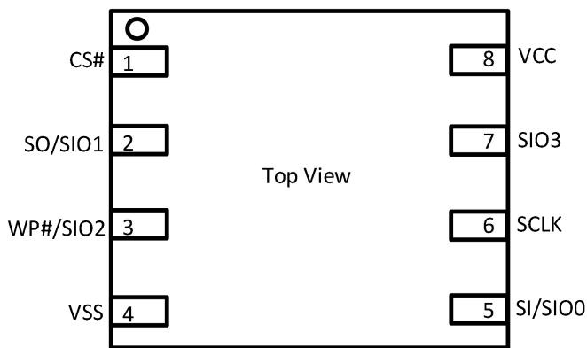

Figure1. Connection Diagram

Pin Description

<table><tr><td>PIN NO.</td><td>PIN NAME</td><td>I/O</td><td>FUNCTION</td></tr><tr><td>1</td><td>CS#</td><td>I</td><td>Chip Select Input</td></tr><tr><td>2</td><td>SO (SIO1)</td><td>I/O</td><td>Data Output (Data Input Output 1)<eq>^{(1)(2)}</eq></td></tr><tr><td>3</td><td>WP# (SIO2)</td><td>I/O</td><td>Write Protect Input (Data Input Output 2)<eq>^{(2)(3)}</eq></td></tr><tr><td>4</td><td>VSS</td><td></td><td>Ground</td></tr><tr><td>5</td><td>SI (SIO0)</td><td>I/O</td><td>Data Input (Data Input Output 0)<eq>^{(1)(2)}</eq></td></tr><tr><td>6</td><td>SCLK</td><td>I</td><td>Serial Clock Input</td></tr><tr><td>7</td><td><eq>SIO_3</eq></td><td>I/O</td><td>Data Input Output 3<eq>^{(2)}</eq></td></tr><tr><td>8</td><td>VCC</td><td></td><td>Power Supply</td></tr></table>

## Notes:

1.SIO0 and SIO1 are used for Dual SPI instructions. 

2.SIO0 – SIO3 are used for Quad SPI instructions 

## 4. Block Diagram

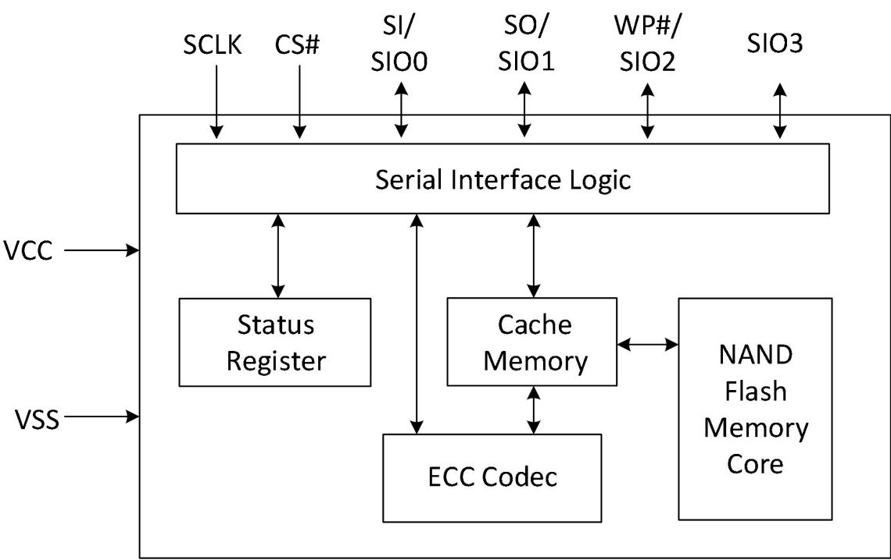

Figure2. Block Diagram

## 5. Memory Mapping

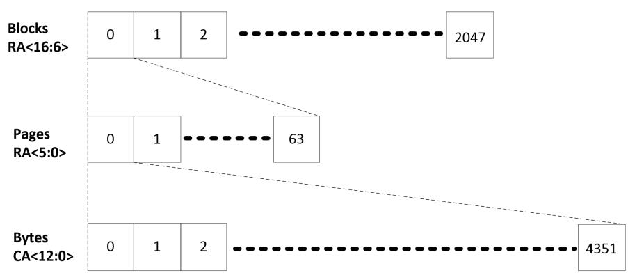

## Note:

The 13-bit column address is capable of addressing from 0 to 8191 bytes; However, only bytes 0 through 4351 are valid. 

Bytes 4352 through 8191 of each page are “out of bounds", do not exist in the device, and cannot be addressed. 

## 6. Array Organization

Table1. Array Organization

<table><tr><td>Each device has</td><td>Each block has</td><td>Each page has</td><td>Unit</td></tr><tr><td>512M + 32M</td><td>256K + 16K</td><td>4K + 256</td><td>Bytes</td></tr><tr><td>2048 x 64</td><td>64</td><td>-</td><td>Pages</td></tr><tr><td>2048</td><td>-</td><td>-</td><td>Blocks</td></tr></table>

Figure3. Array Organization

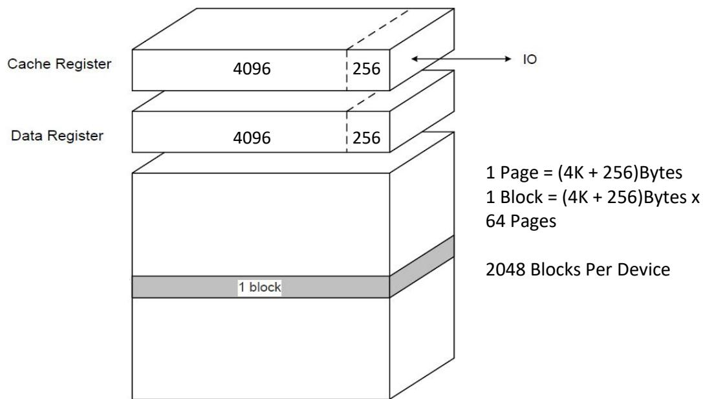

## 7. Device Operation

## 7.1 SPI Modes

## 7.1.1 Standard SPI

The device is accessed through an SPI compatible bus consisting of four signals: Serial Clock (CLK), Chip Select (CS#), Serial Data Input (SI) and Serial Data Output (SO). Standard SPI instructions use the SI input pin to serially write instructions, addresses or data to the device on the rising edge of CLK. The SO output pin is used to read data or status from the device on the falling edge of CLK. 

SPI bus operation Mode 0 (0,0) and 3 (1,1) are supported. The primary difference between Mode 0 and Mode 3 concerns the normal state of the CLK signal when the SPI bus master is in standby and data is not being transferred to the Serial Flash. For Mode 0, the CLK signal is normally low on the falling and rising edges of CS#. For Mode 3, the CLK signal is normally high on the falling and rising edges of CS#. 

Figure4. SPI SDR Modes Supported

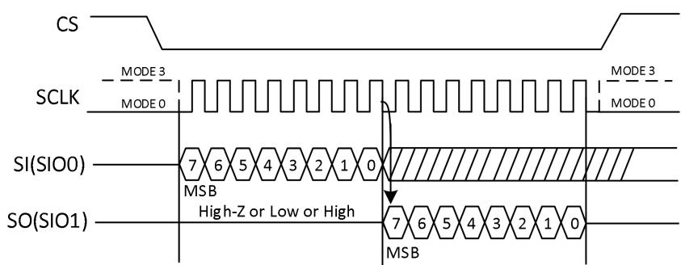

## 7.1.2 Dual SPI

The device supports Dual SPI operation when using the x2 and dual IO instructions. These instructions allow data to be transferred to or from the device at two times the rate of ordinary Serial Flash devices. When using Dual SPI instructions, the SI and SO pins become bidirectional I/O pins: SIO0 and SIO1. 

## 7.1.3 Quad SPI

The device supports Quad SPI operation when using the x4 and Quad IO instructions. These instructions allow data to be transferred to or from the device four times the rate of ordinary Serial Flash. When using Quad SPI instructions the SI and SO pins become bidirectional SIO0 and SIO1 and the WP# pins becomes SIO2. Quad SPI instructions require the Quad Enable bit (QE) to be set. 

## 7.2 Pin Description

## 7.2.1 CS#

The SPI Chip Select (CS#) pin enables and disables device operation. When CS# is high, the device is deselected and the Serial Data Output (SIO0, SIO1, SIO2, SIO3) pins are at high impedance. When deselected, the devices power consumption will be at standby levels unless an internal erase, program or write status register cycle is in progress. When CS# is brought low, the device will be selected, power consumption will increase to active levels and instructions can be written to and data read from the device. After power-up, CS# must transition from high to low before a new instruction will be accepted. 

## 7.2.2 CLK

This input signal provides the synchronization reference for the SPI interface. Instructions, addresses, or data input are latched on the rising edge of the CLK signal. Data output changes after the falling edge of CLK. 

## 7.2.3 Serial Input (SI) / SIO0

This input signal is used to transfer data serially into the device. It receives instructions, addresses, and data to be programmed. Values are latched on the rising edge of serial CLK clock signal. 

SI becomes SIO0 – an input and output during Dual and Quad commands for receiving instructions, addresses, and data to be programmed (values latched on rising edge of serial CLK clock signal) as well as shifting out data (on the falling edge of CLK). 

## 7.2.4 Serial Output (SO) / SIO1

This output signal is used to transfer data serially out of the device. Data is shifted out on the falling edge of the serial CLK clock signal. 

SO becomes SIO1 -an input and output during Dual and Quad commands for receiving addresses, and data to be programmed (values latched on rising edge of serial CLK clock Signal) as well as shifting out data (on the falling edge of CLK). 

## 7.2.5 Write Protect (WP#) / SIO2

SPI NAND provides Hardware Protection Mode besides the Software Mode. Write Protect (WP#) prevents the block lock bits (BP0, BP1, BP2 and INV, CMP) from being overwritten. If the BRWD bit is set to 1 and WP# is LOW, the block protect bits cannot be altered. 

When WP# is driven Low (VIL), during a SET FEATURES command and while the BRWD bit of the Status Register is set to a 1, it is not possible to write to the Status Registers. This prevents any alteration of the Block Protect (BP2, BP1, BP0), INV and CMP bits of the Status Register. As a consequence, all the data bytes in the memory area that are protected by the Block Protect(BP2, BP1,BP0), INV and CMP bits, are also hardware protected against data modification if WP# is Low during a SET FEATURES command. The WP# function is not available when the Quad mode is enabled (QE=1). 

The WP# function is replaced by SIO2 for input and output during Quad mode for receiving addresses, and data to be programmed (values are latched on rising edge of the CLK signal) as well as shifting out data (on the falling edge of CLK). 

## 7.2.6 SIO3

For Standard and Dual SPI Command Sets ,keep SIO3 pin always high level. For Quad SPI Command Sets, keep SIO3 pin high level when SIO3 is not in input and output state. 

## 7.3 Command Set Tables

Table2. Standard SPI Command Set

<table><tr><td>INSTRUCTION NAME</td><td>BYTE 1</td><td>BYTE 2</td><td>BYTE 3</td><td>BYTE 4</td><td>BYTE 5</td><td>BYTE N</td></tr><tr><td>WRITE ENABLE</td><td>06h</td><td></td><td></td><td></td><td></td><td></td></tr><tr><td>WRITE DISABLE</td><td>04h</td><td></td><td></td><td></td><td></td><td></td></tr><tr><td>GET FEATURES</td><td>0Fh</td><td>A7-A0</td><td>(D7-D0)</td><td><eq>wrap^{(8)}</eq></td><td><eq>wrap^{(8)}</eq></td><td><eq>wrap^{(8)}</eq></td></tr><tr><td>SET FEATURES</td><td>1Fh</td><td>A7-A0</td><td>D7-D0</td><td></td><td></td><td></td></tr><tr><td>PAGE READ</td><td>13h</td><td>A23-A16</td><td>A15-A7</td><td>A7-A0</td><td></td><td></td></tr><tr><td>READ FROM CACHE</td><td>03h/0Bh</td><td><eq>A15-A8^{(1)}</eq></td><td>A7-A0</td><td>dummy</td><td>(D7-D0)</td><td>Byte N</td></tr><tr><td>READ ID</td><td>9Fh</td><td>00</td><td><eq>(MID)^{(6)}</eq></td><td><eq>(DID)^{(6)}</eq></td><td></td><td></td></tr><tr><td>READ UID</td><td>4Bh</td><td>dummy</td><td>dummy</td><td>0x00</td><td>dummy</td><td>D127-D0</td></tr><tr><td>PROGRAM LOAD</td><td>02h</td><td><eq>A15-A8^{(1)}</eq></td><td>A7-A0</td><td>D7-D0</td><td>Next byte</td><td>Byte N</td></tr><tr><td>PROGRAM LOAD RANDOM <eq>DATA^{(7)}</eq></td><td>84h</td><td><eq>A15-A8^{(1)}</eq></td><td>A7-A0</td><td>D7-D0</td><td>Next byte</td><td>Byte N</td></tr><tr><td>PROGRAM EXECUTE</td><td>10h</td><td>A23-A16</td><td>A15-A7</td><td>A7-A0</td><td></td><td></td></tr><tr><td>BLOCK ERASE</td><td>D8h</td><td>A23-A16</td><td>A15-A7</td><td>A7-A0</td><td></td><td></td></tr><tr><td>RESET</td><td>FFh</td><td></td><td></td><td></td><td></td><td></td></tr></table>

Table3. Dual SPI Command Set

<table><tr><td>INSTRUCTION NAME</td><td>BYTE 1</td><td>BYTE 2</td><td>BYTE 3</td><td>BYTE 4</td><td>BYTE 5</td><td>BYTE N</td></tr><tr><td>READ FROM CACHE x 2</td><td>3Bh</td><td><eq>A15-A8^{(1)}</eq></td><td>A7-A0</td><td>dummy</td><td>(D7-D0)x2</td><td>-</td></tr><tr><td>READ FROM CACHE DUAL IO</td><td>BBh</td><td><eq>A15-A0^{(2)}</eq></td><td>dummy<eq>^{(3)}</eq></td><td>(D7-D0)x2</td><td>Next byte</td><td>-</td></tr></table>

Table4. Quad SPI Command Set

<table><tr><td>INSTRUCTION NAME</td><td>BYTE 1</td><td>BYTE 2</td><td>BYTE 3</td><td>BYTE 4</td><td>BYTE 5</td><td>BYTE N</td></tr><tr><td>READ FROM CACHE x4</td><td>6Bh</td><td><eq>A15-A8^{(1)}</eq></td><td>A7-A0</td><td>dummy</td><td>(D7-D0)x4</td><td>Byte N</td></tr><tr><td>READ FROM CACHE QUAD IO</td><td>EBh</td><td><eq>A15-A0^{(4)}</eq></td><td>(D7-D0)x4</td><td>Next byte</td><td>Next byte</td><td>Byte N</td></tr><tr><td>PROGRAM LOAD x4</td><td>32h</td><td><eq>A15-A8^{(1)}</eq></td><td>A7-A0</td><td>(D7-D0) x4</td><td>Next byte</td><td>Byte N</td></tr><tr><td>PROGRAM LOAD RANDOM DATA <eq>x4^{(7)}</eq></td><td>C4h/34h</td><td><eq>A15-A8^{(1)}</eq></td><td>A7-A0</td><td>(D7-D0) x4</td><td>Next byte</td><td>Byte N</td></tr><tr><td>PROGRAM LOAD RANDOM DATA Quad <eq>IO^{(7)}</eq></td><td>72h</td><td><eq>A15-A0^{(5)}</eq></td><td>(D7-D0) x4</td><td>Next byte</td><td>Next byte</td><td>Byte N</td></tr></table>

## Notes:

1.The x8 clock = dummy <2:0>, A12-A8 

2.The x8 clock = dummy <2:0>, A12-A0 

3.The x8 clock = dummy <7:0>, D7-D0 

4.The x8 clock = dummy <2:0>, A12-A0,dummy<7:0>,D7-D0 

5.The x8 clock = dummy <2:0>, A12-A0,D7-D0,D7-D0 

6.MID is Manufacture ID, DID is Device ID 

7.Only available in Internal Data Move operation 

8.GET FEATURES(0FH), address=0XC0, wrap function 

## 7.4 WRITE OPERATIONS

## 7.4.1 Write Enable (WREN) (06H)

The Write Enable (WREN) command is for setting the Write Enable Latch (WEL) bit. The Write Enable Latch (WEL) bit must be set prior to following operations that change the contents of the memory array: 

 Page Program 

 OTP Program 

 OTPLock 

 BLOCK ERASE 

Figure5. Write Enable Sequence Diagram

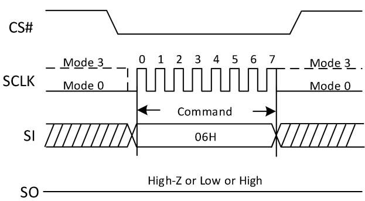

## 7.4.2 WRITE DISABLE (WRDI) (04h)

The Write Disable command is for resetting the Write Enable Latch (WEL) bit. The WEL bit is also reset by following condition: 

 Page Program 

 OTP Program 

 OTPLock 

 BLOCK ERASE 

Figure6. Write Disable Sequence Diagram

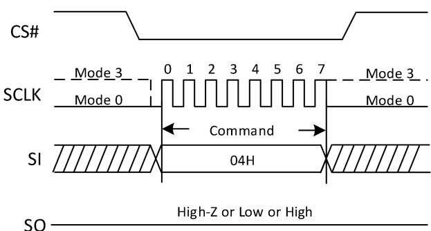

## 7.5 FEATURE OPERATIONS

## 7.5.1 Get Features (0FH) and Set Features (1FH)

The GET FEATURES (0Fh) and SET FEATURES (1Fh) commands are used to monitor the device status and alter the device behavior from the default power-on behavior. These commands use a 1-byte feature address to determine which feature is to be read or modified. Features such as OTP and block locking can be enabled or disabled by setting specific bits in feature address A0h and B0h (shown the following table). The status register is mostly read, except WEL, which is writable bit with the WREN (06h) command. 

When a feature is set, it remains active until the device is power cycled or the feature is written to. Unless otherwise specified in the following table, once the device is set, it remains set, even if a RESET (FFh) command is issued. 

Table5. Features Settings

<table><tr><td rowspan="2">Register</td><td rowspan="2">Address</td><td colspan="8">Data Bits</td></tr><tr><td>7</td><td>6</td><td>5</td><td>4</td><td>3</td><td>2</td><td>1</td><td>0</td></tr><tr><td>Block Lock</td><td>A0H</td><td>BRWD</td><td>Reserved</td><td>BP2</td><td>BP1</td><td>BPO</td><td>INV</td><td>CMP</td><td>Reserved</td></tr><tr><td>Feature</td><td>BOH</td><td>OTP_PRT</td><td>OTP_EN</td><td>Reserved</td><td>ECC_EN</td><td>Reserved</td><td>Reserved</td><td>Reserved</td><td>QE</td></tr><tr><td>Status</td><td>COH</td><td>ECCS3</td><td>ECCS2</td><td>ECCS1</td><td>ECCSO</td><td>P_FAIL</td><td>E_FAIL</td><td>WEL</td><td>OIP</td></tr><tr><td>Drive Strength</td><td>DOH</td><td>Reserved</td><td>DS_IO[1]</td><td>DS_IO[0]</td><td>Reserved</td><td>Reserved</td><td>Reserved</td><td>Reserved</td><td>Reserved</td></tr></table>

## Note:

1.If BRWD is enabled and WP# is low, then the block lock register (BP2-BP0, INV and CMP) cannot be changed. 

2.If QE is enabled, the quad IO operations can be executed. 

3.All the reserved bits must be held low when the feature is set. 

4.The features in the feature byte B0H are all volatile except OTP_PRT bit. 

5.ECC is always on(ECC_EN is invalid) for current product. 

6.DS_IO[1] and DS_IO[0]:IO driver strength setting. 

<table><tr><td>DS_IO[1]</td><td>DS_IO[0]</td><td>IO driver strength</td></tr><tr><td>0</td><td>0</td><td>25%(Default)</td></tr><tr><td>0</td><td>1</td><td>50%</td></tr><tr><td>1</td><td>0</td><td>75%</td></tr><tr><td>1</td><td>1</td><td>100%</td></tr></table>

Figure7. Get Features Sequence Diagram

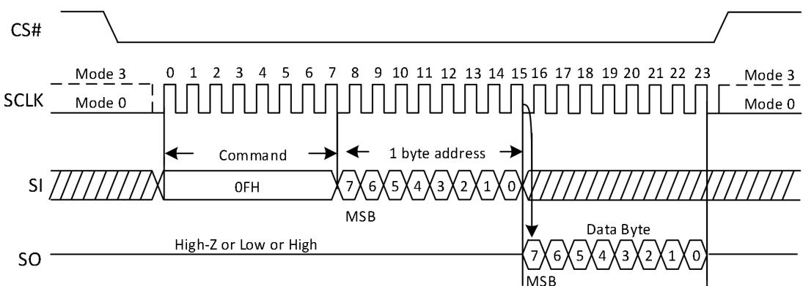

Figure8. Set Features Sequence Diagram

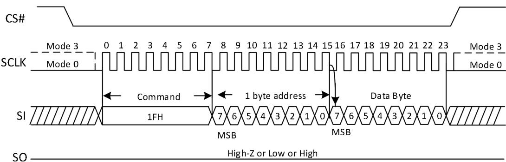

## 7.6 READ OPERATIONS

## 7.6.1 Page Read

The PAGE READ (13h) command transfers the data from the NAND Flash array to the cache register. The command sequence is follows: 

1.13h (PAGE READ TO CACHE) 

2.0Fh (GET FEATURES command to read the status) 

Monitor whether the status of the operation is finished 

3.0Bh or 03h (READ FROM CACHE) 

Requires mode configure bits, followed by 13-bit column address for the starting byte address 

Other Operation： 

 3Bh (READ FROM CACHE x2) 

 6Bh (READ FROM CACHE x4) 

 BBh (READ FROM CACHE DUAL IO) 

 EBh (READ FROM CACHE QUAD IO) 

The PAGE READ command requires a 24-bit address consisting of 7 dummy bits followed by a 17-bit block/page address. After the block/page addresses are registered, the device starts the transfer from the main array to the cache register, and is busy for tRD time. During this time, the GET FEATURES (0Fh) command can be issued to monitor the status of the operation (refer to the Status Register section). Following a status of successful completion, the READ FROM CACHE (03h/0Bh/3Bh/6Bh/BBh/EBh) command must be issued in order to read the data out of the cache. 

The device supports pre-read function. When reading multiple pages continuously, the average tRD is shortened. 

## 7.6.2 Page Read to Cache (13H)

Figure9. Page Read to cache Sequence Diagram

## 7.6.3 Read From Cache (03H or 0BH)

Figure10. Read From Cache Sequence Diagram

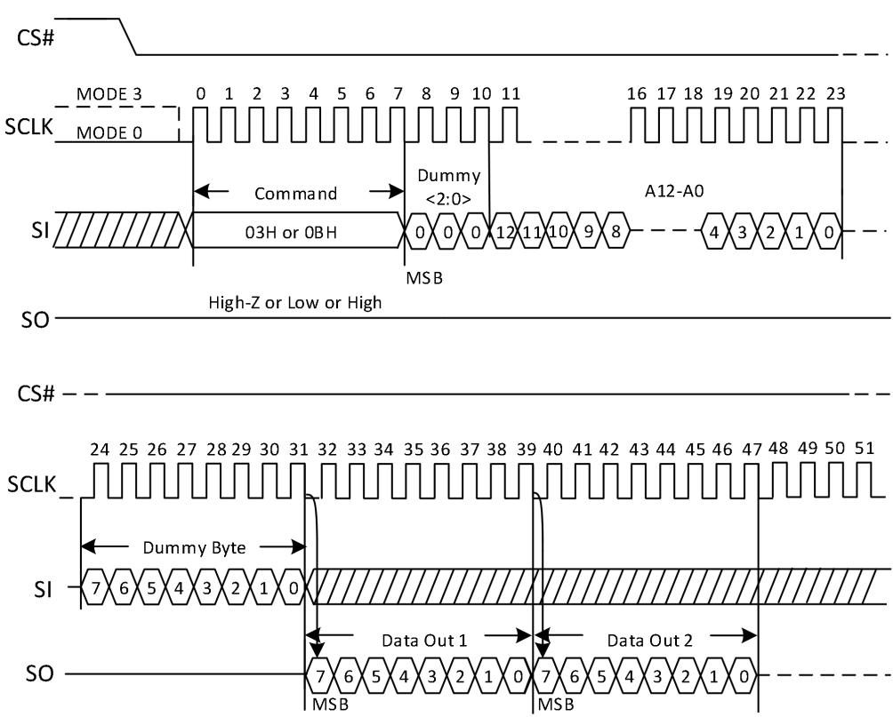

## 7.6.4 Read From Cache x2 (3BH)

Figure11. Read From Cache x2 Sequence Diagram

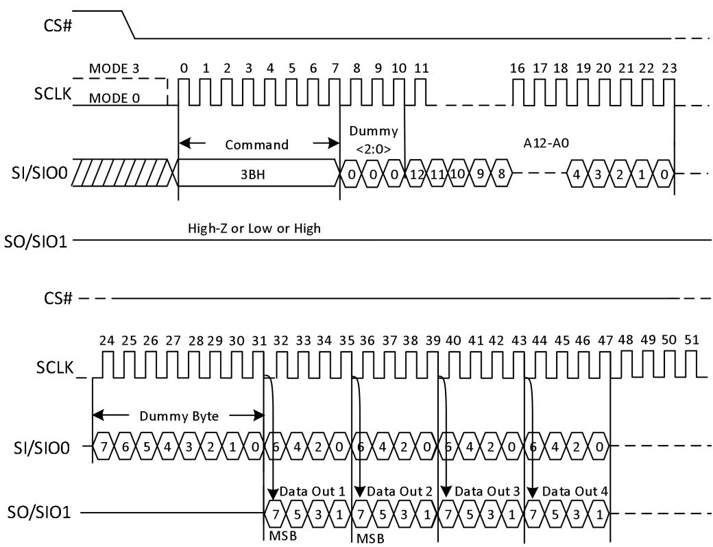

## 7.6.5 Read From Cache x4 (6BH)

The Quad Enable bit (QE) of feature (B0 [0]) must be set to enable for the read from cache x4 command. 

Figure12. Read From Cache x4 Sequence Diagram

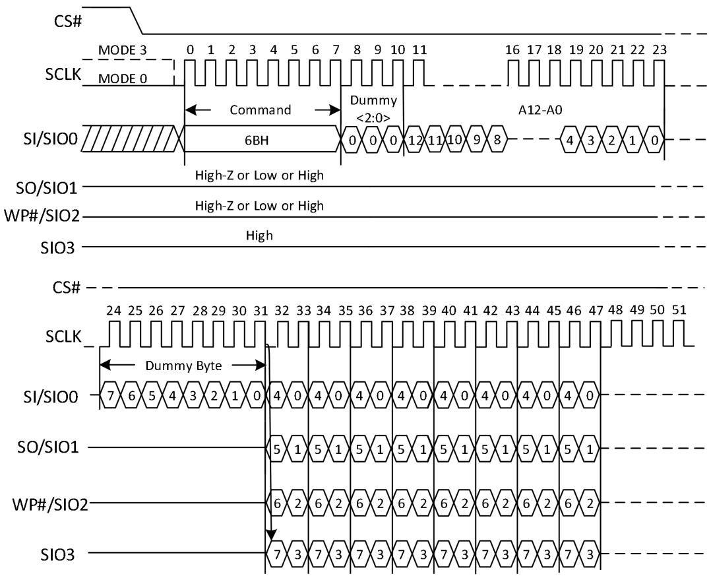

## 7.6.6 Read From Cache Dual IO (BBH)

The Read from Cache Dual I/O command (BBH) is similar to the Read form Cache x2 command (3BH) but with the capability to input the 3 dummy bits, followed by a 13-bit column address for the starting byte address and a dummy byte by SIO0 and SIO1, each bit being latched in during the rising edge of SCLK, then the cache contents are shifted out 2-bit per clock cycle from SIO0 and SIO1. The first byte addressed can be at any location. The address is automatically incremented to the next higher address after each byte of data is shifted out until the boundary by the dummy<2:0>. 

Figure13. Read From Cache Dual IO Sequence Diagram

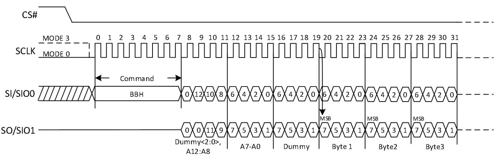

## 7.6.7 Read From Cache Quad IO (EBH)

The Read from Cache Quad IO command is similar to the Read from Cache x4 command but with the capability to input the 3 dummy bits, followed a 13-bit column address for the starting byte address and a dummy byte by SIO0, SIO1, SIO2, SIO3, each bit being latched in during the rising edge of SCLK, then the cache contents are shifted out 4-bit per clock cycle from SIO0, SIO1, SIO2, SIO3. The first byte addressed can be at any location. The address is automatically incremented to the next higher address after each byte of data is shifted out until the boundary by the dummy<2:0>. The Quad Enable bit (QE) of feature (B0 [0]) must be set to enable for the read from cache quad IO command. 

Figure14. Read From Cache Quad IO Sequence Diagram

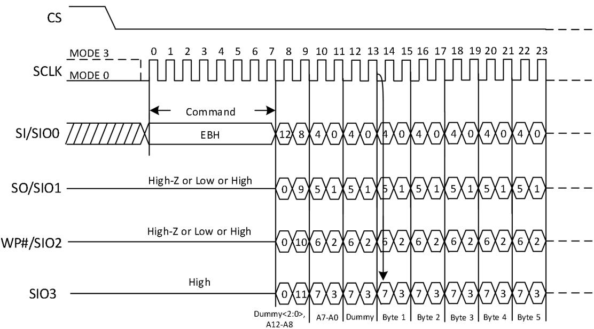

## 7.6.8 Read ID (9FH)

The READ ID command is used to read the 2 bytes of identifier code programmed into the NAND Flash device. The READ ID command reads a 2-byte table (see below) that includes the Manufacturer ID and the device configuration. 

Figure15. Read ID Sequence Diagram

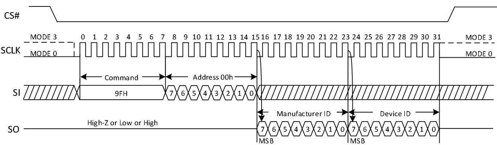

Table6. READ ID Table

<table><tr><td>Address</td><td>Value</td><td>Description</td></tr><tr><td>Byte 0</td><td>0BH</td><td>Manufacture ID (XTX)</td></tr><tr><td>Byte 1</td><td>13H</td><td>Device ID (SPI NAND 3.3V 4Gbit)</td></tr></table>

## 7.6.1 Read UID (4BH)

The READ UID instruction accesses a factory-set read-only 128-bit number that is unique to each device. The ID number can be used in conjunction with user software methods to help prevent copying or cloning of a system. 

Figure16. Read UID (4Bh) Timing

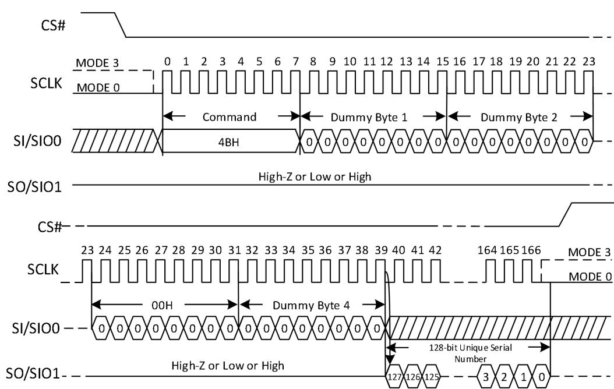

## 7.7 PROGRAM OPERATIONS

## 7.7.1 Page Program

The PAGE PROGRAM operation sequence programs 1 byte to 4352 bytes of data within a page. The page program sequence is as follows: 

 02H (PROGRAM LOAD)/32H (PROGRAM LOAD x4) 

 06H (WRITE ENABLE) 

 10H (PROGRAM EXECUTE) 

 0FH (GET FEATURES command to read the status) 

The 1st step is to issue a PROGRAM LOAD (02H/32H) command. PROGRAM LOAD consists of an 8-bit Op code, followed by 3 dummy bits and a 13-bit column address, then the data bytes to be programmed. The data bytes are loaded into a cache register which is 4352 bytes long. If more than 4352 bytes are loaded, then those additional bytes are ignored by the cache register. The command sequence ends when CS# goes from low to high. 

The 2nd step, prior to performing the PROGRAM EXECUTE operation, is to issue a WRITE ENABLE (06H) command. As with any command that changes the memory contents, the WRITE ENABLE must be executed in order to set the WEL bit. If this command is not issued, then the rest of the program sequence is ignored. 

The 3rd step is to issue a PROGRAM EXECUTE (10h) command to initiate the transfer of data from the cache register to the main array. PROGRAM EXECUTE consists of an 8-bit Op code, followed by a 24-bit address (7 dummy bits and a 17-bit page/block address). After the page/block address is registered, the memory device starts the transfer from the cache register to the main array, and is busy for tPROG time. 

During this busy time, the status register can be polled to monitor the status of the operation (refer to the Status Register section). When the operation completes successfully, the next series of data can be loaded with the PROGRAM LOAD command. 

## Note :

The number of consecutive partial page programming operations (NOP) within the same page must not exceed 4. In addition, pages must be sequentially programmed within a block. 

## 7.7.2 Program Load (PL)(02H)

Figure17. Program Load Sequence Diagram

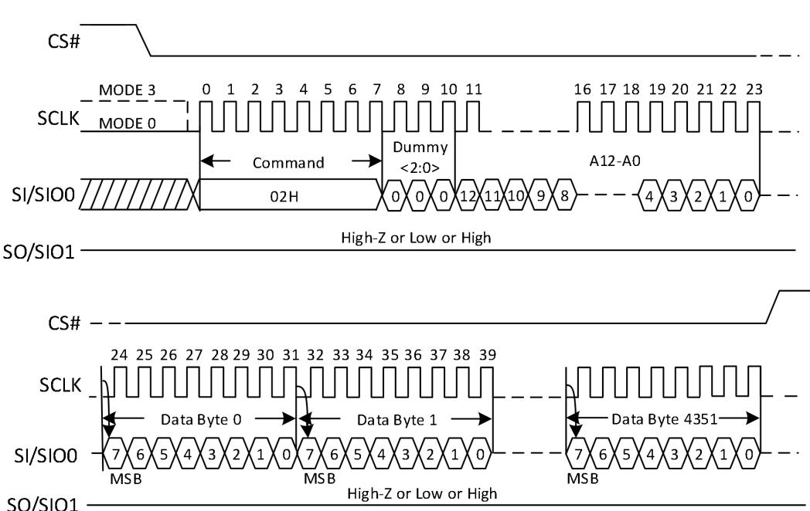

## 7.7.3 Program Load x4 (PL x4) (32H)

The Program Load x4 command (32H) is similar to the Program Load command (02H) but with the capability to input the data bytes by four pins: SIO0, SIO1, SIO2, and SIO3. The command sequence is shown below. The Quad Enable bit (QE) of feature (B0 [0]) must be set to enable for the program load x4 command. 

Figure18. Program Load x4 Sequence Diagram

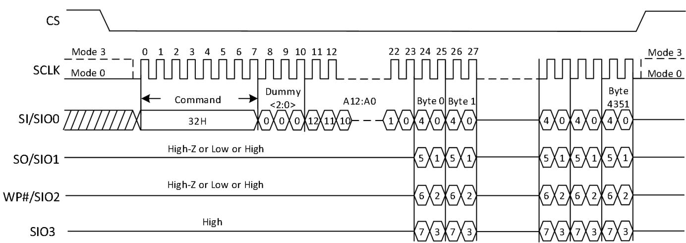

## 7.7.4 Program Execute (PE) (10H)

After the data is loaded, a PROGRAM EXECUTE (10H) command must be issued to initiate the transfer of data from the cache register to the main array. PROGRAM EXECUTE consists of an 8-bit Op code, followed by a 24-bit address (7 dummy bits and a 17-bit page/block address). After the page/block address is registered, the memory device starts the transfer from the cache register to the main array, and is busy for tPROG time. During this busy time, the status register can be polled to monitor the status of the operation (refer to Status Register). When the operation completes successfully, the next series of data can be loaded with the PROGRAM LOAD command. 

Figure19. Program Execute Sequence Diagram

## 7.7.5 Internal Data Move

The Internal Data Move command sequence programs or replaces data in a page with existing data. The Internal Data Move command sequence is as follows: 

 13H (PAGE READ TO CACHE) 

 84H/C4H/ 34H/72H(PROGRAM LOAD RANDOM DATA : Optional) 

 06H (WRITE ENABLE) 

 10H (PROGRAM EXECUTE) 

 0FH (GET FEATURES command to read the status) 

Prior to performing an internal data move operation, the target page content must be read out into the cache register by issuing a PAGE READ (13H) command. The PROGRAM LOAD RANDOM DATA (84H/C4H/34H/72H) command can be issued, if user wants to update bytes of data in the page. 

New data is loaded in the 13-bit column address. If the RANDOM DATA is not sequential, another PROGRAM LOAD RANDOM DATA (84H/C4H/34H/72H) command must be issued with the new column address. After the data is loaded, the WRITE ENABLE command must be issued, and then a PROGRAM EXECUTE (10H) command can be issued to start the programming operation. 

## 7.7.6 Program Load Random Data (84H)

This command consists of an 8-bit Op code, followed by 3 dummy bits, and a 13-bit column address. New data is loaded in the column address provided with the 13 bits. If the random data is not sequential, then another PROGRAM LOAD RANDOM DATA (84h) command must be issued with a new column address. After the data is loaded, a PROGRAM EXECUTE (10h) command can be issued to start the programming operation. 

Figure20. Program Load Random Data Sequence Diagram

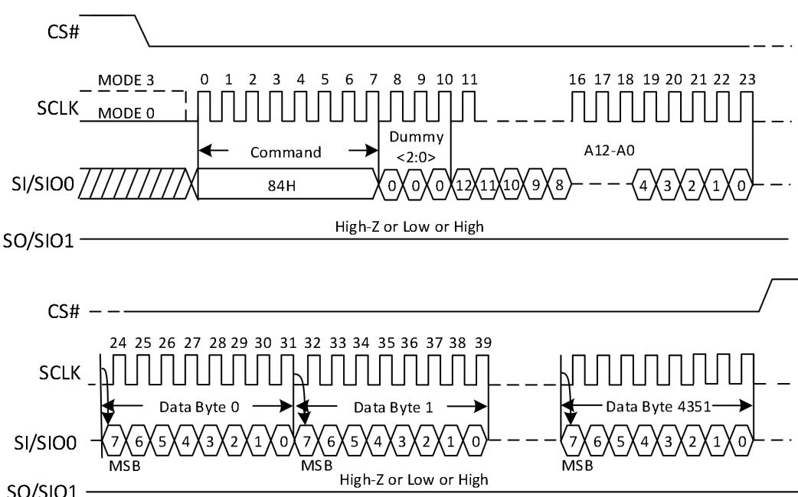

## 7.7.7 Program Random Data x4 (C4H/34H)

The Program Load Random Data x4 command (C4H) is similar to the Program Load Random Data command (84H) but with the capability to input the data bytes by four pins: SIO0, SIO1, SIO2, and SIO3. The command sequence is shown below. The Quad Enable bit (QE) of feature (B0 [0]) must be set to enable for the program load random data x4 command. 

Figure21. Program Load Random Data x4 Sequence Diagram

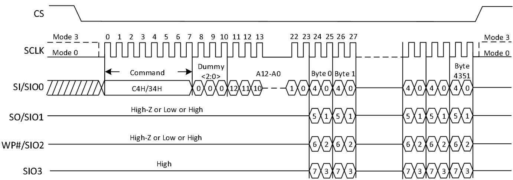

## 7.7.8 Program Random Quad IO (72H)

The Program Load Random Data Quad IO command (72H) is similar to the Program Load Random Data x4 command (C4H) but with the capability to input the 3 dummy bits, and a 13-bit column address by four pins: SIO0, SIO1, SIO2, and SIO3. The command sequence is shown below. The Quad Enable bit (QE) of feature (B0 [0]) must be set to enable for the program load random data x4 command. 

Figure22. Program Load Random Data Quad IO Sequence Diagram

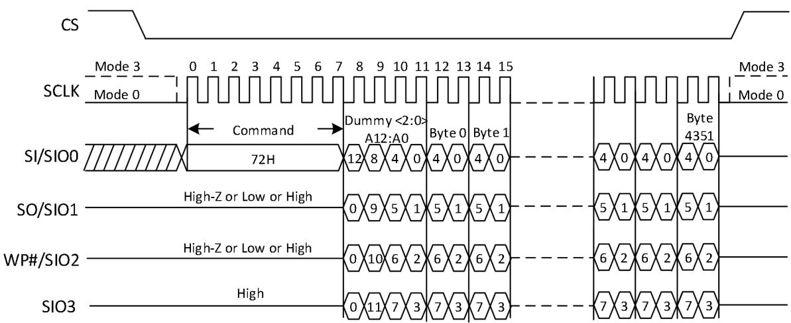

## 7.8 ERASE OPERATIONS

## 7.8.1 Block Erase (D8H)

The BLOCK ERASE (D8h) command is used to erase at the block level. The blocks are organized as 64 pages per block, 4352 bytes per page (4096+256 bytes). Each block is 272Kbytes. The BLOCK ERASE command (D8h) operates on one block at a time. The command sequence for the BLOCK ERASE operation is as follows: 

 06h (WRITE ENBALE command) 

 D8h (BLOCK ERASE command) 

 0Fh (GET FEATURES command to read the status register) 

Prior to performing the BLOCK ERASE operation, a WRITE ENABLE (06h) command must be issued. As with any command that changes the memory contents, the WRITE ENABLE command must be executed in order to set the WEL bit. If the WRITE ENABLE command is not issued, then the rest of the erase sequence is ignored. A WRITE ENABLE command must be followed by a BLOCK ERASE (D8h) command. This command requires a 24-bit address. After the row address is registered, the control logic automatically controls timing and erase-verify operations. The device is busy for tERS time during the BLOCK ERASE operation. The GET FEATURES (0Fh) command can be used to monitor the status of the operation (refer to the Status Register section). 

## Note:

When a BLOCK ERASE operation is in progress, user can issue READ FROM CACHE commands (03H/0BH/3BH/6BH/BBH/EBH) to read the data in the cache. 

Figure23. Block Erase Sequence Diagram

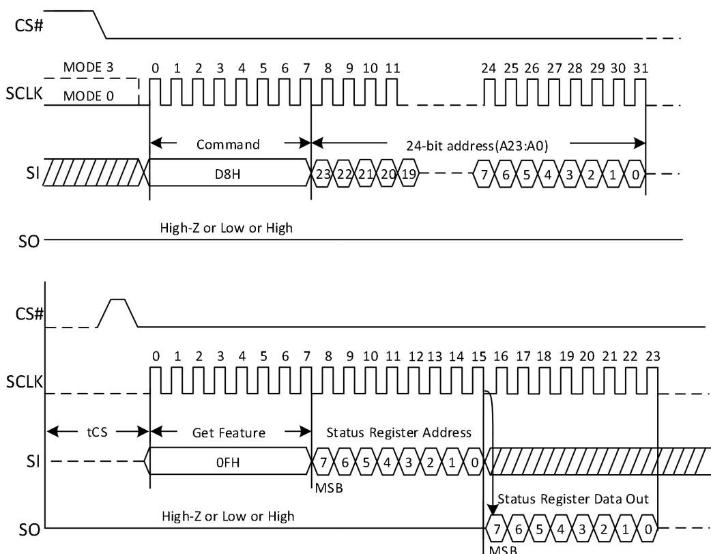

## 7.9 RESET OPERATIONS

The RESET (FFh) command stops all operations. For example, in case of a program or erase or read operation, the reset command can make the device enter the wait state. 

7.9.1 RESET (FFh) 

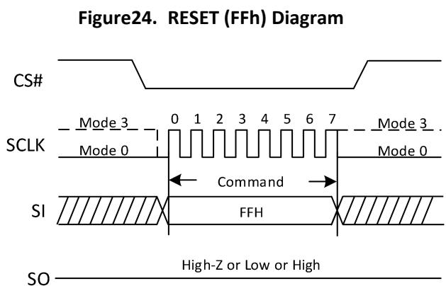

## 7.10 WRITE PROTECT

The write protection will be determined by the combination of CMP, INV, BP[2:0] bits in the Block Lock Register (A0). 

The block lock feature provides the ability to protect the entire device, or ranges of blocks, from the PROGRAM and ERASE operations. After power-up, the device is in the “locked” state, i.e., feature bits BP0, BP1and BP2are set to 1, INV, CMP and BRWD are set to 0. To unlock all the blocks, or a range of blocks, the SET FEATURES command must be issued to alter the state of protection feature bits. When BRWD is set and WP# is LOW, none of the writable protection feature bits can be set. Also, when a PROGRAM/ERASE command is issued to a locked block, status bit OIP remains 0.When an ERASE command is issued to a locked block, the erase failure, 04H is returned. When a PROGRAM command is issued to a locked block, program failure, 08h is returned 

Table7. Block Lock Register Block Protect Bits

<table><tr><td>CMP</td><td>INV</td><td>BP2</td><td>BP1</td><td>BPO</td><td>Protected Row Address</td><td>Protected Rows</td></tr><tr><td>x</td><td>x</td><td>0</td><td>0</td><td>0</td><td>None</td><td>None</td></tr><tr><td>0</td><td>0</td><td>0</td><td>0</td><td>1</td><td>1F800h ~1FFFFh</td><td>Upper 1/64</td></tr><tr><td>0</td><td>0</td><td>0</td><td>1</td><td>0</td><td>1F000h ~1FFFFh</td><td>Upper 1/32</td></tr><tr><td>0</td><td>0</td><td>0</td><td>1</td><td>1</td><td>1E000h ~1FFFFh</td><td>Upper 1/16</td></tr><tr><td>0</td><td>0</td><td>1</td><td>0</td><td>0</td><td>1C000h ~1FFFFh</td><td>Upper 1/8</td></tr><tr><td>0</td><td>0</td><td>1</td><td>0</td><td>1</td><td>18000h ~1FFFFh</td><td>Upper 1/4</td></tr><tr><td>0</td><td>0</td><td>1</td><td>1</td><td>0</td><td>10000h ~1FFFFh</td><td>Upper 1/2</td></tr><tr><td>x</td><td>x</td><td>1</td><td>1</td><td>1</td><td>All (default)</td><td>All (default)</td></tr><tr><td>0</td><td>1</td><td>0</td><td>0</td><td>1</td><td>00000h ~007FFh</td><td>Lower 1/64</td></tr><tr><td>0</td><td>1</td><td>0</td><td>1</td><td>0</td><td>00000h ~00FFFh</td><td>Lower 1/32</td></tr><tr><td>0</td><td>1</td><td>0</td><td>1</td><td>1</td><td>00000h ~01FFFh</td><td>Lower 1/16</td></tr><tr><td>0</td><td>1</td><td>1</td><td>0</td><td>0</td><td>00000h ~03FFFh</td><td>Lower 1/8</td></tr><tr><td>0</td><td>1</td><td>1</td><td>0</td><td>1</td><td>00000h ~07FFFh</td><td>Lower 1/4</td></tr><tr><td>0</td><td>1</td><td>1</td><td>1</td><td>0</td><td>00000h ~0FFFFh</td><td>Lower 1/2</td></tr><tr><td>1</td><td>0</td><td>0</td><td>0</td><td>1</td><td>00000h ~1F7FFh</td><td>Lower 63/64</td></tr><tr><td>1</td><td>0</td><td>0</td><td>1</td><td>0</td><td>00000h ~1FFFFh</td><td>Lower 31/32</td></tr><tr><td>1</td><td>0</td><td>0</td><td>1</td><td>1</td><td>00000h ~1DFFFh</td><td>Lower 15/16</td></tr><tr><td>1</td><td>0</td><td>1</td><td>0</td><td>0</td><td>00000h ~1BFFFh</td><td>Lower 7/8</td></tr><tr><td>1</td><td>0</td><td>1</td><td>0</td><td>1</td><td>00000h ~17FFFh</td><td>Lower 3/4</td></tr><tr><td>1</td><td>0</td><td>1</td><td>1</td><td>0</td><td>00000h ~0003Fh</td><td>Block0</td></tr><tr><td>1</td><td>1</td><td>0</td><td>0</td><td>1</td><td>00800h ~1FFFFh</td><td>Upper 63/64</td></tr><tr><td>1</td><td>1</td><td>0</td><td>1</td><td>0</td><td>01000h ~1FFFFh</td><td>Upper 31/32</td></tr><tr><td>1</td><td>1</td><td>0</td><td>1</td><td>1</td><td>02000h ~1FFFFh</td><td>Upper 15/16</td></tr><tr><td>1</td><td>1</td><td>1</td><td>0</td><td>0</td><td>04000h ~1FFFFh</td><td>Upper 7/8</td></tr><tr><td>1</td><td>1</td><td>1</td><td>0</td><td>1</td><td>08000h ~1FFFFh</td><td>Upper 3/4</td></tr><tr><td>1</td><td>1</td><td>1</td><td>1</td><td>0</td><td>00000h ~0003Fh</td><td>Block0</td></tr></table>

When WP# is not LOW, user can issue bellows commands to alter the protection states as want. 

 Issue SET FEATURES register write (1FH) 

 Issue the feature bit address (A0H) and the feature bits combination as the table 

## 8. Status Register

The device has an 8-bit status register that software can read during the device operation for operation state query. The status register can be read by issuing the GET FEATURES (0FH) command, followed by the feature address C0h (see FEATURE OPERATION).The Output Driver Register can be set and read by issuing the SET FEATURES (0FH)and GET FEATURES command followed by the feature address D0h(see FEATURE OPERATION). 

Table8. Status Register Bit Description

<table><tr><td>Bit</td><td>Bit Name</td><td>Description</td></tr><tr><td>ECCS3 ECCS2ECCS1 ECCS0</td><td>ECCStatus</td><td>ECCS provides ECC Status as follows:0000b = No bit errors were detected during the previous read algorithm.0001b = bit errors were detected and corrected, error bit number = 1.0010b = bit errors were detected and corrected, error bit number = 2.0011b = bit errors were detected and corrected, error bit number = 3.0100b = bit errors were detected and corrected, error bit number = 4.0101b = bit errors were detected and corrected, error bit number = 5.0110b = bit errors were detected and corrected, error bit number = 6.0111b = bit errors were detected and corrected, error bit number = 7.1000b = bit errors were detected and corrected, error bit number = 8.1111b = Bit errors greater than ECC capability (8 bits) and not corrected.Bit errors cannot be detected and corrected if their number exceeds the tolerance.ECCS is set to 0000b either following a RESET, or at the beginning of the READ. It is then updated after the device completes a valid READ operation.After power-on RESET, ECC status is set to reflect the contents of block 0, page 0.</td></tr><tr><td>P_FAIL</td><td>Program Fail</td><td>This bit indicates that a program failure has occurred (P_FAIL set to 1). It will also be set if the user attempts to program an invalid address or a protected region, including the OTP area. This bit is cleared during the PROGRAM EXECUTE command sequence or a RESET command (P_FAIL = 0).</td></tr><tr><td>E_FAIL</td><td>Erase Fail</td><td>This bit indicates that an erase failure has occurred (E_FAIL set to 1). It will also be set if the user attempts to erase a locked region. This bit is cleared (E_FAIL = 0) at the start of the BLOCK ERASE command sequence or the RESET command.</td></tr><tr><td>WEL</td><td>WRITE ENABLE Latch</td><td>This bit indicates the current status of the WRITE ENABLE latch (WEL) and must be set (WEL=1), prior to issuing a PROGRAM EXECUTE or BLOCK ERASE command. It is set by issuing the WRITE ENABLE command. WEL can also be disabled (WEL=0), by issuing the WRITE DISABLE command.</td></tr><tr><td>OIP</td><td>Operation In Progress</td><td>This bit indicates that PROGRAM EXECUTE、PAGE READ、BLOCK ERASE、RESET is in progress.</td></tr></table>

## 9. OTP Region

The device offers a protected, One-Time Programmable NAND Flash memory area. Four full pages (4352 bytes per page) are available on the device, and the entire range is guaranteed to be good. Customers can use the OTP area any way they want, like programming serial numbers, or other data, for permanent storage. When delivered from factory, feature bit OTP_PRT is 0. 

To access the OTP feature, the user must issue the SET FEATURES command, followed by feature address B0h. When the OTP is ready for access, pages 00h–03h can be programmed in sequential order. The PROGRAM LOAD (02H) and PROGRAM EXECUTE (10H) commands can be used to program the pages. Also, the PAGE READ (13H) command and READ FROM CACHE (03h/0Bh/3Bh/6Bh/BBh/EBh) commands can be used to read the OTP area. The data bits used in feature address B0h to enable OTP access are shown in the table below. 

## 9.1 OTP Access

To access OTP, perform the following command sequence: 

 Issue the SET FEATURES command (1Fh) 

 Set feature bit OTP_EN 

 Issue the PAGE PROGRAM (if OTP_EN=1) or PAGE READ command 

It is important to note that after bits 6 and 7 of the OTP register are set by the user, the OTP area becomes read-only and no further programming is supported. For OTP states, see the following table. 

## 9.2 OTP Protect

 Issue the SET FEATURES command (1FH) 

 Set feature bit OTP_EN and OTP_PRT 

 06H (WRITE ENABLE) 

 Issue the PROGRAM EXECUTE (10H) command. 

<table><tr><td>OTP_PRT</td><td>OTP_EN</td><td>State</td></tr><tr><td>x</td><td>0</td><td>Normal Operation</td></tr><tr><td>0</td><td>1</td><td>Access OTP region</td></tr><tr><td>1</td><td>1</td><td>When the device power on state OTP_PRT is 0, user can set feature bit OTP_PRT and OTP_EN to 1, then issue PROGRAM EXECUTE (10H) to lock OTP, and after that OTP_PRT will permanently remain 1.When the device power on state OTP_PRT is 1, user can only read the OTP region data.</td></tr></table>

Table9. OTP States 

## 10. Error Management

This NAND Flash device is specified to have the minimum number of valid blocks (NVB) of the total available blocks per die shown in the table below. This means the devices may have blocks that are invalid when shipped from the factory. An invalid block is one that contains at least one page that has more bad bits than can be corrected by the minimum required ECC. Additional bad blocks may develop with use. However, the total number of available blocks will not fall below NVB during the endurance life of the product. 

Although NAND Flash memory devices may contain bad blocks, they can be used reliably in systems that provide bad-block management and error-correction algorithms. This ensures data integrity. 

Internal circuitry isolates each block from other blocks, so the presence of a bad block does not affect the operation of the rest of the NAND Flash array. 

NAND Flash devices are shipped from the factory erased. The factory identifies invalid blocks before shipping by programming the Bad Block Mark (00h) to the first spare area location in each bad block. This method is compliant with ONFI Factory Defect Mapping requirements. See the following table for the badblock mark. 

System software should initially check the first spare area location for non-FFh data on the first page of each block prior to performing any program or erase operations on the NAND Flash device. A bad-block table can then be created, enabling system software to map around these areas. Factory testing is performed under worst-case conditions. Because invalid blocks may be marginal, it may not be possible to recover the bad-block marking if the block is erased. 

Table10.Error Management Details

<table><tr><td>Description</td><td>Requirement</td></tr><tr><td>Minimum number of valid blocks (NVB)</td><td>2008</td></tr><tr><td>Total available blocks per die</td><td>2048</td></tr><tr><td>First spare area location</td><td>Byte 4096</td></tr><tr><td>Bad-block mark</td><td>Non FFh</td></tr></table>

## 11. ECC Protection

The device offers data corruption protection by offering internal ECC. ECC is always on after device power up, so the default READ and PROGRAM commands operate with internal ECC in the “active” state. 

During a PROGRAM operation, the device calculates an ECC code on the 4k page in the cache register, before the page is written to the NAND Flash array. 

During a READ operation, the page data is read from the array to the cache register, where the ECC code is calculated and compared with the ECC code value read from the array. If error bits are detected, the error is corrected in the cache register. Only corrected data is output on the I/O bus. The ECC status bit indicates whether or not the error correction was successful. The ECC Protection table below shows the ECC protection scheme used throughout a page. 

With internal ECC, the user must accommodate the following: 

 Spare area definitions provided in the ECC Protection table below. 

 ECC can protect according main and spare areas. WRITEs to the ECC area are ignored. 

Table11.ECC Protection and Spare Area

<table><tr><td>Min Byte Address</td><td>Max Byte Address</td><td>ECC Protected</td><td>Area</td><td>Description</td></tr><tr><td>0000H</td><td>01FFH</td><td>Yes</td><td>Main 0</td><td>User data 0</td></tr><tr><td>0200H</td><td>03FFH</td><td>Yes</td><td>Main 1</td><td>User data 1</td></tr><tr><td>0400H</td><td>05FFH</td><td>Yes</td><td>Main 2</td><td>User data 2</td></tr><tr><td>0600H</td><td>07FFH</td><td>Yes</td><td>Main 3</td><td>User data 3</td></tr><tr><td>0800H</td><td>09FFH</td><td>Yes</td><td>Main 4</td><td>User data 4</td></tr><tr><td>0A00H</td><td>0BFFH</td><td>Yes</td><td>Main 5</td><td>User data 5</td></tr><tr><td>0C00H</td><td>0DFFH</td><td>Yes</td><td>Main 6</td><td>User data 6</td></tr><tr><td>0E00H</td><td>0FFFH</td><td>Yes</td><td>Main 7</td><td>User data 7</td></tr><tr><td>1000H</td><td>100FH</td><td>Yes</td><td>Spare 0</td><td>User meta data 0</td></tr><tr><td>1010H</td><td>101FH</td><td>Yes</td><td>Spare 1</td><td>User meta data 1</td></tr><tr><td>1020H</td><td>102FH</td><td>Yes</td><td>Spare 2</td><td>User meta data 2</td></tr><tr><td>1030H</td><td>103FH</td><td>Yes</td><td>Spare 3</td><td>User meta data 3</td></tr><tr><td>1040H</td><td>104FH</td><td>Yes</td><td>Spare 4</td><td>User meta data 4</td></tr><tr><td>1050H</td><td>105FH</td><td>Yes</td><td>Spare 5</td><td>User meta data 5</td></tr><tr><td>1060H</td><td>106FH</td><td>Yes</td><td>Spare 6</td><td>User meta data 6</td></tr><tr><td>1070H</td><td>107FH</td><td>Yes</td><td>Spare 7</td><td>User meta data 7</td></tr><tr><td>1080H</td><td>10E7H</td><td>Yes</td><td>Spare area</td><td>Internal ECC parity data</td></tr><tr><td>10E8H</td><td>10FFH</td><td>NO</td><td>Spare area</td><td>for file system</td></tr></table>

## 12. Application Notes And Comments

## 12.1 Addressing for program operation

Within a block, the pages must be programmed consecutively from the LSB (least significant bit) page of the block to the MSB (most significant bit) page of the block. Random page address programming is prohibited. 

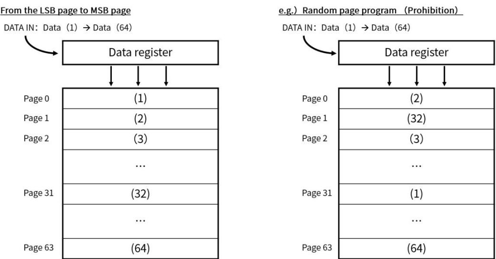

## 12.2 Several programming cycles on the same page (Partial Page Program)

ECC Parity Code is generated during Program operation on Main area (512 byte)+Spare area(16 byte). While using the Partial Page Program, the user must program the data to main field and spare field simultaneously by the definition of sector in section “ECC & Sector definition for ECC”. 

For Example, each segment can be programmed individually as follows:

<table><tr><td rowspan="2"></td><td colspan="8">Main Area</td><td colspan="8">Spare Area</td></tr><tr><td>Address 0~511</td><td>Address 512~1023</td><td>Address 1024~1535</td><td>Address 1536~2047</td><td>Address 2048~2559</td><td>Address 2560~3071</td><td>Address 3072~3583</td><td>Address 3584~4095</td><td>Address 4096~4111</td><td>Address 4112~4127</td><td>Address 4128~4143</td><td>Address 4144~4159</td><td>Address 4160~4175</td><td>Address 4176~4191</td><td>Address 4192~4207</td><td>Address 4208~4223</td></tr><tr><td><eq>1^{st}</eq> Programming</td><td><eq>1^{st}</eq>Main</td><td colspan="7">All 1 s</td><td><eq>1^{st}</eq> Spare</td><td colspan="7">All 1 s</td></tr><tr><td><eq>2^{nd}</eq> Programming</td><td>All 1 s</td><td colspan="3"><eq>2^{nd}</eq>Main</td><td colspan="4">All 1 s</td><td></td><td colspan="3"><eq>2^{nd}</eq>Spare</td><td colspan="4">All 1 s</td></tr><tr><td><eq>3^{rd}</eq> Programming</td><td colspan="4">All 1 s</td><td colspan="2"><eq>3^{rd}</eq>Main</td><td colspan="2">All 1 s</td><td colspan="4">All 1 s</td><td colspan="2"><eq>3^{rd}</eq>Spare</td><td colspan="2">All 1 s</td></tr><tr><td><eq>4^{th}</eq> Programming</td><td colspan="6">All 1 s</td><td colspan="2"><eq>4^{th}</eq>Main</td><td colspan="6">All 1 s</td><td colspan="2"><eq>4^{th}</eq>Spare</td></tr><tr><td>Result</td><td>Data Pattern 1</td><td colspan="3">Data Pattern 2</td><td colspan="2">......</td><td colspan="2">Data Pattern 4</td><td>Data Pattern 1</td><td colspan="3">Data Pattern 2</td><td colspan="2">......</td><td colspan="2">Data Pattern 4</td></tr></table>

Number of partial program cycles in the same page must not exceed 4. 

## 12.3 Keep the power stable and sufficient

Do not turn off the power before the Write/Erase operation is complete. Avoid using the device when the battery is low. Power shortage and/or power failure before the Write/Erase operation is complete will cause loss of data and/or damage to data. 

## 13. Electrical Characteristics

## 13.1 Absolute Maximum Ratings

<table><tr><td>Operating Temperature</td><td>-40°C to +85°C</td></tr><tr><td>Storage Temperature</td><td>-65°C to +150°C</td></tr><tr><td>Voltage on I/O Pin with Respect to Ground</td><td>-0.3V to (VCC+0.3)V (&lt;= 3.9V)</td></tr><tr><td><eq>V_{CC}</eq></td><td>-0.3V to 3.9V</td></tr><tr><td rowspan="2">Electrostatic Discharge Voltage</td><td>Human Body Model(1)</td></tr><tr><td>Charge Device Model(2)</td></tr></table>

## Note:

1. JS-001-2017 (R=1500 ohms, C=100pF). 

2. JS-002-2018. 

## *NOTICE:

Stresses beyond those listed under “Absolute Maximum Ratings” may cause permanent damage to the device. This is a stress rating only and functional operation of the device at these or any other conditions beyond those indicated in the operational sections of this specification are not implied. Exposure to absolute maximum rating conditions for extended periods may affect device reliability. 

## 13.2 PinCapacitance

Applicable over recommended operating range from: ${ \mathsf { T } } _ { \mathsf { A } } = 2 5 ^ { \circ } { \mathsf { C } } ,$ f = 1 MHz. 

<table><tr><td>Symbol</td><td>Test Condition</td><td>MAX.</td><td>Units</td><td>Conditions</td></tr><tr><td><eq>C_{IN}</eq></td><td>Input Capacitance</td><td>6</td><td>pF</td><td>VIN = 0V</td></tr><tr><td><eq>C_{OUT}^{(1)}</eq></td><td>Output Capacitance</td><td>8</td><td>pF</td><td>VOUT = 0V</td></tr></table>

## Note:

Characterized and is not 100% tested. 

## 13.3 Power-on and Power-off Timing

Do not turn off the power before write/erase operation is complete. Avoid using the device when the battery is low. Power shortage and/or power failure before write/erase operation is complete will cause loss of data and/or damage to data. 

Figure25. Power-On Timing

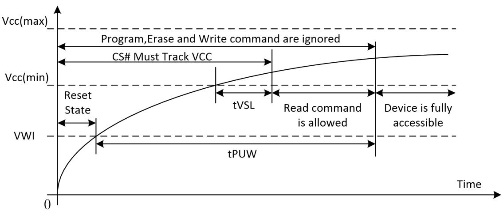

Table12.Power-On Timing and Write Inhibit Threshold

<table><tr><td rowspan="2">PARAMETER</td><td rowspan="2">SYMBOL</td><td colspan="2">SPEC</td><td rowspan="2">UNIT</td></tr><tr><td>MIN.</td><td>MAX.</td></tr><tr><td>VCC (min) to CS# Low</td><td><eq>t_{VSL}</eq></td><td>3</td><td></td><td>ms</td></tr><tr><td>Time Delay Before Write Instruction</td><td><eq>t_{PUW}</eq></td><td>6</td><td></td><td>ms</td></tr><tr><td>Write Inhibit Voltage</td><td><eq>V_{WI}</eq></td><td></td><td>2.5</td><td>V</td></tr></table>

## 13.4 DC Electrical Characteristics

## Table13.DC Characteristics

Applicable over recommended operating range from: ${ \mathsf { T A } } = - 4 0 ^ { \circ } { \mathsf { C } }$ to $8 5 ^ { \circ } \mathsf { C } ,$ $\mathsf { V C C } = 2 . 7 \mathsf { V }$ to 3.6 V, (unless otherwise noted)

<table><tr><td rowspan="2">SYMBOL</td><td rowspan="2">PARAMETER</td><td rowspan="2">CONDITIONS</td><td colspan="3">SPEC</td><td rowspan="2">UNIT</td></tr><tr><td>MIN.</td><td>TYP.</td><td>MAX.</td></tr><tr><td>VCC</td><td>Supply Voltage</td><td></td><td>2.7</td><td></td><td>3.6</td><td>V</td></tr><tr><td>ILI</td><td>Input Leakage Current Times</td><td></td><td></td><td></td><td>±10</td><td>μA</td></tr><tr><td>ILO</td><td>Output Leakage Current</td><td></td><td></td><td></td><td>±10</td><td>μA</td></tr><tr><td>ICC1</td><td>Standby Current</td><td>VCC=3.3V, CS# = VCC,VIN = VSS or VCC</td><td></td><td>180</td><td>1000</td><td>μA</td></tr><tr><td rowspan="3">ICC</td><td>Read Current</td><td rowspan="3">CLK=0.1VCC/0.9VCCFCLK=104MHz</td><td></td><td>25</td><td>40</td><td>mA</td></tr><tr><td>Program Current</td><td></td><td>30</td><td>40</td><td>mA</td></tr><tr><td>Erase Current</td><td></td><td>25</td><td>40</td><td>mA</td></tr><tr><td>VIL (1)</td><td>Input Low Voltage</td><td></td><td>-0.3</td><td></td><td>0.2VCC</td><td>V</td></tr><tr><td>VIH</td><td>Input High Voltage</td><td></td><td>0.8VCC</td><td></td><td>VCC+0.3</td><td>V</td></tr><tr><td>VOL</td><td>Output Low Voltage</td><td>IOL = 1.6mA</td><td></td><td></td><td>0.4</td><td>V</td></tr><tr><td>VOH</td><td>Output High Voltage</td><td>IOH = -100 μA</td><td>VCC-0.2</td><td></td><td></td><td>V</td></tr></table>

## Note：

VILmin and VIH max are reference only and are not tested. 

## 13.5 AC Measurement Conditions

Table14.AC Measurement Conditions

<table><tr><td rowspan="2">SYMBOL</td><td rowspan="2">PARAMETER</td><td colspan="2">SPEC</td><td rowspan="2">UNIT</td></tr><tr><td>MIN.</td><td>MAX.</td></tr><tr><td>CL</td><td>Load Capacitance</td><td></td><td>30</td><td>pF</td></tr><tr><td>TR, TF</td><td>Input Rise and Fall Times</td><td></td><td>5</td><td>ns</td></tr><tr><td>VIN</td><td>Input Pulse Voltages</td><td colspan="2"><eq>0.2 V_{CC}</eq> to <eq>0.8 V_{CC}</eq></td><td>V</td></tr><tr><td>IN</td><td>Input Timing Reference Voltages</td><td colspan="2"><eq>0.3 V_{CC}</eq> to <eq>0.7 V_{CC}</eq></td><td>V</td></tr><tr><td>OUT</td><td>Output Timing Reference Voltages</td><td colspan="2"><eq>0.5 V_{CC}</eq></td><td>V</td></tr></table>

Figure26. AC Measurement I/O Waveform

<table><tr><td rowspan="3"></td><td colspan="2">Input timing reference level</td><td colspan="2">Output timing reference level</td></tr><tr><td>0.8VCC</td><td>0.7VCC</td><td rowspan="2">AC Measurement level</td><td rowspan="2">0.5VCC</td></tr><tr><td>0.2VCC</td><td>0.3VCC</td></tr></table>

## 13.6 AC Electrical Characteristics

## Table15.AC Characteristics

Applicable over recommended operating range from: $\mathsf { T A } = - 4 0 ^ { \circ } \mathsf C$ to ${ 8 5 ^ { \circ } } \mathsf C ,$ VCC = 2.7V to 3.6V

<table><tr><td rowspan="2">SYMBOL</td><td rowspan="2">PARAMETER</td><td colspan="3">SPEC</td><td rowspan="2">UNIT</td></tr><tr><td>MIN.</td><td>TYP.</td><td>MAX.</td></tr><tr><td>fC</td><td>Serial Clock Frequency for: all command</td><td></td><td></td><td>104</td><td>MHz</td></tr><tr><td><eq>t_{CH1(1)}</eq></td><td>Serial Clock High Time</td><td>4.5</td><td></td><td></td><td>ns</td></tr><tr><td><eq>t_{CL1(1)}</eq></td><td>Serial Clock Low Time</td><td>4.5</td><td></td><td></td><td>ns</td></tr><tr><td><eq>t_{CLCH}</eq></td><td>Serial Clock Rise Time (Slew Rate)</td><td>0.1</td><td></td><td></td><td>V/ns</td></tr><tr><td><eq>t_{CHCL}</eq></td><td>Serial Clock Fall Time (Slew Rate)</td><td>0.1</td><td></td><td></td><td>V/ns</td></tr><tr><td><eq>t_{SLCH}</eq></td><td>CS# Active Setup Time</td><td>5</td><td></td><td></td><td>ns</td></tr><tr><td><eq>t_{CHSH}</eq></td><td>CS# Active Hold Time</td><td>5</td><td></td><td></td><td>ns</td></tr><tr><td><eq>t_{SHCH}</eq></td><td>CS# Not Active Setup Time</td><td>5</td><td></td><td></td><td>ns</td></tr><tr><td><eq>t_{CHSL}</eq></td><td>CS# Not Active Hold Time</td><td>5</td><td></td><td></td><td>ns</td></tr><tr><td><eq>t_{SHSL}/t_{CS}</eq></td><td>CS# High Time</td><td>20</td><td></td><td></td><td>ns</td></tr><tr><td><eq>t_{SHQZ}</eq></td><td>Output Disable Time</td><td></td><td></td><td>10</td><td>ns</td></tr><tr><td><eq>t_{CLQX}</eq></td><td>Output Hold Time</td><td>0</td><td></td><td></td><td>ns</td></tr><tr><td><eq>t_{DVCH}</eq></td><td>Data In Setup Time</td><td>2</td><td></td><td></td><td>ns</td></tr><tr><td><eq>t_{CHDX}</eq></td><td>Data In Hold Time</td><td>3</td><td></td><td></td><td>ns</td></tr><tr><td><eq>t_{CLQV}</eq></td><td>Output Valid from CLK</td><td></td><td></td><td>8</td><td>ns</td></tr><tr><td><eq>t_{WHSL}</eq></td><td>WP# Setup Time before CS# Low</td><td>20</td><td></td><td></td><td>ns</td></tr><tr><td><eq>t_{SHWL}</eq></td><td>WP# Hold Time after CS# High</td><td>100</td><td></td><td></td><td>ns</td></tr></table>

## Note:

1. Maximum Serial Clock Frequencies are measured results picked at the falling edge. 

2. TCH1+TCL1 $> = 1 / \mathsf { f C } ;$ characterized and not 100% tested. 

Table16.Programming, Reading and Erasing Characteristics

<table><tr><td rowspan="2">SYMBOL</td><td rowspan="2">PARAMETER</td><td colspan="3">SPEC</td><td rowspan="2">UNIT</td></tr><tr><td>MIN.</td><td>TYP.</td><td>MAX.</td></tr><tr><td>tRST</td><td>CS# High to Next Command After Reset(FFh) from Idle/Program/Read</td><td></td><td></td><td>50</td><td>μs</td></tr><tr><td>tRST</td><td>CS# High to Next Command After Reset(FFh) from Erase</td><td></td><td></td><td>550</td><td>μs</td></tr><tr><td><eq>tRD^{(1)}</eq></td><td>Page Read From Array (random, with ECC)</td><td></td><td>175</td><td>300</td><td>μs</td></tr><tr><td><eq>tRHSA4^{(2)}</eq></td><td>Average Read Time for Sequential Read (with ECC) (High Speed Mode Enable, Read buffer x 4)</td><td></td><td>50</td><td></td><td>μs</td></tr><tr><td>tPROG</td><td>Page Program(with ECC)</td><td></td><td>360</td><td>800</td><td>μs</td></tr><tr><td>tERS</td><td>Block Erase</td><td></td><td>3.5</td><td>10</td><td>ms</td></tr></table>

## Note:

1. tRD is the average busy time for Page Read operation of 64 page continuously in a block. 

2. tRHSA4 is the average busy time for sequential Page Read operation with all data output in each page of 64 pages continuously in a block at 100MHz. 

## 14. SPI Serial Timing

Serial Input Timing

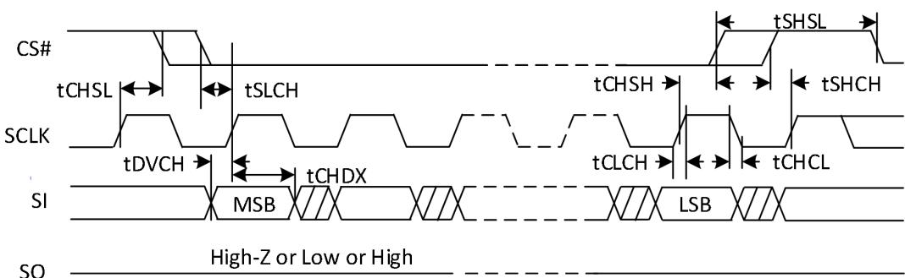

Output Timing

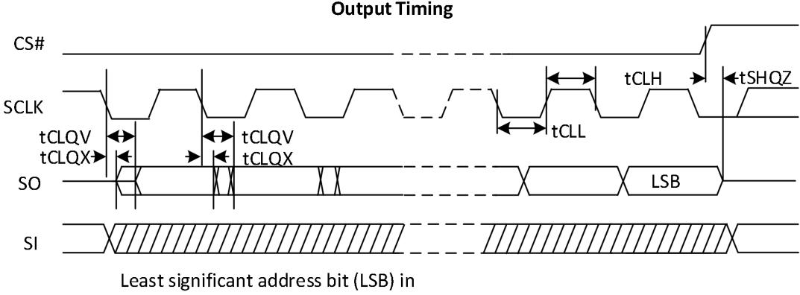

WP Timing

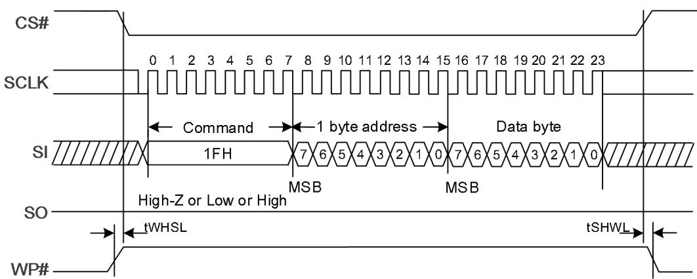

## 15. Ordering Information

Company Prefix 

XT = XTX 

26G = 2.7~3.6V Serial NAND Flash Memory 

01 = 1G bit 

02 = 2G bit 

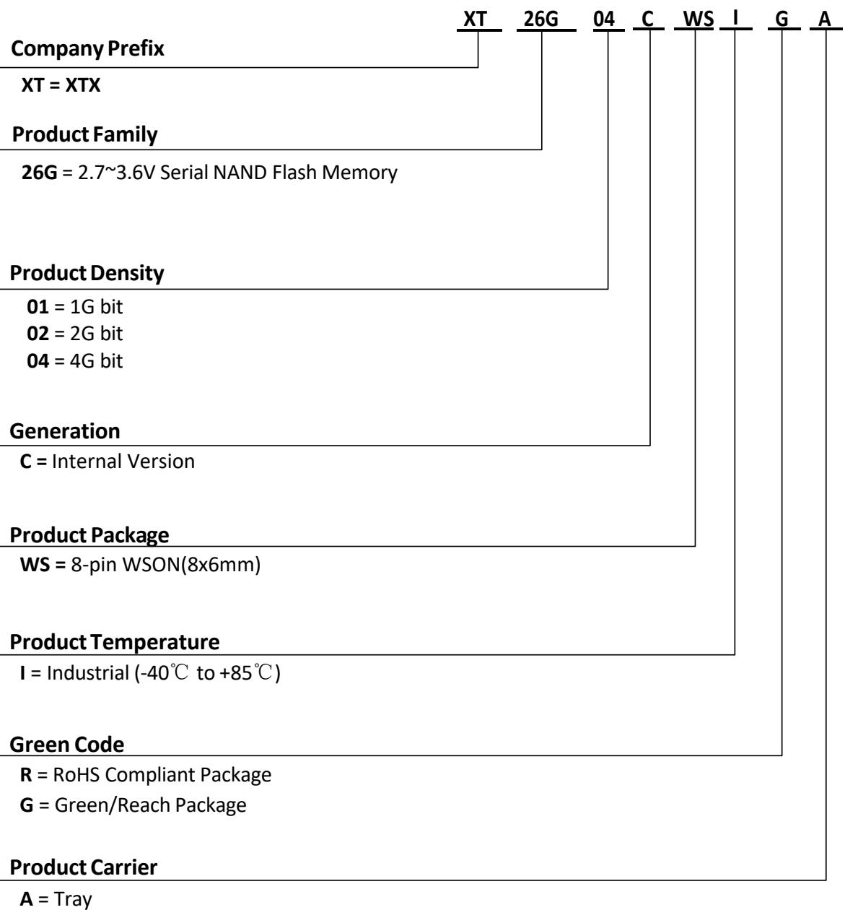

04 = 4G bit 

Generation 

C = Internal Version 

WS = 8-pin WSON(8x6mm) 

I = Industrial (-40℃ to +85℃) 

Green Code 

R = RoHS Compliant Package 

G = Green/Reach Package 

A = Tray 

T = Tape and Reel 

## 16. Package Information

## 16.1 8-Pad WSON8 (8*6mm)

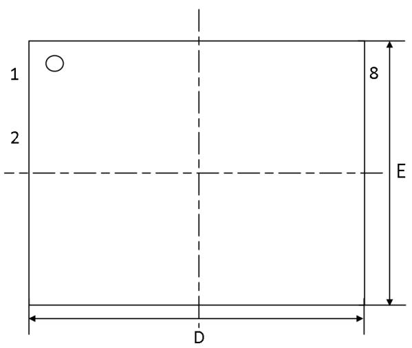

TOP VIEW

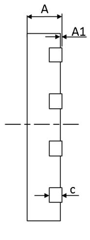

SIDE VIEW

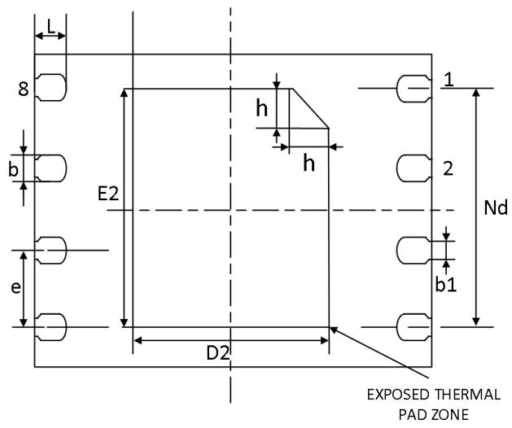

BOTTOM VIEW

<table><tr><td rowspan="2">SYMBOL</td><td colspan="3">MILLIMETER</td></tr><tr><td>MIN</td><td>NOM</td><td>MAX</td></tr><tr><td>A</td><td>0.70</td><td>0.75</td><td>0.80</td></tr><tr><td>A1</td><td>0.00</td><td>0.02</td><td>0.05</td></tr><tr><td>b</td><td>0.35</td><td>0.40</td><td>0.45</td></tr><tr><td>b1</td><td colspan="3">0.25REF</td></tr><tr><td>c</td><td>0.18</td><td>0.20</td><td>0.25</td></tr><tr><td>D</td><td>7.90</td><td>8.00</td><td>8.10</td></tr><tr><td>Nd</td><td colspan="3">3.81BSC</td></tr><tr><td>e</td><td colspan="3">1.27BSC</td></tr><tr><td>E</td><td>5.90</td><td>6.00</td><td>6.10</td></tr><tr><td>D2</td><td>3.30</td><td>3.40</td><td>3.50</td></tr><tr><td>E2</td><td>4.20</td><td>4.30</td><td>4.40</td></tr><tr><td>L</td><td>0.45</td><td>0.50</td><td>0.55</td></tr><tr><td>h</td><td>0.30</td><td>0.35</td><td>0.40</td></tr></table>

## 17. Revision History

<table><tr><td>Version No.</td><td>Description</td><td>Date</td></tr><tr><td>1.0</td><td>Initial Release</td><td>Jan-17-2021</td></tr><tr><td>1.1</td><td>Update status register layout to align with feature address</td><td>Jan-29-2021</td></tr><tr><td>1.2</td><td>Update as ECC always on</td><td>Feb-27-2021</td></tr><tr><td>1.3</td><td>Update standby current value</td><td>Jul-12-2021</td></tr><tr><td>1.4</td><td>Update storage temperature</td><td>Sep-07-2021</td></tr><tr><td>1.5</td><td>Revise the AC Characteristics description and add WP TimingUpdate the max. value of standby current、tRSTUpdate Package information</td><td>Dec-07-2021</td></tr><tr><td>1.6</td><td>Revise the min. Value of <eq>t_{VSL}</eq>Update DS_IO[1] and DS_IO[0] description</td><td>Dec-28-2021</td></tr><tr><td>1.7</td><td>Corrected default value of IO drive strength from 50% to 25%Added &quot;12. Application Notes And Comments&quot; chapterAdjusted ILI/ILO max from ±2μA to ±10μAtRD typical from 270μs to 125μstRD max from 300μs to 200μstPROG typical from 450μs to 360ustPROG max from 700μs to 800μsAdded Note1 after “13.6 AC Electrical Characteristics”</td><td>Jun-23-2022</td></tr><tr><td>1.8</td><td>Adjusted tRD typical to 175μstRD max to 300μstERS typical to 3.5msAdded Endurance</td><td>Sep-26-2024</td></tr><tr><td>1.9</td><td>Add ESD-CDMAdd tRHSA4Delete HOLD function</td><td>Jan-02-2025</td></tr></table>

芯天下技术股份有限公司 

XTX Technology Inc. 

Tel: (86 755) 28229862 

Fax: (86 755) 28229847 

Web Site: http://www.xtxtech.com/ 

Technical Contact: fae@xtxtech.com 